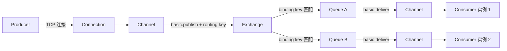

# RabbitMQ 的 Exchange 路由和 AMQP 模型是怎么回事？

> “消息发出去没人收到”这类事故，根子往往不在可靠性配置，而在你有没有真的搞懂消息从哪条路走进队列。

很多人对 RabbitMQ 的印象停留在三句话：

- 它有 Exchange
- 它有四种类型
- 它支持 routing key 模糊匹配

这三句话都不算错，但一旦线上出事，你需要回答的是更具体的问题：

- 生产者明明发成功了，为什么三个下游只有一个收到了？
- 我发了 `order.create`，为什么绑了 `order.*` 的队列没收到？
- 同一个队列挂了两个消费者实例，为什么每个实例只拿到一半消息？
- 消息发到一个根本没人绑定的 Exchange，它去哪了？会报错吗？

这些问题的答案都在“模型”里。这篇按一条消息的视角走一遍：**客户端连上来 → 声明拓扑 → 发到 Exchange → 按绑定路由 → 进队列 → 分给消费者**。

## 先把角色摆清楚：AMQP 0-9-1 的六个概念

RabbitMQ 原生实现的是 AMQP 0-9-1（4.x 起 AMQP 1.0 也成了一等协议），这套模型里有六个概念，面试时能一次说全就已经强过大多数人：

| 概念     | 是什么                               | 容易混的点                                   |
| -------- | ------------------------------------ | -------------------------------------------- |
| Broker   | 一个 RabbitMQ 服务节点（或一个集群） | 集群里队列数据默认只落在某一个节点上         |
| Vhost    | 虚拟主机，资源和权限的隔离边界       | 它不是命名空间前缀，而是真正独立的资源域     |
| Exchange | 交换器，只做路由，不存消息           | Exchange 自己不落盘，消息存的是队列          |
| Queue    | 队列，消息实际存放和消费的地方       | 队列是“消费组”的单位，不是“广播”的单位       |
| Binding  | Exchange 到 Queue 的绑定规则         | 绑定是多对多，一个队列可以被多个 Exchange 绑 |
| Channel  | 建立在 TCP 连接上的虚拟信道          | 不是线程安全的，这一点线上出事最多           |

再加两个角色：Producer 和 Consumer。它们不是 Broker 里的实体，而是客户端。

用一张图看消息的动线：



图里有两个关键分叉值得注意：

1. **Exchange 到 Queue 是一对多**：一条消息如果匹配上多个绑定，会被复制到多个队列，每个队列各存一份。
2. **Queue 到 Consumer 是多对一摊分**：同一个队列的多个消费者是竞争关系，消息被轮流投递，不是每人一份。

这两点合起来解释了一个高频误解：**RabbitMQ 的“广播”靠的是“多个队列”，不是“多个消费者”**。给一个队列挂五个消费者实例，你得到的是负载均衡；想让五个下游都收到，就得有五个队列各绑一次。

## 为什么要有 Channel：连接贵在哪

面试常问“为什么 RabbitMQ 用信道而不是一条消息一个连接”，标准答法是“TCP 建连开销大”。这个答案只对了一半，另一半才是工程价值：

| 维度      | 一个连接一条消息                | 一条连接多个 Channel            |
| --------- | ------------------------------- | ------------------------------- |
| 建连成本  | 每次握手、认证、TLS 协商        | 只在启动时建一次                |
| Broker 侧 | 每个连接一个 Erlang 进程 + 内存 | 连接数可控，Channel 更轻        |
| 并发隔离  | 天然隔离                        | 需要应用侧自己管 Channel 的归属 |
| 错误影响  | 只影响这一条                    | 一个 Channel 抛异常只关掉自己   |

关键在最后一行：**Channel 上的协议错误是 channel 级异常，不会拖垮整条连接**。比如你声明队列时参数和已有队列不一致，Broker 会返回 `406 PRECONDITION_FAILED` 并关闭这个 Channel，连接还在，其他 Channel 照常工作。这就是“一个业务一个 Channel”这种做法的由来。

但 Channel 有两个硬约束，是线上事故的常见来源：

1. **Channel 不是线程安全的**。多个线程共用一个 Channel 发消息，帧会交错，轻则抛 `IOException` 关掉 Channel，重则消息内容错乱。正确做法是每个线程（或每个消费回调的执行单元）用自己的 Channel，或者用客户端的连接池封装。
2. **单个连接上的 Channel 数不宜过多**。官方建议的量级在几十到两百之间，Channel 频繁创建销毁（Channel churn）会让 Broker 侧的 Erlang 进程调度抖动，CPU 飙起来。

还有一个隐式依赖：**所有 Channel 共享同一条 TCP 连接的流量控制**。一条连接被阻塞（比如触发内存告警），上面所有 Channel 都发不出消息。所以“一个应用一条连接”在高吞吐场景并不总是最优，连接池要按业务隔离。

## Vhost：不是装饰性的路径前缀

Vhost 是资源的隔离域，Exchange、Queue、Binding、权限、策略都在 vhost 内生效。两个 vhost 里可以有同名队列，互不影响。默认 vhost 是 `/`。

它在工程上的意义是：

- **环境隔离**：开发、测试、预发、生产不要共用一个 vhost，否则一条错误的 `queueDeclare` 就能改动别人环境里的同名队列。
- **权限最小化**：RabbitMQ 的权限模型是「用户 × vhost × configure/write/read」，只给某个 vhost 的写权限，就限死了越权访问别的业务队列。
- **多租户**：一个 Broker 上跑多个业务线时，用 vhost 隔开比用命名前缀约定可靠得多。

一个细节：vhost 之间不能直接通信。跨 vhost 要转发只能用 shovel 或 federation 插件，这也决定了它是“硬隔离”而不是“软约定”。

## Exchange 的四种类型：路由规则怎么走

这是最该讲清楚的一段。四种类型的差别，本质是“用什么去匹配绑定”：

| 类型    | 匹配依据                        | routing key 的作用 | 典型用途                       |
| ------- | ------------------------------- | ------------------ | ------------------------------ |
| direct  | routing key 与 binding key 全等 | 决定投递到哪个队列 | 按事件类型分发、点对点任务     |
| fanout  | 不看 key，绑定即投递            | 被忽略             | 配置刷新、缓存失效广播         |
| topic   | routing key 按词段模式匹配      | 决定匹配哪些模式   | 按业务域 + 事件 + 环境多维路由 |
| headers | 消息 headers 键值匹配           | 被忽略             | 极少使用，匹配成本高           |

### direct：全等匹配，最容易被低估

direct 的规则只有一句：binding key 和 routing key 完全相等才投递。注意是**字符串全等**，不是前缀匹配，也不是包含匹配。

```text
Exchange: order.direct
Queue A 绑定 binding key = order.created
Queue B 绑定 binding key = order.created
Queue C 绑定 binding key = order.paid

发送 routing key = order.created  → A 和 B 各收到一份，C 收不到
发送 routing key = order.create   → 谁都不收到（少一个 d 就是零投递）
```

最后一行是重点：**direct 下写错一个字母，消息不会报错，它只是谁都不匹配**。没有路由到任何队列的消息，默认被 Broker 直接丢弃（后面讲怎么兜）。

顺带说一个特殊 Exchange：**默认 Exchange**（名字是空字符串 `""`），它是预声明的 direct 类型，绑定关系是“每个队列自动用自己的队列名当 binding key”。所以在很多示例里直接写 `basicPublish("", "my-queue", ...)` 就能投递——本质是走了默认 Exchange 的全等匹配。这个机制在 RPC 回复队列场景里很常用。

### fanout：忽略 key，绑定即投递

fanout 完全不看 routing key，把消息复制给所有绑定的队列。它的价值在于“发布者不需要知道有几个订阅者”。

典型场景是**配置刷新**：五个服务实例各自声明一个队列绑到同一个 fanout，配置中心发一条，五份副本同时到达。注意这里的“五份”是五个队列，不是五个消费者。

有人会问：那用 direct 配一个固定的 key 效果不是一样？不一样。fanout 在**新增订阅方时不需要改发布端代码**，而 direct 需要发布端知道这个 key 存在（虽然 key 是固定的，但语义上 fanout 表达的是“广播”）。

### topic：词段通配，是 RabbitMQ 路由能力的主场

topic 的规则是：routing key 用 `.` 分隔成若干词段，binding key 里可以用两个通配符：

- `*` 匹配**恰好一个**词段
- `#` 匹配**零个或多个**词段

用订单系统举个例子，routing key 设计成 `<业务域>.<事件>.<环境>`：

```text
routing key: order.created.prod

绑定 order.*.prod      → 匹配（* 吃掉 created）
绑定 order.#            → 匹配（# 吃掉 created.prod）
绑定 *.created.*        → 匹配
绑定 order.created      → 不匹配（词段数不同，且没有通配符）
绑定 order.*            → 不匹配（少一段）
绑定 #.created.prod     → 匹配
```

这里有两个特别容易答错的点：

1. **`#` 可以匹配零段**，所以 `order.#` 也能匹配只有 `order` 一个词段的 routing key。有人以为 `#` 至少匹配一段。
2. **`*` 只匹配一段**，`order.*` 不会匹配 `order.created.prod`。日志采集场景里“用 `*` 一把梭”的写法经常在这里翻车。

topic 真正的优势是**订阅方可以自己定义关心的维度**。发布端只负责按维度拼 routing key，订阅端用模式表达兴趣，两边解耦。这比 direct 灵活，比 fanout 精确。

### headers：能力有，但别在业务里用

headers 类型不看 routing key，而是匹配消息 `headers` 里的键值对，用 `x-match` 控制语义：

- `x-match: all`：所有声明的 header 都要匹配
- `x-match: any`：匹配任意一个即可

听起来很灵活，但它的匹配要在 Broker 侧逐条遍历 header 做比较，成本远高于字符串匹配，而且**路由规则藏在消息体属性里，运维在管理界面上根本看不出来消息为什么会去这个队列**。所以实践中的结论很干脆：除非你确实有“按任意属性组合路由”的极端需求，否则用 topic 表达。

## 路由失败：这一步最容易被跳过

前面提到 direct 写错 key 会“零投递且不报错”。这是生产者端最隐蔽的丢消息方式，RabbitMQ 提供了两个机制处理，**它们的定位不同，不能互相替代**：

| 机制               | 配置位置           | 谁收到通知    | 典型用途                     |
| ------------------ | ------------------ | ------------- | ---------------------------- |
| mandatory + return | 每条消息的发布参数 | 生产者        | 需要感知“这条消息没人要”     |
| Alternate Exchange | Exchange 声明参数  | 备用 Exchange | 兜住整类路由失败，做死信兜底 |

### mandatory + basic.return

发布时把 `mandatory` 置为 `true`，如果消息到了 Exchange 但没有任何队列匹配，Broker 会通过 `basic.return` 把消息退回给生产者。生产者要用 `addReturnListener` 注册回调才能真正拿到，**只开 mandatory 不注册回调，等于把退回的消息又丢了一次**。

Java 客户端的写法大致是：

```java
channel.addReturnListener((replyCode, replyText, exchange, routingKey, props, body) -> {
    // 到这里说明消息进了 Exchange 但没进任何队列
    log.warn("unroutable: exchange={}, key={}, reason={}", exchange, routingKey, replyText);
});

channel.basicPublish("order.direct", "order.createdd", true, null, body);
```

工程上还要注意两点：

- `basic.return` 是**异步**的，和 confirm 的到达顺序没有强绑定，不能靠“先收到 return 就一定没收到 confirm”推断。
- 退回的消息要落地：记日志、写本地表、进补偿任务，随便哪一种，都比“打一行 warn 就完事”强。

### Alternate Exchange：Exchange 级别的兜底

在声明 Exchange 时带上 `alternate-exchange` 参数，所有路由失败的消息会被转发到这个备用 Exchange。备用 Exchange 通常是 fanout，后面接一个“未路由消息”队列，交给人工或补偿程序处理。

两者的取舍：

- **要按消息粒度做业务判断**（比如某类事件必须有人订阅，否则告警），用 mandatory。
- **要一个统一兜底、不想改发布端代码**，用 AE。

有个细节容易踩：**配置了 AE 之后，路由失败不会再触发 `basic.return`**，消息直接进 AE。所以别指望两个机制同时生效，选一个并把监控做在那条路上。

## 两类“临时队列”，和它们的删除条件

真实项目里队列不只是“持久化队列”，还有几种生命周期很短的形态。它们的删除条件不一样，配错就是“上线后消息莫名消失”：

| 属性                 | 含义                             | 删除时机                       |
| -------------------- | -------------------------------- | ------------------------------ |
| `durable=false`      | 队列元数据不落盘                 | Broker 重启后队列消失          |
| `exclusive=true`     | 只允许声明它的那条连接使用       | 声明连接断开                   |
| `auto-delete=true`   | 最后一个消费者取消订阅后自动删除 | 最后一个 consumer 消失         |
| server-named（`""`） | Broker 生成 `amq.gen-xxxx` 名字  | 通常配合 exclusive/auto-delete |

这里有个版本变化值得单独提一句：**非持久化且非排他的 classic 队列（transient non-exclusive）从 RabbitMQ 4.3 起默认被禁止声明**，需要显式打开一个 deprecated 开关才能用。原因是这种队列既不能重启保留、又不能自动清理，只会留下垃圾。新代码如果还在写 `queueDeclare("x", false, false, false, null)`，升级后会直接报错。

顺带一个和自动删除有关的竞态，官方文档专门写过：auto-delete 队列如果用了固定名字，客户端断线重连时会和 Broker 的删除动作赛跑——重连快的时候可能在“队列还没删完”时重新声明，然后被紧随其后的删除干掉，或者反过来声明到一半队列已经消失，抛 channel 异常。规避办法很朴素：**临时队列用 server-named 名字，别用固定名**。

## 声明一致性与命名约束：两个必知的报错

RabbitMQ 的拓扑是“声明即创建”，这带来两个几乎每个项目都会遇上的错误码：

| 场景                       | 返回                                    | 触发条件                                              |
| -------------------------- | --------------------------------------- | ----------------------------------------------------- |
| 声明已存在但属性不同的队列 | `406 PRECONDITION_FAILED`，Channel 关闭 | durable、exclusive、auto-delete、x-arguments 任一不同 |
| 声明以 `amq.` 开头的队列   | `403 ACCESS_REFUSED`                    | `amq.` 前缀保留给 Broker 内部使用                     |

第一条是团队协作的经典事故：A 服务声明 `durable=true`，B 服务声明同一个队列 `durable=false`，先启动的那个赢，后启动的直接 406，而且**报错信息只告诉你参数不匹配，不会告诉你差在哪**。工程上的解法不是“谁先启动谁定”，而是把拓扑收敛成一份声明清单（代码里的配置类、或部署时由运维用策略和 `rabbitmqadmin` 建），应用只做“确认存在”，不做“随便改属性”。

第二条的坑在于名字里带 `amq.`，比如有人为了“看起来像系统队列”把业务队列命名为 `amq.order.queue`，结果声明直接被拒。

## 队列是单核热点：这条模型约束决定了你的拓扑

最后一个模型层面的约束，很多选型文章不提，但它直接影响你该建几个队列：**一个队列副本（无论 leader 还是 follower）的热路径基本只用一个 CPU 核**。

这意味着：

- 靠“一个大队列 + 疯狂加消费者”提高吞吐是有天花板的，加过某个点之后只会看到 unacked 堆积。
- 正确做法是**按业务维度拆多个队列**，把并行度做在队列数量上。
- 需要按 key 保序又要并行时，可以用 `x-modulus-hash` 类型的 Exchange 按 routing key 取模散到多个队列，再让每个队列挂单消费者（RabbitMQ 里“单活跃消费者”也能做到，见下一篇）。

官方文档对这个问题的原话很直接：单个队列在多数场景下是反模式。这句话比“RabbitMQ 吞吐低”有用得多——它说明问题出在拓扑设计，不是组件不行。

## 小结

- AMQP 0-9-1 的核心是 Exchange 只路由、Queue 才存消息；一条消息匹配多个绑定就复制成多份，所以“广播”靠多队列，不靠多消费者。
- Channel 是 TCP 上的虚拟信道，共享连接的流量控制，且**不是线程安全的**；一个 Channel 的协议错误只关自己，不影响整条连接。
- direct 是字符串全等（写错一个字母就零投递），fanout 忽略 key，topic 的 `*` 匹配一段、`#` 匹配零段或多段，headers 能用但不建议在业务里用。
- 路由失败有两种兜法：mandatory + return 通知生产者，alternate-exchange 统一兜底，二者互斥，配了 AE 就不会再有 return。
- 声明已存在但属性不同会返回 `406` 并关闭 Channel，`amq.` 前缀会返回 `403`；拓扑声明要收敛到一处，别让应用互相覆盖。
- 一个队列副本的热路径基本只用单核，队列数量和分区方式才是并行的抓手，单大队列是反模式。

## 参考

综合自仓库内高性能消息队列参考材料，并结合 RabbitMQ 官方文档（Queues、Exchange Types、Dead Letter Exchanges、Publisher Confirms、Channels 等章节）关于 AMQP 模型、路由规则、队列属性、声明一致性与队列单核约束的说明整理；其中“`amq.` 前缀 403”“非持久化非排他 classic 队列在 4.3 起默认禁止”“单队列副本单核热点”等边界均按官方 4.x 文档核对过版本。
