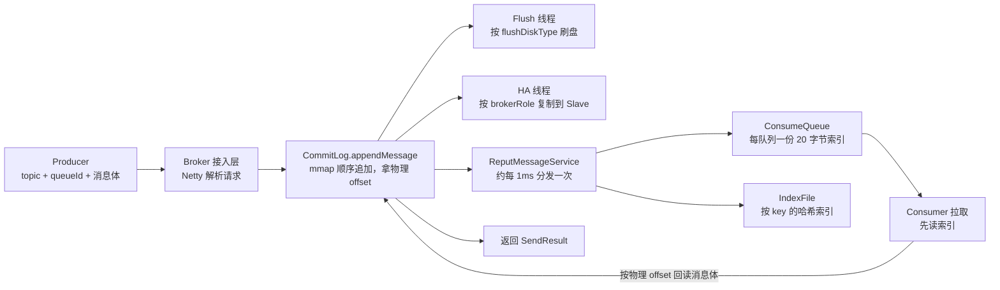
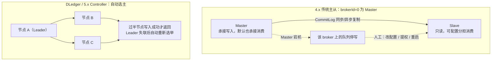

# RocketMQ 的 CommitLog 和 ConsumeQueue 怎么配合？

> RocketMQ 把「写」做成全局一条顺序日志，把「读」拆成一层按队列组织的索引。它的快和它的痛都来自这个决定：写入几乎不受 topic 数量影响，消费却要在索引和消息体之间来回跳。

存储这道题，问到最后通常落在两处：**为什么所有 topic 的消息能写进同一个文件还不乱**，以及**刷盘、主从这些开关到底在保什么**。这篇从部署角色讲起，把写入链路、索引结构、可靠性开关串一遍，顺手把几个流传很广但站不住的说法拆掉。

## 先看四个角色：谁管元数据，谁管消息？

面试里常见的一种答法是"NameServer 是注册中心、Broker 存消息"，背下来没错，但一被追问"NameServer 挂了会怎样"就卡住。要答得住，得先知道每个角色手里握着什么，以及它没了以后谁受影响。

| 角色          | 手里的东西                                                 | 挂了会怎样                                                                            |
| ------------- | ---------------------------------------------------------- | ------------------------------------------------------------------------------------- |
| NameServer    | 路由表：哪些 broker、每个 topic 在哪个 broker 上有几个队列 | 已启动的客户端靠本地路由缓存继续跑，读写不中断；新启动的客户端拿不到路由              |
| Broker Master | CommitLog / ConsumeQueue / IndexFile，承接写，默认也承接读 | 其上的队列整体不可写，4.x 传统主从需要人工切主，客户端要等路由刷新                    |
| Broker Slave  | 复制的 CommitLog，可配置承担部分消费                       | 不影响写；若 brokerRole 是 SYNC_MASTER，Master 会因它不可用而返回 SLAVE_NOT_AVAILABLE |
| Producer      | 本地路由缓存、队列选择策略、重试计数                       | 业务侧直接报错，靠本地补偿表或事务消息兜底                                            |
| Consumer      | 拉取下来的消息、消费位点                                   | 积压增长，端到端延迟变大，但不影响写入                                                |

Producer 和 Consumer 都是**先问 NameServer、再直连 Broker**，业务数据不经过 NameServer。这一点常被误解成"NameServer 是网关"，其实它只发路由，不转发消息。

至于为什么不像 Kafka 早年的版本那样用 ZooKeeper：路由信息是**读多写极少、且短时间不一致也完全能接受**的元数据，为它引入一个需要选举、需要额外运维的强一致组件，收益不划算。NameServer 的设计是每个节点各自维护一份全量路由，节点之间**不通信、不同步**，Broker 每隔 30 秒向**所有** NameServer 上报心跳，NameServer 每 10 秒扫一次、120 秒没心跳就摘掉这个 Broker。少一跳选举，就少一类脑裂和运维事故。

需要说明的是，5.x 的 Controller 模式让 NameServer 端多了一个 Controller 角色（可以内嵌部署），它用类 Raft 的日志做 broker 选主——**需要强一致的是"谁是主"这个决策，不是路由表本身**，这个分工比"把注册中心做成 ZooKeeper"更划算。

## 一条消息写进 broker 之后，走了哪几条路？

这是全篇最该背下来的一张图。消息落到 CommitLog 之后会分叉成两条路：一条是**持久化路径**（刷盘、复制到从节点），决定"会不会丢"；另一条是**分发路径**（异步构建 ConsumeQueue 和 IndexFile），决定"能不能被消费"。



两条路的关键差别在这里：**分发是异步的**。CommitLog 写完（该刷的刷完、该复制的复制完）就可以给 Producer 返回 `SEND_OK`，而 ConsumeQueue 可能还差几条没建好。所以"发送成功"和"立刻能被消费"之间，天生有一个毫秒级的窗口，这个窗口和消息丢失完全是两回事。

## CommitLog、ConsumeQueue、IndexFile 各存什么？

| 组件         | 存的内容                                                  | 组织方式                                                                                  | 大小与粒度                                       |
| ------------ | --------------------------------------------------------- | ----------------------------------------------------------------------------------------- | ------------------------------------------------ |
| CommitLog    | 消息**本体**加元数据（topic、queueId、tag、属性、消息体） | 所有 topic 混写，顺序追加，写满切下一个文件                                               | 单文件默认 1GB，文件名是 20 位左补零的起始偏移量 |
| ConsumeQueue | 索引：`commitLogOffset(8B) + size(4B) + tagHash(8B)`      | 一个 topic 的一个队列对应一套文件，路径 `store/consumequeue/{topic}/{queueId}/{fileName}` | 每条 20 字节定长，单文件 30 万条，约 5.72MB      |
| IndexFile    | 按消息 key 建的哈希索引，支持按 key 或时间区间查消息      | 哈希槽 + 索引条目，文件名用创建时间戳                                                     | 单文件约 40MB，容纳 500 万个 key                 |

三个容易被问倒的细节：

- **CommitLog 不是"一个大文件"，是一组 segment。** 第一个文件是 `00000000000000000000`，写满 1GB 后是 `00000000001073741824`，文件名就是这段日志在整个 CommitLog 里的起始物理偏移。用固定大小切段的原因很实际：mmap 需要固定长度的映射区，而且消息过期删除时以段为单位整段删，不会在文件中间留洞。
- **ConsumeQueue 里没有消息体。** 它只有 offset、size 和 tag 的 hashCode。消费者拿到这三样，还得拿 offset 回 CommitLog 把消息读出来，这就是后面"消费比生产更吃页缓存"的根源。
- **tagHash 只有 8 字节，是会冲突的。** 所以 tag 过滤不是"索引层筛完就完事"，hash 命中之后 broker 还要回 CommitLog 读出真实 tag 再比一次（5.x 的 SQL92 属性过滤还要解析消息属性），过滤的代价远不是零。

为什么 ConsumeQueue 要做成 20 字节定长？因为消费位点本质是一个**条目下标**：想知道第 N 条消息的索引在哪，直接算 `N × 20` 就行，不需要 B 树、不需要查表。这是 RocketMQ 用"消息只能顺序追加、从不原地修改"换来的极简寻址。

## 为什么所有 topic 共用一个 CommitLog？

先想反面：如果每个 topic（甚至每个队列）各写自己的文件，写入就会变成"多路随机写"——磁盘磁头要在多个文件之间来回跳，机械盘直接退化成寻道表演，SSD 也会因为写入分散放大写放大。

RocketMQ 的选择是把所有 topic 的消息排进同一条日志尾部：

- 写入永远是**追加**，落点就在当前 segment 的末尾；
- 多条消息天然凑成一批连续写，顺序 IO 把磁盘的持续吞吐吃满；
- 写路径只有一条，**新增 topic 不会新增一条写路径**，写吞吐基本与 topic 数量无关。

代价也很明确，而且是结构性的：

1. **消费变成"先查索引、再随机读消息体"。** 读的时候要按 offset 跳到 CommitLog 的某个位置，这个位置和上一条消息未必相邻（不同 topic 交错写入）。
2. **随机读靠页缓存扛。** 消费追得上时，读的多半是刚写进 [Page Cache](/cs-basics/operating-system/os-page-cache.html) 的数据，命中即内存速度；一旦消费落后到几小时前，读的就是冷数据，每个 offset 都可能是真实磁盘 IO。
3. **所以"落后越多，读比写更痛"。** 写是顺序的，多慢都还是顺序；读落后以后是随机的，还会把有用的页缓存挤出去，反过来拖慢正在进行的写。积压怎么排、限流怎么做，放在 [MQ 消息积压怎么排查](./high-performance-message-backlog.md) 里讲，这里只记住结论：**RocketMQ 的写很抗压，读不抗压。**

顺带说清一个常见误解：CommitLog 混写**不代表**消费时会扫全表。消费查询是按 `{topic}/{queueId}` 精确定位 ConsumeQueue 文件的，混写只影响物理邻接性，不影响逻辑寻址。

## 刷盘和复制是两件事：四种组合分别丢什么？

很多人把这两个开关混成一个"可靠性等级"，其实它们管的是不同层面的故障：

- **刷盘（flushDiskType）** 管的是**单机**：数据从页缓存落到磁盘没有。
- **复制（brokerRole）** 管的是**多机**：数据在主节点之外还有没有第二份。

组合起来就是四象限：

| 配置组合                    | 返回 SEND_OK 的条件           | broker 进程崩溃 | 整机断电 / 磁盘报废    | 恢复后的一致性风险                     | 吞吐与延迟           |
| --------------------------- | ----------------------------- | --------------- | ---------------------- | -------------------------------------- | -------------------- |
| 异步刷盘 + 异步复制（默认） | 写进页缓存即返回              | 不丢            | 未刷、未复制的数据丢失 | 主恢复后按自己磁盘截断，已确认消息消失 | 最高，延迟最低       |
| 同步刷盘 + 异步复制         | 本机 fsync 成功才返回         | 不丢            | 从节点没有这份数据     | 同上，能兜住的只是单机故障             | 受限于磁盘 fsync     |
| 异步刷盘 + 同步复制         | 主写页缓存 + 从确认收到才返回 | 不丢            | 主节点数据丢，从节点有 | 切到从可继续读，主恢复后需反向补齐     | 受限于网络往返       |
| 同步刷盘 + 同步复制         | 本机落盘 **且** 从节点确认    | 不丢            | 两份都在，通常不丢     | 只有同时坏两台才丢                     | 最慢，磁盘和网络都等 |

读这张表要注意三件事，前两件是常见误解：

- **"异步刷盘 = 进程一崩就丢"不成立。** 页缓存是内核管的，broker 进程退出或被杀，脏页照样会被回写。真正危险的是整机断电、内核 panic、磁盘本身坏掉这类**整机级故障**——所以别把"重启 broker 验证一下"当成刷盘策略的验证手段。
- **"同步刷盘就一定不丢"同样是个伪命题。** 它只保证本机落盘。如果这台机器整体报废而复制是异步的，从节点上缺的那一段照样没了；更要命的是传统主从下主节点恢复重启时，会**以自己磁盘上的数据为准**，把从节点上多出来的部分截掉，于是"已经确认过的消息"在可读视图里消失——对业务来说和丢没有区别。
- 异步刷盘 + 同步复制这一格的取舍最容易被讲反：它把风险从"消息没了"换成了"写入变慢"，整机故障时数据还在从节点上，但代价是每次写入都要等一次网络往返。

真正的结论是：**可靠性不是某一个参数决定的，而是刷盘 × 复制 × 消费位点提交时机三件事的乘积。** 位点那一段在 [消息可靠性](./high-performance-message-reliability.md) 和 [幂等设计](./high-performance-message-idempotency.md) 里展开。

## 主从、DLedger 和 Controller：自动切换是怎么来的？

传统主从里，`brokerId = 0` 是 Master，大于 0 是 Slave；Slave 定时从 Master 拉 CommitLog，但**只能读不能写**。这意味着 Master 一挂，这台 broker 上的队列就写不进去了——不是"降级"，是"停写"。



版本差异必须锁着版本谈，这是这道题最容易答飘的地方：

| 形态                          | 引入版本 | 行为                                                                                                       |
| ----------------------------- | -------- | ---------------------------------------------------------------------------------------------------------- |
| 传统主从                      | 早期     | Slave 只读，切主靠人工；Master 挂掉期间写入中断                                                            |
| DLedger 模式                  | 4.5 起   | 基于 Raft 的 CommitLog，多数派写入成功才返回，Leader 挂了自动选主；至少 3 节点，选举期间不可写             |
| Slave 接管写（acting master） | 4.9 起   | Slave 在 Master 失联后可临时接管写入，本质是降级，仍有丢消息风险                                           |
| Controller 模式               | 5.x      | 独立/内嵌 Controller 负责 broker 选主，主备自动切换；同时引入 Proxy、gRPC 协议、POP 消费、定时消息精度提升 |

所以被问"RocketMQ 支不支持自动故障转移"，正确答法是先反问版本：**4.5 之前不支持，4.5 起要开 DLedger，5.x 走 Controller。** 而且 5.x 内部还在演进（Proxy 的 Local/Cluster 两种部署、POP 消费的成熟度），具体行为一定要对齐到小版本和官方文档，别拿 4.x 的结论套 5.x。

## Producer 发一条消息要过几道关？

从客户端看，一次 `send` 至少经过四步：

1. **取路由**：从 NameServer 拉到 topic 的队列列表，缓存在本地（默认 30 秒刷新一次）。
2. **选队列**：默认轮询；带 `MessageQueueSelector` 时按业务 key 取模（顺序消息就靠这个）；发送失败时默认**不**切换 broker 重试，需要显式打开 `retryAnotherBrokerWhenNotStoreOK`。
3. **发送**：同步等响应、异步等回调、单向只写不读（`sendOneway` 丢了都不知道，只适合日志类）。
4. **判状态**：`SendResult` 不是"成功/失败"两态，而是四态：

| SendStatus            | 触发场景                             | 含义                                       | 该怎么处理                                         |
| --------------------- | ------------------------------------ | ------------------------------------------ | -------------------------------------------------- |
| `SEND_OK`             | 写入完成，且按配置完成了刷盘/复制    | 按当前配置该做的都做了，**不等于已被消费** | 正常推进业务                                       |
| `FLUSH_DISK_TIMEOUT`  | `SYNC_FLUSH` 下等刷盘超时（默认 5s） | 消息进了页缓存，但可能没落盘               | 不能当成功；重投或落补偿表，靠幂等去重             |
| `FLUSH_SLAVE_TIMEOUT` | `SYNC_MASTER` 下等从节点确认超时     | 主节点成功，从节点落后                     | 可重投，但要接受重复；下游必须幂等                 |
| `SLAVE_NOT_AVAILABLE` | `SYNC_MASTER` 但从节点不可用         | 复制链路断了                               | 告警 + 重投，或临时把 brokerRole 降为 ASYNC_MASTER |

代码骨架（超时、重试、顺序发送都写进去）：

```java
DefaultMQProducer producer = new DefaultMQProducer("order_producer_group");
producer.setNamesrvAddr("10.0.0.11:9876;10.0.0.12:9876");
producer.setSendMsgTimeout(3000);            // 单次发送超时，默认 3000ms
producer.setRetryTimesWhenSendFailed(2);     // 同步发送失败重试次数
producer.setRetryTimesWhenSendAsyncFailed(2);
producer.setRetryAnotherBrokerWhenNotStoreOK(true); // 非 SEND_OK 时换 broker 再试
producer.start();

Message msg = new Message("OrderTopic", "PAID", orderId, payload);
SendResult result = producer.send(msg, 3000);
if (result.getSendStatus() != SendStatus.SEND_OK) {
    // 磁盘/复制没跟上：落本地补偿表，由定时任务重投，不要静默吞掉
    log.warn("send not ok, status={}, msgId={}", result.getSendStatus(), result.getMsgId());
}

// 顺序消息：同一个 orderId 必须固定落到同一个队列，否则顺序无从谈起
producer.send(msg,
    (mqs, m, arg) -> mqs.get(Math.abs(arg.hashCode()) % mqs.size()),
    orderId);

producer.shutdown();
```

消费侧骨架（集群消费 + tag 过滤 + 幂等）：

```java
DefaultMQPushConsumer consumer = new DefaultMQPushConsumer("order_consumer_group");
consumer.setNamesrvAddr("10.0.0.11:9876");
consumer.setMessageModel(MessageModel.CLUSTERING);      // BROADCASTING 则是每台都收全量
consumer.subscribe("OrderTopic", "PAID || SHIPPED");   // tag 表达式，* 表示全部
consumer.setConsumeFromWhere(ConsumeFromWhere.CONSUME_FROM_LAST_OFFSET); // 新消费组从哪开始
consumer.setConsumeThreadMin(20);
consumer.setConsumeThreadMax(64);
consumer.registerMessageListener((MessageListenerConcurrently) (msgs, ctx) -> {
    for (MessageExt m : msgs) {
        handleIdempotently(m);   // 重投、位点回退都会带来重复，处理逻辑必须幂等
    }
    return ConsumeConcurrentlyStatus.CONSUME_SUCCESS; // 返回 RECONSUME_LATER 会进重试队列
});
consumer.start();
```

事务消息的半消息、回查那套机制，以及顺序消息的重试阻塞问题，放在 [事务消息和顺序消息](./high-performance-rocketmq-reliability-transaction.md) 里，这里只留一句：**`SEND_OK` 只保证存储侧按配置落好了，消费侧的一致性是另一条链。**

## 消费端怎么读，位点又记在哪？

消费模型有两种，差别只在"一条消息投给几个人"：

| 模型                        | 投递范围                               | 位点存哪                                                                                       | 适用场景               |
| --------------------------- | -------------------------------------- | ---------------------------------------------------------------------------------------------- | ---------------------- |
| 集群消费 Clustering（默认） | 同一消费组内分摊，一条消息只给一个实例 | 客户端内存 + 本地文件 `~/.rocketmq_offsets`，定期同步到 broker 的 `config/consumerOffset.json` | 业务消息，要扩消费能力 |
| 广播消费 Broadcasting       | 组内每个实例都收全量                   | 只存客户端本地文件，不往 broker 同步                                                           | 本地缓存刷新、配置推送 |

集群消费的位点其实有**两份**：客户端本地一份（重启后先按它恢复），broker 端一份（重平衡后按它对齐）。这个设计解释了为什么"从节点读"容易出问题：消息可能从 Slave 拉，位点却以 Master 侧的记录为准，两者进度不一致时就会出现"重复消费"或"看起来漏了"。

5.x 的 POP 消费把这件事整个搬到了服务端：客户端不再参与重平衡，Broker 按消息粒度分配，位点由服务端管理，配合不可见时长和 `reviveTopic` 做超时重投。好处是消除"队列数固定导致消费能力卡死"的长尾，代价是重投和位点语义更依赖服务端，排查时得换一套视角。

重平衡的触发条件有四个，排障时按这个顺序查：**消费实例上下线、订阅关系变化（同组订阅的 tag 不一致也会触发）、topic 队列数变化、以及定时触发（约 20 秒一轮）。**

## 参数调优：哪几个开关真影响吞吐和可靠性？

| 配置项                              | 默认值      | 调大 / 调小会影响什么                                                                                               |
| ----------------------------------- | ----------- | ------------------------------------------------------------------------------------------------------------------- |
| `mappedFileSizeCommitLog`           | 1GB         | 调大：文件更少、删除更粗、单次恢复更慢；调小：文件多、启动扫描久、过期删除更细                                      |
| `flushDiskType`                     | ASYNC_FLUSH | 改 SYNC_FLUSH 换可靠性，代价是每条消息等 fsync，吞吐显著下降                                                        |
| `osPageCacheBusyTimeOutMills`       | 1000ms      | 写持锁超过该阈值就判定页缓存繁忙、快速失败；调小更容易触发 SYSTEM_BUSY，调大则请求堆积                              |
| `transientStorePoolEnable`          | false       | 开：写入先落独立堆外缓冲池，与页缓存写入解耦，但多一次拷贝，进程崩溃时缓冲里的数据会丢；**只有 ASYNC_FLUSH 才能开** |
| `maxTransferBytesOnMessageInMemory` | 约 256KB    | 大于阈值时消费改为堆内存拷贝读取，避免长时间持有映射缓冲区；具体默认值随版本变，配前先核对                          |
| `warmMapedFileEnable`               | false       | 开：创建新 segment 时预先触碰页面，减少首次写的缺页抖动，代价是建文件瞬间更慢                                       |
| `maxMessageSize`                    | 4MB         | 单条消息上限，超了直接拒绝；调大要同步算 ConsumeQueue 与页缓存的压力                                                |
| `diskMaxUsedSpaceRatio`             | 75          | 磁盘使用率红线，超了 broker 转只读；调大能多扛一阵，但把磁盘写满的风险留给整机                                      |
| `fileReservedTime`                  | 72（小时）  | 过期文件删除时长；调小能省磁盘，但回溯消费的时间窗也一起变短                                                        |

对应的 `broker.conf` 片段（注释单独起行，`Properties` 不认行尾注释）：

```properties
brokerClusterName = DefaultCluster
brokerName = broker-a
# 0 = Master，大于 0 = Slave；5.x Controller 模式下由 Controller 分配
brokerId = 0
# ASYNC_MASTER / SYNC_MASTER / SLAVE
brokerRole = ASYNC_MASTER
# ASYNC_FLUSH / SYNC_FLUSH
flushDiskType = ASYNC_FLUSH
mappedFileSizeCommitLog = 1073741824
# 磁盘使用率红线，超过后 broker 拒绝写入
diskMaxUsedSpaceRatio = 75
# 消息保留时长，单位小时
fileReservedTime = 72
maxMessageSize = 4194304
osPageCacheBusyTimeOutMills = 1000
# 只有 ASYNC_FLUSH 下才生效
transientStorePoolEnable = false
```

改之前先 `mqadmin getBrokerConfig -b <brokerAddr>` 把线上真实值拉下来：这些默认值在 4.x 和 5.x、甚至不同小版本之间都有出入，凭记忆改参数是排障事故的高发区。

## 和 Kafka 的存储差在哪一层？

只做结构级对比，吞吐链路的细节在 [Kafka 为什么吞吐高](./high-performance-kafka-throughput.md) 里已经讲过，不重复：

| 维度               | RocketMQ                                                                       | Kafka                                                          |
| ------------------ | ------------------------------------------------------------------------------ | -------------------------------------------------------------- |
| 日志组织           | 所有 topic 混写进一份 CommitLog，按 1GB 切段                                   | 每个 partition 一个目录，内含 `.log` / `.index` / `.timeindex` |
| 索引形态           | 每队列一份 20 字节定长稠密索引，按下标直接算位置                               | 稀疏索引（offset → 物理位置），按 offset 二分再顺序扫          |
| 页缓存用法         | 写入和读取都靠 mmap 把页缓存映射进用户态，发送前还能再加工（大消息退回堆拷贝） | 写入走普通 write；读取走 `sendfile`，数据不出内核态            |
| topic 数对写的影响 | 基本无关，写路径只有一条                                                       | 每个 partition 都是独立文件与刷盘对象，数量上去后开销明显      |
| 消费位点           | 客户端本地 + broker 端 `consumerOffset.json`；5.x POP 由服务端管               | 存在 `__consumer_offsets` 这个内部 topic 里                    |

一句话概括差异的根源：**Kafka 用"分区独立"换简单和顺序，RocketMQ 用"全局一份日志"换写扩展性和业务语义。** 两者都不是"谁更快"的问题，而是把复杂度放在了不同位置。

顺手拆掉一个说法：**"RocketMQ 用 mmap 所以比 Kafka 快"是句绝对话。** mmap 在写入侧省掉了"用户态拷贝进 Socket"的前置步骤，但在消费侧它必须把数据拷进用户态、再由应用写向网络，比 `sendfile` 多一次 CPU 拷贝。RocketMQ 之所以选 mmap，是因为它读消息时还要做 tag 过滤、消息体拼装、按 offset 回读这些加工，`sendfile` 那种"数据我看不见"的方式用不了。这是"需不需要改数据"的取舍，不是性能排名。

## 容易踩的坑

- **磁盘写满后 broker 直接转只读。** 使用率超过 `diskMaxUsedSpaceRatio` 对应的水位后，写入会被拒绝，客户端看到的是 `service not available now, maybe disk full`。多数事故的起因不是流量，而是日志或快照文件把盘吃满。
- **从 Slave 读把位点搞乱。** 开启从节点读之后，消息来源和位点来源不同步，主从切换前后容易出现重复或"看不到"的消息。除非明确要拿从节点扛读流量，否则别随手开。
- **segment 太多，broker 启动像蜗牛。** 启动时要逐个扫描 CommitLog 和 ConsumeQueue 做恢复，文件数量与恢复时间近似线性。`mappedFileSizeCommitLog` 调太小、保留时间太长，都会攒出成千上万个文件。
- **消息体超限被拒，但报错不明显。** 默认上限 4MB，超了在 broker 侧直接拒；大消息还会挤占页缓存、拉长单次拉取耗时。大 payload 更适合放对象存储、消息里只传引用。
- **tag 过滤不是免费的。** ConsumeQueue 里只有 tag 的哈希，命中后还要回 CommitLog 读真实 tag 比对；订阅 `*` 再加一堆无谓的 tag 分支，等于让 broker 白读一遍。
- **broker 内存开太大反而更慢。** 真正的高速缓存是操作系统的页缓存，不是 JVM 堆。堆调大等于从页缓存手里抢内存，再叠上 GC 停顿，吞吐只会更难看；`transientStorePoolEnable` 又是额外一份堆外内存。三份内存一起算超了，机器一旦开始 swap，broker 的表现会从"慢"直接掉到"像挂了"。
- **主从延迟导致切换丢消息。** 异步复制下切换，从节点缺的那一段就是缺了；对账类业务要按"可能丢"设计补偿，而不是假设 MQ 一定兜住。
- **同名 topic 的队列数不一致，路由就乱了。** 不同 broker 上 `writeQueueNums` / `readQueueNums` 不一致，生产端看到的队列集合和消费端分配的结果对不上，表现为部分队列永远没人消费或者重复消费。建 topic 时统一队列数，改队列数要走 `updateTopic` 并核对全集群。

## 小结

1. 四个角色各管一件事：NameServer 只发路由（无状态、节点间不同步），Broker 存消息，Producer 直连 Master 写，Consumer 拉索引再回读 CommitLog。
2. 存储三件套的分工是**混写 + 索引**：CommitLog 是所有 topic 的顺序追加日志（1GB 一个 segment），ConsumeQueue 是每队列 20 字节定长的索引（只有 offset、size、tagHash，没有消息体），IndexFile 是 key 哈希索引。写入靠顺追加所以快，消费要先查索引再随机回读消息体，所以一落后就变慢。
3. 刷盘管单机、复制管多机，四象限里没有"全都要还很快"的选项；`SEND_OK` 只代表按当前配置落好了，不代表不丢、更不代表被消费。
4. 自动故障转移要锁版本：4.5 起 DLedger、4.9 起 Slave 可接管写、5.x 走 Controller 并引入 Proxy / gRPC / POP；不同小版本行为不同。
5. 调参先分清改动落在哪一层：CommitLog 段大小、刷盘方式、页缓存超时、读写分离池、消息体积上限，各自影响的是吞吐、延迟还是可靠性，别混着改。

## 参考

综合自 Apache RocketMQ 官方文档与设计文档（存储模型、刷盘与主从复制、Controller / DLedger 模式、5.x Proxy 与 POP 消费）、Apache RocketMQ 源码里 `MessageStoreConfig` / `BrokerConfig` 的默认值定义，以及仓库内消息队列专题的既有笔记。

核对与改写做了这几件事：

- 用源码里的默认值核对了 segment 大小、ConsumeQueue 条目结构与文件容量、刷盘超时、`osPageCacheBusyTimeOutMills`、`maxMessageSize` 等数值，并标出"随版本变化、以 `mqadmin getBrokerConfig` 为准"的边界；
- 把"零拷贝 / mmap 所以更快"这类绝对化表述，改写成按读写路径与是否需要加工数据来解释的取舍；
- 区分了刷盘（单机持久化）与复制（多机冗余）两个常被混为一谈的维度，并说明四象限各自丢什么；
- 对主从、DLedger、Slave 接管写、Controller 四种形态标注了引入版本，避免跨版本套结论；
- 与 Kafka 的对比只保留存储结构层面，吞吐链路的机制不复述，避免与同专题已有笔记重复。
