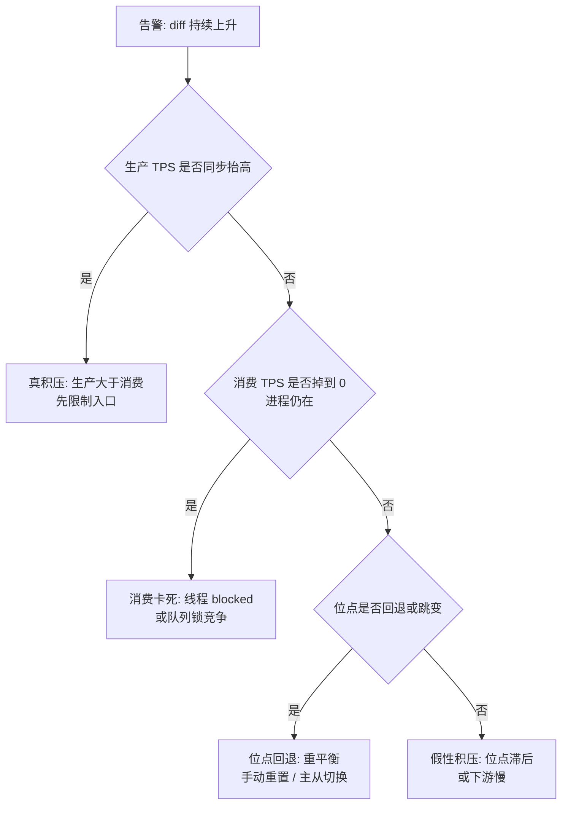

# RocketMQ 积压、重复消费怎么排查？

> 积压只是症状。RocketMQ 里真正要盯的是位点怎么走、回读打到哪里、页缓存还剩多少——先把现象归到生产、Broker、消费三段中的一段，再谈扩容。

存储结构在[上一篇](./high-performance-rocketmq-architecture-storage.html)里讲，事务与顺序语义也有专篇收口；这篇只做一件事：**线上出问题时，按什么顺序取什么证据**。

## 四类“像积压”的现象怎么分？

告警里那句“diff 涨了”，其实混了四种完全不同的病。先分流，再取样：



| 现象                                 | 第一个要看的指标                          | 常见根因                           |
| ------------------------------------ | ----------------------------------------- | ---------------------------------- |
| diff 单边上涨，消费 TPS 平稳         | 生产 TPS、`topicStatus` 里 maxOffset 斜率 | 上游放量、重试风暴、补偿脚本重放   |
| diff 上涨但消费 TPS 掉到 0，进程存活 | `jstack` 里 `ConsumeMessageThread_` 栈    | 业务死锁、连接池耗尽、下游 hang 住 |
| 消费 TPS 正常，diff 却不收敛         | 两次采样的 consumerOffset 是否前进        | 位点提交滞后、位点被重置、重复拉取 |
| 只有个别队列 diff 高                 | `topicStatus` 的 QID 分布                 | 热点 key、顺序消费、单 key 倾斜    |
| 消费 TPS 很高但业务延迟高            | 端到端 RT、重复率、`%RETRY%` 堆积         | 消息进重试、重复消费、下游慢       |

第三行那种“假性积压”最容易被误判：消费者其实已经把消息拉到本地 ProcessQueue 并处理完了，但位点是每 5 秒批量提交一次，本地还允许缓存 `pullThresholdForQueue`（默认 1000）条。这一刻的 diff 里包含“已在内存、已处理、尚未提交”的消息，业务侧根本没有延迟。所以**判断积压要同时看位点差和业务延迟**，只看 diff 会白扩容。

## 线上必须会用的几个观测面在哪？

RocketMQ 的排障信息一半在 `mqadmin` 里，一半在操作系统里。先记住这张对照表：

| 命令                                  | 关键输出                                                              | 什么时候用                   |
| ------------------------------------- | --------------------------------------------------------------------- | ---------------------------- |
| `mqadmin topicStatus -t TOPIC`        | 每个 broker × QID 的 minOffset / maxOffset                            | 看队列倾斜、看消息是否被清理 |
| `mqadmin consumerProgress -g GROUP`   | 每 topic 的 `Diff Total`、`Consume TPS`                               | 看消费进度和吞吐趋势         |
| `mqadmin brokerStatus -b IP:10911`    | putTps / getTps、commitlog 容量、pageCacheLockTimeMills、flush 落后量 | 看 Broker 自己吃不吃得消     |
| `mqadmin consumerConnection -g GROUP` | 在线实例、订阅关系、消费模式                                          | 看实例是否变少、订阅是否漂移 |
| `mqadmin consumerStatus -g GROUP -s`  | 客户端运行态（订阅、消费统计，可带线程栈）                            | 想从 MQ 侧反查消费者内部     |

老版本里 `brokerStatus` 这个入口叫 `getBrokerRuntimeInfo`，取的是同一份 Broker runtime 数据；5.x 部分子命令改过名，动手前用 `mqadmin help <cmd>` 对一遍。位点是唯一能分清“没拉走”和“拉了没提交”的视角，所以先看它：

```bash
$ sh mqadmin topicStatus -n 10.0.0.10:9876 -t TP_ORDER_PAID
#Broker Name        #QID  #Min Offset   #Max Offset   #Last Updated
broker-a            0     8412300       9006712       2026-11-17 10:21:03,412
broker-a            1     8400120       9006688       2026-11-17 10:21:03,412
broker-b            2     8388004       9006905       2026-11-17 10:21:03,415
broker-b            3     1200000       1200117       2026-11-17 10:21:03,415
```

字段含义别背错：`Min Offset` 是队列当前最早可读位点（老消息被清理后它会往前“消失”），`Max Offset` 是最新写入位点，两者之差是该队列还没被取走的量。这里 QID=3 的 max-min 只有 117，其余三个队列各差 60 万——**总量看着均匀，实际是三条队列在扛**，这就是倾斜。

位点差要按消费组算，`topicStatus` 只看得到 topic 总量：

```bash
$ sh mqadmin consumerProgress -n 10.0.0.10:9876 -g CG_ORDER
#Topic                #Diff Total
TP_ORDER_PAID         1805637
%RETRY%CG_ORDER       3721
Consume TPS: 412.53
```

`Diff Total` 是这个组在该 topic 上所有队列 `maxOffset - consumerOffset` 的累加；`Consume TPS` 是 Broker 按两次采样位点差估算的，只适合看趋势，不是业务口径的 TPS。`%RETRY%` 那行有 diff，说明失败消息正在回炉。注意这个命令只到 topic 粒度，想看**每个队列**的位点，得在客户端读 `OffsetStore` 自己暴露（Micrometer 或自建 exporter），Broker 侧并不暴露队列级消费位点。还有一条反直觉的：**diff 归零不等于消费正常**——消息可能正堵在业务线程池里排队，或者已经耗尽重试进了 `%DLQ%`，而 DLQ 有自己的位点，不计入这个 diff。

```bash
$ sh mqadmin brokerStatus -b 10.0.0.11:10911 -n 10.0.0.10:9876
commitLogDirCapacity       = Total : 900.0 GiB, Free : 96.4 GiB.
putTps                     = 3120.50 2988.10 2901.33
getTransferredTps          = 2860.11 2790.60 2701.72
pageCacheLockTimeMills     = 12
remainHowManyDataToFlush   = 0.00 B
sendThreadPoolQueueSize    = 8
sendThreadPoolQueueCapacity= 10000
```

`putTps` 的三个数是近 10 秒、1 分钟、10 分钟均值，一起看才知道是尖刺还是持续；`getTransferredTps` 是消费侧回读的传输 TPS，它和 `putTps` 的差值就是堆积速度；`pageCacheLockTimeMills` 是写 mmap 时等页缓存的时间，上到几十毫秒就该警觉；`remainHowManyDataToFlush` 是还没落盘的字节数，同步刷盘时它直接决定发送 RT；`sendThreadPoolQueueSize` 逼近 capacity 说明 Broker 已经在排队。机器侧再配一套 `iostat -x 1`、`vmstat 1`、`ss -s`、`jstat -gc <pid> 1000`、`free -g`，和它们对齐看：

| 指标            | 异常信号                        |
| --------------- | ------------------------------- |
| 生产 / 消费 TPS | 两者长期背离，差值就是堆积速度  |
| 堆积条数        | 单边上涨或回退                  |
| 回读 RT         | 消费 RT 涨而生产 RT 正常        |
| 失败 / 重试率   | 重试量随总量同比上升            |
| 磁盘与页缓存    | `%util` 满、`wa` 高、cache 变小 |

## 消费端慢，慢在哪一行代码？

消费端变慢是最常见的根因，但“慢”有很多种。先抓栈，再对着栈读，比看监控快：

```bash
jstack <pid> > /tmp/consumer.stack.1
sleep 3
jstack <pid> > /tmp/consumer.stack.2
grep -A 12 'ConsumeMessageThread_' /tmp/consumer.stack.1 | head -60
```

| 栈的样子                                            | 说明                                   |
| --------------------------------------------------- | -------------------------------------- |
| 停在 `HikariPool.getConnection` / `DruidDataSource` | 连接池不够，或下游 SQL 慢              |
| 停在 `SocketInputStream.read`、`Jedis`、Feign       | 下游 hang 住，等超时                   |
| `BLOCKED`，`waiting to lock` 指向自己业务类         | 消费并发下的锁竞争（按订单加锁最常见） |
| 全在 `ArrayBlockingQueue.put`                       | 自建线程池成瓶颈，消费线程只是提交者   |

代码层面的三个高频杀手：消费逻辑里串行调多个 RPC、把整批消息包进一个大事务、以及 `pullBatchSize` / `consumeMessageBatchMaxSize` 配得和实际处理能力不匹配。下游 RT 要看 P99 而不是均值，一次 P99 到 2 秒的 Redis 调用就足以把整批消费拖过超时线。参数要成组看，改一个往往只是把问题挪个位置：

| 参数                         | 默认值 | 影响                                               |
| ---------------------------- | ------ | -------------------------------------------------- |
| `consumeThreadMin/Max`       | 20     | 实例内并发消费线程数，上限受分配到的队列数约束     |
| `pullBatchSize`              | 32     | 单次拉取条数，过大则单批处理久、易超时             |
| `consumeMessageBatchMaxSize` | 1      | 单次回调处理条数，批量大省调用开销，但失败整批重投 |
| `pullThresholdForQueue`      | 1000   | 单队列本地缓存上限，太小会频繁流控、拉不满         |
| `consumeTimeout`             | 15 min | 超时队列会被收回，触发重平衡和重复消费             |

并行上限这条公式要刻在脑子里，8 个队列就算堆到 5 实例 × 20 线程，实际并行度仍然是 8：

```text
组内并行上限 = min( topic 总队列数, 消费实例数 × consumeThreadMax )
同一队列内部 = 串行（同一时刻只有一个线程在处理这个队列的一批消息）
```

## 队列数不够，到底该怎么加？

先纠正一个很常见的算法错误：`writeQueueNums` 是**每个 Broker 上**的队列数，不是 topic 的总数。总队列数 = `writeQueueNums × Broker 数`。2 个 Broker、每个 4 队列，topic 一共 8 条队列，`topicStatus` 里会看到 8 行。

建 topic 时如果走自动创建，队列数取 Broker 的 `defaultTopicQueueNums`（4.x 默认 4）；生产环境通常关掉自动创建，用命令显式建：

```bash
sh mqadmin updateTopic -n 10.0.0.10:9876 -c DefaultCluster -t TP_ORDER_PAID -r 8 -w 8
```

topic 建好以后再调队列数，要注意四件事：

1. 减队列很危险：被删掉的队列里未消费的消息不会再被投递，消费位点直接作废。
2. 加队列时所有 Broker 上的 `writeQueueNums` 必须改成一致，否则路由分布和发送分布都会歪。
3. 生效有延迟：NameServer 约 30 秒扫一次路由、客户端约 30 秒刷新路由、客户端约 20 秒跑一次重平衡，三段叠加后新队列才会被分配出去。
4. 历史消息仍然躺在老队列里，新队列只接新消息。扩容提高的是后续吞吐，老队列的存量消化速度不变。

把算例算清楚：单线程处理一条消息 2ms，即单队列上限 500 TPS；当前 2 Broker × 4 队列 = 8 队列，理论上限 4000 TPS，而峰值要 5000 TPS。

| 方案                   | 结果                | 代价                                  |
| ---------------------- | ------------------- | ------------------------------------- |
| 只把消费者加到 10 台   | 仍然 4000 TPS       | 白扩容，线程抢 8 条队列               |
| 每个 Broker 队列 4 → 6 | 12 × 500 = 6000 TPS | 需改 topic 并等路由刷新，老队列不加速 |
| 单队列吞吐 500 → 700   | 8 × 700 = 5600 TPS  | 要么批量消费，要么优化单条处理逻辑    |
| 按业务拆成两个 topic   | 队列翻倍且隔离故障  | 改造成本最高，但最治本                |

结论是：**并行上限是队列数，不是消费者数量**。加消费者之前先确认队列还有空余，否则只是多部署几台同样吃不满的机器。同理，加 Broker 也不会凭空抬高消费并行度——新加的 Broker 只承接新队列，消费端慢的问题照旧。

## 同一条消息为什么被消费了两次？

RocketMQ 的投递语义是 at-least-once，重复是设计属性而不是偶发故障。线上真遇到重复，先归到四类根因：

| 根因       | 现场特征                                | 怎么证实                                                                              |
| ---------- | --------------------------------------- | ------------------------------------------------------------------------------------- |
| ack 时机错 | 位点已推进，但业务回滚或报错            | 看是否“先返回成功再做事”、批量里部分失败仍返回 `CONSUME_SUCCESS`、异常被 catch 后吞掉 |
| 重平衡     | 同一 msgId 被两个实例处理，实例数在变   | `consumerConnection` 看实例；日志里消费耗时接近 `consumeTimeout`                      |
| 重试       | `reconsumeTimes > 0`，`%RETRY%` 有 diff | `consumerProgress` 里 `%RETRY%CG_xxx` 的 diff                                         |
| 位点回退   | diff 突然变大或位点倒退                 | 是否有手动 `resetOffsetByTime`、是否刚发生主从切换                                    |

查证顺序固定成三条命令：

```bash
# 1) 按业务 key 找消息本体（重投后的消息 keys 不变）
sh mqadmin queryMsgByKey -n NS -t TP_ORDER_PAID -k ORDER_20261117001
# 2) 按 msgId 看这条投递在消费组里的轨迹
sh mqadmin queryMsgByUniqueKey -n NS -t TP_ORDER_PAID -i 0A1B2C3D00002A9F0000000000000001 -g CG_ORDER
# 3) 看位点有没有回退：隔 30 秒采两次 consumerProgress 对比
sh mqadmin consumerProgress -n NS -g CG_ORDER
```

这里有个细节能省掉一半排查时间：**msgId 是按 CommitLog 物理位置算出来的，重投一次就换一个**，它只能标识“某一次投递”。要串起一条消息的完整轨迹，用业务 key 或客户端生成的 `UNIQ_KEY`，别拿 msgId 当主键去 grep 全链路。至于“日志里同一 msgId 出现两次”，更可能是重平衡后两个实例各消费了一遍，而不是重试。

处置分两层：短期先把可疑实例摘掉、把消费超时调大、把批量调小；长期一定落到幂等上——唯一键去重、状态机 CAS、消费记录表，做法见[幂等设计](/high-availability/high-availability-idempotency-design.html)。指望 MQ 端消除重复，只会把问题推迟到下一次发布。

## Broker 卡住时，证据链怎么串？

Broker 侧的问题会以三种面貌出现：发送变慢、发送报错、消费回读变慢。按“报错文案 → Runtime info → 操作系统”这条链往下钻，先认几个关键配置和它们的表现：

| 现象 / 报错                                  | 对应配置                                            | 含义                                     |
| -------------------------------------------- | --------------------------------------------------- | ---------------------------------------- |
| `[PCBUSY_CLEAN_QUEUE]broker busy`、CODE: 2   | `osPageCacheBusyTimeOutMills=1000`                  | 写页缓存等太久，内存压力大               |
| `FLUSH_DISK_TIMEOUT`（SendStatus，不是异常） | `flushDiskType=SYNC_FLUSH`、`syncFlushTimeout=5000` | 同步刷盘超时，落盘跟不上                 |
| 发送被拒、`sendThreadPoolQueueSize` 顶满     | `sendThreadPoolQueueCapacity=10000`                 | Broker 处理队列满，开始丢请求            |
| 消费回读 RT 高，生产 RT 正常                 | `storePathCommitLog` 与 `storePathRootDir` 同盘     | 回读和写入抢同一块盘                     |
| putTps 出现秒级空洞                          | Broker 堆与 G1 停顿                                 | GC 停顿期间不接请求，用 `jstat -gc` 对齐 |

一次真实的追查长这样，注意每一步都在缩小范围，而不是反复重启：

```text
① 生产端 10:31:07 开始 SendStatus 从 SEND_OK 变成 FLUSH_DISK_TIMEOUT，占比 3%
② broker 日志同时段出现 flush disk timeout，GroupCommitService 跟不上
③ mqadmin brokerStatus：remainHowManyDataToFlush 从 0 涨到 380 MB
④ iostat -x 1：commitlog 所在盘 %util=100%，w_await 从 1.2ms 升到 68ms
⑤ vmstat 1：wa 由 2 升到 34，bo 长期 200MB/s 以上
⑥ 结论：盘被同期备份任务抢了带宽，不是 RocketMQ 参数问题
```

证据到这里就够定责了：`remainHowManyDataToFlush` 上涨说明消息在攒着等落盘，`%util` 与 `w_await` 一起高说明设备饱和，`wa` 高说明是 IO 等待而不是 CPU 忙。处置按代价排序：先把备份任务限速或挪走，再看是否要把 CommitLog 单独分盘（`storePathCommitLog`），最后才考虑临时切 `ASYNC_FLUSH` 或调大 `syncFlushTimeout` 换稳定——这两个动作都在拿可靠性换吞吐，要写进变更单。

如果是页缓存忙，方向不是调大 `osPageCacheBusyTimeOutMills`（那只是让它晚点报错），而是看机器内存是否被子进程吃掉、`vm.dirty_ratio` 是否让回写集中爆发、消息体是否突然变大导致映射页暴涨。

## 主从切换为什么会丢消息、又会重复？

先把版本差异摆清楚，否则结论一定是错的：

| 部署形态                   | 选主方式              | 丢消息边界                                              |
| -------------------------- | --------------------- | ------------------------------------------------------- |
| 4.x 主从（`ASYNC_MASTER`） | 手工/脚本，无自动选主 | 未同步到 slave 的消息会丢，已返回 `SEND_OK` 也可能丢    |
| 4.x 主从（`SYNC_MASTER`）  | 手工                  | 返回成功的已落 slave，基本不丢；但 slave 故障会阻塞发送 |
| 4.5+ DLedger               | Raft 多数派自动选主   | 多数派已提交的不丢，少数派上的未提交消息丢              |
| 5.x Controller 模式        | Controller 自动选主   | 同上，切换更平滑，支持动态角色                          |

切换之后有两件事要预料到。一是**重复**：新主的位点可能落后于旧主（异步复制没追上），消费组按新主的 `consumerOffset` 继续消费，中间那段会被再投一次，重平衡期间重复量还会放大。二是**看起来像积压**：切换后 diff 突然变大，不一定是消息变多了，而是位点回退了——这时候对比 `topicStatus` 的 maxOffset 有没有倒退、`consumerProgress` 的位点有没有跳，比看总量有用。

关于从节点读，有个说法要纠正：**“只有 master 能读，从 slave 读没用”只在 4.x 默认配置下成立**。4.x 的消费位点提交和主读都在 master，`slaveReadEnable` 默认关闭；一旦打开，Broker 会在 master 堆积较多而 slave 有余量时建议客户端改从 slave 拉（`suggestWhichBrokerId`），代价是可能读到落后的数据，下游表现为“偶尔拿到旧状态”。5.x 之后又多了 `enableSlaveActingMaster` 这类从节点接管读的配置，行为已经和 4.x 不同，别把老结论直接套到新集群上。

## 死信和重试堆积该怎么收？

`%RETRY%` 和 `%DLQ%` 都是系统 topic，名字带消费组后缀，所以要先知道自己在看哪个组：

```bash
sh mqadmin topicList -n NS | grep -E '%RETRY%|%DLQ%'
sh mqadmin topicStatus -n NS -t %RETRY%CG_ORDER
```

`%RETRY%` 有堆积，说明消息在按退避级别反复失败。它的危害常被低估：重试消息和正常消息**共用同一批消费线程**，重试越堆，正常吞吐越低，看上去像整体变慢。`%DLQ%` 有消息则意味着已经耗尽重试次数（并发消费默认 16 次，由订阅组的 `retryMaxTimes` 控制），必须人工介入。

死信重放别写成“读出来再发一遍”，按这个顺序做：

1. 抽样用 `queryMsgByUniqueKey` 看清异常，确认代码或数据已修复，否则重放就是二次事故。
2. 用独立的临时消费组订阅 `%DLQ%CG_ORDER`，从最早位点开始，单线程并限速（例如 200 TPS）。
3. 重投时保留原 `keys` / `tags`，额外加 `replayBatch`、`replayFrom=DLQ` 属性，方便事后对账和二次止损。
4. 幂等键用业务唯一键；重放记录落库，记下批次、msgKey、结果。
5. 处理完观察原 topic 的 diff 和 `%RETRY%` 是否二次上涨；DLQ 消息保留一段时间做审计，不要直接 `deleteTopic` 清空。

顺序消费还有个特殊坑：失败后是**原地重试、不跳过**，一条毒消息能把整条队列钉死。这时表现是“只有那个队列的 diff 一直涨、消费 TPS 为 0”，和消费卡死很像，区别在于栈里能看到同一条消息被反复处理。

## 磁盘写满之后 Broker 会怎么表现？

水位线是 `diskMaxUsedSpaceRatio`（4.x 默认 75）。超过之后 `CleanCommitLogService` 会去删最老的文件，但删除还受 `fileReservedTime`（默认 72 小时）约束：没到保留时间的文件，超了水位也不删。于是水位继续涨，直到写不进去。这时报错长得很像“服务挂了”：

```text
MQBrokerException: CODE: 14  DESC: service not available now, maybe disk full,
CL: 0.98 CQ: 0.95 INDEX: 0.96, maybe your broker machine memory is too small
```

它其实是磁盘配额，**别去重启 Broker**——重启后一样写不进，还丢掉现场。按这个顺序处理：

1. `df -h` 确认是 store 盘满了，排除日志盘。
2. `mqadmin getBrokerConfig -b IP:10911` 确认 `storePathRootDir`、`storePathCommitLog`、`fileReservedTime`、`diskMaxUsedSpaceRatio`。
3. 临时调小保留时间（如 `updateBrokerConfig -k fileReservedTime -v 12`）让清理周期跑起来，或扩盘、把分片迁走；小幅抬高水位只能把墙往后挪几小时，算不上方案。
4. 生产端同步降级：暂停非核心 topic、对入口限流，避免刚腾出的空间又被写满。

**别直接删 CommitLog 文件**。ConsumeQueue 里每条 20 字节的索引存的就是 CommitLog 的物理偏移，位点也按这个偏移记；文件一删，索引还指向不存在的物理位置，消费回读会直接解码失败，`commitLogMinOffset` 和磁盘上的文件列表也对不上，Broker 甚至起不来。要么让 Broker 按保留策略自己删，要么换盘后重建 topic 再回填。

## 标准排查顺序：照着做就行

不用每次现想，固定成八步：

1. **确认现象**：是 diff 涨、业务延迟涨，还是发送报错？三者取一个主症状。
2. **确认范围**：单 topic、单队列、单消费组，还是全集群；是否刚发布、刚扩容、刚切换。
3. **拉 TPS 与位点**：`brokerStatus` 的 putTps / getTransferredTps、`consumerProgress` 的 diff 与回退、`topicStatus` 的队列倾斜与 minOffset。
4. **定位段落**：生产突增（限流）／Broker 吃紧（磁盘、页缓存、GC）／消费慢（栈、下游、参数）／位点异常（重平衡、重置、切换）。
5. **取证据**：`jstack` 2～3 次、`iostat -x 1`、`vmstat 1`、`consumerConnection`、Broker 日志同时段片段，一起留档。
6. **最小处置**：先限流或摘实例止血；要扩就先确认队列有空余，再扩消费者。
7. **处理存量**：判断是原组继续追、临时组并行追，还是从业务库重建事件；重放前确认幂等。
8. **收尾与复盘**：清点 `%RETRY%` / `%DLQ%` 并按批次重放，再补 diff、消费 RT、重试率、死信量、磁盘水位告警，把这次的判定阈值写进 runbook。

这套顺序和通用的[消息积压排查](/high-performance/high-performance-message-backlog.html)是同一副骨架，区别只在于这里每一步都能落到 RocketMQ 的具体命令和字段上。

## 哪些坑最容易踩？

1. **只看堆积数不看消费 TPS**：总量涨可能是生产放量，消费 TPS 掉才是消费端出事，两者处置方向完全相反。
2. **扩容消费者但队列数不够**：并行上限是队列数，8 条队列加 20 台机器，实际并发还是 8。
3. **重平衡频繁导致反复重复**：实例频繁上下线、单批处理接近 `consumeTimeout`，队列反复易主，重复量和延迟一起涨。
4. **把消费线程池当成拉取线程池**：拉取由 `PullMessageService` 单线程驱动，消费走 `consumeExecutor`；调大 `consumeThreadMax` 不会让拉取变快。
5. **只监控 Broker 不监控死信**：Broker 一切正常，`%DLQ%` 却在悄悄涨，等发现时已经攒了几天的失败消息。
6. **把 DLQ 当垃圾清空**：清空等于放弃补偿依据，正确做法是修复后按批次重放，再让保留策略自然清理。

## 小结

1. 积压先分流：真积压、消费卡死、位点回退、假性积压，四类的第一手证据完全不同。
2. 位点差不是真相：`topicStatus` 看队列与清理，`consumerProgress` 看组进度，队列级位点只能在客户端取。
3. 并行上限是队列数（`writeQueueNums × Broker 数`），加消费者只在这条上限之内才有效。
4. Broker 异常按“报错文案 → runtime info → 磁盘/内存指标”串证据链，`FLUSH_DISK_TIMEOUT`、`PCBUSY`、`CODE: 14` 分别指向刷盘、页缓存和磁盘水位。
5. 重复消费是 at-least-once 的必然结果，排查靠业务 key 而不是 msgId，终局解只有幂等。

## 参考

综合自 Apache RocketMQ 官方文档（`mqadmin` 运维命令、Broker 与 MessageStore 配置项、主从部署与 DLedger/Controller 模式说明）及公开的 RocketMQ 运维实践整理，核对说明如下：

- `mqadmin` 子命令与参数以 4.9.x 的注册表为准，`brokerStatus` 在更早版本里叫 `getBrokerRuntimeInfo`；5.x 部分子命令改名或增删参数，执行前用 `mqadmin help` 对一遍。
- 默认值（`defaultTopicQueueNums`、`osPageCacheBusyTimeOutMills`、`syncFlushTimeout`、`sendThreadPoolQueueCapacity`、`diskMaxUsedSpaceRatio`、`fileReservedTime`、`consumeThreadMax`、`pullBatchSize`）按 4.x 的 `BrokerConfig` / `MessageStoreConfig` / `DefaultMQPushConsumer` 核对，不同版本有调整，以 `getBrokerConfig` 实际输出为准。
- 主从切换与从节点可读在 4.x 与 5.x 行为不同，文中已分版本标注；DLedger 与 Controller 的丢消息边界按 Raft 多数派提交语义描述。
