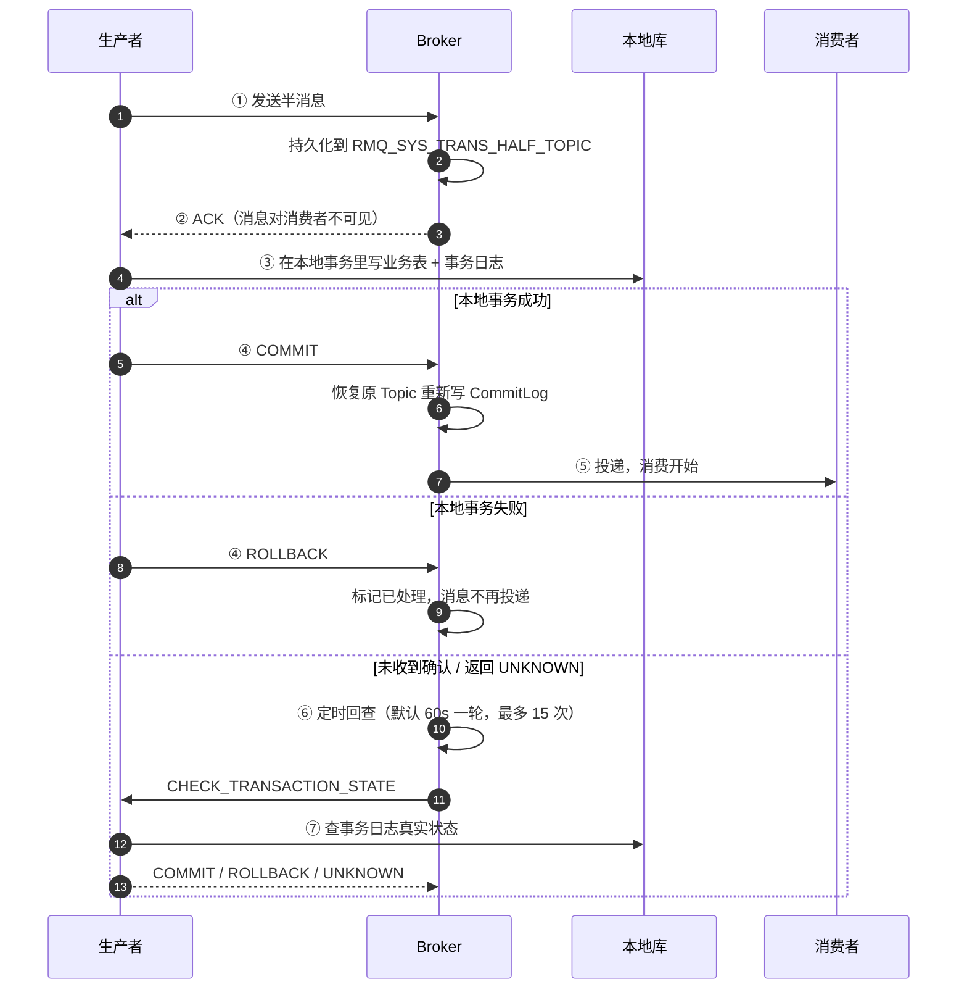
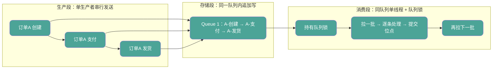

# RocketMQ 事务消息和顺序消息怎么保证不丢不重？

> 事务消息、顺序消息、延时消息、重试与死信，都是 RocketMQ 替你扛下的某一段语义；每一段之外剩下的部分，仍然要业务自己补。

“RocketMQ 怎么保证不丢、不重、不乱”最常见的答法是背四个名词：事务消息、顺序消息、延时消息、死信队列。名词好背，边界难说——线上真正出事的地方，几乎都落在这些能力的边界之外。

这一篇只讲语义能力本身：承诺什么、靠什么兑现、代价在哪。消息链路三段的一般性可靠性分析在 [`MQ 如何保证消息不丢？`](/high-performance/high-performance-message-reliability.html) 里拆过了，结论只有一句：**可靠投递靠“确认 + 持久化 + 重试 + 补偿”四层叠加**；顺序消息的通用原理在 [`顺序消息怎么保证？`](/high-performance/high-performance-message-ordering.html)，这里只补 RocketMQ 的落地细节。

## 下单要“写库 + 发消息”，这两个动作为什么原子不了？

订单服务创建一笔订单，代码无非两行：`orderMapper.insert(order)` 提交本地事务，然后 `rocketMQTemplate.send("ORDER_CREATE", event)` 把事件交给 Broker。这里有两个窗口，谁都盖不住：

| 出问题的时刻                             | 结果                                     |
| ---------------------------------------- | ---------------------------------------- |
| 写库成功，发送前进程挂掉 / 发送抛异常    | 订单存在，但下游库存、积分、通知全没收到 |
| 发送成功，本地事务回滚（或后续校验失败） | 下游收到一笔根本不存在的订单事件         |

数据库事务管不到 Broker，Broker 也不关心你的数据库，所以“两个动作原子化”天然没有现成事务可用。把 Broker 拉进 XA/2PC 理论上可行，工程上不划算：锁范围大、并发度低、Broker 也不是标准 XA 资源。真正的抓手只有两类：**本地消息表（Outbox）** 把“待发送事件”写进和业务表同库的一张表，同一个本地事务提交，后台任务扫表投递；**事务消息** 把“暂存 + 确认 + 回查”内置进 Broker，业务只多写一个监听器。

## 本地消息表、事务消息、Seata AT、TCC 该怎么挑？

四种方案都能做到“最终一致”，差别在**谁承担复杂度**：

| 方案       | 保证的范围                             | 业务侵入                    | 运维成本                             | 适合什么场景                       |
| ---------- | -------------------------------------- | --------------------------- | ------------------------------------ | ---------------------------------- |
| 本地消息表 | 本地事务 + 消息落表原子；投递靠扫描    | 低：加一张表 + 一个扫描任务 | 中：补偿任务、去重、积压监控要自己做 | 绝大多数业务事件，尤其多下游       |
| 事务消息   | 本地事务 + 消息发送原子（Broker 回查） | 中：写监听器，回查要能查库  | 中：半消息治理、回查次数监控         | 单一事件、不想自己维护补偿扫描     |
| Seata AT   | 多库多服务的本地事务 + 全局回滚        | 低：注解即用                | 高：TC 集群、undo_log、全局锁        | 多数据源 CRUD、强一致要求较高      |
| TCC        | 业务资源预留，可精确补偿               | 高：Try/Confirm/Cancel 三套 | 高：幂等、空回滚、悬挂全要处理       | 资金、库存等能“先冻结再确认”的资源 |

结论要克制：**多数团队最终落地的还是本地消息表 + 定时补偿**。原因是它不绑定具体 MQ、状态在自家库里可查可修、能一次投递给多个下游；事务消息的优势是少写一个扫描任务，代价是把一致性的一部分交给了 Broker 的回查节奏。

## 半消息、本地事务、回查，这三步是怎么扣起来的？



“不可见”不是靠给消息打标记实现的：Broker 收到半消息后，把消息的 Topic 改写成内部主题 `RMQ_SYS_TRANS_HALF_TOPIC`，原 Topic 和 queueId 备份到消息属性里。这个主题没有消费组订阅，消费者自然也看不到。等收到 COMMIT，Broker 再把消息从半消息主题读出来，恢复原 Topic 重新写一次 CommitLog，这时它才真正进入某个队列。

几个默认参数值得记住（都在 Broker 侧，可调）：

| 配置项                     | 默认值 | 作用                         |
| -------------------------- | ------ | ---------------------------- |
| `transactionTimeOut`       | 6s     | 单次本地事务执行的超时判定   |
| `transactionCheckInterval` | 60s    | 回查扫描周期                 |
| `transactionCheckMax`      | 15     | 同一条半消息最多被回查多少次 |

回查不是生产者主动上报，而是 Broker 的 `TransactionalMessageCheckService` 定时扫半消息主题，按 producerGroup 找一台存活的生产者实例发 `CHECK_TRANSACTION_STATE`。这条链路的关键性质是：**回查请求会打到哪个实例是不确定的**。

回查结果的处理也很直接：返回 COMMIT 就投递、返回 ROLLBACK 就丢弃、返回 UNKNOWN 就等下一轮。超过 `transactionCheckMax` 之后，4.x 默认是把半消息丢弃并留一条 WARN 日志，5.x 的文档口径是丢弃或进入死信队列。无论哪个版本，工程上都应该把它当成“这条消息不会再来”——所以要监控回查次数，而不是等它自己消失。

## 回查接口为什么必须幂等，还得能查到“真实状态”？

因为回查有两个不确定性：一是可能重复调用（最多 15 次），二是可能落到**没执行过这笔本地事务的另一台实例**上。两条合起来就推出两个硬要求：

1. `checkLocalTransaction` 只能查、不能“顺手补做业务”，重复执行也必须给同一答案；
2. 事务状态必须落在所有实例都能读到的地方（数据库或可靠共享存储），放 JVM 内存 Map、放本地缓存，都会在回查落到别的实例时查询失败。

```java
@RocketMQTransactionListener
public class OrderTxListener implements RocketMQLocalTransactionListener {
    private final OrderTxService orderTxService; // 业务表 + 事务日志，同库
    private final TxLogMapper txLogMapper;

    // 半消息发送成功后回调：执行本地事务
    @Override
    public RocketMQLocalTransactionState executeLocalTransaction(Message msg, Object arg) {
        String txId = (String) msg.getHeaders().get("rocketmq_TRANSACTION_ID");
        try {
            orderTxService.createOrderWithTxLog(txId, (OrderCommand) arg); // 同一个本地事务
            return RocketMQLocalTransactionState.COMMIT;
        } catch (DuplicateKeyException e) {
            return RocketMQLocalTransactionState.COMMIT; // 同 txId 重复执行，按成功处理
        } catch (Exception e) {
            return RocketMQLocalTransactionState.ROLLBACK; // 只确定没写进去才回滚
        }
    }

    // 回查：可能打到同组任意一台机器，必须查库
    @Override
    public RocketMQLocalTransactionState checkLocalTransaction(Message msg) {
        String txId = (String) msg.getHeaders().get("rocketmq_TRANSACTION_ID");
        TxLog log = txLogMapper.selectByTxId(txId);
        if (log == null) return RocketMQLocalTransactionState.UNKNOWN; // 查不到 ≠ 失败
        return log.isSuccess() ? RocketMQLocalTransactionState.COMMIT
                               : RocketMQLocalTransactionState.ROLLBACK;
    }
}
```

## 事务消息替你保证了什么，又明确没保证什么？

这是整篇最该说清楚的一段：事务消息只做一件事——让“本地事务的结果”和“这条消息最终可见/不可见”收敛到同一个结论。

| 它保证                                     | 它不保证                                     |
| ------------------------------------------ | -------------------------------------------- |
| 本地事务提交成功 → 消息最终一定会被投递    | 消费者一定处理成功，消费失败照样要重试和补偿 |
| 本地事务回滚 → 消息最终一定不会被投递      | 只投递一次，重复消费照样存在，幂等照样要写   |
| 半消息不会永远悬着（有超时和回查次数上限） | 多个本地库、多条消息、多个下游的原子性       |
| 单个生产者、单个 Topic 的事件发送一致性    | 生产者侧的业务校验、参数合法性、下游业务规则 |

所以“用事务消息替代分布式事务”这个说法是错的。它把**跨系统事务**缩小成了**一次本地事务 + 一次消息发送**的一致性问题；消费者拿到消息之后的处理，依然是最终一致 + 幂等的老问题，[`MQ 如何处理重复消费和幂等？`](/high-performance/high-performance-message-idempotency.html) 讲的那一套一点没少。另外，4.x 的事务消息不支持延时消息和批量消息，也不支持一条消息覆盖多个本地库——这不是缺陷，是它把范围刻意收窄了。

还有两个工程边界要提前想清楚。第一个是**半消息堆积会拖慢回查**：回查由 Broker 定时扫半消息队列，扫的量和半消息数量正相关，业务侧如果习惯性把异常吞掉返回 UNKNOWN，半消息就会越积越多，回查越来越慢，形成“越不决越慢、越慢越不决”的循环。

第二个是**回查查不到记录时怎么答，属于业务判断而不是技术判断**，三种情况对应三种答案：

| 真实情况                           | 应该答                     | 答错的代价                                          |
| ---------------------------------- | -------------------------- | --------------------------------------------------- |
| 本地事务还在执行或提交中           | UNKNOWN                    | 答 COMMIT：投出一条业务其实没成功的消息，下游脏数据 |
| 明确已回滚，或从未执行且不会再执行 | ROLLBACK                   | 答 COMMIT：下游凭空收到一笔不存在的业务事件         |
| 已提交成功，但日志被清理导致查不到 | 先修数据保留策略，不能靠猜 | 答 ROLLBACK：业务成功但事件永久丢，只能靠对账补     |

这条规则的推论是：事务日志的保留时长必须**长于**事务消息的回查窗口，否则回查永远查不到。

## 顺序消息：RocketMQ 凭什么能做到“同一个 key 有序”？

先分清全局顺序和局部顺序。全局顺序在 RocketMQ 里的落地方式就是“一个 Topic 一个队列、生产者串行、消费者单线程”，并行度被压到 1，队列所在节点故障整条链路停摆——真实业务里只有 binlog 同步、撮合这类必须全序的场景才值得。

绝大多数业务要的是局部顺序：同一笔订单的事件有序，订单之间互不相干。RocketMQ 的做法是让“同一个顺序单元”贯穿生产、存储、消费三段：



生产侧有两代写法。4.x 自己实现队列选择，5.x 把它抽象成 MessageGroup：

```java
// 4.x：同一个 orderNo 必须算出同一个队列下标
SendResult sendOrderEvent(OrderEvent event) throws Exception {
    Message msg = new Message("ORDER_EVENT", event.tag(), event.payload());
    return producer.send(msg, new MessageQueueSelector() {
        @Override
        public MessageQueue select(List<MessageQueue> mqs, Message msg, Object arg) {
            int index = Math.floorMod(arg.hashCode(), mqs.size());
            return mqs.get(index); // 别用随机数、时间戳、UUID
        }
    }, event.orderNo());
}

// 5.x：FIFO 类型 Topic 上按消息组选队列
Message msg = messageBuilder.setTopic("ORDER_EVENT")
        .setMessageGroup(event.orderNo()).setBody(event.payload()).build();
```

两个硬前提必须同时成立：**单一生产者**和**串行发送**。`send()` 要同步等结果，不能 `sendOneWay`，也不能把同一订单的事件丢进线程池并发发——不同线程之间没有先后可言，顺序在发出前就已经丢了。消费侧用 `MessageListenerOrderly`，三把锁叠加：客户端按队列加本地锁（同一队列同一时刻只有一个消费线程在跑）、向 Broker 申请队列锁并定期续租、Broker 保证同一消费组内一个队列只分配给一个消费者实例。任何一段掉链子顺序就失效，常见断点如下：

| 断点                             | 后果                                 |
| -------------------------------- | ------------------------------------ |
| 生产端并发发送 / 用了随机选择器  | 同一订单的事件散落在多个队列         |
| Topic 队列数扩容后取模结果变化   | 跨扩容点的旧消息与新消息落在不同队列 |
| 消费端把消息丢进业务线程池       | 拉取有序，处理无序                   |
| Rebalance 期间新旧消费者短暂并存 | 队列锁租约未过期，可能出现重复消费   |

表中第二行经常被忽略：`hash % size` 在 `size` 变化时会整体漂移。要么对顺序敏感的 Topic 固定队列数、扩容时走新 Topic 灰度切换，要么引入一致性哈希。

## 顺序消息贵在哪？吞吐、阻塞和“跳过”之后的乱序怎么兜？

顺序是有价格的，价格体现在三个地方：

1. **并行度上限就是队列数**。一个队列同时只能有一个消费线程，所以同一个消费组的并行度大致等于队列数（4.x 更是严格的一队列一实例）。队列开少了，加机器也没用。
2. **消费失败会阻塞后续消息**。顺序消费失败不能“跳过继续”（那等于断序），只能原地重试，同一队列后面的消息全得等。一条脏消息就能把整组卡住，积压曲线会直线上扬。
3. **重试次数用满后，RocketMQ 会跳过**。5.x 的文档口径很明确：顺序消息的重试只在限定次数内，超过最大重试次数后不再重试，跳过这条消息继续消费。4.x 的顺序消费 `maxReconsumeTimes` 默认取 `Integer.MAX_VALUE`（等于不设上限），不少团队会手工调小，就是怕堵死。

“跳过”这个词的工程含义要说透：**顺序保证在这条消息处断了一次**。假设订单的“支付成功”被跳过，后面的“发货”照样会被处理，业务看到的是“未支付却已发货”。这不是框架 bug，是“不让一条毒消息永久堵死整个队列”和“不让顺序断”之间的取舍。

对比一下 Kafka：Kafka 里消费卡住通常表现为分区挂起，靠 `max.poll.interval` 超时触发 rebalance，把分区交给别的消费者，毒消息可能引发反复重平衡；RocketMQ 是原地重试，堵在队列上但不会引发重平衡风暴。两种都不完美，所以顺序消息必须配业务兜底：

```sql
-- 状态机式条件更新：命中 0 行说明这条消息不该在此刻生效
update t_order
   set status = 'SHIPPING'
 where order_no = #{orderNo}
   and status = 'PAID';
```

命中 0 行时不要硬推进，按“重复 / 乱序 / 非法”分别处理；对覆盖式更新的表，用版本号（`where version < #{version}`）挡住迟到的旧消息。这部分思路和 [`顺序消息怎么保证？`](/high-performance/high-performance-message-ordering.html) 里讲的一致，只是 RocketMQ 的断点更多落在“重试跳过”和“队列扩容”上。

## 延时消息：4.x 的 18 个档位和 5.x 的任意时间差在哪？

延时消息的用途很集中：订单超时未支付自动关闭、支付结果轮询、定时对账。RocketMQ 两代版本的能力差别很大，先看对比：

| 维度     | 4.x 延时消息                                 | 5.x 定时消息                                 |
| -------- | -------------------------------------------- | -------------------------------------------- |
| 设置方式 | `setDelayTimeLevel(level)`，传档位下标       | `setDeliveryTimestamp(ms)`，传绝对毫秒时间戳 |
| 可选时间 | 固定 18 档：1s 5s 10s 30s 1m … 20m 30m 1h 2h | 任意时间，最大默认 24 小时                   |
| 存储     | 改写到 `SCHEDULE_TOPIC_XXXX`，按档位分队列   | 追加写 `timerLog` + 内存时间轮               |
| 精度     | 受档位粒度与扫描周期影响                     | 默认 1s（`timerPrecisionMs` 可调）           |
| 撤回     | 没有撤回 API                                 | 同样没有撤回 API                             |

实现上有两代思路：4.x 把 Topic 换成 `SCHEDULE_TOPIC_XXXX`、queueId 设成 `level - 1`，每个档位一条扫描线，到点再恢复原 Topic 写回 CommitLog，所以档位之外的时间只能“向上取整”；5.x 传的是绝对时间戳，消息与投递时间追加写进 `timerLog`，内存里维护秒级时间轮，到期由 `TimerMessageStore` 回写原 Topic。工程上还要盯三件事：

- **精度不等于准时**：到期消息仍要排一次写入和投递，堆积时到期延迟会被放大。
- **堆积藏在另一套存储里**：4.x 在 `SCHEDULE_TOPIC_XXXX`，5.x 在 `timerLog`，按业务 Topic 看监控一切正常。
- **没有撤回能力**：开源版不提供按 msgId 取消延时消息的 API，只能到期后先查业务状态做**逻辑取消**，已支付就直接丢弃。

## 失败了往哪走？重试和死信各自接管什么？

RocketMQ 的重试分两段，责任人也不同：

| 失败点                                   | 消息落到哪                      | 谁负责处理                         |
| ---------------------------------------- | ------------------------------- | ---------------------------------- |
| 生产者发送超时 / Broker 不可用           | 客户端自动重试，换一个队列再发  | 生产端：`retryTimesWhenSendFailed` |
| 本地事务成功但消息没发出去               | 本地消息表 / 半消息回查         | 业务补偿任务 + 对账                |
| Broker 写盘失败、磁盘满                  | 生产者收到错误码，重试或失败    | 运维：磁盘水位告警                 |
| 消费失败（临时异常、下游超时）           | `%RETRY%{consumerGroup}` 主题   | 消费端重试，间隔按等级递增         |
| 消费失败（重试超限 / 业务不合法）        | `%DLQ%{consumerGroup}` 死信主题 | 运维 + 业务：监控、人工重放        |
| 消费成功但位点没提交                     | 同一条消息再次投递              | 业务幂等                           |
| 位点已提交但业务其实是失败的（异步 ack） | 无人兜，消息已“消失”            | 消费记录表 + 对账                  |

表里几个落点背后的默认值：

- **生产者**：同步发送失败默认重试 2 次（即最多 3 次尝试），失败换队列；`sendLatencyFaultEnable=true` 时还会对故障 Broker 退避（4.x 默认关闭）。
- **消费者**：集群模式（CLUSTERING）失败返回 `RECONSUME_LATER`，消息进 `%RETRY%{group}`，重试间隔按等级递增（10s 30s 1m 2m 3m 4m 5m 6m 7m 8m 9m 10m 20m 30m 1h 2h），默认 16 次后进 `%DLQ%{group}`。
- **广播模式（BROADCASTING）不重试**：位点在客户端本地，消费失败就是失败，框架不会替你重投——“消费失败一定重试”这句话只在集群模式成立。
- **死信主题默认只读**：不能被消费者直接订阅，只能通过控制台或运维工具重放回原 Topic，保留时长受 `fileReservedTime`（默认 72 小时）约束。死信的价值不在“存着”，而在有人看：告警阈值、重放工具、重放后的幂等校验，缺一样就只是个垃圾桶。

消费端该做的是按异常分流，而不是把所有失败都丢给重试：

```java
public ConsumeConcurrentlyStatus consume(MessageExt msg) {
    if (dedup.seen(bizKey(msg))) return ConsumeConcurrentlyStatus.CONSUME_SUCCESS; // 重复
    try { orderService.handle(msg); return ConsumeConcurrentlyStatus.CONSUME_SUCCESS; }
    catch (BizRuleException e) { return ConsumeConcurrentlyStatus.CONSUME_SUCCESS; } // 转异常表
    catch (Exception e) { return ConsumeConcurrentlyStatus.RECONSUME_LATER; } // 进 %RETRY%
}
```

## 幂等为什么必须业务自己写？

到这一步可以给出定论了：RocketMQ 的语义上限是**至少一次**。消费者处理完业务、还没来得及提交位点就宕机，Broker 只能重投；消费超时没响应，也会重投——这两条决定了重复是设计的一部分，不是异常。所以幂等的抓手必须落在业务唯一键上，而不是消息 ID：

| 做法            | 关键点                                     | 局限                                    |
| --------------- | ------------------------------------------ | --------------------------------------- |
| 唯一键 + 去重表 | 业务单号建唯一索引，插入冲突即视为重复     | 表会变大，要定期归档                    |
| Redis `SETNX`   | 处理前抢占 key，处理失败要能删 key 重来    | 主从切换 / 过期可能丢 key，不能单独依赖 |
| 状态机条件更新  | `where status = 期望前态`，命中 0 行就跳过 | 只适用于状态迁移类业务                  |
| 版本号 / 时间戳 | `where version < 新版本`，挡住迟到的旧消息 | 需要消息里带版本                        |

注意第一列写的是“业务单号”，不是 `msgId`：消息重试时会重新构造一条消息、生成新的 msgId，补偿重放、人工重放同理。用 `msgId` 去重，等于对重试消息完全失效。

工程上比较稳的组合是**唯一键兜底 + Redis 挡在前面**：Redis 拦掉绝大部分重复（快），数据库唯一索引负责正确性（准）。更强的一致性要求下，可以把去重表和业务表放在同一个本地事务里提交，用数据库自己的能力保证“只生效一次”。展开的讨论在 [`接口幂等怎么设计？`](/high-availability/high-availability-idempotency-design.html)。

## “不丢不重”到底要靠哪几段拼起来？

把上面所有能力摆到一条链路上，责任划分是这样的：

| 链路段   | 要打开的开关                                                  | 兜底手段                        |
| -------- | ------------------------------------------------------------- | ------------------------------- |
| 生产端   | 同步发送 + 失败重试 + `sendLatencyFaultEnable`                | 发送失败落表，补偿任务重投      |
| 事务边界 | 事务消息（或本地消息表），回查接口幂等且查库                  | 事务日志保留期 > 回查窗口；对账 |
| Broker   | 同步刷盘（`SYNC_FLUSH`）+ 同步复制（`SYNC_MASTER`）或 DLedger | 磁盘水位告警、主从切换演练      |
| 消费端   | 集群模式 + 业务成功后再提交位点 + 有限重试                    | 幂等 + 死信监控 + 重放工具      |
| 顺序消费 | 单一生产者 + 串行发送 + `MessageListenerOrderly`              | 状态机 / 版本号兜住断序         |
| 延时消息 | 4.x 选合适档位 / 5.x 传绝对时间戳                             | 到期先校验业务状态，做逻辑取消  |
| 业务侧   | 对账任务（金额、状态、事件数三方对齐）                        | 人工介入 + 补偿脚本             |

一句话：**事务消息管生产端那一段，顺序消息管同一个 key 的处理次序，重试和死信管失败之后去哪，幂等管重复，对账管所有人都漏掉的情况。** 把这些当成五个独立开关去配，是配不出“不丢不重”的。

## 容易踩的坑

| 坑                           | 为什么会出事                                                          |
| ---------------------------- | --------------------------------------------------------------------- |
| 把事务消息当分布式事务的银弹 | 它只保证“本地事务 + 一次发送”最终一致，消费侧成功与幂等仍要自己做     |
| 回查接口不幂等、状态放内存   | 回查最多 15 次且可能落到同组另一台机器，内存里的状态查不到            |
| 回查查不到记录就返回 COMMIT  | 可能投出一条业务并不存在的事件；应先答 UNKNOWN，同时修好日志保留期    |
| 顺序消息用异步或并发发送     | `sendOneWay`、线程池并发发，顺序在进 Broker 前就丢了，后面配也没用    |
| 顺序消费里做耗时操作         | 单队列吞吐 = 1/单条耗时；消费超时（默认 15 分钟）还会触发重投制造重复 |
| 重试次数用满却没监控死信     | 16 次用完进 `%DLQ%`，死信只读且有保留期，没人看就是静默丢失           |
| 延时消息堆在调度主题里没人看 | 积压在 `SCHEDULE_TOPIC_XXXX` / `timerLog`，业务 Topic 指标一切正常    |
| 先提交位点，再异步处理业务   | 业务失败了消息已“消费成功”，排查时消费日志全是成功                    |

## 小结

- 事务消息解决的是“本地事务 + 消息发送”的原子性：半消息对消费者不可见，本地事务提交后 COMMIT，未确认则 Broker 按默认 60 秒一轮、最多 15 次回查；回查必须幂等，状态必须落库，且日志保留期要长于回查窗口。
- 事务消息不是分布式事务的银弹，消费侧依然是最终一致 + 幂等；半消息堆积会拖慢回查，回查超限后消息不再投递，只能靠监控和对账兜。
- 顺序消息是“生产串行 + 同队列存储 + 同队列单线程消费”三段对齐的结果，靠 MessageGroup（4.x 是 MessageQueueSelector）把同一 key 固定到一个队列；代价是并行度等于队列数、失败会阻塞后续消息，重试超限后跳过即断序，要靠状态机和版本号兜。
- 延时消息 4.x 只有 18 个固定档位（最大 2 小时）、5.x 支持任意时间戳（默认上限 24 小时）；两代都没有撤回 API，只能到期后校验业务状态做逻辑取消。
- 失败路径要背清：生产端同步发送默认重试 2 次，消费端集群模式重试 16 次后进 `%DLQ%`、广播模式不重试；“不丢不重”最终靠同步发送 + 事务消息/本地消息表 + 同步刷盘与同步复制 + 成功再提交位点 + 幂等与对账组合出来。

## 参考

综合自 Apache RocketMQ 官方文档中事务消息、顺序消息、定时/延时消息、消息重试与死信队列各章节，以及 RocketMQ 4.x / 5.x 客户端与 Broker 源码里的默认参数。核对过的点包括：半消息写入 `RMQ_SYS_TRANS_HALF_TOPIC` 的实现方式、回查的默认周期与次数、4.x 的 18 个延时档位与 `SCHEDULE_TOPIC_XXXX` 的搬运机制、5.x 的 `timerLog` 与时间轮、消费重试的 16 档间隔与死信主题命名、广播模式不重试，以及顺序消费在 4.x 与 5.x 上对最大重试次数的不同默认值。文中涉及业务设计的部分（本地消息表、幂等、状态机兜底）来自本仓库高性能与高可用专题已有笔记的交叉印证。
