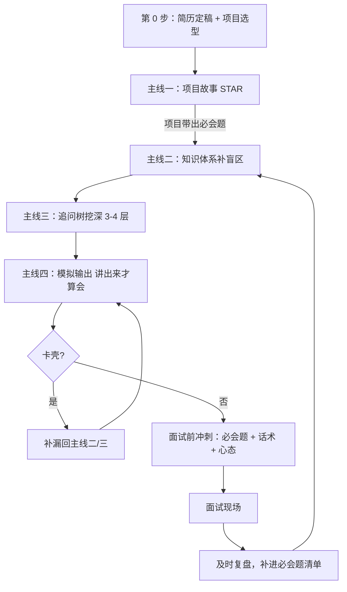

# 3-5 年 Java 后端面试到底该怎么准备？

> 一句话点题：3-5 年的面试不是比谁背得多，而是比谁讲得清、扛得住追问。

## 3-5 年面试和校招到底差在哪

校招那会儿，面试官心里默认你"啥也没做过"，所以八股默写、算法手撕、基础概念就是主旋律，对项目方向也比较宽容。但到了 3-5 年这个段位，你是社招，面试官默认你"是来干活的"，问题的重心整个就挪了。

核心区别我用一张表说清楚：

| 维度     | 校招                    | 3-5 年社招                                 |
| -------- | ----------------------- | ------------------------------------------ |
| 考察重心 | 基础概念、算法 AC 率    | 项目深挖、工程能力、为什么这么做           |
| 项目方向 | 和公司业务没关系也行    | 岗位匹配度很关键，方向不符 HR 可能直接筛掉 |
| 八股     | 默写为主，问得广        | 问得少而深，且围绕你简历里写的技术展开     |
| 算法     | 笔试门槛，AC 率低直接挂 | 通常一轮压轴一道题，工程够强可容忍         |
| 追问深度 | 一两层就放过            | 能连追三四层，问到你说不出为止             |

所以 3-5 年的胜负手不在"我会背多少"，而在两件事：一是你能不能把自己做过的东西讲成有取舍、有理由的决策；二是面对"为什么不用 X、那如果出现 Y 怎么办"的连环追问，你能不能接得住。理解了这一点，后面的四条主线才有了主心骨。

> 提醒：算法在不同厂权重差别很大。重算法的厂（字节、快手、腾讯这类）即便社招也会把代码题当重要一环，别因为"社招重工程"就完全放掉算法；而中小厂、业务型团队往往只压轴放一道，工程扎实就能过。按目标公司分配时间，别一刀切。

## 准备的四条主线

我把准备拆成四条互相咬合的主线，单独练哪一条都不够，得一起推进。

### 主线一：项目故事——把项目讲成"决策"而不是"流水账"

面试官让你介绍项目，最怕听到的是"我先做了登录，又做了订单，然后做了支付……"这种时间线流水账。他想知道的是你遇到了什么问题、做了什么技术决策、为什么这么选、最后效果如何。STAR 是个不错的脚手架：

- **Situation（情景）**：项目要解决什么问题，背景是什么；
- **Task（任务）**：你负责哪一块，角色是什么；
- **Action（行动）**：具体做了什么，用了什么技术，遇到什么坑，怎么填的；
- **Result（结果）**：成果最好量化，比如 QPS 从多少提到多少、响应时间降了多少。

落到执行上，给每个简历项目准备三样东西：一张项目卡片（背景、技术栈、你负责的模块、1-2 个难点和解决方式、可量化的成果）、一份"必会题清单"（项目用了什么技术，就把那块八股吃透，比如用了 Redis 做缓存，那 Redis 数据结构、持久化、过期策略都得会）、两版话术（1 分钟版给自我介绍用，3-5 分钟版给深挖用）。

一个反面例子：简历写"负责开发订单模块"，这种模糊描述基本等于没写。改成"用 Redis + Lua 实现了订单库存的原子扣减，压测下把超卖率从 0.3% 降到 0"——有技术、有场景、有数据，面试官才抓得住点。记住工作内容控制在 6-8 条、其中 3-4 条得有技术亮点，模糊的"负责开发"一定要换成"技术 + 场景 + 效果"。

### 主线二：知识体系——按项目和岗位定优先级

八股看着海，但按优先级一缩就那么几块。一条比较稳的顺序是：**项目用到的技术 → 简历上写"熟练"的 → MySQL + Redis → Java 基础/集合/并发 → Spring → 分布式/高并发 → JVM**。

为什么是这个顺序？因为面试官是顺着你的简历往下挖的，你项目里用的东西他一定会问，而且问得最深；其次是简历上你自己标了"熟练掌握"的，等于你自己挖的坑，必须填得上。MySQL 和 Redis 是后端面试的绝对高频区，权重不低于、甚至高于 Java 基础本身。

> 边界提醒：分布式/微服务、高并发、JVM 这几块，校招层面不强制要求；但 3-5 年只要简历或岗位沾边，就得认真准备，否则一挖就露馅。具体来说，JVM 主要是大厂和部分中厂（美团、阿里、携程、顺丰、招银这类）会问，面国企或小厂可以放放；分布式锁、分布式 ID、消息队列等则是"项目用到就得死磕"。

八股千万别硬背成文科。最有效的学法是和实战绑定：项目要用 Redis 做缓存，你就先把 Redis 基本使用摸一遍，再去看它的八股，看完发现还能做限流、分布式锁，就在项目里实践一下，八股自然就记住了。目标是"理解 + 记关键词"，而不是一字不差背课文——那种背法既记不住、也坚持不下去，对日常开发帮助也最小。

### 主线三：追问树——每道题往下挖 3-4 层

3-5 年面试真正吓人的是追问。一道"你们项目怎么用 Redis 的"，往下能接：为什么用 Redis 不用本地缓存 → 缓存和 DB 一致性怎么保证 → 先更新 DB 还是先删缓存 → 双删延迟有没有做 → 缓存击穿/穿透/雪崩怎么防 → 持久化用 RDB 还是 AOF → 为什么这么选。一条线三四层，哪层接不住就凉了。

所以准备时别只列"我会被问什么题"，而要给每道题画一棵追问树：自己假设自己是面试官，对每个答案继续问"为什么、那如果、有没有更好的方案"。把树画出来，你就知道自己真正的盲区在哪——往往不是第一层答不上，而是第三层压根没想过。

一个小技巧：分布式 ID、分布式锁、幂等这类有多种实现的技术，不要试图背下所有方案，重点记你项目用的是哪种、为什么选它、它比别的方案好在哪、缺点是什么。其余方案知道个大概能做对比就行，不然面试官一对比你答不出反而露怯。

### 主线四：模拟输出——讲出来才算会

"看会了"和"讲得出"是两回事。很多人复习时在桌前点头觉得都懂，一进面试场嘴就瓢。所以最后一条主线是强迫自己输出：对着镜子讲、用手机录音回放、找同学朋友互相 mock、或者用 AI 模拟面试官追问。能用自己的话流畅讲一遍、还能扛住两三轮追问，这题才算真正拿下。

定期还要自测，不然确实会忘。每周末把本周的题随机抽几道脱稿讲一遍，卡壳的地方记下来重点过。讲给别人听、写成博客整理，都是检测自己到底懂没懂的好办法。

## 怎么用这份知识库串起来

理清四条主线后，复习顺序我建议是"先项目，后知识，再模拟"——先花时间把项目和简历挖透，因为项目的深挖会自然带出一批必会题；再按优先级补知识盲区；最后用模拟把所有东西"讲活"。下面这张图把整条主线串起来：

这条主线对应到本知识库里，可以这样衔接：想看具体的四周复习节奏，去 [四周计划篇](/interview-preparation/interview-prep-four-week-plan.html)，它把"先项目后知识再模拟"拆到了每一周；项目故事怎么讲、STAR 怎么落地，参考后续的 STAR 与项目表达篇；追问树怎么画、高频追问路径有哪些，参考后续的追问树篇；知识体系则按本知识库的专题主线走——Java 基础、集合、并发、MySQL、Redis、Spring、分布式、JVM 各成一篇，缺哪补哪，别贪多。

## 容易踩的坑

- **盲目堆八股、追求数量**。八股是看不完的，追求"我会 1000 题"没意义。真正值钱的是项目相关的、简历标熟练的那一小圈，把它们挖到能扛追问，比泛泛过 500 题强得多。
- **只看不练、不输出**。看完点头不等于会讲。不强迫自己开口，到了现场就会"脑子有货嘴说不出"。录音、mock、给别人讲，是必须的环节，跳不过去。
- **项目讲成流水账**。把项目讲成"先做 A 再做 B 后做 C"是最大的败笔。面试官要的是决策和理由，不是时间线。每段都得有"为什么这么选、遇到什么问题、怎么解决、效果如何"。
- **简历过度包装又填不上**。包装可以，但每条都得能自圆其说，多问自己一句"如果面试官问为什么"，逻辑不能断。过度夸大，一深挖就穿帮，反而比不写还糟。
- **算法完全放掉**。社招重工程没错，但别因噎废食。重算法厂压轴会考，工程再好算法为零也容易挂，至少保持手感。
- **不复盘、不迭代**。面完一场就忘是大忌。把答得不好的题补进必会题清单，下一场前重点过，面试本身也是最好的复习材料。

## 小结

1. 3-5 年面试重心从"背得多"转到"讲得清、扛得住追问"：校招看基础和算法，社招看项目深度和工程决策。
2. 四条主线一起推：项目故事（STAR）带出必会题 → 知识体系按项目和岗位定优先级补盲区 → 追问树每题挖 3-4 层 → 模拟输出讲出来才算会。
3. 优先级序列记一条：项目用的技术 > 简历标熟练的 > MySQL + Redis > Java 基础/集合/并发 > Spring > 分布式/高并发 > JVM，再按目标公司微调。
4. 八股别背成文科，和实战绑定、记关键词、能扛追问才合格；只看不练、项目讲成流水账是两个最常见的坑。
5. 复习顺序"先项目后知识再模拟"，每周末自测、每场面试后复盘补漏，让准备成为一个会迭代的循环。

## 参考

- 公开面试资料：《如何高效准备 Java 面试？》
- 公开面试资料：《2026 最新版 Java 后端面试通关计划》
- 公开面试资料：《2026 最新版 Java 后端面试重点总结》
