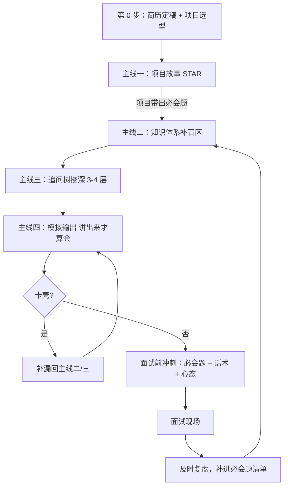

# Java 后端面试到底该怎么准备？

> 面试准备要能把原理讲清楚、把项目讲具体，并解释方案的适用条件与取舍。

## 先看岗位要求，再定准备重点

同样是 Java 后端岗位，有的团队更关注基础与编码能力，有的需要你独立负责业务模块，还有的把稳定性和性能治理放在首位。准备前先读目标岗位的职责和技术要求，再对照自己能拿出哪些真实经历或实验结果。

可以按下面几类要求安排练习：

| 岗位要求         | 准备重点                             | 可展示的证据                       |
| ---------------- | ------------------------------------ | ---------------------------------- |
| 基础与编码       | 语言、集合、算法、测试和边界处理     | 能独立完成的代码与测试，复杂度分析 |
| 业务模块开发     | 数据模型、接口、事务、缓存和协作边界 | 真实负责的功能，关键设计及验证结果 |
| 稳定性与性能治理 | 监控、排障、容量、故障恢复和性能取舍 | 日志、压测条件、指标变化和故障复盘 |
| 服务与架构设计   | 需求约束、组件选型、一致性和演进路径 | 备选方案比较、代价说明和落地边界   |

无论岗位偏哪一类，都要练好两件事：把做过的事情讲成有依据、有取舍的过程；面对"为什么不用 X、那如果出现 Y 怎么办"时，能从原理和约束继续推导。项目经验还不多时，可以用课程项目、开源贡献或小实验练习，但要如实说明背景和自己的参与范围。

> 算法和工程题的权重因团队与面试流程而异。优先核对岗位说明和招聘方告知的考察环节，再安排训练；不要仅凭公司规模或招聘类别推断哪些内容一定不考。

## 准备的四条主线

我把准备拆成四条互相咬合的主线，单独练哪一条都不够，得一起推进。

### 主线一：项目故事——把项目讲成"决策"而不是"流水账"

面试官让你介绍项目，最怕听到的是"我先做了登录，又做了订单，然后做了支付……"这种时间线流水账。他想知道的是你遇到了什么问题、做了什么技术决策、为什么这么选、最后效果如何。STAR 是个不错的脚手架：

- **Situation（情景）**：项目要解决什么问题，背景是什么；
- **Task（任务）**：你负责哪一块，角色是什么；
- **Action（行动）**：具体做了什么，用了什么技术，遇到什么坑，怎么填的；
- **Result（结果）**：成果最好量化，比如 QPS 从多少提到多少、响应时间降了多少。

落到执行上，给每个简历项目准备三样东西：一张项目卡片（背景、技术栈、你负责的模块、1-2 个难点和解决方式、可量化的成果）、一份"必会题清单"（项目用了什么技术，就把那块八股吃透，比如用了 Redis 做缓存，那 Redis 数据结构、持久化、过期策略都得会）、两版话术（1 分钟版给自我介绍用，3-5 分钟版给深挖用）。

一个反面例子：简历写"负责开发订单模块"，这种模糊描述基本等于没写。改成"用 Redis + Lua 实现了订单库存的原子扣减，压测下把超卖率从 0.3% 降到 0"——有技术、有场景、有数据，面试官才抓得住点。记住工作内容控制在 6-8 条、其中 3-4 条得有技术亮点，模糊的"负责开发"一定要换成"技术 + 场景 + 效果"。

### 主线二：知识体系——按项目和岗位定优先级

八股看着海，但按优先级一缩就那么几块。一条比较稳的顺序是：**项目用到的技术 → 简历上写"熟练"的 → MySQL + Redis → Java 基础/集合/并发 → Spring → 分布式/高并发 → JVM**。

为什么是这个顺序？因为面试官是顺着你的简历往下挖的，你项目里用的东西他一定会问，而且问得最深；其次是简历上你自己标了"熟练掌握"的，等于你自己挖的坑，必须填得上。MySQL 和 Redis 是后端面试的绝对高频区，权重不低于、甚至高于 Java 基础本身。

> 分布式、微服务、高并发和 JVM 的准备深度，要看岗位职责和简历承诺。项目里用到的分布式锁、消息队列等，需要讲清使用方式与失败边界；岗位明确要求性能治理，就要补齐 JVM、压测和排障。暂未接触的主题可以先建立基本认识，再用实验逐步补足。

八股千万别硬背成文科。最有效的学法是和实战绑定：项目要用 Redis 做缓存，你就先把 Redis 基本使用摸一遍，再去看它的八股，看完发现还能做限流、分布式锁，就在项目里实践一下，八股自然就记住了。目标是"理解 + 记关键词"，而不是一字不差背课文——那种背法既记不住、也坚持不下去，对日常开发帮助也最小。

### 主线三：追问树——每道题往下挖 3-4 层

技术面试常通过连续追问检验理解深度。一道"你们项目怎么用 Redis 的"，往下能接：为什么用 Redis 不用本地缓存 → 缓存和 DB 一致性怎么保证 → 先更新 DB 还是先删缓存 → 延迟双删有哪些局限 → 缓存击穿/穿透/雪崩怎么防 → 持久化用 RDB 还是 AOF → 为什么这么选。沿着这条线练习，能发现自己缺的是概念、边界还是实践证据。

所以准备时别只列"我会被问什么题"，而要给每道题画一棵追问树：自己假设自己是面试官，对每个答案继续问"为什么、那如果、有没有更好的方案"。把树画出来，你就知道自己真正的盲区在哪——往往不是第一层答不上，而是第三层压根没想过。

一个小技巧：分布式 ID、分布式锁、幂等这类有多种实现的技术，不要试图背下所有方案，重点记你项目用的是哪种、为什么选它、它比别的方案好在哪、缺点是什么。其余方案知道个大概能做对比就行，不然面试官一对比你答不出反而露怯。

### 主线四：模拟输出——讲出来才算会

"看会了"和"讲得出"是两回事。很多人复习时在桌前点头觉得都懂，一进面试场嘴就瓢。所以最后一条主线是强迫自己输出：对着镜子讲、用手机录音回放、找同学朋友互相 mock、或者用 AI 模拟面试官追问。能用自己的话流畅讲一遍、还能扛住两三轮追问，这题才算真正拿下。

定期还要自测，不然确实会忘。每周末把本周的题随机抽几道脱稿讲一遍，卡壳的地方记下来重点过。讲给别人听、写成博客整理，都是检测自己到底懂没懂的好办法。

## 怎么用这份知识库串起来

理清四条主线后，复习顺序我建议是"先项目，后知识，再模拟"——先花时间把项目和简历挖透，因为项目的深挖会自然带出一批必会题；再按优先级补知识盲区；最后用模拟把所有东西"讲活"。下面这张图把整条主线串起来：

这条主线对应到本知识库里，可以这样衔接：想看具体的四周复习节奏，去 [四周计划篇](/interview-preparation/interview-prep-four-week-plan.html)，它把"先项目后知识再模拟"拆到了每一周；项目故事怎么讲、STAR 怎么落地，参考后续的 STAR 与项目表达篇；追问树怎么画、高频追问路径有哪些，参考后续的追问树篇；知识体系则按本知识库的专题主线走——Java 基础、集合、并发、MySQL、Redis、Spring、分布式、JVM 各成一篇，缺哪补哪，别贪多。

## 容易踩的坑

- **盲目堆八股、追求数量**。八股是看不完的，追求"我会 1000 题"没意义。真正值钱的是项目相关的、简历标熟练的那一小圈，把它们挖到能扛追问，比泛泛过 500 题强得多。
- **只看不练、不输出**。看完点头不等于会讲。不强迫自己开口，到了现场就会"脑子有货嘴说不出"。录音、mock、给别人讲，是必须的环节，跳不过去。
- **项目讲成流水账**。把项目讲成"先做 A 再做 B 后做 C"是最大的败笔。面试官要的是决策和理由，不是时间线。每段都得有"为什么这么选、遇到什么问题、怎么解决、效果如何"。
- **简历描述超出实际经历**。每条职责和成果都应有事实依据，能说清自己的参与范围、验证方法和未解决的问题。没有做过的方案可以讨论设计思路，但不能写成已落地的经历。
- **算法完全放掉**。根据目标岗位的考察要求保留编码练习，至少能清楚表达思路、处理边界并分析复杂度。
- **不复盘、不迭代**。面完一场就忘是大忌。把答得不好的题补进必会题清单，下一场前重点过，面试本身也是最好的复习材料。

## 小结

1. 根据岗位职责、技术要求和已有能力确定准备重点，用代码、实验和真实项目支撑回答。
2. 四条主线一起推：项目故事（STAR）带出必会题 → 知识体系按项目和岗位定优先级补盲区 → 追问树每题挖 3-4 层 → 模拟输出讲出来才算会。
3. 优先级序列记一条：项目用的技术 > 简历标熟练的 > MySQL + Redis > Java 基础/集合/并发 > Spring > 分布式/高并发 > JVM，再按目标公司微调。
4. 八股别背成文科，和实战绑定、记关键词、能扛追问才合格；只看不练、项目讲成流水账是两个最常见的坑。
5. 复习顺序"先项目后知识再模拟"，每周末自测、每场面试后复盘补漏，让准备成为一个会迭代的循环。

## 参考

- 公开面试资料：《如何高效准备 Java 面试？》
- 公开面试资料：《2026 最新版 Java 后端面试通关计划》
- 公开面试资料：《2026 最新版 Java 后端面试重点总结》
