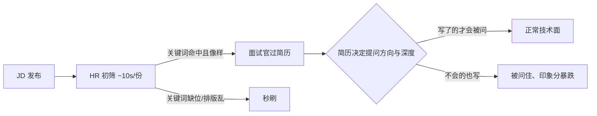

# 简历怎么写才不被秒刷？

> 简历是给筛简历的人省时间用的，不是给自己列功劳用的。先想清楚谁在看、看多久、找什么，再决定写什么、怎么写——这一篇不教排版模板，只讲筛简历逻辑反推出来的写法。

## 子问题小节

### 一份简历在别人眼里被看多久

很多人写简历是按"我把做过的事都列上"的思路写，但看简历的人根本没那个时间。同样是这份简历，在不同人手里被处理的节奏完全不同：

- **HR 初筛**：一份简历通常只有 10 秒上下。HR 多数不懂技术细节，他们做的是关键词匹配——JD 里写了 Spring Boot、Redis、消息队列，就在你简历上扫这几个词有没有出现、出现得够不够"像"。
- **面试官过简历**：你过了初筛进了面试，面试官会在面试前再翻一遍，决定**从哪里开始问、问多深**。基本规律是：你写了什么，他就大概率问什么；你标了"精通"，他就往深里挖；你标了"了解"，他就只问个概念。

把这两层连起来，能反推出几条硬规则：

一句话：**关键词要对得上 JD，会什么写什么、不会的别硬写。** 简历不是功劳簿，是一份让筛的人快速判断"这人值得花 1 小时面一面"的筛选凭据。

### 简历该分哪几块：一张表说清楚

结构本身没有太大花样，重点是每块"写什么、写多长、别犯什么错"。下面这张表把常见模块一次说清：

| 模块          | 写什么                                         | 建议篇幅        | 常见错误                         |
| ------------- | ---------------------------------------------- | --------------- | -------------------------------- |
| 基本信息      | 姓名、年龄、电话、邮箱、籍贯；可选 Github/博客 | 2~3 行          | 放生活照；博客没内容也硬挂上去   |
| 求职意向      | 目标岗位 + 期望城市                            | 1 行            | 不写或含糊，让 HR 自己猜         |
| 教育经历      | 学校、学历、专业、起止时间，倒序               | 1~2 行          | 漏毕业时间，让人算不出应届/社招  |
| 专业技能      | 按熟练度分档，和项目对得上                     | 4~6 行          | 堆词、全写"了解"、大小写不规范   |
| 工作/实习经历 | 公司、时间、职位、职责概述                     | 每段 2~3 行     | 时间正序写、只写公司名不说做了啥 |
| 项目经历      | 精选 2~3 个，STAR + 量化结果                   | 每个 6~8 条职责 | 流水账、纯业务、围绕一个技术点写 |
| 荣誉/校园     | 含金量高的奖项（ACM、天池等）                  | 可选            | 拿水奖凑数，反而稀释亮点         |
| 个人评价      | 用具体例子说特点                               | 2~3 行          | "勤奋、吃苦、踏实"这类虚词       |

篇幅上，校招别超过 2 页，社招别超过 3 页。内容多不必硬塞进一页，排版干净就行；但真有把简历写到近 10 页的，那基本是没替看的人考虑过。

### 技能怎么写：分档别堆词

技能模块最大的问题是"堆"——把听过的技术名词全列上，HR 看着像全栈，面试官一问就露。正确做法是**按熟练度分档**，而且每档都要能扛住对应深度的追问：

| 档位      | 含义                                   | 能不能扛住追问     |
| --------- | -------------------------------------- | ------------------ |
| 精通      | 读过源码、能定位深层问题、能做架构选型 | 能讲设计权衡和取舍 |
| 熟练      | 项目里独立用过、能解决常见报错         | 能讲原理和踩过的坑 |
| 熟悉/掌握 | 知道核心概念、能基本使用               | 能答基础八股       |
| 了解      | 看过文档、跑过 demo                    | 只能答一两句       |

分档之后还有两个细节容易丢分：一是**技术名词大小写要规范**，`java` 写成 `Java`、`spring boot` 写成 `Spring Boot`，这事很多面试官会盯；二是**技能要和项目里用到的对得上**，技能栏写了 RabbitMQ，项目里却一点消息队列的影子都没有，面试官会怀疑你是不是真用过。

> 资料里有一条建议是"JD 要求但你不会的技能，花几天学一下，简历上可以写自己了解"。这句要纠偏一下：**只学几天的东西最多标"了解"，而且要保证能答出基础概念**。一旦标成"熟悉"甚至"熟练"，面试官按这个深度追问，你答不上来，印象分比没写还差。简历的真实性可以适当润色，但不能把"听过"包装成"用过"。

### 项目经历：STAR + 量化 + 技术难点

项目经历是整份简历最重的部分，也是最容易被写废的部分。很多简历的项目模块要么太啰嗦地介绍"项目是做什么的"，要么几条纯业务流水账，看不出候选人到底强在哪。

项目模块的固定结构可以这样：

- **项目描述**：一两行说清项目做什么，别长篇大论介绍业务背景。
- **技术栈**：直接列技术名词（Spring Boot + MySQL + Redis + …），不要再解释每个技术是干嘛的——那是无效介绍。
- **个人职责**：6~8 条，重点写"我做了什么、解决了什么问题、带来什么改善"，这是核心。
- **项目成果（可选）**：一两句量化成绩，别铺开写。

个人职责的写法，核心是 **STAR（Situation 情景 / Task 任务 / Action 行动 / Result 结果）+ 量化结果 + 技术难点**，而且表述要具体到"技术 + 场景 + 效果"。下面是一个改前/改后对比：

**改前（流水账式）**：

> 负责订单模块开发，使用 Spring Boot 和 MySQL，完成订单的增删改查，配合前端联调上线。

这句话的问题在于：没说遇到了什么问题、用什么思路解决、效果如何，面试官只能接着问"还做了啥"，问不深也聊不出亮点。

**改后（STAR + 量化）**：

> - 负责订单核心模块，基于 Spring 状态机实现订单状态流转，覆盖待支付/已支付/已发货/已完结等 7 个状态，替代原有 if-else 硬编码，新增状态只需加枚举不再改主干逻辑。
> - 引入 RabbitMQ 延迟队列插件实现订单超时自动取消，替代原定时任务轮询方案，超时判定精度从分钟级提升到秒级，DB 轮询压力下降约 40%。
> - 针对订单列表慢查询，通过加联合索引 + 覆盖索引优化，接口 P99 从 1.8s 降到 0.3s。

改后的每一条都是"用了什么技术 + 在什么场景 + 解决了什么问题 + 量化效果"，面试官顺着任何一条都能往下深挖，而你因为这些是真做过的（或者你吃透了的），接得住。

还有两个写法上的雷区：一是**别让职责全围绕一个技术点**，比如 8 条全是"用 Redis 做了缓存"，会显得技术面太窄；二是**别全是性能优化**，适当穿插一两条协作、排查类的（比如用 MAT 分析 dump 定位线上超时、排查线程池死锁），能体现综合素质。

## 容易踩的坑

- **造假或夸大**：把别人的模块说成自己的、编造不存在的项目。面试官随便追两三个细节就穿帮，一旦确认造假基本一票否决。适当润色（把吃透的同事模块拿来写、把效果量化得更准）没问题，但编事实不行。
- **流水账 / 纯业务**：职责写成了"参与了 XX 模块开发，完成 XX 功能"，没有问题、没有技术、没有结果。面试官读不到亮点，就只能往基础八股上问。
- **与岗位 JD 不匹配**：投 Java 后端却满篇写着前端/运维内容，关键词对不上 JD，HR 初筛就被刷。投之前按 JD 把技能关键词和项目侧重点调一调。
- **一稿投所有**：同一份简历投大厂、投小厂、投不同方向。正确做法是准备一个底稿，按目标岗位微调技能顺序、项目取舍和求职意向。
- **页数失控**：校招超 2 页、社招超 3 页，近 10 页的简历基本没人有耐心看完。精炼语言，突出亮点，而不是堆字数。
- **语义模糊**：写"我在团队中扮演了很重要的角色"这种主观表述。换成"作为后端技术负责人，主导 3 人小组完成后端设计与开发"才具体。
- **格式和细节**：一定用 PDF 投递，别用 Word；技术名词大小写规范；中英文/数字之间加空格，阅读体验会好很多。这些细节很多面试官会介意。

## 小结

写简历的正确顺序是**先想筛简历的人**，再想自己：HR 10 秒扫关键词，面试官按简历定提问方向和深度，所以关键词要对得上 JD、会什么写什么不会别写。结构上分块清晰、篇幅克制（校招 ≤2 页、社招 ≤3 页）；技能按熟练度分档，和项目对得上；项目经历用 STAR + 量化 + 技术难点，职责具体到"技术 + 场景 + 效果"。最后避开造假、流水账、一稿投所有这几个最常见的坑。把简历当成一份让筛的人省时间的凭据来写，通过率会高很多。

## 参考

- 程序员简历编写指南（公开面试资料）
- 项目经验指南（公开面试资料）
