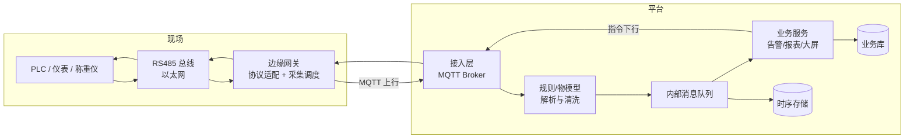
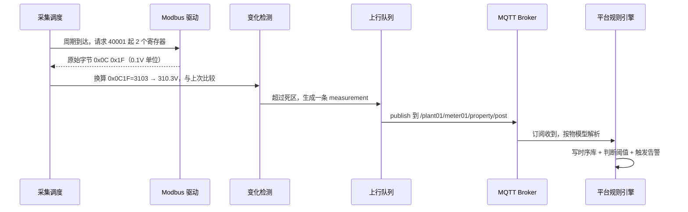

# 设备接入平台的整体链路怎么搭？

> 工业设备接入的难点不在"写个后端服务"，而在于现场那一端不可编程、网络不可靠、数据错了没人替你兜。这一篇先把整条链路的分层和职责讲清楚，后面每篇再钻一个具体协议。

## 先看一条真实链路

一条产线上有 3 台西门子 1200、8 台支持 Modbus RTU 的电表、2 台走 RS232 输出的老称重仪。客户要的东西很朴素：车间大屏看实时产量，每天早上 8 点出昨日各班组的电耗报表，某项温度超过阈值就给他发企微告警。

数据是怎么从寄存器走到报表的：

链路上一共六个位置，每一层的职责边界如果混了，后面一定出问题：

| 层       | 干什么                                 | 最容易被塞进去的错东西       |
| -------- | -------------------------------------- | ---------------------------- |
| 设备层   | PLC 程序、仪表固件                     | 指望改 PLC 程序来适配平台    |
| 总线层   | RS485 / 以太网 / 现场网关              | 把电气问题当软件问题查       |
| 边缘网关 | 协议适配、点位映射、采集调度、本地缓存 | 只做透传，把所有脏活丢给云   |
| 接入层   | 长连接、鉴权、限流、掉线感知           | 用 HTTP 轮询去扛几千台设备   |
| 平台层   | 物模型、清洗、告警、报表、指令下发     | 把采集逻辑写进业务服务       |
| 存储层   | 时序明细、业务关系数据                 | 采集明细和订单数据放同一个库 |

## 为什么工业后端和互联网后端不是一回事

同样是 Java 服务，面对的约束完全不同，这决定了架构的重心：

| 维度 | 互联网后端         | 工业设备接入                       |
| ---- | ------------------ | ---------------------------------- |
| 对端 | 自家可控的服务/App | 客户现场的 PLC，**改不了**         |
| 网络 | 内网或稳定公网     | 车间电磁干扰、无线桥接、断网是常态 |
| 数据 | 丢一次可以补偿     | 采集缺一段，报表和报警就失真       |
| 时间 | 服务器时间可信     | 设备时钟经常是错的，甚至没电重置   |
| 变更 | 随时发版           | 现场停机窗口要跟生产排期约         |
| 交付 | 上线即完成         | 现场调试、点表核对、验收、培训     |

最要命的一条是"对端改不了"。设备给你什么你就得接什么：寄存器地址对不上、波特率被锁死、只开了 102 端口没开 Modbus、应答要 800ms 才回来。所以工业后端的核心能力不是"设计一个漂亮的微服务"，而是**把现场的不确定性收敛成一个稳定的数据模型**。

## 边缘网关到底在干什么

很多方案把网关写成"串口转 TCP 的透传盒子"，结果云端要处理几百种报文格式，一出问题就得派人去现场。网关存在的意义是**把协议差异挡在现场一侧**：

1. **协议适配**：同一套采集框架下挂 Modbus RTU / Modbus TCP / S7 / OPC UA / 各家私有 ASCII 协议驱动，云端只认统一的上行格式。
2. **点位映射**：把"地址 40001、float、ABCD 字序、单位 kWh、系数 0.1"这类现场知识配置化，云端看到的是 `meter_01.active_energy`。
3. **采集调度**：按点位配置的周期轮询、按变化上报（deadband）、按事件触发，处理好总线独占和时间预算（详见 [设备数据粘包、丢包怎么兜住？](/iot/iot-frame-parsing-reliability.html)）。
4. **本地缓存与断网续传**：断网时先落本地（磁盘队列/嵌入式库），恢复后按时间序补传，并带上原始设备时间戳。
5. **边缘规则**：产线级的联动（超限就地停机、本地声光报警）不能等云端往返 200ms。

一句话概括职责划分：**网关负责"把现场变成可用的数据流"，平台负责"把数据流变成业务"**。

## 点位模型：整个系统的地基

工业项目里 80% 的返工来自点位表没设计好。一个点位至少要有这些字段：

| 字段               | 说明                                           | 常见错误                             |
| ------------------ | ---------------------------------------------- | ------------------------------------ |
| `deviceId`         | 设备唯一标识                                   | 用 IP 当 ID，换网段就全乱            |
| `pointId`          | 点位编码                                       | 用中文名做键，改字就断历史           |
| `dataType`         | bool / int16 / uint16 / int32 / float / string | 有符号无符号不分，负数全变 6 万多    |
| `address`          | 协议相关地址（寄存器、DB 偏移）                | 1 基址 0 基址混填                    |
| `byteOrder`        | ABCD / CDAB / BADC / DCBA                      | 32 位量只填一半，值恒为 0 或天文数字 |
| `scale` / `offset` | 工程值换算 `value * scale + offset`            | 把换算写死在业务代码里               |
| `unit`             | 单位                                           | 电耗混了 kWh 和 MWh                  |
| `range`            | 量程上下限                                     | 没有量程就无法判断异常值             |
| `rw`               | 只读 / 可写                                    | 把只读点位配成可写，下发指令报异常码 |
| `period`           | 采集周期                                       | 全点位 100ms，总线根本轮不过来       |
| `deadband`         | 变化死区                                       | 没有死区，稳态数据把存储写爆         |

这张表不是一个 Java 实体类那么简单，它是**设备手册、现场调试记录、平台配置、报表口径四方的共同语言**。它一旦上线，改动成本极高（历史数据对不上），所以设计时要把"未来可能加的点位"留出扩展位。

## 一个点位的数据是怎么流动的

以"读电表 A 相电压"为例，走一遍完整路径，看清楚每层各自解决什么：

注意两件事：

- **原始值、工程值、展示值要分清楚**。存储建议存工程值（统一口径）同时留原始值（便于对账），展示层再按精度格式化。
- **时间戳要打两个**：设备/网关采集时间，平台入库时间。设备时钟不可信时，业务判断用采集时间，审计用入库时间。只有一个时间戳的系统，事后排查永远说不清。

## 上行与下行不是对称的两件事

上行是"多对一"，量大但可以聚合、可以丢精度、可以延迟；下行是"一对少"，量小但**不能错、不能重、要知道结果**。这决定了它们的实现完全不同：

| 关注点   | 上行（采集）           | 下行（指令）                        |
| -------- | ---------------------- | ----------------------------------- |
| 频率     | 高（秒级/分钟级）      | 低（人工触发/规则触发）             |
| 语义     | 允许降采样、允许乱序   | 必须一次性生效                      |
| 失败处理 | 重试、补采、标记 stale | 超时确认、幂等键、状态机兜底        |
| 典型通道 | MQTT QoS0/1 批量上报   | MQTT + 请求响应主题，或独立指令通道 |
| 关键风险 | 阻塞、重复、时钟漂移   | 重复执行、执行了但没回执            |

下行最容易踩的坑是"发出去了就当成功了"。现场真实的失败模式有很多种：网关离线、PLC 在手动模式不接收、写进去了但被 PLC 程序下一秒覆盖、写成功但回执丢了。所以指令必须是一个**状态机**（已下发 → 已投递 → 已执行 → 已确认 / 超时失败），并且带幂等键，重发不会重复动作。

## 面向"设备接入平台怎么设计"这类题怎么答

面试里问这类题，别一上来就画微服务。按这个顺序讲，条理最清楚：

1. **先问场景**：几台设备、什么协议、采集频率、数据要留多久、有没有下行控制、客户是不是要多租户隔离。这些决定量级和复杂度。
2. **算量级**：设备数 × 点位 × 频率 = 每秒写入点数，再乘每条大小，得出带宽与存储。这一步能把"要不要上时序库"变成一道算术题而不是偏好题。
3. **画分层**：设备 → 网关 → 接入 → 平台 → 存储，每层说清职责边界（就是前面那张表）。
4. **说清三个硬点**：协议适配怎么做成插件、采集调度和总线独占怎么排、断网续传和幂等怎么做。
5. **收口到取舍**：为什么上行选 MQTT 而内部总线选 RocketMQ（见 [MQTT 适合什么场景、QoS 怎么选？](/iot/iot-mqtt-practice.html)）、为什么采集明细不落 MySQL（见 [采集数据该存时序库还是 MySQL？](/iot/iot-time-series-storage.html)）、为什么告警要有抑制和恢复通知。

一个能打的答法大致是：

> 按"现场适配、接入解耦、平台业务"三段切。现场用边缘网关做协议适配和点位映射，把 Modbus/S7 这些差异挡在边缘；接入层用 MQTT 长连接扛海量设备并做鉴权限流，设备数据进来先按物模型解析成统一 measurement；平台侧拆成规则引擎和业务服务，中间用 RocketMQ 削峰解耦，明细写时序库、关系数据写 MySQL。可靠性上，采集侧靠超时预算 + 失败降级 + 补采兜住丢数，上行靠"设备+点位+时间"唯一键做幂等，下行做成带幂等键的状态机。这样换协议只动网关驱动，换存储只动落库层，业务不用跟着改。

## 定制化交付：这份工作绕不开的现实

做甲方项目，"系统设计"之外还有一半工作是交付工程，这块在纯互联网背景的人身上最容易缺：

- **需求调研**：到现场看设备型号、控制柜、网络拓扑，跟电气工程师确认能开放哪些协议、有哪些是只读的。
- **点表交付**：客户给的点表通常有错（地址偏移、字序、单位），必须一个个对现场实测值核对，形成签字版本。
- **联调**：先单台单点通，再整台，再整线；每一层都要有可验证的中间结果，否则出问题无法定界。
- **验收**：数据准确率、断网恢复时间、告警到达率这类指标要提前和客户书面约定口径。
- **文档**：部署手册、点位表、接口文档、运维手册。现场换人接手是常态，文档不是形式主义。

## 容易踩的坑

- **把采集逻辑写进业务服务**：一个点位解析出错拖垮整个订单服务。
- **网关只做透传**：云端要兼容 N 种私有报文，每次新增设备都要发版。
- **不做变化死区**：稳态数据每秒一条，存储和带宽被无效数据吃掉。
- **缺数据补 0**：均值、能耗累计、报警判定全部失真，而且事后无法区分"真的是 0"和"没采到"。
- **用 IP 或串口号做设备标识**：换网段、换 USB 口，历史数据就断代。
- **只打一个时间戳**：设备时钟漂移时，报表和故障复盘永远对不上。
- **下行没有幂等和状态机**：网络抖动导致指令重复执行，现场动作两次。
- **采集明细和业务数据同库**：一次大范围聚合把在线业务拖死。
- **假设现场网络稳定**：断网续传、重连退避、本地缓存这三件不做，项目一定在验收前出事。

## 小结

- 设备接入分六层：设备、总线、边缘网关、接入、平台、存储；网关负责把现场变成可用数据流，平台负责把数据流变成业务。
- 与互联网后端最大的差别是"对端改不了"和"网络不可靠"，架构重心在收敛现场的不确定性，而不是堆微服务。
- 点位表（设备、点位、类型、地址、字序、换算、量程、读写、周期、死区）是整个系统的地基，上线后改动成本极高。
- 上行可聚合可降精度，下行必须幂等且带状态机；两者不能用同一套可靠性思路。
- 现场工程能力（点表核对、分层联调、验收口径、交付文档）和代码能力同等重要。

## 参考

本文按工业现场常见做法组织，对照 Modbus 官方规范、西门子 S7 通信的公开资料、MQTT 3.1.1 / 5.0 规范与主流 broker 文档，核对了协议适配边界、采集调度约束与上行语义；架构分层与交付实践部分综合自实际项目中的边缘网关与设备接入平台方案，并对"网关只做透传""缺失补 0""单时间戳"等常见做法做了取舍分析。
