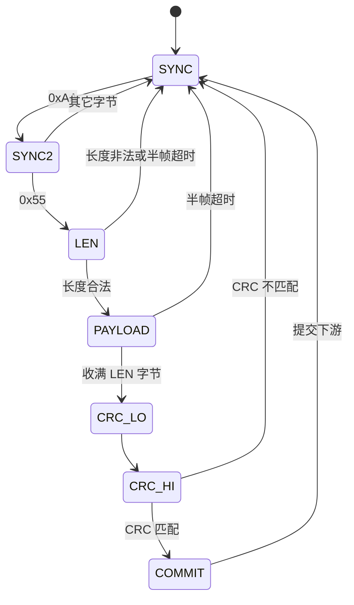
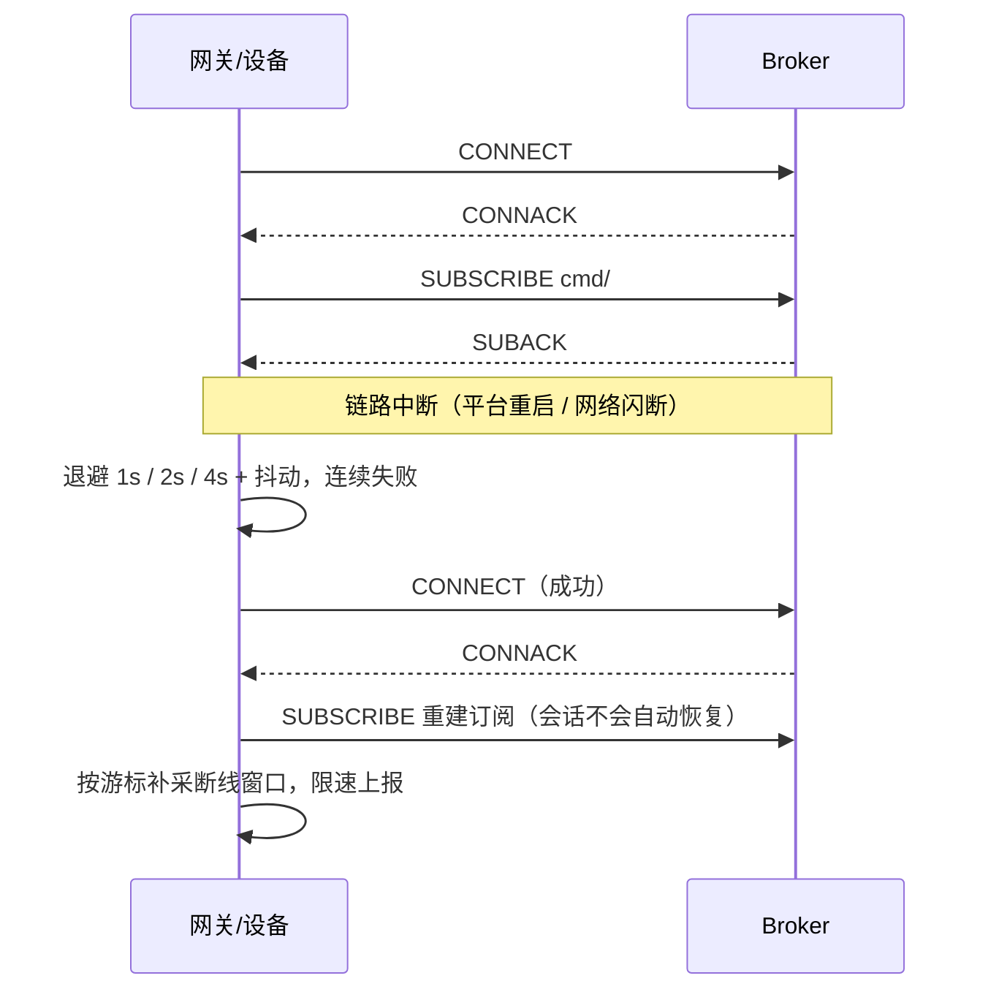

# 设备数据粘包、丢包怎么兜住？

> 现场说的「丢数据」，一半是解析器没对上帧边界，一半是采集预算根本不够，真正被干扰吃掉的反而没那么多——先分类，再谈治理。

## 为什么一次 read() 拿到的不是「一条数据」？

串口（`/dev/ttyUSB0`、`COM3`）和 TCP socket 在这点上完全一致：内核交给应用的是**字节流**，不是「消息流」，`read` 只承诺「这次给了你 n 个字节」，从不承诺「这 n 个字节正好是一帧」。边界必须由协议自己定义。Netty 那篇 [Netty 的线程模型是怎样的？为什么高性能？](/java/io/java-io-netty.html) 已经把「粘包拆包是应用层责任」讲透了，这里只谈现场设备会碰到的四种形态。

以一条 Modbus RTU 应答为例（CRC 实算）：请求 `01 03 00 00 00 02 C4 0B`，应答 `01 03 04 00 64 00 C8 BA 7A`，即「从站 1 读两个保持寄存器，值 100、200」。

| 现象       | 字节表现                                                | 根因                                                 | 治理位置      |
| ---------- | ------------------------------------------------------- | ---------------------------------------------------- | ------------- |
| 半包       | 只拿到 `01 03 04 00 64`，`00 C8 BA 7A` 还在驱动缓冲     | 字节到达与应用读取不同步，读得太早                   | 组帧缓冲      |
| 粘包       | 拿到 `…BA 7A` + `01 03 00 00 00 02 C4 0B`（下一轮请求） | 两次读之间没人取数据，内核缓冲攒了两帧               | 组帧切分      |
| 帧尾被截断 | 拿到 `01 03 04 00 64 00 C8 BA`，差末字节，CRC 必错      | RS485 半双工切向太早，发送器关断时字节还没移出去     | 驱动层 / 时序 |
| 真丢       | 一个字节都没回来；或整帧从首字节就错位                  | 从站不应答、地址冲突、总线冲突、干扰误码、本轮被跳过 | 链路 / 采集层 |

前三条不是「数据没到」，是**我们没拼对**，只有第四条要去现场查线。顺手钉死两个误解：**「一次 `read()` 等于一帧」是错的**；**「TCP 可靠所以设备数据不会丢」也是错的**——TCP 只保证它收到的字节按序、不重，上层组帧组错、超时太短把应答丢了、队列满被覆盖，都不在它的承诺内，数据丢在上层而不是传输层。半双工方向切换的具体时序问题（什么时候拉低 DE、`tcdrain` 为什么不能省）见 [RS232、RS485 和串口编程要注意什么？](/iot/iot-serial-rs232-rs485.html)。

## 「丢包」在现场混了哪几件事？

| 层次   | 现场说法         | 判断证据                                   | 典型成因                                 |
| ------ | ---------------- | ------------------------------------------ | ---------------------------------------- |
| 解析层 | 「数据丢了」     | 抓包能看到完整应答，库里没有或值错位       | 半包没拼、方向切换截断、校验后被误丢     |
| 链路层 | 「设备掉线了」   | 只有请求没有应答，或应答字节明显错乱       | 地址配错、总线冲突、终端电阻、干扰、掉电 |
| 采集层 | 「这一轮没采到」 | 日志里有 timeout/skipped，本轮点位少于配置 | 周期不够、超时太长、单设备卡死拖垮整轮   |
| 平台层 | 「平台数据不全」 | 网关本地库有记录、上报侧没有               | 上报被限流、批量写失败没重试、唯一键错   |

判据：**先看请求-应答配对日志，再看抓包**。配对日志能立刻分出「没发出去 / 发了没回 / 回了没解出来」，抓包则是唯一能证明「字节到底长什么样」的证据；两者冲突时信抓包。

## 组帧有哪几种办法，各自什么时候失效？

| 方案            | 边界怎么定                           | 适用                                 | 失效条件                                    |
| --------------- | ------------------------------------ | ------------------------------------ | ------------------------------------------- |
| 定长帧          | 每帧固定 N 字节                      | 老式仪表、固定格式私有协议           | 出现变长字段就得改协议；错一字节永久错位    |
| 分隔符帧        | 以 `\r\n`、`;` 等结尾                | ASCII 文本协议、称重仪表、条码枪     | 载荷里可能出现分隔符；二进制场景不可用      |
| 长度字段帧      | 帧头写明后续字节数                   | 自定义二进制协议、Modbus TCP（MBAP） | 长度字段被污染，必须限最大值 + 二次校验     |
| 静默间隔 + 校验 | 总线安静超 T3.5 即判帧结束，再验 CRC | Modbus RTU 等串行总线                | USB 转串口把到达间隔「压平」，T3.5 量不出来 |

必须点明的坑：**Modbus TCP 和 Modbus RTU 不能用同一套解析代码**。TCP 靠 **MBAP 的 Length 字段**，该值等于 `Unit ID + PDU` 的字节数、**不含前 6 个字节**（Transaction ID 2 + Protocol ID 2 + Length 2），范围看错一次就稳定偏移 6 字节；串口侧靠 **T3.5 静默间隔 + CRC16**，T3.5 是 3.5 个字符时间，8N1 下每字符 11 bit、9600 波特约 1.146ms，故 ≈ 4.01ms，波特率高于 19200 时规范建议固定 1.75ms。而 USB 转串口、串口服务器常把帧内帧间间隔抹平（驱动批量提交 URB），「静默 4ms」根本测不出来——这时要么让设备侧换带帧头/长度的私有协议，要么补一层「功能码 → 期望长度」的推断，把间隔判据降级为辅助判据。

## 组帧状态机怎么写才不会卡死？

原则一句话：**解析器必须能在任意字节处被中断、丢弃并重新同步，永远不停在中间状态等一个不会来的字节。**



环形缓冲 + 逐字节状态机 + 两道保险的骨架：

```java
/** 帧：AA 55 | LEN | PAYLOAD | CRC16-LO | CRC16-HI，CRC 覆盖 LEN+PAYLOAD（import java.util.function.Consumer） */
public final class FrameDecoder {
    private static final int MAX_PAYLOAD = 253;             // 长度上限：脏数据第一道闸
    private static final long HALF_FRAME_TIMEOUT_MS = 200;  // 半帧超时：第二道闸
    private enum S { SYNC, SYNC2, LEN, PAYLOAD, CRC_LO, CRC_HI }
    private final byte[] ring;              // 环形缓冲，容量固定
    private final Consumer<byte[]> sink;    // 校验通过才往下游送
    private int r, w, size, payloadLen, got, crc, crcLo;
    private byte[] payload;
    private S state = S.SYNC;
    private long frameStartMs, dropped, halfFrameDrops;

    public FrameDecoder(int cap, Consumer<byte[]> sink) { this.ring = new byte[cap]; this.sink = sink; }

    public void feed(byte[] chunk, int len, long now) {
        if (size + len > ring.length) { r = w = size = 0; state = S.SYNC; dropped++; return; }
        for (int i = 0; i < len; i++) { ring[w] = chunk[i]; w = (w + 1) % ring.length; size++; }
        if (state != S.SYNC && now - frameStartMs > HALF_FRAME_TIMEOUT_MS) { state = S.SYNC; halfFrameDrops++; }
        while (size > 0) {
            int b = ring[r] & 0xFF; r = (r + 1) % ring.length; size--;
            switch (state) {
                case SYNC: if (b == 0xAA) { state = S.SYNC2; frameStartMs = now; } break;   // 帧头起点开始计时
                case SYNC2: if (b == 0x55) state = S.LEN; else if (b != 0xAA) state = S.SYNC; break;
                case LEN:
                    if (b == 0 || b > MAX_PAYLOAD) { state = S.SYNC; dropped++; break; }
                    payloadLen = b; got = 0; payload = new byte[b]; crc = crc16(0xFFFF, b);
                    state = S.PAYLOAD; break;                    // LEN 也参与 CRC
                case PAYLOAD:
                    payload[got++] = (byte) b; crc = crc16(crc, b);
                    if (got == payloadLen) state = S.CRC_LO; break;
                case CRC_LO: crcLo = b; state = S.CRC_HI; break;
                case CRC_HI: if ((crcLo | (b << 8)) == crc) sink.accept(payload); else dropped++;
                    state = S.SYNC; break;                   // 成功失败都回找帧头
                default: state = S.SYNC;
            }
        }
    }

    private static int crc16(int c, int b) {
        c ^= b;
        for (int i = 0; i < 8; i++) c = (c & 1) != 0 ? (c >>> 1) ^ 0xA001 : c >>> 1;
        return c;
    }
}
```

两个保险各防什么：**半帧超时**——对方发半帧就掉电、线被拔，状态机会停在 `PAYLOAD` 死等，日志没报错但下游一直没有新数据；超时后强制回 `SYNC`，代价是丢半帧，收益是解析器继续活着，取值一般是 T3.5 的 20~100 倍。**缓冲区上限**——`LEN` 是外来字节，可能是 `0xFF`，按它 `new byte[255]` 死等，或不设上限地往 `ByteArrayOutputStream` 里 append，一条脏数据就能让内存和状态机一起失控；长度必须校验范围，环形缓冲容量必须固定，写满即视为噪声并清空。

## 链路是 TCP 还要自己写解析器吗？

大概率不用，用现成解码器，重点是参数别配错：

```java
// MBAP: TransactionId(2) ProtocolId(2) Length(2) UnitId(1) PDU(<=253)
// maxFrameLength = 7 + 253 = 260；长度字段在 offset 4、长 2；长度值已含 UnitId+PDU，故 adjust = 0
// initialBytesToStrip = 6：剥掉 TransactionId/ProtocolId/Length，留下 UnitId + PDU 给下游
ch.pipeline()
  .addLast(new LengthFieldBasedFrameDecoder(260, 4, 2, 0, 6))
  .addLast(new MbapValidator())        // 长度字段只保证「切得开」，不保证「是合法 MBAP」
  .addLast(new ModbusPduDecoder())
  .addLast(new DeviceInboundHandler());
```

`LengthFieldBasedFrameDecoder` 是**无条件相信长度字段**的：只要长度值落在 `maxFrameLength` 内它就切一帧，哪怕 Protocol ID 不是 0、Transaction ID 对不上本轮请求，所以后面必须跟校验 handler，否则脏数据会以「合法帧」身份一路流到业务层，比解析崩溃更难查。串口侧 Netty 有 `netty-transport-rxtx`（`RxtxChannel`）这类扩展，但原生库老旧、维护状态一般，新项目更常见用 jSerialComm 之类直接读字节再套上面的状态机——**TCP 优先用现成解码器，串口基本自研状态机**。

## 一轮采集的时间预算怎么算？

三条式子先立住：单轮理论耗时 ≈ Σ（每台设备事务数 × 单次往返耗时），**必须小于轮询周期 T**，否则采集永远追不上、队列只涨不消；超时值要大于最慢设备的正常响应（经验取典型 RTT 的 2~3 倍或手册给出的最大响应时间），**同时**满足「设备数 × 超时 ≤ T」。算例：10 台设备、每台 3 个点位、单次往返 40ms、T = 1s。

| 方案                        | 事务数 | 理论耗时              | 结论                         |
| --------------------------- | ------ | --------------------- | ---------------------------- |
| 逐点读（每点一次事务）      | 30     | 30 × 40ms = 1200ms    | 超过 T，永远滞后、越跑越积压 |
| 每台一次批量读连续寄存器    | 10     | 10 × 40ms = 400ms     | 余量 600ms，可用             |
| 批量读 + 单台超时 500ms     | 10     | 9×40 + 500 = 860ms    | 一台异常还撑得住             |
| 批量读 + 两台同时超时 500ms | 10     | 8×40 + 2×500 = 1320ms | 已超一轮，下一轮从延迟开始   |

于是就出现了那个经典现场：有人「保险起见」把超时设成 3 秒。一台设备卡住就吃掉 3 个采集周期，采集线程追不上、任务队列堆积，最后要么 OOM，要么所有点位时间戳都停在故障前、值一直不变——监控上「有数据」，实际全是 stale。**超时设得比周期还长，等于把单点故障放大成全局故障**；正确做法是超时远小于 T（200~500ms），个别设备超时就跳过，下一轮再来。

## 读能重试、写为什么不能？

标准是幂等性，不是「重试几次比较稳」。读幂等——同一个寄存器读三次值不会变三倍，所以超时重试 1~2 次合理，在干扰大的 485 总线上还能把偶发误码救回来；写通常不幂等——`写线圈 ON` 这类赋值型还好，但「累加计数」「触发一次配料」「下发启停脉冲」重试就会执行两次，得靠设备侧命令序号去重，或改成「先读状态、确认未生效再补发」。

| 连续失败次数  | 动作                                           | 质量标记 |
| ------------- | ---------------------------------------------- | -------- |
| 1             | 同一事务重试 1 次（仅读操作）                  | 暂不标   |
| 2~3           | 停止重试，本轮跳过该设备，记录原因码           | `bad`    |
| ≥ N（如 5）   | 标记 `offline`，从轮询列表摘除，进入半开探测   | `stale`  |
| 探测成功 1 次 | 恢复 `online`，先全量读确认一次，再回正常节奏  | `good`   |
| 探测持续失败  | 探测频率降到 30 秒一次，避免占用主预算，并告警 | `stale`  |

「半开探测」是这套机制的关键：离线设备彻底不管（永远发现不了恢复）和按原频率继续打（白烧预算）都不对，正确做法是每 30 秒发一个最小请求探一下，成功即恢复、失败继续等。

## 断线数据怎么补，三个时间戳怎么对？

设备侧通常自带历史缓存：PLC 有环形 DB，仪表有历史记录区，边缘网关一般落一份本地库（SQLite / 本地时序库）。断线恢复后按游标续采：网关维护 `lastSeq` / `lastTs` 游标，采集成功才推进；重连后先问设备「缓存里最老、最新的记录序号」算出缺口区间；按区间分批拉取（每批设上限），拉完切回实时轮询；补采打 `source=history` 并**限速**上报——恢复瞬间几千台一起补传，平台侧就是一次小型 DDoS。

| 时间戳       | 谁打的           | 可信度               | 正确用途                      |
| ------------ | ---------------- | -------------------- | ----------------------------- |
| `ts_device`  | 设备/PLC 自己    | 可能漂移、可能没同步 | 业务判断、趋势分析、补采游标  |
| `ts_gateway` | 网关收到应答时刻 | 网关时钟，通常已 NTP | 估算传输延迟、检测时钟漂移    |
| `ts_ingest`  | 平台入库时刻     | 服务器时钟，最准     | 审计、SLA、乱序窗口、排查延迟 |

两条规则：**用采集时间做业务判断是错的**，它反映「我们什么时候问的」而不是「数据什么时候产生的」，用 `ts_ingest` 算「昨天 14:00 的产量」，链路一抖结论就全错；**设备时间不可信时要用双时间戳**——持续比较 `ts_gateway - ts_device`，取滑动中位数当漂移估计，超过阈值（如 2 秒）打 `uncertain`，原始 `ts_device` 保留在独立字段里等对时后校正，而不是就地覆盖原值。

## 重复上报和乱序怎么处理？

去重锚点是业务唯一键，常用 `(device_id, point_id, ts_device, seq)`，用唯一索引或 upsert 兜底，重复上报只更新质量标记、不产生新行。必须落库而不是只在内存去重——网关重启、补采重拉、MQ 至少一次投递都会让同一批数据再来一遍。具体手段见 [接口幂等怎么设计？](/high-availability/high-availability-idempotency-design.html)，这里只强调：**唯一键要包含设备时间，不是入库时间**。

乱序有两种处理：写入侧允许乱序、查询侧按 `ts_device` 聚合（时序库常见做法，代价是已封窗的降采样结果遇到迟到数据会丢，窗口要留 `allowed lateness` 或触发重算）；或者写入侧维护 2×T（或 30 秒）的乱序窗口，窗内排序后写、窗外直接放行，适合下游是有状态计算（如累计量差分）。

## 数据质量怎么标，缺失能不能补 0？

**补 0 是现场最贵的「小聪明」**，它把「没有数据」伪装成「数据是 0」：丢 20 分钟补 0，日均值直接掉三分之一；温度补 0 触发低温报警，流量补 0 让停机判定误判；电表读数补 0 再涨回来，差值会算出一段负用电量。正确做法是四态质量码，缺失就如实标缺失。

| 质量码      | 含义                     | 什么时候打                                 | 下游怎么用                         |
| ----------- | ------------------------ | ------------------------------------------ | ---------------------------------- |
| `good`      | 值可信                   | 应答正常、CRC 通过、值在量程内             | 正常参与统计、报警、计费           |
| `bad`       | 有值但不可信             | CRC 失败勉强解出、超量程、设备自诊断故障位 | 可展示，禁止进均值与报警判定       |
| `stale`     | 没有新值，沿用最后已知值 | 超时、离线、本轮被跳过                     | 只能作「最后已知值」，禁止参与判定 |
| `uncertain` | 值在但来源/精度存疑      | 时钟跳变、补采回填、降采样聚合             | 标注来源后谨慎使用，报表要能区分   |

点位落库模型大致如下，关键是质量码与时间戳必须和值同存：

| 字段                       | 示例                         | 说明                                  |
| -------------------------- | ---------------------------- | ------------------------------------- |
| `device_id` / `point_id`   | `meter-07` / `p_total`       | 设备与点位标识                        |
| `ts_device` / `ts_gateway` | `2026-11-17T10:00:00.123Z`   | 设备时间与网关接收时间，统一 UTC 毫秒 |
| `value` / `unit`           | `1234.5` / `kWh`             | 数值与单位，单位必须落库              |
| `quality` / `source`       | `good` / `realtime`          | 四态质量码；实时或断点补采            |
| `seq` / `raw_hex`          | `88421` / `01 03 04 00 64 …` | 序号用于缺口检测；原始帧留证          |

## 断线重连为什么不能固定间隔？

因为设备不是一台而是几千台，而且**往往同时掉线**——平台重启、机房断网、broker 升级，故障是全局的，恢复也是全局的。若每台都「固定 10 秒重试」，平台一起来几千个连接同一秒涌入，TLS 握手、认证、订阅全挤在一起，broker 被打挂，设备再等 10 秒，形成周期性雪崩。正确做法是**指数退避 + 抖动**：

```java
/** equal jitter：一半固定一半随机，既错开峰值又不至于退避太慢 */
public long nextDelayMs() {
    long exp = Math.min(capMs, baseMs << Math.min(attempt++, 16));   // 1s,2s,4s… 封顶
    return exp / 2 + ThreadLocalRandom.current().nextLong(exp / 2 + 1);
}
public void reset() { attempt = 0; }   // 连接 + 订阅 + 首个心跳都成功才重置
```



心跳分三层，解决不同问题：TCP keepalive 由内核负责，解决对端主机消失却没人发 FIN（默认常 2 小时，必须显式调小才有意义）；应用层心跳由业务代码负责，解决进程活着但业务卡死（线程池满、DB 卡住），一般 30 秒一次最小读请求、2 次失败判离线；MQTT keepalive 是协议栈层，客户端声明间隔、服务端在 1.5 倍间隔内收包，否则断开。重连后还有三件事：重新协商能力（波特率、从站地址、点位表版本可能已变）、重新订阅（`clean session` 为真时订阅全丢）、补齐断线窗口——只重连不重建会话，表现就是「连上了但一条指令都收不到」。

## 上下游速度不匹配时缓冲怎么设？

采集是周期性的（比如每秒 30 个事务），上报常被限流（比如 200 条/秒），上游快下游慢是常态。缓冲只有一条铁律：**有界**。

```java
private final BlockingQueue<Sample> buffer = new ArrayBlockingQueue<>(50_000);
// 采集线程：不阻塞轮询；满了走降采样通道，而不是无限堆积
if (!buffer.offer(sample)) {
    downsampler.accept(sample);                 // 1 分钟窗口保留 min/max/avg/count
    metrics.counter("collector.buffer.full").increment();
}
// 上报线程：批量条数或 1s 定时，谁先满足谁触发
List<Sample> batch = new ArrayList<>(500);
buffer.drainTo(batch, 500);
reporter.report(batch);
```

队列满时做什么，是两种完全不同的动作：**丢数据**是丢最新点或随机丢，报警依赖的极值可能正好被丢掉，判据失效；**降精度**是用窗口内的 min/max/avg/count 代表 N 个点，趋势与越限判定都还在，只是分辨率低。报警模型看阈值穿越、依赖极值，趋势看均值，所以「丢数据」和「降精度」是两件事——队列满时优先降精度、保极值，真正要丢只该丢历史明细，并且必须计数打点。

## 现场排障拿什么证据？

顺序是日志 → 串口原始字节 → 抓包 → 对时。抓包机和网关时钟必须同步，毫秒级偏差就会让「先发请求还是先回数据」变成糊涂账。

```bash
# 看设备到底回了什么（先确认字节，再谈解析）
stty -F /dev/ttyUSB0 9600 cs8 -cstopb -parenb raw -echo
cat /dev/ttyUSB0 | hexdump -C

# 串口转 TCP 便于抓包
socat PTY,link=/tmp/ttyV0,raw,echo=0 TCP-LISTEN:9000,reuseaddr

tcpdump -i any -nn -s0 -w /tmp/modbus.pcap 'tcp port 502'   # Modbus TCP 默认端口 502
tshark -r /tmp/modbus.pcap -Y 'modbus' -V | head -80
```

「请求/应答配对」必须进日志，字段缺一个都会在排障时卡住：

| 字段                       | 示例                                   | 排障时回答的问题       |
| -------------------------- | -------------------------------------- | ---------------------- |
| `req_id`                   | `gw-03-000123`                         | 这条应答属于哪次请求   |
| `ts`                       | `2026-11-17T10:00:00.123Z`             | 与抓包时间对齐         |
| `device_id` / `slave_addr` | `meter-07` / `7`                       | 地址配错的第一现场     |
| `tx_hex` / `rx_hex`        | `01 03 00 00 00 02 C4 0B` / `…BA 7A`   | 组帧问题的唯一证据     |
| `rx_len`                   | `7`                                    | 与期望长度一比就是半包 |
| `state_at_fail`            | `PAYLOAD`                              | 状态机卡在哪个状态     |
| `elapsed_ms`               | `41`                                   | 时间预算是否被吃掉     |
| `result`                   | `ok / timeout / crc_err / short_frame` | 失败分类，别只记失败   |

## 容易踩的坑

- **把一次 `read()` 当成一帧**：返回值是字节数不是帧数，必须缓冲后由状态机切分。
- **CRC 通过就当数据对**：CRC 只证明这串字节没被打乱，不证明这是你要的那台设备——从站地址配错、寄存器读错，帧照样过 CRC，值却是别人家的。
- **缺失数据补 0**：均值、报警阈值、累计量全部失真，而且看起来「有数据」，比缺数据更难发现。
- **固定间隔重连**：平台重启后几千台同时回连，broker 被自己人打挂，然后周期性雪崩。
- **超时大于采集周期**：一台设备卡住吃掉好几轮，整轮雪崩，最终表现为所有点位 `stale`。
- **把串口读放在 UI 线程或单线程定时任务里同步读**：一次阻塞读就冻住界面或拖垮调度，采集必须独立线程且带超时。
- **队列无界**：下游慢一点就 OOM，或者进程被 kill 后缓冲里几万条数据全丢。
- **时间戳用服务器本地时间且不存时区**：跨时区、夏令时、报表口径全乱；统一存 UTC 毫秒，展示时再转。

## 小结

- 「丢包」分三层：解析层没拼对、链路层真没回、采集层没采到。抓包有完整应答而库里没有，问题一定在上层。
- 组帧四法：定长、分隔符、长度字段、静默间隔 + CRC。Modbus TCP 靠 MBAP 长度字段（不含前 6 字节），Modbus RTU 靠 T3.5，**不能共用一套解析代码**。
- 组帧状态机必须带两个保险：半帧超时丢弃、长度与缓冲上限；否则一条脏数据就能让解析器永久卡死。
- 预算是硬约束：`设备数 × 事务数 × 单次往返 < T`，超时值必须远小于 T。超时设 3 秒会把单点故障升级成全局雪崩。
- 可靠性靠四件事叠加：读可重试写不盲重试、指数退避加抖动重连、双时间戳与断点补采、四态质量标记（缺失不补 0）。

## 参考

综合自 Modbus Organization 的《Modbus Application Protocol Specification V1.1b3》《Modbus over Serial Line Specification and Implementation Guide V1.02》《Modbus Messaging on TCP/IP Implementation Guide V1.0b》；Netty 官方 API 文档与源码中 `LengthFieldBasedFrameDecoder`、`DelimiterBasedFrameDecoder`、`netty-transport-rxtx` 的行为定义；MQTT 3.1.1 / 5.0 规范中 keepalive 与 clean session 的语义；以及公开的 exponential backoff with jitter（full jitter / equal jitter）工程实践。核对项：

- 用 CRC16/Modbus 实算了文中两帧 `01 03 00 00 00 02 C4 0B` 与 `01 03 04 00 64 00 C8 BA 7A`，确认校验字节正确；按 MBAP 定义核对了 Length 字段覆盖 `Unit ID + PDU`、不含前 6 字节，并据此推导 `LengthFieldBasedFrameDecoder(260, 4, 2, 0, 6)` 的五个参数（260 = 7 字节 MBAP + 253 字节最大 PDU）。
- 按 8N1 每字符 11 bit 复算了 9600 波特下 T3.5 ≈ 4.01ms、高于 19200 波特固定 1.75ms 的规范建议；按 10 台 × 3 点位 × 40ms 与 T = 1s 复算了逐点读、批量读、混合超时三种情形的理论耗时与最坏耗时；对照核验了「一次 read 当一帧」「TCP 可靠所以上层不丢」「缺失补 0」「固定间隔重连」四类常见说法，均属错误归因，正文已分别给出正确表述。
