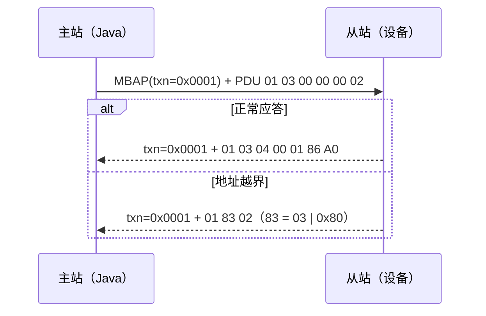
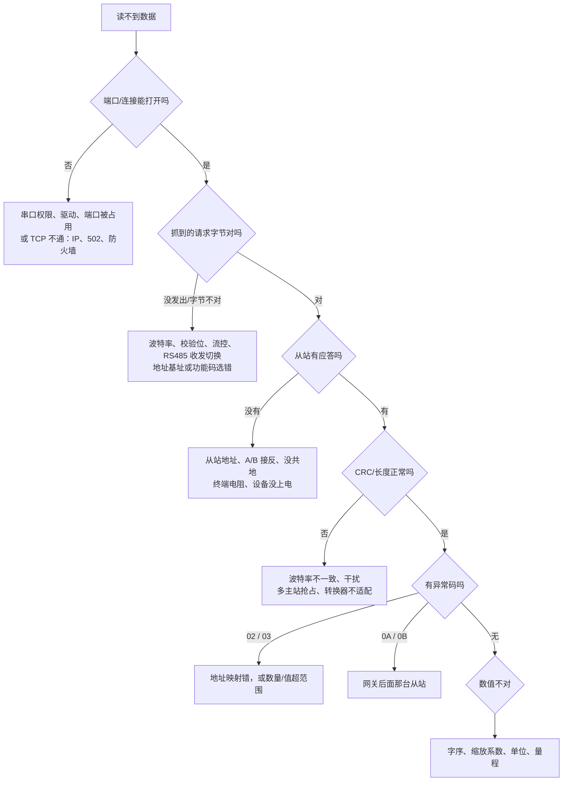

# Modbus 协议怎么读写寄存器？

> Modbus 只规定了一件事：怎么把一串字节问出去、怎么把一串字节答回来。这串字节代表温度还是频率、精度多少、多久问一次，它一个字都没写——现场八成的坑恰好都在"它没写"的那部分。

## 为什么 1979 年的协议，今天还在车间里跑？

Modbus 是 Modicon（后来的施耐德）1979 年为自家 PLC 做联网搞出来的。它能活到现在靠的不是先进，而是三件很现实的事：**公开且无授权费**（规范全文公开，做变频器、温控表、电表的厂商不用交钱就能宣称"支持 Modbus"）、**实现极简**（一问一答，没有会话、没有握手、没有描述文件，几百行 C 加一个 UART 就能当从站）、**物理层便宜**（RS485 两根双绞线，9600 波特率下挂几十台设备、跑上千米）。

所以它成了工业现场的"最大公约数"：任何一台新设备，别的不一定有，Modbus 一定有。代价也很清楚，而且这些代价在面试里比背功能码更值钱：

| 它没管的事 | 现场后果                                                                                         |
| ---------- | ------------------------------------------------------------------------------------------------ |
| 数据语义   | 40001 是温度还是频率、要不要乘 0.1，全靠设备手册；同厂不同型号都可能不一样                       |
| 安全机制   | 基础规范没有认证、没有加密，能连上 502 就能读能写（TLS 是后来的 Modbus Security 规范，端口 802） |
| 轮询策略   | 规范只说"一问一答"，谁先发、多久发一次、超时多少都在应用层，所以"Modbus 慢"多半是调度写坏了      |

还有个容易被忽略的前提：Modbus 是**单主多从、无冲突检测**。总线上谁都能当主站，两个采集程序同时跑（比如本地调试工具和平台采集服务），双方的帧会互相打断，表现为随机 CRC 错——这种故障最难查，因为两边单独跑都是好的。

## RTU、ASCII、TCP 三种形态差在哪？

同一套功能码和 PDU，套上三种不同的"信封"，就成了三个名字：

| 维度         | Modbus RTU           | Modbus ASCII             | Modbus TCP        |
| ------------ | -------------------- | ------------------------ | ----------------- |
| 编码         | 二进制               | 十六进制 ASCII 字符      | 二进制            |
| 校验         | CRC16（2 字节）      | LRC（1 字节）            | 无，靠 TCP/IP     |
| 帧边界怎么判 | 3.5 字符静默（T3.5） | `:` 开头、`\r\n` 结尾    | MBAP 里的长度字段 |
| 介质         | RS485 / RS232        | RS485 / RS232            | 以太网，端口 502  |
| 效率         | 高                   | 约一半（每字节两个字符） | 高                |
| 现场占比     | 主流                 | 少见，老设备或调试口     | 主流              |

同一个请求，RTU 是 8 个字节 `01 03 00 00 00 02 C4 0B`；ASCII 版是 17 个字符 `:010300000002FA\r\n`（`:` 起、`\r\n` 收，中间 12 个字符是报文、`FA` 是 LRC），体积翻了一倍多——这就是它效率低、只在老设备和调试口出现的原因。

**"假 TCP"是现场高频坑。** 很多 485 转以太网模块、4G DTU 工作在"透明传输"模式，把串口字节原样转到 TCP 上——线上跑的是 `01 03 00 00 00 02 C4 0B` 这种纯 RTU 帧，没有 MBAP 头，业内叫 RTU over TCP。问题是 RTU 靠 T3.5 静默判断帧结束，而 TCP 是字节流，会粘包会拆包，8 字节的应答可能分两次到达，于是只能"睡几十毫秒再读"来拼帧，负载一高就散架。正确做法是优先用设备自带的 Modbus TCP 模式；确实要 RTU over TCP，就按"功能码 + 数量算出期望长度"的状态机缓冲解析，而不是 sleep。

## 四张数据表是怎么分出来的？

Modbus 的数据模型本质是两个维度叉成的四格：**位宽**（1 bit / 16 bit）× **访问方向**（只读 / 读写），每格一张表，各有 0~65535 的地址空间：

| 数据区                       | 单位   | 访问 | 读功能码 | 写功能码               | 老式编号前缀 |
| ---------------------------- | ------ | ---- | -------- | ---------------------- | ------------ |
| 线圈 Coils                   | 1 bit  | 读写 | 01       | 05（单个）/ 15（多个） | 0xxxx        |
| 离散输入 Discrete Inputs     | 1 bit  | 只读 | 02       | 无                     | 1xxxx        |
| 输入寄存器 Input Registers   | 16 bit | 只读 | 04       | 无                     | 3xxxx        |
| 保持寄存器 Holding Registers | 16 bit | 读写 | 03       | 06 / 16 / 22 / 23      | 4xxxx        |

先掐掉一个根子上的误解：**0x / 1x / 3x / 4x 不是协议字段**，它是 Modicon 老 PLC 的编号习惯，只活在给人看的文档里。线上跑的只有"功能码 + 16 位偏移"——同一个偏移 `0x0000`，配功能码 03 是保持寄存器，配 04 就是输入寄存器。四张表在协议层面是**同一套地址空间被功能码切成四份**，每份都从 0 起，互不相通。

功能码 23（读写多个寄存器）为什么存在？因为它解决原子性：设备要"下发设定值 + 立刻读回确认"，用 06 再 03 是两次事务，中间可能被别的主站插进来；23 把两段地址放进同一个请求，从站处理时不被打断。22（掩码写）则是用 AND/OR 掩码改单个寄存器的某几位，省掉"读-改-写"三步。排障时还有个冷门好用的 43/14（Read Device Identification），能读回厂商名、型号、版本——连错设备时先用它确认对面是谁。

## 一帧报文到底长什么样？

RTU 的一帧（ADU）= 从站地址 1 字节 + PDU（1~253 字节）+ CRC 2 字节，整帧不超过 256 字节。假设现场要读 1 号从站保持寄存器 `0x0000` 起的 2 个：

```text
请求  01 03 00 00 00 02 C4 0B
      │  │  └──┬──┘ └──┬──┘ └──┬──┘
      │  │   起始地址  数量   CRC16（低字节在前！）
      │  └─ 功能码 03 = 读保持寄存器
      └─── 从站地址 1
应答  01 03 04 00 01 86 A0 C9 EB   → 寄存器值 0x0001、0x86A0（那个 04 是字节数，不是功能码）
```

**T3.5 是怎么算出来的？** 8N1 下一个字符是 11 个 bit（1 起始 + 8 数据 + 1 停止），9600 下 `11 / 9600 ≈ 1.146ms`，T3.5 = `1.146 × 3.5 ≈ 4.01ms`，T1.5 ≈ 1.72ms。规范还补了一句：波特率高于 19200 时直接用固定值 T3.5 = 1.75ms、T1.5 = 0.75ms，因为 115200 下理论值只有 0.33ms，普通定时器卡不住。这也解释了"115200 的 RTU 时好时坏"——不是协议不支持，是 USB 转 485 芯片加操作系统调度给不了毫秒级确定性。

CRC 的算法就这几行，两个细节最容易错：多项式用 `0xA001`（`0x8005` 的镜像，因为串口低位先发），**发送时低字节在前**：

```java
static int crc16(byte[] buf, int off, int len) {     // 校验范围 = 地址 + PDU，不含 CRC 自己
    int crc = 0xFFFF;
    for (int i = off; i < off + len; i++) {
        crc ^= buf[i] & 0xFF;
        for (int b = 0; b < 8; b++) crc = ((crc & 1) != 0) ? (crc >>> 1) ^ 0xA001 : crc >>> 1;
    }
    return crc;                                        // 先发低字节 crc & 0xFF，再发高字节
}
```

TCP 把信封换成 7 字节 MBAP 头，后面接原封不动的 PDU：

```text
00 01 | 00 00 | 00 06 | 01 | 03 00 00 00 02
事务ID  协议ID   长度   单元ID   PDU（读 0x0000 起 2 个）
        恒为 0   = 单元ID + PDU 的字节数（1 + 5 = 6）
```



三个字段各管一件事：**事务 ID** 是请求与应答的配对标签，串行"发一个等一个"时它几乎恒定，只有在一条连接上并发/流水线发请求才有意义——而规范没要求从站支持流水线，绝大多数设备一次只处理一个请求，所以老实串行最省事。**协议 ID** 恒为 0，是给别的协议留的位置。**单元 ID** 在纯 TCP 设备上常被忽略（有的设备会校验，填 0 或 255 还会被拒），它真正的主场是串口网关：一台 485 转 TCP 网关后面挂着 1~247 号从站，单元 ID 就是"请把这一帧转给 485 上那个地址"，网关再把应答包回来。所以"TCP 通了但读不到"经常是单元 ID 填错，那是网关在找不到下游设备。

## 40001 到底该填几？

这是头号坑。手册写"当前温度：保持寄存器 40001"，代码里的 `start` 该填什么？**大多数情况填 0**——4xxxx 是给人看的编号，`40001` 对应"保持寄存器表里第 1 个"，即偏移 `0x0000`。40001 − 40001 = 0，秘密就这一句。但这个"大多数"不是规范强制的：规范里根本没有 4xxxx，只有 0~65535 的偏移，0 基还是 1 基是**厂商和库各自的约定**。

| 代码里的 `start`         | 常见于                                                                         |
| ------------------------ | ------------------------------------------------------------------------------ |
| `40001` → `0`（0 基）    | 最通用；modbus4j、j2mod 的 start 参数直接进 PDU，PLC4X 的地址串偏移同样是 0 基 |
| `40001` → `1`（1 基）    | 部分老 DCS/SCADA 的 tag 配置，少数照抄 Modicon 文档的库                        |
| 手册直接给"寄存器 0/1/2" | 现代设备常见，手册已按 0 基给偏移                                              |
| 6 位编号 `400001`        | 地址超 9999 的设备，`400001` 同样对应偏移 0，别和 5 位的混用                   |

**走一遍现场。** 温控表手册写"温度 40001，单位 0.1℃"，设备实际水温 15.0℃：

```text
应有  01 03 00 00 00 01 84 0A          → 应答 01 03 02 00 96 38 2A，0x0096 = 150，×0.1 = 15.0℃
实发  01 03 9C 41 00 01 FA 4E          → 把 40001 当偏移填了进去（40001 = 0x9C41）
```

后者发生什么取决于设备内部实现：表里只实现 0~99 号寄存器就回 `01 83 02`（非法数据地址），报错干脆；表里高地址段放着校准系数、序列号之类，你就读到一个"看着像数字"的值（比如 `0x0000`），程序算出 0.0℃ 而实际 15.0℃——**不报错但值错了，这才是最难查的**。所以落地动作是固定的：先拿一个已知量（室温、设定值、设备面板上的数字）对一遍，对上了再怀疑别的。

另外两种"跨区"误区：一次读跨越了设备内部两个数据块（40001~40010 一块、40011 起另一块），越过中间空洞会让**整条请求**被拒（回 02），不是部分成功，所以分段读不只是性能问题；以及越界，单次读保持寄存器协议上限是 125 个（`0x7D`），设备往往只允许 100 甚至更少，超了回 03。

## 一个 float 为什么要占两个寄存器？

因为寄存器只有 16 位，float / int32 是 32 位，必须拆成两个寄存器，麻烦在于拆法不止一种。**不能配的部分**：单个寄存器内部，字节序是规范定死的大端（高字节在前）。能配的只有两件事——两个寄存器谁在前、每个寄存器内部要不要翻过来。2 × 2 = 4 种组合，就是手册里那四个词。拿 `int32 = 100000`（`0x0001 86A0`）举例：

| 组合 | 谁在前             | 第一个寄存器 | 第二个寄存器 | 别名                |
| ---- | ------------------ | ------------ | ------------ | ------------------- |
| ABCD | 高字在前，字节正序 | `0x0001`     | `0x86A0`     | big-endian，标准序  |
| CDAB | 低字在前           | `0x86A0`     | `0x0001`     | word swap，最常遇到 |
| BADC | 高字在前，字节互换 | `0x0100`     | `0xA086`     | byte swap           |
| DCBA | 低字在前，字节互换 | `0xA086`     | `0x0100`     | little-endian       |

float 同理：`23.45f` 的 IEEE754 是 `0x41BB999A`，ABCD 下是两个寄存器 `0x41BB`、`0x999A`，CDAB 下顺序反过来。同一台设备字序配错，按 ABCD 硬解会得到 `-1.59e-23`（字序反）或 `-0.00295`（字节序反）这种数值，而不是报错——所以「值不对但通得上」永远是先查字序和缩放，不是先换设备。

Java 里最稳的做法是**先归一化到 ABCD，再统一用 BIG_ENDIAN 解析**，别一边 `order(LITTLE_ENDIAN)` 一边又手工换寄存器顺序，两种手段叠加是算错数的经典来源：

```java
/** 两个 16 位寄存器 → 4 字节，统一成 ABCD 大端；无符号 32 位再 & 0xFFFFFFFFL 转 long */
static byte[] toAbcd(int r0, int r1, boolean wordSwap, boolean byteSwap) {
    int hi = wordSwap ? r1 : r0, lo = wordSwap ? r0 : r1;
    if (byteSwap) {
        hi = ((hi & 0xFF) << 8) | ((hi >>> 8) & 0xFF);
        lo = ((lo & 0xFF) << 8) | ((lo >>> 8) & 0xFF);
    }
    return new byte[]{(byte) (hi >>> 8), (byte) hi, (byte) (lo >>> 8), (byte) lo};
}

static float toFloat(int r0, int r1, boolean wordSwap, boolean byteSwap) {
    return ByteBuffer.wrap(toAbcd(r0, r1, wordSwap, byteSwap))
            .order(ByteOrder.BIG_ENDIAN).getFloat();
}
```

映射直接写进配置：`ABCD` → `false, false`；`CDAB` → `true, false`；`BADC` → `false, true`；`DCBA` → `true, true`。

## 十次读怎么合并成三次？

单次请求的协议上限（都是"最多"，设备能接受的通常更小）：

| 功能码  | 单次最大数量                                    | 说明               |
| ------- | ----------------------------------------------- | ------------------ |
| 01 / 02 | 2000 个点（`0x07D0`）                           | 位读取             |
| 03 / 04 | 125 个寄存器（`0x7D`）                          | 字读取，最常见瓶颈 |
| 15 / 16 | 1968 个线圈（`0x07B0`）/ 123 个寄存器（`0x7B`） | 批量写             |

假设要采 10 个点位，分布在 `40001~40004`、`40011~40012`、`40040~40043` 三段：最笨是一个点一次请求（10 次往返），按段合并是 3 次。那中间的空洞要不要一起读？算一下：9600 8N1 下一个寄存器 2 字节的线上时间 `2 × 11 / 9600 ≈ 2.29ms`；而一次 8 字节请求加 25 字节应答约 38ms，再叠加设备处理 10~50ms。**多读十几个无用寄存器，通常比多一次往返便宜**，所以工程上一般按"空隙 ≤ 15~20 个寄存器就合并"来定策略；波特率越高，往返越被设备处理延迟主导，合并收益反而更明显。

**重试要分开看。** 读是幂等的，超时重试没副作用；写要分两类：写绝对值（06/16 写设定值、05 写线圈）重试相对安全，同一帧重发结果一样；写"命令寄存器"（启停、点动、批次触发、累加）重试可能执行两次，这类要么只发一次靠读回状态确认，要么在协议之外做请求序号/握手。

## 从站回了个 83 是什么意思？

异常应答格式很朴素：**功能码最高位置 1**，后面跟 1 字节异常码。`03 | 0x80 = 0x83`，所以 `01 83 02 C0 F1` 就是"1 号从站拒绝了刚才那个 03 请求，原因 02（非法数据地址）"。

| 异常码 | 名称                             | 现场含义         | 先查什么                                                         |
| ------ | -------------------------------- | ---------------- | ---------------------------------------------------------------- |
| 01     | ILLEGAL FUNCTION                 | 不支持这个功能码 | 是不是把 03 发给了只有 04 的输入寄存器表；RTU/ASCII 是否配错     |
| 02     | ILLEGAL DATA ADDRESS             | 地址越界         | 地址基址算错（40001 直接填了）、超出设备实现的寄存器数、跨了空洞 |
| 03     | ILLEGAL DATA VALUE               | 数量或值不合法   | 一次读超设备上限、写入超量程、数量填 0                           |
| 04     | SERVER DEVICE FAILURE            | 从站内部执行失败 | 设备本体故障或报警，看面板                                       |
| 05     | ACKNOWLEDGE                      | 已接受，正在处理 | 长任务（配方下发），稍后再轮询结果                               |
| 06     | SERVER DEVICE BUSY               | 从站忙           | 轮询太密、上一帧还没处理完，降频或加间隔                         |
| 0A     | GATEWAY PATH UNAVAILABLE         | 网关找不到路径   | 网关后面那台从站没上电、单元 ID 填错                             |
| 0B     | GATEWAY TARGET FAILED TO RESPOND | 网关转发超时     | 485 侧物理层：断线、波特率、终端电阻、A/B 接反                   |

这张表能直接读出排障分工：**01 是"问错了方式"，02 是"问错了地方"，03 是"问错了数量"，04/06 是"设备自己不行"，0A/0B 是"网关后面那段不通"**。

一个高频实现缺陷：很多手写解析器只判"功能码 == 03"，遇到 `0x83` 当未知帧丢掉，上层看到的表现是**超时**，于是去查线查波特率，其实设备早说了地址错。正确写法先判 `(fc & 0x80) != 0` 走异常分支，把异常码原样打日志。另外异常应答本身也是合法帧、**带 CRC**，长度和正常应答不同，解析时不能按固定长度读。

## 一条 485 总线怎么排轮询节奏？

RS485 半双工、单主多从：同一时刻只有一个发送者，从站不会主动上报（少数支持 08 诊断的除外），所以"实时性"完全由轮询周期决定，和协议无关。

要求 5 秒内把所有设备刷一遍、总线上 N 台，单台预算就是 `(T − 总线余量) / N`，这个预算必须同时覆盖发请求、设备处理、收应答三段。超时必须**小于**预算，否则一台掉线设备就能吃掉整轮——这就是"设备越多越慢、慢得像指数"的真实原因。

调度上有几条经验规则：

- **超时按帧长算，别用库的默认值**。8 字节请求加 25 字节应答在 9600 下约 38ms，200~300ms 已足够宽容；默认 3s 或 5s 会把周期拖成分钟级。
- **慢设备隔离**。连续超时 K 次就降级：减少单次读的寄存器数、拉长它的间隔，而不是每轮全额等它。
- **写优先但不抢占**。待写队列优先于读队列插入，但写不能插进一个进行中的事务（半双工），只能在两次事务之间调度，并给每轮留写配额。
- **读计划事先编译**。把每台设备的点位按地址排序、分组、合并成"读计划"，轮询时直接执行，别每轮临时算地址段。

```text
loop 每 T 秒:
  设备按优先级排序，跳过退避期中的设备
  for dev in devices:
     budget = 剩余时间 / 剩余设备数
     dev 有待写 且 写配额未用完 ? 发写请求 : 发它的第一个读计划段
     等待 min(budget, dev.timeout)；异常 0A/0B/04/06 → 打降级标记，下轮加大间隔
     超时 → 连续失败 +1，达 K 次进入退避；成功则清零
  记录本轮耗时分布（后续调 T 的唯一依据）
```

## Java 这边怎么写？

先看库的定位，别一上来就自己拼字节，也别指望库替你调度：

| 方案         | 覆盖范围                                   | 串口                                        | 适合                               |
| ------------ | ------------------------------------------ | ------------------------------------------- | ---------------------------------- |
| jSerialComm  | 只做串口读写                               | 自带本地库，免装 DLL                        | 完全掌控报文拼装与帧解析           |
| RXTX         | 只做串口读写                               | 要手工放 `.so`/`.dll`，高版本 JDK 易崩      | 老项目遗留                         |
| modbus4j     | RTU/ASCII/TCP/UDP + 四张表 API             | 走 `SerialPortWrapper` 抽象，实现要自己提供 | Java 后台采集中台                  |
| j2mod        | RTU/ASCII/TCP/UDP                          | 自带串口封装，开箱可用                      | 快速接串口从站                     |
| Apache PLC4X | 多协议（Modbus / S7 / OPC UA），声明式地址 | 走驱动                                      | 要同时接西门子和 Modbus 的融合网关 |

一段能跑的最小骨架（j2mod 串口 RTU，读 1 号从站偏移 0 起的 2 个保持寄存器）：

```java
ModbusFactory factory = new ModbusFactory();
SerialParameters p = new SerialParameters();
p.setCommPortId("/dev/ttyUSB0"); p.setBaudRate(9600);
p.setDataBits(8); p.setStopBits(1); p.setParity(0);        // 0 = 无校验
p.setEncoding(Modbus.SERIAL_ENCODING_RTU); p.setEcho(false);  // 485 两线半双工，回显必须关

ModbusSerialMaster master = factory.createSerialMaster(p);
master.setTimeout(300);          // 默认值往往太长，会拖垮轮询周期
master.setRetries(0);            // 重试自己管，别让库在背后偷偷重发

try {
    int[] regs = master.readMultipleRegisters(1, 0x0000, 2);   // 从站 1，偏移 0，数量 2
    float temp = Float.intBitsToFloat((regs[0] << 16) | (regs[1] & 0xFFFF));
    System.out.printf("temp=%.2f%n", temp);
} catch (ModbusIOException e) {  // 超时 / 帧不完整：先确认真发出去了
} catch (ModbusException e) {    // 异常应答（02/03/04…），别当超时处理
}
```

TCP 场景不引库也能起步：`Socket` 发 7 字节 MBAP 加 PDU、按长度字段读回来，二十行代码。用库的价值在于四张表 API 一致、异常码映射、CRC 与串口时序已经处理好。

## 现场不通时按什么顺序查？

排障最怕想到哪查到哪。顺序应该从物理层往上，每层只回答一个问题：请求发出去了吗？从站回了吗？回的内容对吗？值对吗？



工具上：串口侧用串口监听或在转换器监听口抓，Modbus Poll 之类的调试器对点位；TCP 侧 `tcpdump -i any port 502 -X` 直接看十六进制。**先把"线上到底跑了什么字节"变成可观察的**，后面每一步才有依据。

## 容易踩的坑

1. 从站地址 0 是**广播**，只用于写（从站不回应答），拿 0 去读只会等到超时；248~255 保留，TCP 里 255 还常被网关当作"直接寻址"的约定值。
2. `40001` 直接填进 `start`，或 5 位/6 位编号混用。
3. CRC 高低字节写反：算出来是 `0x0BC4`，线上必须发 `C4 0B`；校验范围别把 CRC 自己算进去。
4. 以为 Modbus TCP 也有 CRC，又加两个字节——从站按长度字段解析，多出来的字节会被当成下一帧开头。
5. 波特率不一致：症状是**清一色 CRC 错或帧错**，不是"设备坏了"。
6. 485 不共地、两端没 120Ω 终端电阻、接成星型：短距离一切正常，线一拉长就随机出错。
7. 一次读跨了两个内部数据块，整条回 02，被误读成"设备不支持这个地址"；想写输入寄存器（3x）也一样——04 没有写功能码，3x 只能读。
8. 库的默认超时 3~5 秒，50 台设备一轮要几分钟，还以为是协议慢。
9. 指望库做重试、调度、写幂等——Modbus 里没有 QoS、没有"可靠投递"，谁这么宣传，谁是在自己封装层上加东西。
10. 只判功能码相等，把 `0x83` 异常帧当垃圾丢掉，最终表现成超时。
11. 线圈打包是 **LSB 优先**：应答第一个字节的 bit0 就是请求里的第一个线圈；按 MSB 解会把点位整段反过来。
12. 把 502 直接暴露公网：基础规范无认证无加密，等于把 PLC 的写权限交出去，要隔离或加 TLS 网关（802）。

## 小结

1. Modbus 只定义"字节怎么问、字节怎么答"；数据语义、轮询策略、安全机制全在协议之外，现场问题八成出在这三件"协议外"的事上。
2. 四张表 = 两种位宽（1 bit / 16 bit）× 两种访问（只读 / 读写），靠功能码区分，每张表各有 0~65535 地址空间；`40001` 是人看的编号，PDU 里对应 0 基偏移 `0x0000`。
3. RTU 帧 = 从站地址 + PDU + CRC16（多项式 `0xA001`，**低字节在前**），帧边界靠 T3.5 静默（9600 下约 4.0ms）；TCP 帧 = MBAP 7 字节 + PDU，**没有 CRC**，帧边界靠长度字段。
4. 32 位量占两个寄存器：寄存器内部固定大端，能配的只有"谁在前 + 是否字节互换"四种组合，选定后写进配置。
5. 485 单主半双工，实时性由调度决定：合并相邻地址、单台预算 = T/N、慢设备隔离退避、写优先但不抢占总线；排障按"请求发出 → 从站应答 → CRC/异常码 → 地址映射 → 字序 → 电气"一路往下。

## 参考

综合自 Modbus Organization 公开的三份规范：《Modbus Application Protocol Specification V1.1b3》（功能码、数据模型、异常码、125/2000 等上限）、《Modbus over Serial Line Specification and Implementation Guide V1.02》（RTU/ASCII 帧、T3.5/T1.5、高波特率固定取值、地址 0 广播与 248~255 保留）、《Modbus Messaging on TCP/IP Implementation Guide V1.0b》（MBAP 头、端口 502、事务 ID 语义），以及变频器 / 温控表 / 多功能电表一类器件手册中常见的寄存器表约定（4xxxx 编号、缩放系数、字序说明）与 j2mod / modbus4j / Apache PLC4X / jSerialComm 的公开 API 文档。核对与改写：文中每个 hex 报文的 CRC 都按 `0xFFFF` 初值、`0xA001` 多项式重算过（`01 03 00 00 00 02` 的 CRC 为 `0x0BC4`，线上顺序 `C4 0B`），T3.5 按 11 bit/字符重算（9600 → 4.01ms，19200 → 2.00ms）；严格区分了「规范强制」（功能码、异常码、寄存器内字节序、单次数量上限）与「厂商惯例」（4xxxx 编号、0/1 基址、字序组合、缩放系数），把"协议规定 40001 就是保持寄存器第一个"这类混讲纠正为"Modicon 编号习惯 + 0 基偏移"；同时纠正了三类流传较广的错误说法——Modbus TCP 需要 CRC（实际没有）、`0x83` 可当未知帧丢弃（实际是必须解析的异常应答）、库会替你重试与调度（实际只做编解码）；RTU over TCP/UDP 按现场实践定位：裸 RTU 帧走 TCP/UDP 从未进入官方规范，帧边界只能按长度推导，不能靠 T3.5 计时。
