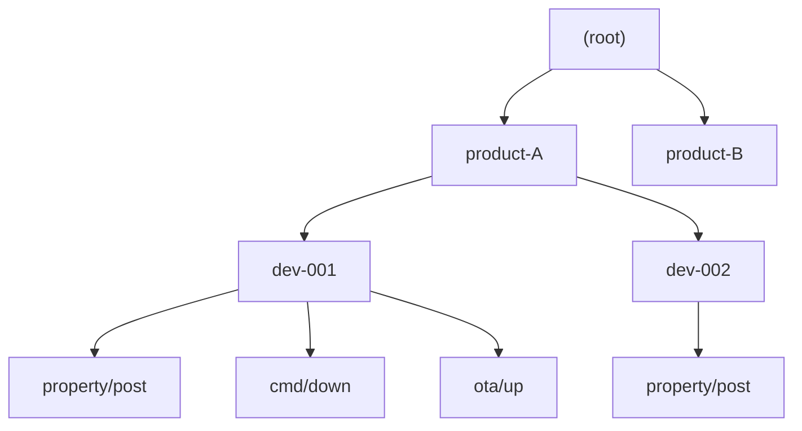
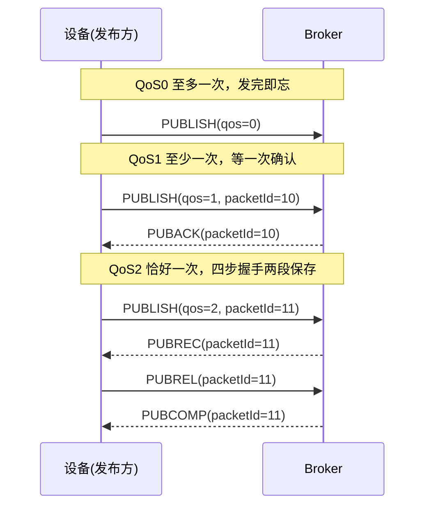
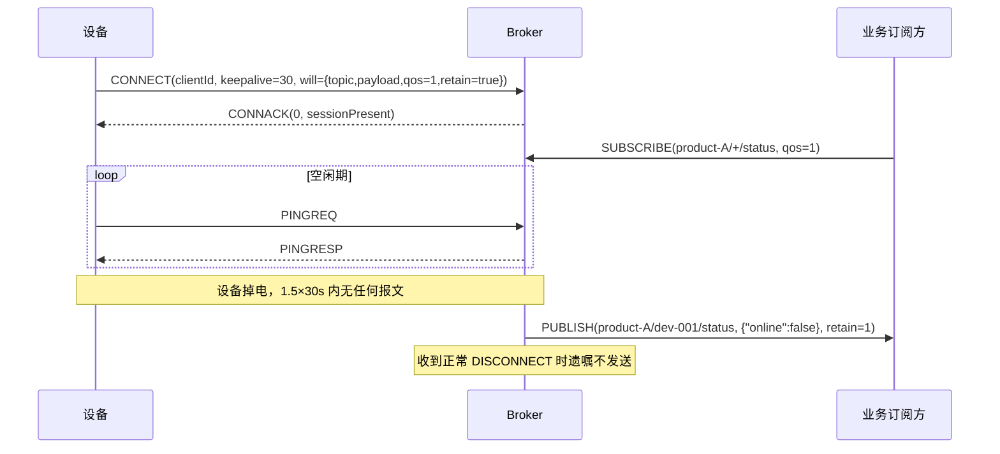

# MQTT 适合什么场景、QoS 怎么选？

> MQTT 的强项不是"传得快"，而是在弱网和百万连接下"活着还省电省流量"。把它当内部 MQ 用、把 QoS 当业务幂等用，是这类题最常见的两处跑偏。

## 先看它当年要解决什么问题

MQTT 诞生于 1999 年，最初的场景是卫星链路下的遥测：带宽以 kbps 计、链路随时断、对端可能是电池供电的传感器。这三个约束直接决定了它的形态：

- **头部极小的二进制协议**。固定头最小时只有 2 字节，剩下是变长长度字段和可选属性，没有 HTTP 那一大坨文本头。
- **长连接 + 服务端主动下推**。设备一次连上就一直挂着，平台随时能下发指令；不需要设备不停地问"有我的消息吗"。
- **协议状态机极简**。全协议只有 14 种报文类型，MCU 上用几 KB RAM 就能实现一个客户端。

拿它和另外两条常见路线比：

| 维度         | MQTT                           | HTTP 轮询                  | Kafka                             |
| ------------ | ------------------------------ | -------------------------- | --------------------------------- |
| 连接模型     | 长连接，双向                   | 每次请求建连（或复用短连） | 长连接，但客户端较重              |
| 单条消息开销 | 固定头 2 字节起                | 数百字节头部               | 批量 + 协议头，单条也不大但要攒批 |
| 下行触达     | broker 直接推给在线设备        | 只能等设备下次来问         | 无"设备"概念，要自己搭推送通道    |
| 网络假设     | 明确假设会断，有会话与重连语义 | 断了就是一次失败           | 假设 broker 之间网络稳定          |
| 堆积与回放   | 离线队列有限，不能当存储       | 无                         | 强项，按时间保留可回放            |

所以那句"MQTT 是更轻的 Kafka"是彻底的错位：**MQTT 优化的是"连接数与弱网可用性"，Kafka 优化的是"吞吐与堆积"**。两者连优化目标都不在一条轴上。

## 三个角色、一套层级：模型其实很小

MQTT 的世界里只有三样东西：

- **Broker**：所有连接的汇聚点，负责鉴权、订阅匹配、消息路由、会话与离线队列。EMQX、HiveMQ、Mosquitto、VerneMQ 都是这一类。
- **Client**：设备端和后端服务端在协议层面完全对等，谁都能既发布又订阅。
- **Topic**：消息地址，用 `/` 分层的 UTF-8 字符串，发布者只管往 topic 上写，不关心谁在听。

订阅端可以用两个通配符：

- `+` 匹配**一层**，如 `product-A/+/property/post` 能匹配 `product-A/dev-001/property/post`，但匹配不到 `product-A/dev-001/raw/property/post`。
- `#` 匹配**剩余所有层**，且必须放在末尾、前面紧跟 `/`。`product-A/#` 合法，`product-A/#/post` 非法。



按这棵树看几条订阅的实际命中范围：

| 订阅 filter                 | 命中                        | 说明                                              |
| --------------------------- | --------------------------- | ------------------------------------------------- |
| `product-A/+/property/post` | dev-001、dev-002 的属性上报 | 最常见的一类规则引擎订阅                          |
| `product-A/dev-001/#`       | 001 下全部子 topic          | 单设备调试很方便                                  |
| `product-A/#`               | A 产品下所有设备所有 topic  | 设备量一大就是 CPU 灾难                           |
| `#`                         | 除 `$SYS` 开头外的**全量**  | 3.1.1 规定 `$` 开头的系统 topic 不被根级 `#` 匹配 |

broker 内部维护的是一棵订阅树：每个节点上挂着"哪些连接订阅了以我为前缀的 filter"。一条消息进来，它按 topic 层级往下走，沿途收集匹配的会话。这套结构对**精确订阅**很便宜，但对 `#` 这种全量订阅就是**每条消息都要遍历一遍**——这也是为什么"图省事直接订阅 `#`"在小规模测试里看不出问题，设备一上万就把 broker 的 CPU 打满。

## QoS 到底保证了什么

这是本篇的核心，也是面试最容易含糊过去的地方。三种 QoS 的差别不是"丢不丢"，而是**握手轮次与 broker 侧状态的开销**。



| QoS | 语义               | 握手                                | broker 要保存什么                          | 典型代价                       |
| --- | ------------------ | ----------------------------------- | ------------------------------------------ | ------------------------------ |
| 0   | 至多一次，可能丢   | 无                                  | 什么都不存                                 | 最省，但断网瞬间的数据直接没了 |
| 1   | 至少一次，可能重复 | PUBLISH → PUBACK                    | 未确认消息（每个订阅会话各一份）           | 重传带来重复，业务必须幂等     |
| 2   | 恰好一次（单跳内） | PUBLISH → PUBREC → PUBREL → PUBCOMP | 两段状态：等 PUBREL 的报文 ID + 已投递标记 | 往返翻倍、存储翻倍、延迟更高   |

QoS2 的"两段保存"具体是：收到 PUBLISH 先落一条"这个 packetId 我收过了"，回 PUBREC；收到 PUBREL 才真正交付下游，回 PUBCOMP 并清状态。中间任何一步重传，靠 packetId 去重。**它保证的是"发布方 → broker"这一段不重复，而不是端到端不重复。**

真实链路是这样的，每一跳都有自己的语义，任意一段都能把 QoS2 的承诺破坏掉：


所以这条结论要能背下来：**QoS 只描述单跳（客户端 ↔ broker）的传输语义；端到端链路上，设备重启、broker 会话过期、桥接丢消息、规则引擎异步线程池拒绝、消费者重启，任何一处都会制造重复或丢失。业务侧的幂等键、去重表、状态机，一条都省不了。**

真实项目的选择其实很朴素：

- **遥测上报走 QoS0 或 QoS1**。高频采样点丢了下一拍就补上了，QoS1 已经够；选 QoS0 是为了省掉每条消息一次 ACK 往返。
- **下行指令走 QoS1**。指令不能丢，但"可能重复"由设备侧按 reqId 去重兜住。
- **QoS2 极少用于生产**。它把 broker 的会话存储从"一条待确认消息"扩大到"两段状态"，吞吐和内存都翻倍，而端到端该重复还是重复——花两份代价买一段单跳保证，性价比很低。3.1.1 时代很多 broker 对 QoS2 的离线队列支持还不如 QoS1 完整。

## 会话与离线消息：clean session 到底在取舍什么

MQTT 的连接是有"会话"的，会话里装两样东西：**订阅关系**和**未被确认的 QoS1/2 消息**。

- `Clean Session = 1`：每次连上来都是一张白纸，断开就删会话。订阅没了，离线期间的消息也不留。
- `Clean Session = 0`：broker 保留会话，重连时 `CONNACK` 里 `sessionPresent=1`，订阅自动恢复，离线期间积压的 QoS1/2 消息补发给你（受 broker 的 `max_queued_messages`、队列过期时间、单会话内存/磁盘配额限制）。

MQTT 5.0 把这件事拆细了：`Clean Start` 只表示"这次连接是否丢弃旧会话"，`Session Expiry Interval` 单独控制"断开后会话还能活多久"（0 表示立刻删，`0xFFFFFFFF` 表示永不过期）。这比 3.1.1 的布尔开关精确得多，也解释了一个常见困惑——"为什么我设了 clean session=0，设备离线两小时后消息还是丢了"：因为 broker 的会话过期时间或队列上限先把它清了。

| 设备类型                    | 建议                    | 理由                                       |
| --------------------------- | ----------------------- | ------------------------------------------ |
| 电池供电、只上报的传感器    | 1                       | 不留会话，省 broker 内存，丢点数据无所谓   |
| 需要接收下行指令的执行器    | 0（配合有限过期时间）   | 短暂断网期间的指令要能补上                 |
| 移动/车机这类频繁换网的终端 | 0 + 短过期（如 1 小时） | 隧道断几分钟能续上，长时间离线不值得占资源 |
| 后端服务端订阅者            | 0 + 持久 clientId       | 重启后订阅自动恢复，配合共享订阅分摊       |

这里必须泼一盆冷水：**离线队列不是可靠存储**。它通常是内存里的一段有界队列（部分 broker 可落盘，但同样有上限），内存水位一高就按策略丢弃最旧或最新的消息，broker 重启也可能清空。把"设备离线三天的数据靠 broker 队列兜住"当设计前提，一定会在真实故障里翻车——正确做法是设备端本地缓存 + 重连后按序号补传。

## Retained 消息：给"最新状态"用的，不是缓存

retained 语义很简单：发布时带 retain 标记，broker 为该 topic **保留最后一条**消息；之后任何新订阅者一订阅，立刻收到这条。它非常适合"设备当前状态"——新上线的监控页面订阅 `product-A/dev-001/status`，马上就能画出在线状态，不用干等设备下次上报。

坑也就藏在这个"持久"里：

1. **它不会自己消失**。要清除只有一招——向同一 topic 发布**空 payload 且 retain=1**。很多团队忘了这一步，设备都报废了，订阅者还在读它半年前的"在线"。
2. **订阅者可能拿到过期状态**。retained 只保证"最后一条"，不保证"新鲜"。所以 payload 里必须带设备时间戳或 monotonic 版本号，消费侧自己判"这条是不是太老了"。5.0 的 `Message Expiry Interval` 能让 broker 主动丢掉过期的 retained，3.1.1 只能应用层自己判。
3. **大 payload 会放大成本**。retained 只保留最后一条，听起来不占空间，但 broker 要为每个 topic 维护一份，且每次有新订阅者都要复制分发。把固件二进制、整包配置、图片塞进 retained，等于给 broker 的内存和出网带宽加了一个长期负担。
4. **一个 topic 只有一条 retained**。想用 retained 保存"最近 N 条"是做不到的，那是时序库的活。

## 遗嘱和 keepalive：为什么"看起来在线"其实已经掉线

TCP 连接断了 broker 当然知道；但设备**掉电、拔网线、进了信号盲区**时，链路上没有任何 FIN，broker 只看到"这个连接一直很安静"。于是协议给了两个机制：

- **keepalive**：CONNECT 时协商的心跳周期。客户端在空闲时必须至少每个周期发一次 `PINGREQ`，broker 回 `PINGRESP`；broker 在 **1.5 倍 keepalive** 内没收到任何报文，就判定连接失效并关闭它。
- **Will（遗嘱）**：CONNECT 时预先登记一条消息，broker 在"连接非正常断开"时代为发布。四个字段缺一不可：`will topic`、`will payload`、`will QoS`、`will retain`。



几个容易搞混的点：

- **触发条件是"异常断开"**：keepalive 超时、TCP 复位、broker 侧踢连接都会触发；客户端主动发 `DISCONNECT` 是正常关闭，遗嘱不发（5.0 还能在 DISCONNECT 里指定 `0x04` 让 broker 照发）。
- **它和 TCP keepalive 不是一回事**。TCP keepalive 是内核层的探活，默认两小时才发第一个探测包，参数还得改 `sysctl`；MQTT keepalive 是应用层的心跳报文，能穿过 NAT、能被 LB 看见、语义由协议定义。指望 TCP keepalive 快速发现掉线，等于指望两小时后才报警。
- **keepalive=0 表示关闭心跳**，broker 不会因空闲判定掉线——生产环境别这么干，那意味着僵尸连接永远不会被回收。

keepalive 取值是纯权衡：

| keepalive       | 掉线发现时间 | 代价                                                                 |
| --------------- | ------------ | -------------------------------------------------------------------- |
| 5s              | 约 7.5s      | 弱网抖动就重连，海量设备会形成连接风暴，流量与 CPU 都涨              |
| 30s（常见起点） | 约 45s       | 心跳流量与发现速度的平衡点，多数平台的默认                           |
| 120s            | 约 180s      | 省电省流量，但指令下发会打到"以为在线其实已死"的连接上，白等一次超时 |
| 0               | 永不         | 僵尸连接堆积，会话和内存泄漏                                         |

还有一条硬约束：**keepalive 必须小于链路上所有中间设备的 idle timeout**，否则 LB/NAT 先悄悄把连接回收了，双方都还觉得在线。

## 多实例消费：共享订阅解决了什么

单实例后端订阅 `product-A/+/property/post`，一切正常。后端扩到三个实例，如果每个实例都订阅同一个 filter，broker 会**给每个订阅者各投一份**——同一条上报被处理三次，写三次库。这是 MQTT 与"队列"最不像的地方：**它的默认语义是发布/订阅的广播，不是消费组分摊**。

解决办法是共享订阅：

```text
$share/{group}/{filter}
$share/ingest/product-A/+/property/post
```

同一个 `group` 下的多个客户端，broker 只在组内**选一个**投递（轮询、随机或按哈希，具体看 broker 实现），组与组之间仍各自收到全量。这正好对应 Kafka 的 consumer group 心智。

要讲清楚的两个边界：

- **3.1.1 里这不是标准能力**。3.1.1 规范全文没有 `$share`，这是 broker 厂商各自的扩展（EMQX、HiveMQ、Mosquitto 等都实现了，语法基本相同但负载均衡策略和是否支持 `$queue` 有差异）。
- **5.0 才把它写进规范**（共享订阅一节明确了 `$share/{ShareName}/{filter}` 的形式），但依然标注为**服务端可选实现**——不是所有 broker 都支持，跨 broker 桥接时也不一定透传。上线前必须按目标 broker 的版本文档核对，不要默认"MQTT 5 就有"。

## Topic 怎么设计才不给自己挖坑

一套能落地的命名，核心原则是**把"谁、什么方向、什么类型"编码进层级，让订阅者能用通配符精确圈范围**：

```text
{productKey}/{deviceId}/property/post      # 设备上报属性
{productKey}/{deviceId}/event/post         # 设备上报事件（告警、故障）
{productKey}/{deviceId}/cmd/down           # 平台下发指令
{productKey}/{deviceId}/cmd/reply          # 设备回指令执行结果
{productKey}/{deviceId}/ota/up             # 设备上报固件版本/进度
{productKey}/{deviceId}/status             # 在线状态（retained）
```

几个刻意的设计决定：

1. **设备 ID 放在层级里，不是塞进 payload**。ID 进了 topic，broker 就能在路由阶段完成过滤，订阅者也不用"收全量再按字段筛"。塞进 payload 意味着所有订阅者都得先解包再判断，还得为每条消息付一次无用的分发成本。
2. **方向显式写出来**（`cmd/down` 对 `property/post`），ACL 才能按前缀一条规则卡死：设备只允许 publish 自己的 `.../property/post`、`.../cmd/reply`，只允许 subscribe 自己的 `.../cmd/down`。
3. **别写前导 `/`**。`/product-A/dev-001/...` 的第一层是空字符串，和 `product-A/dev-001/...` 是两个不同的 topic，订阅 `+/+/property/post` 一条都匹配不上。这是排查"订阅成功但收不到消息"时最冤的一类原因。
4. **不要用 `#` 订阅全量做业务分流**。规则引擎按产品/设备类型订阅精确前缀，把过滤交给 broker 的订阅树，而不是让一个消费者扛全部流量再在内存里分支。

下行指令的 request/reply，两个版本的做法差别很大：

- **5.0 原生支持**：请求消息带 `Response Topic`（设备把结果发到哪）和 `Correlation Data`（回执里原样带回的二进制标识），协议层就把"这条回复对应哪条请求"说清楚了，不用猜。
- **3.1.1 只能自己约定**：payload 里放 `reqId`（UUID 或自增序号），设备回复到 `.../cmd/reply` 并带上同一个 `reqId`，平台侧用 `reqId → 等待中的 Future` 做映射，配合超时。这个约定必须写进设备接入规范，否则不同厂商的设备各回各的格式。

## 海量连接下的运维现实

协议设计得再省，落到运维还是这几个硬指标：

- **容量底座是 fd 和内存**。一条连接至少占一个 fd（TLS 还要加证书上下文等资源），`ulimit -n` 与 systemd 的 `LimitNOFILE` 必须调到远超目标连接数，百万连接就是百万级 fd，还要一起调 `somaxconn`、`tcp_max_syn_backlog`。broker 侧一条普通连接常驻内存大致在**几 KB 到几十 KB**量级，开会话队列、TLS、大 keepalive 窗口还会往上走——百万连接乘出来就是几十 GB，所以"先压测出单连接成本再算机器数"比背一个 QPS 数字有用。
- **LB 的 idle timeout**。这是线上最常见的"神秘掉线"：客户端 keepalive 是 60s，而 LB 空闲 60s 就断，两边同时判定，形成规律性的整点重连。规则是 **LB idle timeout 至少是 keepalive 的 2 倍**，或者把 keepalive 压到 LB 超时的 1/2 以下。另需确认 LB 是否支持 MQTT 的 WebSocket 承载、有没有改 `Connection` 头。
- **接入冲击与配额**。TLS 握手是 CPU 密集型的一次性开销，平台重启或证书轮换后几万台设备同时握手会直接打满 CPU，必须限速接入；客户端重连要用**指数退避 + 随机抖动**（1s、2s、4s…上限 60s，再乘 0.5~1.5），broker 侧再叠连接速率限制。单设备每秒消息数、单消息大小、单连接订阅数、会话队列长度这四类配额要在 broker 上配死，否则一台固件 bug 疯狂上报的设备就能拖垮集群。

## 安全：设备接进来之前先想清楚

- **传输层**：生产必须 TLS。单向认证（服务端证书）挡住链路窃听；双向认证（mTLS，设备持客户端证书）把"设备身份"绑到证书上，比共享密钥强，代价是证书签发与轮换要做成一整套流程。8883 走 TLS，8083/8084 走 WebSocket（浏览器和小程序侧会用到）。
- **认证**：用户名密码是最低配（每设备独立凭据，不能所有设备共用一个）；更进一步是 JWT / 平台下发的临时 token，配合 5.0 的 `Authentication Method` 做多因子。
- **ACL 按 topic 前缀隔离**：这是设备侧最有效的一道墙。`product-A/${deviceId}/#` 用变量替换，规则写成"publish 只允许 `{productKey}/{deviceId}/property/post` 和 `.../cmd/reply`，subscribe 只允许 `.../cmd/down`"。有了这条，即使某台设备的凭据泄露，它也只能污染自己的 topic，改不了别人的数据、也订阅不到别人的指令。
- **防重放**：QoS1 的重传和攻击者的重放，在协议层长得一样。做法是在 payload 里带设备时间戳 + 单调递增序号，服务端做时间窗校验（如 ±5 分钟）并记录已处理的最大序号；敏感指令再加签名（设备私钥或平台下发的会话密钥）。幂等键则兜住"窗口内重复"的部分。

## 它和 RocketMQ / Kafka 是分工，不是替代

把边界画清楚，这题就基本答完了：

```text
设备 --MQTT(接入层：长连/弱网/下行)--> Broker --规则引擎/物模型--> RocketMQ/Kafka(内部总线：堆积/回放/分区顺序)--> 消费者
```

- **接入层用 MQTT**：它的核心资产是"海量常连 + 双向 + 会话与遗嘱"，这是 Kafka 完全不解决的问题域。
- **内部解耦用 RocketMQ / Kafka**：需要堆积缓冲（下游挂了要能扛住峰值的几十分钟）、需要按 key 分区保证同一设备的消息有序、需要回放重算、需要成熟的消费组与死信治理。这些恰恰是 MQTT broker 不擅长的——它的离线队列是有界的、没有分区概念、没有 offset 回放，broker 也不是围绕磁盘顺序写和高吞吐堆积设计的。
- **别把 MQTT 当服务间总线**。见过用 MQTT 让十几个微服务互相发消息的架构，最后卡在三处：没有回放能力导致排障时无法重放、没有分区顺序导致同设备指令乱序、broker 会话内存被"业务积压"占满把设备连接挤掉。

内部总线的取舍可以对着[Kafka、RocketMQ、RabbitMQ 怎么选？](/high-performance/high-performance-mq-selection.html)看，两者是串联关系。

## Java 客户端怎么落地

Java 侧主流两个选择，差异集中在协议版本支持与 API 风格上：

| 维度     | Eclipse Paho                                               | HiveMQ Client                                       |
| -------- | ---------------------------------------------------------- | --------------------------------------------------- |
| 协议版本 | 3.1.1 与 5.0 分属不同 artifact（`mqttv3` / `mqttv5`）      | 一套 API 完整支持 3.1.1 与 5.0                      |
| API 风格 | 朴素、同步为主，`MqttClient` 是线程安全的阻塞封装          | 全异步，`CompletableFuture` 返回，回调风格统一      |
| 重连     | 需自行实现，或开 `setAutomaticReconnect` 用固定/自定义策略 | 内置指数退避重连策略，可插拔                        |
| 适合     | 设备端/资源受限、只要 3.1.1、依赖轻                        | 后端服务、要用 5.0 特性（Response Topic、会话过期） |

一段能直接用的 Paho 骨架（3.1.1，服务端订阅者视角）：

```java
MqttAsyncClient client = new MqttAsyncClient(
        "ssl://broker.example.com:8883",
        "svc-ingest-" + instanceId,      // clientId 全局唯一，重复会被 broker 踢下线
        new MemoryPersistence());

MqttConnectOptions opts = new MqttConnectOptions();
opts.setCleanSession(false);             // 保留会话，重连后订阅与离线消息还在
opts.setKeepAliveInterval(30);           // 必须小于 LB idle timeout
opts.setAutomaticReconnect(true);
opts.setUserName("svc-ingest");
opts.setPassword(token.toCharArray());
opts.setWill("platform/svc-ingest/status",
        "{\"online\":false}".getBytes(StandardCharsets.UTF_8), 1, true);

client.setCallback(new MqttCallbackExtended() {
    @Override
    public void connectComplete(boolean reconnect, String serverURI) {
        // sessionPresent=1 时 broker 已恢复订阅，这里重订阅是幂等的，建议照做，
        // 避免会话被 broker 提前清理后静默失聪
        client.subscribe("$share/ingest/product-A/+/property/post", 1);
    }

    @Override
    public void messageArrived(String topic, MqttMessage msg) {
        // 回调线程是客户端的 IO/ACK 线程，这里只做拷贝与投递，绝不同步查库或发 HTTP
        byte[] payload = msg.getPayload().clone();
        worker.execute(() -> handle(topic.split("/")[1], payload));
    }

    @Override
    public void connectionLost(Throwable cause) {
        log.warn("mqtt connection lost", cause); // 重连交给 automaticReconnect 的退避策略
    }
});

client.connect(opts).waitForCompletion(10_000);
```

几个必须写进代码规范的点：

- **订阅要在 `connectComplete` 里做**，不要在构造后 `connect()` 旁边顺手订阅一次——重连后如果会话没恢复，你就再也收不到消息了。
- **回调里不能阻塞**。QoS1 的 PUBACK 往往就在回调返回后才发出，回调堵住意味着 broker 认为你没收货而重发，inflight 窗口被占满，整条连接吞吐塌掉。控制台会看到"消息一直重复、延迟越来越大"这种很迷惑的现象。
- **QoS 按用途定**，别整条链路统一用 1：状态类 retained 用 1+retain，高频遥测 0 或 1，指令 1，没有特别理由不要上 2。

## 容易踩的坑

1. **把 QoS2 当成业务幂等**。它只保证单跳不重，链路上任何一次桥接、重试、重启都会制造重复；幂等键必须在业务侧。
2. **clean session=1 还指望指令不丢**。断开即删会话，离线期间的下行指令直接没了，设备重连后一脸茫然。
3. **retained 收到半年前的状态**。设备早已报废，没人发空 payload 清除，监控面板一直显示"在线"。
4. **clientId 重复互相踢**。同一 clientId 后连的会把先连的顶掉，表现为"设备周期性掉线"；设备端 clientId 必须带唯一后缀（如 `deviceId-sn`）。
5. **重连后订阅没恢复**。clean session=1 或会话被 broker 清理，客户端没在 `connectComplete` 重新 subscribe，从此静默失聪。
6. **在消息回调里同步查库/调 HTTP**。ACK 线程被阻塞，QoS1 消息反复重投，堆积越滚越大。
7. **拿 MQTT 传固件和图片**。几百 KB 到几 MB 的 payload 会占用 broker 内存、拉长 TLS 传输、把心跳挤掉；大文件走 HTTP 分片上传，MQTT 只传 URL 和进度。
8. **keepalive 与 LB 超时打架**。两者接近时，连接会被规律性地踢掉，重连日志一眼看不出原因。
9. **broker 磁盘/内存满了**。QoS1 的会话队列涨到上限后开始丢最旧消息，还会影响新连接的建立；`max_queued_messages` 和磁盘告警必须提前配，不要等它自然发生。

## 小结

1. MQTT 优化的是"连接数与弱网可用性"，不是吞吐与堆积；它和 Kafka/RocketMQ 是接入层与内部总线的分工关系。
2. QoS 只保证单跳（客户端 ↔ broker）语义：0 可能丢、1 可能重、2 用四步握手换单跳不重，端到端仍要靠业务幂等。
3. clean session 决定"重连后还认不认得你"：要收下行指令就用 0，只上报的传感器用 1；离线队列有上限，不能当可靠存储。
4. retained 存的是"最后一条"，不是缓存：删除要发空 payload，消费侧必须按时间戳判断新鲜度。
5. keepalive 是应用层心跳（1.5 倍判定掉线），必须小于 LB 的 idle timeout；遗嘱只在异常断开时触发，四个字段都要配。

## 参考

综合自 MQTT 3.1.1（OASIS Standard）与 MQTT 5.0 规范原文，以及 EMQX、HiveMQ、Mosquitto 等 broker 官方文档和 Eclipse Paho、HiveMQ 客户端文档整理。核对过的具体点包括：QoS 握手报文序列（PUBREC/PUBREL/PUBCOMP 与 packetId 去重的两段状态）、broker 在 1.5 倍 keepalive 内无报文判定连接失效、clean session 与 5.0 的 `Session Expiry Interval` / `Clean Start` 语义差异、retained 消息靠空 payload 清除、`+`/`#` 通配符与 `$SYS` 不被根级 `#` 匹配的规则、共享订阅 `$share/{group}/{filter}` 在 3.1.1 中缺失而在 5.0 中作为服务端可选能力被定义。仓库内参考资料对 MQTT 只有"轻量、发布订阅、适配弱网"这类概述，本文在此基础上把"可靠"收窄为单跳语义，并补齐会话、遗嘱、共享订阅与运维侧的边界。
