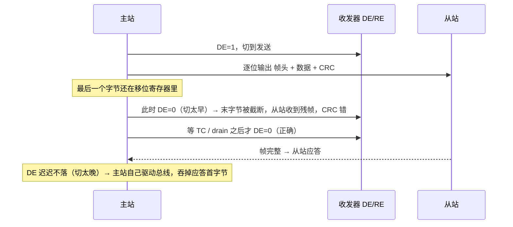

# RS232、RS485 和串口编程要注意什么？

> 串口问题里真正难的不是解析帧，而是“为什么昨天好好的今天全是 CRC 错”——答案通常在电气层、参数一致性、以及半双工那根方向线的几毫秒上。

## 先把概念摆正：串口、电气标准、应用协议

面试里答“RS485 就是一种通信协议”，从这里就已经错了。这三个词根本不在同一层：

| 层次          | 谁定义           | 管什么                                                       | 例子                           |
| ------------- | ---------------- | ------------------------------------------------------------ | ------------------------------ |
| 物理电气层    | EIA/TIA 标准     | 电压怎么表示 0/1、能拉多长、能挂多少节点、用什么连接器       | RS-232、RS-422、RS-485         |
| 字符帧层      | UART 外设 + 驱动 | 一个字节怎么排成位流：波特率、起始位、数据位、校验位、停止位 | 9600 8N1                       |
| 链路 / 应用层 | 协议规范或厂商   | 帧头、地址、功能码、CRC、谁先说话、超时重发                  | Modbus RTU、DL/T 645、自定义帧 |

对齐一下关系：

- **“串口”**是异步字符传输这件事本身（UART），跟电压标准无关；
- **“RS232 / RS485”**只规定电气特性，不规定字节含义，更不规定谁先发；
- **“Modbus RTU”**才是协议，它恰好常跑在 485 上，也能跑在 232、甚至 TCP 上。

所以 485 上能跑任意私有帧，这正是现场“厂家自定义协议”满天飞的原因。反过来，看到 RS485 就以为是 Modbus，是投产前最常见的误判。

## 232、422、485 差在哪？

| 维度     | RS-232                         | RS-422                               | RS-485                                         |
| -------- | ------------------------------ | ------------------------------------ | ---------------------------------------------- |
| 传输方式 | 单端，一根信号线对地           | 差分，A/B 成对（4 线）               | 差分，两线（可 4 线全双工）                    |
| 逻辑电平 | ±3~±15V，负电平表示逻辑 1      | 差分 ≥200mV 即判读，驱动器输出 ≥1.5V | 同 422                                         |
| 典型距离 | 约 15m@9600（受线缆电容限制）  | 1200m@≤100kbps                       | 1200m@≤100kbps                                 |
| 速率上限 | 数十 kbps 常规，短距可上 1Mbps | 10Mbps@12m 量级                      | 视收发器，短距可达数十 Mbps                    |
| 拓扑     | 点对点                         | 1 发多收（≤10 个接收器）             | 多点总线，标准 32 单位负载（1/8 负载可达 256） |
| 双工     | 全双工                         | 全双工                               | 两线半双工为主                                 |
| 共模范围 | 无，靠地线电位一致             | -7V~+7V                              | -7V~+12V                                       |
| 地线     | 必须共地                       | 建议共地                             | 建议共地，长线优先隔离                         |
| 抗干扰   | 差                             | 好                                   | 好                                             |

**差分为什么抗干扰**：A、B 两根线拧成双绞，外部干扰（变频器、接触器、动力电缆）几乎同时叠加到两根线上，接收端只取 A-B 的差值，共模部分被减掉。RS-232 用“信号线对地”的绝对电压判读，地电位一漂就直接变成误码，这就是它只能跑十几米的根本原因。

**为什么两线半双工成了现场主流**：省线（一对双绞 + 屏蔽就能挂 32 个节点）、便宜、布线简单。代价是同一时刻只能有一个设备说话，必须靠主站轮询——Modbus RTU 的“一问一答”就是被这个物理约束逼出来的形态。422 的四线全双工留给“必须双向同时传”的场合，现场很少见。

## 一个字节在线上到底长什么样？

异步串口没有时钟线，靠“起始位的下降沿”对齐，双方各凭自己的波特率计时。8N1 一帧是：`空闲(1)｜起始(0)｜D0→D7（低位先发）｜停止(1)｜空闲(1)`。

| 配置 | 每字符位数       | 9600 下耗时 | 115200 下耗时 |
| ---- | ---------------- | ----------- | ------------- |
| 8N1  | 1+8+0+1 = 10 bit | 1.042ms     | 86.8µs        |
| 8E1  | 1+8+1+1 = 11 bit | 1.146ms     | 95.5µs        |
| 7E1  | 1+7+1+1 = 10 bit | 1.042ms     | 86.8µs        |

换算很直接：`1.042ms = 10bit ÷ 9600bps × 1000`。这个数字不是学术练习，它直接决定三件事：

1. **Modbus RTU 的 T3.5 帧间隔**：≤19200bps 时按 3.5 个字符时间算，9600 下就是 `3.5 × 1.042 ≈ 3.65ms`；高于 19200 时规范建议固定用 1.75ms，因为再按字符算已经小于调度抖动。帧边界靠“静默多久”判定，所以 T3.5 是**时间**不是字节数。
2. **读超时预算**：Modbus RTU 最大 ADU 256 字节，9600 8N1 下光传完就要 `256 × 1.042 ≈ 267ms`，再加从站处理时间。所以读超时拍 100ms 必然误判超时，实际至少 500ms~1s。
3. **方向切换的保护延时**：按“字节数 × 10 ÷ 波特率”算，后面细讲。

## 波特率偏差多大就不能用？

接收端在每一位的中间采样，误差会一帧一帧累积：8N1 里最后一个采样点在 9.5 个位时间处，允许的累积偏移只有半个位宽，理论上限约 `0.5 ÷ 9.5 ≈ 5%`，工程上要留余量，双方合计控制在 **2%~3% 以内**才稳。真正的坑是“你以为设了 115200，其实发的是 125000”：

| 波特率      | 位宽   | 现场常见问题                                                                                                   |
| ----------- | ------ | -------------------------------------------------------------------------------------------------------------- |
| 9600        | 104µs  | 几乎无坑，各种时钟源都能整除                                                                                   |
| 19200       | 52µs   | 同上，工业仪表最稳的选择                                                                                       |
| 115200      | 8.68µs | MCU 用 8MHz 主频、16 倍过采样时，分频值 `8e6/(16×115200)=4.34`，取整成 4 → 实际 125kbps，误差 8.5%，直接收不了 |
| 921600 以上 | 1.09µs | 取决于 USB 转串口芯片与驱动能否跟上，线材与电平日渐吃紧                                                        |

看到“设备标注 115200 但通信死活不通、降到 9600 就正常”，先怀疑对方时钟源分频取整，而不是怀疑自己的代码。

## RS485 方向切换：切早了截断，切晚了吞应答

两线半双工意味着收发器同一时刻只能干一件事，方向由 DE（发送使能）/ RE（接收使能）控制，多数收发器把两者接成一个引脚，通常由 RTS 或某个 GPIO 驱动。



关键在“什么时候算发完”。这里有四种语义，混用就是事故：

| 说法             | 真实含义                                         | 能用来切方向吗                    |
| ---------------- | ------------------------------------------------ | --------------------------------- |
| 写函数返回       | 数据已拷进驱动/芯片缓冲                          | **不能**，可能一个 bit 都还没上线 |
| TXE / FIFO 空    | 发送保持寄存器空，最后一个字节可能仍在移位寄存器 | **不能**，差一到两个字符时间      |
| TC / `tcdrain()` | 移位寄存器也空了，最后一个停止位已发完           | 能                                |
| 库里的 `flush`   | 语义看实现：有的是 drain，有的是**丢弃缓冲**     | 必须先查文档                      |

工程上可用的三条路（注意：jSerialComm 的 `flushIOBuffers()` 底层是 `tcflush`/`PurgeComm`，语义是**丢弃收发缓冲**，而且它没暴露 `tcdrain()`，别拿它当“等发送完成”）：

1. **按位宽算保护延时**（最通用）：`延时 = 字节数 × 10 × 1000 ÷ 波特率 + 余量`，余量给 1~2 个字符时间吸收驱动和 USB 芯片的抖动。
2. **内核 RS485 模式**：Linux 有 `TIOCSRS485`，可让驱动在发完后自动释放 DE，`serial_rs485` 里还能配 `delay_before_send`/`delay_after_send`（微秒）。jSerialComm 部分平台提供 `setRs485ModeParameters(...)`，但需要收发器真的由 UART 的 RTS 控制。
3. **JNA 直调 `tcdrain(fd)`**：要精确语义时的兜底，代价是绕开库的抽象。

还有一条常被忽略：**成品 USB 转 485 转换器大多是硬件自动方向**（芯片自己检测发送结束），这时应用再去拨 RTS，等于跟硬件打架，反而切错方向。先确认手上是哪种硬件，再决定要不要软件控制方向。

## 总线电气：最容易“时好时坏”的地方

| 项目     | 现场做法                                  | 为什么                                                                               |
| -------- | ----------------------------------------- | ------------------------------------------------------------------------------------ |
| 终端电阻 | 120Ω，**只在总线物理两端**各一个          | 匹配双绞线特性阻抗，吸收末端反射；中间节点加会加重负载                               |
| 偏置电阻 | 只加一处（通常主机端），典型 390~680Ω     | 总线空闲时把 A/B 拉开到确定电平，避免接收端乱翻；要按终端和节点数核算空闲差分 >200mV |
| 屏蔽层   | 单点接地，一般在控制柜侧                  | 两端都接地会形成地环路，把干扰引进信号线                                             |
| 拓扑     | 手拉手菊花链，分支线尽量 <1m              | 星形/树形引入阻抗不连续，反射直接变误码                                              |
| 线材     | 120Ω 双绞屏蔽线，线径 0.5mm²（AWG20）以上 | 线径决定压降与衰减，非双绞则共模抑制失效                                             |
| 共地     | 三线（A/B/GND）或隔离收发器               | 485 的共模范围只有 -7~+12V，两端地电位差超了必错                                     |
| 布线     | 与动力线分开走，间距 ≥20cm，交叉成 90°    | 变频器、伺服、接触器是现场最大的干扰源                                               |

“通信时好时坏”里电气占比很高：白天产线一开就错、夜里停机就正常；换根短线就好；某个节点一上电全体掉线——这些都不是代码能修的。隔离收发器（光耦或磁隔离 + 隔离电源）在变频器附近基本是必需品，不是可选项。

## USB 转串口：能通不代表时序对

| 芯片            | 常见形态             | 驱动                                  | 现场注意                                            |
| --------------- | -------------------- | ------------------------------------- | --------------------------------------------------- |
| CH340 / CH341   | 低成本模块、开发板   | WCH 官方 `CH341SER`；部分系统需手动装 | 兼容片多，同一型号不同批次行为有差异                |
| FT232R / FT2232 | 工业级转换器、调试线 | FTDI VCP 驱动，主流系统内置           | 最稳；`latency timer` 默认 16ms，可用 FT_PROG 调小  |
| CP2102 / CP2104 | 各类小模块、ESP32 板 | 主流系统内核自带（`cp210x`）          | 稳定，成本略高                                      |
| PL2303          | 老模块、老设备随机线 | Prolific 驱动                         | 新版驱动会拒认旧/克隆片，Win8+ 上常报“已停产”类错误 |
| CH9102 / CH343  | 较新的开发板         | WCH 驱动                              | 免驱程度不如 CP2102，老系统要装                     |

关键认知：**USB 是批量传输，芯片内部还有 FIFO 和 latency timer**。你 `write()` 返回只代表数据进了芯片，“线上真的发出去”中间隔着几毫秒到十几毫秒且不确定。9600 慢速轮询察觉不到；115200 的半双工方向切换、要求毫秒级应答的协议上，这就是灾难。同一个程序换根 FT232 就好、换根 CH340 就偶发丢包，原因就在这里。

**Windows 的 COM 号会漂**：COM 号绑定在“设备实例”上，换个 USB 口就是一个新实例，可能从 COM3 变 COM7。做法是固定物理口 + 设备管理器里手动指定 COM 号，或者干脆按设备描述/PNP 路径匹配，别把 “COM3” 写进配置中心。

Linux 上认三类节点：`/dev/ttyUSB0` 是 USB 转串口桥（CH340、FT232、CP2102）；`/dev/ttyACM0` 是 USB CDC-ACM 类（Arduino Uno、部分 4G 模块）；真正的板载 UART 是 `/dev/ttyS0` 之类，可能需要 `setserial` 看 UART 类型。

`cu.*` 与 `tty.*` 这对节点其实是 **macOS/BSD** 的命名（Linux 默认没有）：`tty.*` 会等 DCD（载波检测）信号拉起来才让你读写，`cu.*`（call unit）不等，直接可用。连自己的设备应该用 `cu.*`；jSerialComm 在 macOS 上枚举出来的也是 `cu.*`。Linux 上对应的是“每次插拔都变号”，靠 `/dev/serial/by-id/` 或 udev 别名解决：

```bash
# 看设备挂在哪个节点、序列号是什么
ls -l /dev/serial/by-id/ && udevadm info -a -n /dev/ttyUSB0 | grep -E 'idVendor|idProduct|serial'

# /etc/udev/rules.d/99-plc.rules：按芯片序列号固定成 /dev/ttyPLC0
SUBSYSTEM=="tty", ATTRS{idVendor}=="0403", ATTRS{idProduct}=="6001", \
  ATTRS{serial}=="A50285BI", SYMLINK+="ttyPLC0", MODE="0660", GROUP="dialout"

sudo udevadm control --reload-rules && sudo udevadm trigger
```

```bash
stty -F /dev/ttyUSB0 9600 cs8 -cstopb -parenb -crtscts clocal raw -echo  # 注：应用打开后会覆盖
printf '01 03 00 00 00 01 84 0A' | xxd -r -p > /dev/ttyUSB0   # 发一帧
timeout 1 hexdump -C -n 64 /dev/ttyUSB0                      # 收一帧
```

权限上把用户加进 `dialout` 组（Arch 是 `uucp`），重新登录才生效。另一个高频坑：Ubuntu 22.04 起 `brltty`（盲文终端服务）会抢 CH340（`1a86:7523`），表现为设备节点出现几秒就消失、`dmesg` 里看到 `ch341-uart converter now disconnected`，处理是卸掉或屏蔽 brltty。

## Java 怎么落地：jSerialComm 打开、读、写

**JDK 为什么没有串口 API**：串口配置最终落到系统调用（POSIX 的 `termios`/`ioctl`、Windows 的 `DCB`/`PurgeComm`），纯 Java 碰不到。早年 Sun 提供过可选的 `javax.comm` 扩展包，后来停止维护；此后 JDK（含 21/22）一直没有标准串口 API。Java 22 起 FFM API 正式化，理论上可以自己写绑定，但生态里还是用成熟库更省事。

| 对比项     | jSerialComm                         | RXTX                                            |
| ---------- | ----------------------------------- | ----------------------------------------------- |
| 维护状态   | 持续维护（2.x）                     | 2010 年前后基本停更                             |
| native 库  | 打进 jar，运行时自动解压加载        | 需手动放 `.dll`/`.so`，与平台、位数、JVM 强绑定 |
| Maven 坐标 | `com.fazecast:jSerialComm`          | 无官方坐标，多为私服或本地 jar                  |
| 读写模型   | 超时模式 + 事件监听                 | 老 `javax.comm` 风格，阻塞读                    |
| 新平台     | 支持 macOS ARM、Linux aarch64       | 不支持                                          |
| RS485 辅助 | 部分平台有 `setRs485ModeParameters` | 无                                              |

枚举用 `SerialPort.getCommPorts()`（取 `getSystemPortPath()` 而不是描述串），打开时参数一项都不能少：

```java
import com.fazecast.jSerialComm.SerialPort;

public static SerialPort open(String portName) {          // "/dev/ttyPLC0" 或 "COM3"
    SerialPort port = SerialPort.getCommPort(portName);
    // 波特率、数据位、校验位、停止位：必须与设备端完全一致
    port.setComPortParameters(9600, 8, SerialPort.NO_PARITY, SerialPort.ONE_STOP_BIT);
    port.setFlowControl(SerialPort.FLOW_CONTROL_DISABLED); // 工业仪表基本不用流控
    // 读：半阻塞，至少 1 字节或超时即返回；写：阻塞
    port.setComPortTimeouts(SerialPort.TIMEOUT_READ_SEMI_BLOCKING
            | SerialPort.TIMEOUT_WRITE_BLOCKING, 300, 1000);
    if (!port.openPort()) {
        throw new IllegalStateException("open " + portName + " failed, err="
                + port.getLastErrorCode());
    }
    return port;
}
```

接收别自己起阻塞读，用事件 + 有界队列：

```java
BlockingQueue<byte[]> rxQueue = new ArrayBlockingQueue<>(1024);
AtomicLong dropped = new AtomicLong();
final CountDownLatch disconnectLatch = new CountDownLatch(1);

port.addDataListener(new SerialPortDataListener() {
    @Override
    public int getListeningEvents() {
        return SerialPort.LISTENING_EVENT_DATA_AVAILABLE
                | SerialPort.LISTENING_EVENT_PORT_DISCONNECTED;
    }
    @Override
    public void serialEvent(SerialPortEvent event) {
        if (event.getEventType() == SerialPort.LISTENING_EVENT_PORT_DISCONNECTED) {
            disconnectLatch.countDown();      // 交给重连线程处理，别在这里重开
            return;
        }
        int available = port.bytesAvailable();
        if (available <= 0) return;
        byte[] buf = new byte[available];
        int n = port.readBytes(buf, available);
        if (n > 0 && !rxQueue.offer(Arrays.copyOf(buf, n))) {
            dropped.incrementAndGet();        // 宁可丢并计数，也不要阻塞事件线程
        }
    }
});
```

发送要加锁，并且等真的发完再切方向：

```java
private final Object writeLock = new Object();
private final int baud = 9600;

void send(byte[] frame) throws InterruptedException {
    synchronized (writeLock) {                      // 一帧不能被别的线程插进来
        port.setRTS();                               // DE=1：仅"软件控制方向"的硬件需要
        int n = port.writeBytes(frame, frame.length);
        if (n != frame.length) {
            port.clearRTS();
            throw new IllegalStateException("partial write: " + n + "/" + frame.length);
        }
        Thread.sleep(sendCompleteMillis(frame.length)); // 等最后一个停止位离线上
        port.clearRTS();                             // DE=0：让出总线，准备收应答
    }
}

long sendCompleteMillis(int bytes) {                 // 8N1：1 字符 = 10 bit
    return (long) Math.ceil(bytes * 10 * 1000.0 / baud) + 2; // +2ms 吸收驱动/USB 抖动
}
```

几条规矩：

- **事件回调线程只有一个**，里面只做“搬字节”，不要写库、不要发 HTTP、不要 `put()` 阻塞队列；
- 别在 Tomcat 请求线程或主线程里阻塞读，串口慢（9600 一帧 267ms）会把线程池拖死；
- `TIMEOUT_READ_SEMI_BLOCKING` 是“有 1 字节就返回”，**不代表读满一帧**，组帧要自己做（下一篇展开）。

## 读写工程做法：超时、加锁、重连

- **读超时按最坏帧长算**：`最大帧字节数 × 每字节耗时 + 从站处理时间 + 余量`，别用拍脑袋的 100ms。
- **不要假设一次 read = 一帧**：半阻塞读随时可能返回半个帧，粘包拆包见《设备数据粘包、丢包怎么兜住？》。
- **单串口单调度线程**：这条链路上只有它允许碰这个端口，写入排队、读取回调只做搬运，天然避免了帧交错。
- **重开策略**：监听断线事件 → `closePort()` → 指数退避重开（1s、2s、4s……封顶 30s），重开前按 udev 别名或序列号重新解析端口名，别死记 `/dev/ttyUSB0`。
- **关闭要彻底**：先 `removeDataListener` 再 `closePort()`，异常路径用 `finally`。反复重开却不清监听器，回调会一层层叠加，同一个字节被消费多次——这类“重连后数据重复”的 bug 很难从日志看出来。
- **两套程序抢同一端口**：Windows 上第二个 `openPort()` 直接失败；**Linux 上不独占，两个进程都能打开，然后互相抢读同一份字节流**，现象是“随机丢字节、CRC 偶发错”。排查时先 `fuser /dev/ttyUSB0` 或 `lsof` 看一眼。

## 现场排障按什么顺序走？

顺序错了会白折腾两小时。按物理层往上爬：

1. **先确认电气层收发**：串口调试助手或总线监听工具直连，能不能看到原始字节？能看到就说明硬件、驱动、参数这一层通了，问题在上层组帧。
2. **核对双方参数是否完全一致**：波特率、数据位、校验位、停止位、流控。不是“大概一致”——`9600 8N1` 和 `9600 8E1` 差一个校验位，就是全乱码。
3. **看 hex 而不是看字符串**：全是 `0x00`、全是 `0xFF`、有规律的错位，分别指向不同问题；用文本模式看一堆问号什么也判断不了。
4. **查方向切换与共地**：偶发 CRC 错优先怀疑 DE 切早/切晚、偏置缺失、两端地电位差。
5. **换短线、换供电、查驱动与端口名**：USB hub 供电不足会表现为“接上就掉线、换主机就好”；最后才怀疑驱动、换口、看 `dmesg`。

| 现象                     | 最可能原因                                          |
| ------------------------ | --------------------------------------------------- |
| 全乱码、连字符都对不上   | 波特率不一致（含时钟分频误差）或数据位/校验位不一致 |
| 偶发 CRC 错、重发就好    | 方向切换时机、终端电阻/偏置缺失、干扰与共地         |
| 完全无响应，发出去没回音 | 接线 A/B 反了、从站地址/波特率不对、DE 没切到发送   |
| 跑一段时间后掉线         | USB 供电不足、线缆/接头氧化、驱动异常、看门狗复位   |
| 热插拔后打不开           | 端口名变了、旧进程仍占着句柄、`brltty` 抢占设备     |
| 收到自己发的帧           | A/B 短接或回环未断开，或 DE 一直没释放              |

## 容易踩的坑

- **把 485 当协议**：485 只是电气层，上面跑什么帧得另外问清楚，别答“485 协议”。
- **以为 485 是全双工**：两线 485 同一时刻只能一方说话，所有“并发下发”的设计在总线层都是排队。
- **“能通”就以为时序对**：USB 转串口的芯片缓冲 + latency timer 让时序天然不确定，慢速轮询掩盖了很多问题，一上高速就暴露。
- **`flushIOBuffers()` 当 drain 用**：它是丢弃缓冲，不是等发送完成。
- **`setComPortParameters` 少设一项**：库不会帮你猜，默认值（8N1、无流控）和设备要求不一致时，收到的就是乱码。
- **“8 位数据含校验”的说法**：8E1 是 8 数据位 **外加** 1 位校验，共 11 bit；“数据位含校验”只在 7 数据位 + 第 8 位当奇偶的私有约定里才成立。
- **用虚拟串口自测就以为没问题**：com0com / `socat` 造的对端没有真实电气层、没有方向切换、没有波特率误差，本地全绿不代表现场能跑，只验证了组帧逻辑。
- **关端口不彻底**：不 `closePort()` 就重启进程，句柄泄漏，下次打不开；Linux 上虽不报错，但旧数据还留在缓冲里。

## 小结

1. 串口是异步字符传输，RS232/422/485 是**电气标准**，Modbus RTU 才是协议——三层别混着答。
2. 232 单端 ±3~15V、约 15m、点对点；422 差分四线全双工；485 差分两线半双工、1200m 量级、32 节点（1/8 负载可到 256），现场主流是 485。
3. 8N1 每字节 10 bit，9600 下 1.042ms；Modbus T3.5 在 9600 是 3.65ms，读超时要按最大帧长算（256 字节约 267ms），别拍 100ms。
4. 半双工方向切换要等**发送完成**（TC/`tcdrain`），不是等写函数返回；切早截断末字节，切晚吞掉应答首字节，`flushIOBuffers()` 是丢弃缓冲不能替代 drain。
5. 现场排障顺序是电气层 → 参数一致性 → hex 观察 → 方向与共地 → 供电与线缆 → 驱动与端口名；“能通”不等于“时序对”。

## 参考

综合自 TIA/EIA-232-F、TIA/EIA-422-B、TIA/EIA-485-A 的电气指标（电平范围、共模范围、距离与节点数），Modbus 应用协议规范 V1.1b3 的 RTU 帧与 T3.5 定时规定，FTDI FT232R、Silicon Labs CP210x、WCH CH340/CH343、Prolific PL2303 的数据手册与驱动说明，Linux 内核 `Documentation/driver-api/serial/` 与 `termios(3)`、`tcdrain(3)` 手册页，以及 jSerialComm 官方 API 文档与 RXTX 项目归档说明。核对过的点：位宽与字符时间换算、T3.5 随波特率的分段规则、jSerialComm 的超时模式与事件语义（`flushIOBuffers` 为丢弃而非 drain）、`cu.*`/`tty.*` 的 DCD 差异与 udev 固定设备名的写法、以及 brltty 抢占 CH340 的实际表现。
