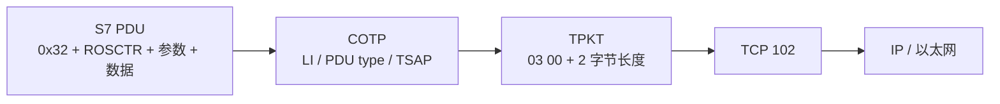
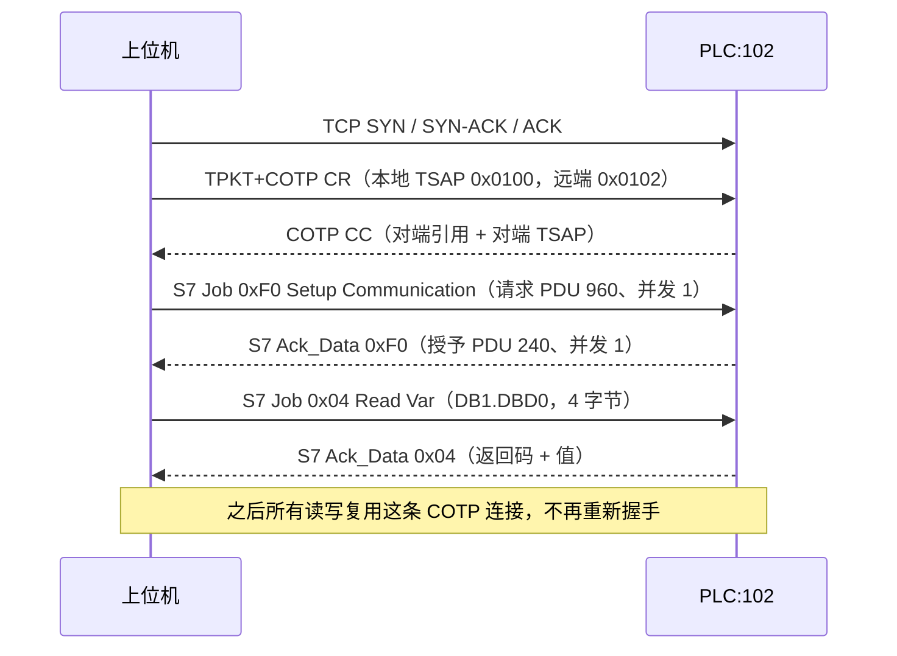

# S7 协议怎么和西门子 PLC 通信？

> S7 不是"Modbus 换个端口"。它是有会话、有能力协商、有类型化地址的私有协议；把分层、PDU 预算和 DB 布局这三件事讲清，第三方读取才谈得上可控。

## 为什么已经有 Modbus 了还要单开一篇讲 S7？

国内产线的 PLC 存量大头是西门子：S7-200 SMART、S7-300、S7-400 还在跑，新线上 S7-1200/1500 也常见。很多现场谈集成时会直接说"Modbus 没开，你连西门子协议吧"——不是技术偏好，而是程序在别人手里、PLC 侧根本没配 Modbus 服务端。这时上位机要么走 S7，要么走 OPC UA（还要看 CPU 支不支持、有没有授权）。

麻烦在于 S7 没有公开规范：字段语义是从抓包、逆向和开源实现里一点点攒出来的，网上流传的解密笔记互相复制，错误也跟着传染。所以这篇不讲"功能码大全"，只讲四件事——层层嵌套的报文各自负责什么、连接怎么一步步建起来、地址参数怎么编码、1200/1500 上"知道 DB 号却读不到"的根因在哪。

先纠正一个定位。Modbus TCP 是无状态的一问一答：请求里带事务号，服务端按功能码去读写扁平寄存器表，多个请求可以并发在路上。S7 是**面向连接的会话型协议**：先建 COTP 连接占住一个连接资源，再协商双方能接受的 PDU 大小和并发 Job 数，之后所有读写都在这个会话里按 PDU 排队。这个差别直接引出后面所有工程问题——连接数、批读上限、重连策略。

| 维度     | Modbus TCP            | S7                                           |
| -------- | --------------------- | -------------------------------------------- |
| 会话     | 无，请求彼此独立      | 有，先建 COTP 连接才能发业务 PDU             |
| 寻址     | 功能码 + 扁平寄存器号 | 区域 + DB 号 + 字节/位偏移，可一次打包多点位 |
| 能力协商 | 没有                  | Setup Communication 协商 PDU 长度与并发 Job  |
| 数据类型 | 调用方自己解释字节    | 请求里显式带 transport size                  |
| 资料     | 公开规范              | 厂商私有，靠逆向与开源实现沉淀               |
| 失败粒度 | 整包异常码            | 每 item 一个返回码，可部分成功               |

## 这套协议为什么套了三层壳？

要理解分层，得回到历史。西门子的工业以太网最早跑在 OSI 栈上：物理/链路以上是 ISO 8473（CLNP）网络层、ISO 8073（COTP）传输层，S7 应用层压在最上面。后来全行业换 TCP/IP，西门子没有重写应用层，而是按 RFC 1006 在 TCP 上**仿真** ISO 传输层服务（ISO-on-TCP）。结果是今天看到的套娃：

- **TPKT**（RFC 1006）只干一件事：给字节流分帧。TCP 是流，没有消息边界，TPKT 头里的 2 字节长度把一条 PDU 框出来。
- **COTP**（ISO 8073 class 0）负责连接建立（CR/CC）、断开（DR）、数据传输（DT），并用 TSAP 做寻址。TSAP 就是"PLC 里哪个连接端点"，等价于给机架槽位起了个地址。
- **S7 PDU** 才是业务：读、写、协商、诊断。

代价很实在：多两轮握手、长度字段重复（TPKT 有总长，COTP 有 LI，S7 里还有参数长度和数据长度，改一个字段就得同步改三处）、TSAP 要按机架槽位算。好处是抓包时能一眼定位问题出在哪一层。

顺带纠正一个流传很广的说法：**102 不是"S7 专用端口"**，它是 RFC 1006 分配给 ISO-on-TCP 的端口，任何跑 ISO-on-TCP 的协议都可以用。S7 只是恰好跑在上面，所以端口固定、不可配置。



各层的关键字段：

| 层   | 关键字段                        | 取值/说明                                                |
| ---- | ------------------------------- | -------------------------------------------------------- |
| TPKT | version、reserved、length       | `03 00`，长度含 4 字节头                                 |
| COTP | LI、PDU type、src/dst ref、TSAP | CR=`0xE0`、CC=`0xD0`、DT=`0xF0`、DR=`0x80`               |
| S7   | Protocol ID                     | 固定 `0x32`                                              |
| S7   | ROSCTR                          | `0x01` Job、`0x02` Ack、`0x03` Ack_Data、`0x07` Userdata |

S7 头本身是定长的 10 字节（Job）或 12 字节（Ack_Data 多两个字节的 error class/code）：

| 偏移 | 字段               | 长度 | 说明                            |
| ---- | ------------------ | ---- | ------------------------------- |
| 0    | Protocol ID        | 1    | 恒为 `0x32`                     |
| 1    | ROSCTR             | 1    | Job / Ack / Ack_Data / Userdata |
| 2    | Redundancy ID      | 2    | 一般 `00 00`                    |
| 4    | PDU reference      | 2    | 请求响应用它配对                |
| 6    | Parameter length   | 2    | 参数区字节数                    |
| 8    | Data length        | 2    | 数据区字节数                    |
| 10   | Error class / code | 2    | 仅 Ack_Data，`00 00` 表示无错   |

Userdata（`0x07`）走的是另一套参数格式，用来读 SZL 诊断、做时间同步这类拿不到 DB 的事，第三方库通常只实现其中最常用的几个功能组。

## 连接是怎么一步步建起来的？

一条 S7 连接要过三关：TCP、COTP、S7 Setup Communication。任何一关失败，现象都是"连不上"，但原因完全不同，所以抓包时一定要看停在哪一层。



第二关的 COTP CR 是排障重灾区。TSAP 的编码规则是：高字节表示连接类型（`0x01` 是 PG/OP 连接，部分设备用 `0x03` 表示基础 S7 连接），低字节是 **rack × 32 + slot**，也就是 `(rack << 5) | slot`。

| 目标 CPU            | rack | slot | 远端 TSAP |
| ------------------- | ---- | ---- | --------- |
| S7-300（典型）      | 0    | 2    | `01 02`   |
| S7-400（典型）      | 0    | 3    | `01 03`   |
| S7-1200 / 1500      | 0    | 1    | `01 01`   |
| 扩展机架 1 上的 CPU | 1    | 3    | `01 23`   |

一张真实的 CR 报文（22 字节）：

```text
03 00 00 16                      # TPKT：版本 3，总长 0x16 = 22
11 e0 00 00 00 01 00             # COTP：LI=0x11, CR(0xE0), dst-ref, src-ref, class 0
c1 02 01 00                      # 参数 src-TSAP = 0x0100（本地上位机）
c2 02 01 02                      # 参数 dst-TSAP = 0x0102 → rack 0 / slot 2
c0 01 0a                         # 参数 TPDU size 代码 0x0a = 1024 字节
```

如果抓包看到 CR 发出去了、对端只回一个 DR 或干脆不回，就是 TSAP（或者 rack/slot）算错了，别去怀疑 PDU 长度。反过来说，**CC 回来了就说明会话层已经通了**，后面再报错都是 S7 层或 PLC 组态的事。

第三关是 Setup Communication（功能码 `0xF0`），参数 8 字节：`F0 00` + MaxAmQCaller + MaxAmQCallee + PDU 长度。请求与应答：

```text
# 请求：客户端想要 960 字节 PDU、并发 1
03 00 00 19 02 f0 80
32 01 00 00 00 01 00 08 00 00
f0 00 00 01 00 01 03 c0

# 应答：CPU 只给 240 字节 PDU、并发 1
03 00 00 1b 02 f0 80
32 03 00 00 00 01 00 08 00 00 00 00
f0 00 00 01 00 01 00 f0
```

注意应答里 `00 f0` = 240。**这个协商结果是后面所有批量读取的天花板**，客户端单方面想要 960 没用，以 PLC 给的为准。

| CPU 系列 | 常见协商 PDU            | 单点位最大数据量 |
| -------- | ----------------------- | ---------------- |
| S7-300   | 240                     | ≈ 222 B          |
| S7-400   | 480                     | ≈ 462 B          |
| S7-1200  | 240（受型号与固件限制） | ≈ 222 B          |
| S7-1500  | 960                     | ≈ 942 B          |

常见误解：把 240 当成"一次能读 240 字节数据"。240 是**整包上限**，要扣掉 12 字节 S7 头、2 字节读参数、每个数据项 4 字节头。单点位可用数据是 `PDU − 18`；一次打包 n 个点位时，可用数据降到 `PDU − 14 − 16n` 左右（每个点位在请求参数区占 12 字节、响应数据区占 4 字节头）。240 的 CPU 一次读 4 个分散点位，实际只剩 160 多字节可用，这就是"明明只读了几个浮点数却报长度错"的来源。

## 读一个 DB1.DBD0 到底发了什么？

S7 的地址不是"寄存器号"，而是一个四元组加两个长度字段。核心编码在 Read Var（`0x04`）/ Write Var（`0x05`）的 item 里，语法固定 12 字节：

| 字段                   | 示例       | 说明                                                                                                                                        |
| ---------------------- | ---------- | ------------------------------------------------------------------------------------------------------------------------------------------- |
| Variable specification | `12`       | 固定值                                                                                                                                      |
| 后续地址长度           | `0a`       | 固定 10 字节                                                                                                                                |
| Syntax ID              | `10`       | S7ANY，表示绝对地址                                                                                                                         |
| transport size         | `02`       | `01`=BIT、`02`=BYTE、`03`=CHAR、`04`=WORD、`05`=INT、`06`=DWORD、`07`=DINT、`08`=REAL、`09`=DATE、`0B`=TIME、`0E`=DT、`0F`=DTL、`13`=STRING |
| 元素个数               | `00 04`    | BIT 时表示位数，其余表示元素个数                                                                                                            |
| DB 号                  | `00 01`    | 仅 DB 区域有效，其他区域填 0                                                                                                                |
| 区域                   | `84`       | `81`=输入(I)、`82`=输出(Q)、`83`=位存储(M)、`84`=DB、`1C`=计数器、`1D`=定时器                                                               |
| 位地址                 | `00 00 00` | 24 位按位编址：`byte_offset × 8 + bit`                                                                                                      |

"读 DB1.DBD0 的 4 个字节"完整请求（31 字节）：

```text
03 00 00 1f 02 f0 80              # TPKT 总长 31；COTP DT，EOT 置位
32 01 00 00 00 01 00 0e 00 00     # S7 Job：参数 14 字节，数据 0 字节
04 01                             # Read Var，1 个 item
12 0a 10 02 00 04 00 01 84 00 00 00
```

响应长这样（29 字节）：

```text
03 00 00 1d 02 f0 80
32 03 00 00 00 01 00 02 00 08 00 00   # Ack_Data：参数 2，数据 8，error 0
04 01
ff 04 00 20 00 00 00 2a               # 返回码 FF；数据项类型 04；长度 32 位；值 42
```

几个必须记牢的细节：

- **返回码 `FF` 才是成功**。`0x05` 是地址越界、`0x0A` 是对象不存在，出现在数据项里而不是包头里——所以多 item 读会出现"部分成功"，解析时要逐项判断。
- **长度字段是位**。数据项 transport size 为 `04`（BYTE/WORD/DWORD 一类）时，长度按位算，`00 20` = 32 位 = 4 字节。
- **大端**。DBD0 = 42 在线上就是 `00 00 00 2a`；REAL 也是大端 IEEE754，Java 侧用 `ByteBuffer.order(BIG_ENDIAN)` 或 `DataInputStream` 直接读，别顺手 `Integer.reverseBytes`。
- **STRING 有 2 字节头**：最大长度、当前长度，后面才是字符。
- 写请求的数据区里，**最后一个 item 只带 3 字节头不带值**，这是历史遗留，库通常替你补齐；自己拼包时漏了它，报文长度就会对不上。

## 为什么 1200/1500 上"知道 DB 号"也读不到？

这是第三方对接最高频的翻车点，也最容易被误判成"协议不支持"。

S7-1200/1500 新建 DB 时默认勾选 **Optimized block access（优化的块访问）**：变量按类型重新布局、按对齐规则打包，只保证符号名可访问，**不承诺任何稳定的绝对偏移**。而这个偏移恰恰是 S7ANY 绝对地址语法唯一认的东西。于是第三方库按 `DB1.DBD0` 去读，得到的可能是别的变量、可能是填充字节，也可能直接报 `0x810A`。

还有一道闸门常被忽略：TIA 里 CPU 属性 → 防护与安全 → **"允许来自远程伙伴的 PUT/GET 通信访问"**，新版软件默认不勾。不勾的时候 TCP 通、COTP 也 CC 成功、Setup Communication 也正常，就是读 DB 被拒（`0xD241` 一类）。很多人卡在这一步，因为前面全绿灯。

三条出路，按工程成本排序：

| 方案       | 操作                                                   | 代价                                                                  |
| ---------- | ------------------------------------------------------ | --------------------------------------------------------------------- |
| 取消优化   | DB 属性里去掉"优化的块访问"，重新编译                  | 偏移会变，HMI 与程序里的绝对引用要同步改；改动 PLC 程序通常要停机窗口 |
| 走符号访问 | 用支持 S7CommPlus 的网关/库，或 TIA 导出标签表给上位机 | 依赖网关能力，跨厂商性差                                              |
| 上 OPC UA  | 1500 原生服务端，1200 需固件支持/额外授权              | 需要组态、证书与授权，但最标准                                        |

结论要说准：**这不是 S7 协议能力不足，而是数据布局不再对外暴露绝对地址**。协议本身能读，工程约束不允许你按偏移猜。所以对接前必须先确认两件事——DB 是否非优化、PUT/GET 是否允许，问错了这两句，后面全是白忙。

## S7-200 和 200 SMART 能照抄 300 的地址映射吗？

不能，而且这是踩坑率极高的一类。

| 型号         | 物理层                            | 协议                          | 以太网接入方式                   |
| ------------ | --------------------------------- | ----------------------------- | -------------------------------- |
| S7-200       | RS-485                            | PPI（主/从）、可作 MPI 从站   | 需 CP243-1 模块，模块内部转成 S7 |
| S7-200 SMART | 自带 RJ45                         | 以太网口直接跑 S7（作服务端） | 直连，无需模块                   |
| S7-300/400   | 集成 MPI/DP，以太网靠 CP 或集成口 | S7                            | 集成口或 CP                      |

差异集中在三处：

1. **DB 概念不同**。200 没有 300 那样的多 DB，变量都在 V 区；第三方按 S7 访问时，V 区被映射成 **DB1**。所以"读 VW100"要写成"读 DB1 偏移 100、2 字节"，而不是去找 DB2。
2. **模拟量偏移不是从 0 开始**。200/200 SMART 的模拟量从 `AIW16`/`AQW16` 起编址，换算到输入/输出区是字节偏移 32 起。拿 300 的"AIW0 对应偏移 0"直接套，读到的全是错位数据。
3. **TSAP 惯例不同**。200 SMART 常要用 `0x03xx` 一类组合才能连上，库的默认 `0x0102` 不一定适用，得按现场试。

所以地址映射表必须按型号维护，不要写死一套常量。跨型号的项目，把这层抽成一个配置（区域 + DB + 偏移 + 类型），换机型只改配置。

## S7、Modbus TCP、OPC UA 该怎么取舍？

三个协议不是新旧替代关系，各自有明确的适用面：

| 场景                                       | 首选                        | 理由                                 |
| ------------------------------------------ | --------------------------- | ------------------------------------ |
| 已有西门子程序、不允许改、只给了机架槽位   | S7                          | 改程序成本高于写采集端               |
| 点位少、PLC 侧已开 Modbus 服务端或可加网关 | Modbus TCP                  | 无会话、无 native 依赖、跨厂商       |
| 1500 原生、要跨厂商、要信息模型与安全      | OPC UA                      | 有地址空间、证书、用户认证           |
| 多品牌混线、要历史数据与统一命名空间       | 边缘网关 + 上层 MQTT/OPC UA | 把协议差异留在边缘，别在业务代码里堆 |

决策清单，从上往下问：

1. **能不能改 PLC 程序？** 能改 → 加 Modbus 服务端或启用 OPC UA 更省事；不能改 → S7。
2. **CPU 是哪一代？** 1200/1500 → 先查"DB 是否优化 + PUT/GET 是否允许"；300/400 → S7 直读基本没障碍。
3. **点位规模多大？** 几十点、秒级采集 → 直连够用；几千点、亚秒级 → 上网关做汇聚与缓存，别让业务服务直连 PLC。
4. **有没有审计/安全要求？** 有 → OPC UA 的证书与角色模型是硬需求，S7 本身没有这些。
5. **运行环境有没有 native 库的限制？** 容器、ARM 边缘盒子 → 优先纯 Java 实现，见下一节。

## 落地时该选哪个库？

开源侧主流三条路：

| 方案                       | 形态                          | 优点                                | 代价                                                                                                  |
| -------------------------- | ----------------------------- | ----------------------------------- | ----------------------------------------------------------------------------------------------------- |
| snap7                      | C/C++ 动态库，Java 走 JNI/JNA | 轻、成熟、协议细节透明，社区资料多  | native 库要按平台打包（linux x86_64/aarch64、Windows）；容器镜像得带 `.so`/`.dll`；ARM 上常要自己编译 |
| Apache PLC4X（S7 driver）  | 纯 Java（Netty）              | 无 native、打包简单、多协议统一 API | 功能面比 snap7 窄，个别 CPU/固件行为要实测                                                            |
| s7connector 等老牌 Java 库 | 纯 Java                       | 代码简单，易读                      | 维护停滞，PDU 与错误处理较弱，别用于新项目                                                            |

Java 用 snap7 的真实成本不在 API，而在部署：JNA 通过 `jna.library.path` 找 native 库，容器里要确认 `ldd` 依赖齐全；一次构建多平台发布，就得把各平台二进制都塞进去并做运行时选择。如果团队没有 native 运维经验，PLC4X 这类纯 Java 实现的隐性成本更低。商业侧（KEPServer、各类边缘网关）解决的是型号覆盖、诊断与协议转换，但它们同样受 PDU 与连接数约束——网关只是把问题挪到边缘，并没有消除。

## 一条连接能扛多少点位？

这是选型和容量评估最容易被跳过的一环。S7 的连接资源是**稀缺硬件资源**：

| CPU     | 连接资源典型量级               | 现实影响                                                    |
| ------- | ------------------------------ | ----------------------------------------------------------- |
| S7-300  | 十几个，其中 PG/OP 各保留 1 个 | 上位机 + HMI + 编程器一起上就紧张，满了直接拒绝或踢掉旧连接 |
| S7-400  | 比 300 宽裕，但仍按型号有上限  | 多客户端时仍要规划                                          |
| S7-1200 | 8～16（看型号与固件）          | 三四个系统同时采集就会互相挤                                |
| S7-1500 | 32～64                         | 宽裕，但 PG 连接被占仍会影响在线调试                        |

由此推出几条工程结论：

- **别用短连接做高频采集**。每次连接要 TCP 三次握手 + COTP CR/CC + Setup Communication，三个往返，还伴随连接资源的申请释放。秒级采集用短连接，PLC 的资源表会被反复冲刷，现场表现是"偶发连不上"。
- **长连接 + 心跳**。用周期性读一个已知变量（或读 SZL）当保活，比 TCP keepalive 更能反映应用层真实状态。
- **同一 PLC 只允许一个采集进程**。多个客户端抢连接时，输的那方往往不是被拒绝，而是旧连接被静默顶掉，日志里表现为超时，很难查。
- **按 PDU 预算切块**。先把点位按"区域 + DB + 偏移"排序，合并连续段（小间隙连读后丢弃），单包 item 数控制在 20 以内并留 10% 余量；跨区域混读虽然语法允许，但参数区消耗大、命中率低，部分固件对混合组合支持不完整，拆开更稳。
- **重连要退避**。指数退避加上限，避免 PLC 重启瞬间被几十个客户端把连接表打满。

## 报错了该从哪里开始查？

先分层定位，再看错误码——只看数字容易被误导，因为同一个 class/code 在不同 CPU 与固件上的解释会有差异。

| 现象 / 错误码         | 可能原因                                                         | 下一步                                   |
| --------------------- | ---------------------------------------------------------------- | ---------------------------------------- |
| `0x8104` 上下文不支持 | 该 CPU 没有这个区域或功能（例如在 1200/1500 上读定时器、计数器） | 换区域；IEC 定时器改读它背后的 DB        |
| `0x810A` 对象不存在   | DB 号错、偏移越界、DB 是优化访问                                 | 核对 DB 号与长度；确认 DB 非优化         |
| `0x8105` 地址非法     | 位偏移 > 7、长度为 0、地址编码算错                               | 检查 `byte×8+bit` 的拼装                 |
| `0xD241` / `0xD401`   | 访问被拒：PUT/GET 未允许、CPU 防护级别、功能不允许               | TIA 里勾选 PUT/GET，核对防护设置         |
| `0x8500` 一类         | 参数/长度超限，或该 CPU 不支持这种组合                           | 缩减单包 item 数与长度                   |
| CR 发出后没有 CC      | TSAP 或 rack/slot 写错，或对端不是 S7 服务                       | 抓包核对 TSAP，换槽位重试                |
| 102 端口连不上        | 防火墙、路由器 ACL、VLAN 隔离                                    | `nc -vz` 探端口，抓包看 SYN 是否被回 RST |
| 偶发超时、连接被顶掉  | 连接资源耗尽，被别的客户端挤掉                                   | 统计客户端数量，收敛成单一采集进程       |

排障顺序建议固定成一套动作：`nc -vz host 102` → `tcpdump` 看有没有 CR/CC → 看 Setup Communication 授予的 PDU → 用最小请求读 `DB1.DBX0.0` 一个位 → 最后才去查 DB 优化与 PUT/GET 组态。顺序反了，就会在应用层反复猜。

## 哪些坑最容易踩？

1. **PDU 协商值当摆设**：按 960 写死批读长度，遇到 240 的 300/1200 直接报长度错。
2. **一次跨区域读一大片**：参数区被地址占满，可用数据反而更少，且部分固件不支持这种组合。
3. **DB 开了优化访问还按偏移读**：读错值或 `0x810A`，且换一台机器就复现不了。
4. **多个客户端抢连接**：HMI、网关、自研程序同时连，互相踢，日志里全是超时。
5. **TSAP 高低字节写反**：`01 02` 写成 `02 01`，永远收不到 CC。
6. **槽位照抄**：300 填 slot 2 是对的，1200/1500 填 2 就错，应为 1。
7. **把 S7 当轮询协议**：几百毫秒一轮短连接，PLC 连接资源被反复冲刷。
8. **忽略固件版本**：同型号不同固件对 PUT/GET 默认值、可用功能、PDU 上限都可能不同。
9. **手拼包漏字段**：TPKT 长度、COTP LI、S7 参数/数据长度三处必须同步，差一个字节整包被丢。
10. **字节序想当然**：WORD/DWORD/REAL 都是大端，`STRING` 前面还有两字节长度头。
11. **只测通不测边界**：没验证"读越界返回什么"、"DB 被删后报什么"，上线后偶发问题无从定位。

## 小结

1. S7 是**会话型**协议：TCP 102 → TPKT 分帧 → COTP 建连（TSAP 里编码 rack/slot）→ S7 PDU 做业务，102 是 ISO-on-TCP 的端口而非 S7 专属。
2. Setup Communication 协商出的 PDU 是批量读写的天花板：240 是整包上限，单点位可用 `PDU − 18`，多点位每个再扣 16 字节左右。
3. 地址是四元组：区域 + DB 号 + 字节/位偏移 + 传输长度，DB 区域码 `0x84`，位地址按 `byte×8+bit` 编码，数据大端。
4. 1200/1500 读不到 DB，先查两件事：DB 是否取消"优化的块访问"、CPU 是否允许 PUT/GET——这是工程约束，不是协议缺陷。
5. 连接资源很贵：长连接 + 心跳 + 单采集进程 + 按 PDU 切块，比任何"优化技巧"都管用。

## 参考

综合自 RFC 1006（ISO-on-TCP 分帧）、ISO 8073（COTP 的 CR/CC/DT 与 TSAP 语义）等公开文本，Wireshark 的 s7comm 解析器字段定义，snap7 与 Apache PLC4X S7 driver 的开源实现与接口文档，以及西门子 S7-1200/1500 系统手册中关于"优化的块访问"与 PUT/GET 通信访问的说明。文中报文示例按上述实现的编码规则逐字节拼装，并核对了 TPKT 总长、COTP LI、S7 参数长度与数据长度四处长度字段的一致性；PDU 预算公式按响应头 12 字节、读参数 2 字节、每 item 16 字节推导后与开源库的实际分块阈值比对；错误码解释做了跨型号比对，凡不同固件行为不一致处已在正文标注以型号手册为准。
