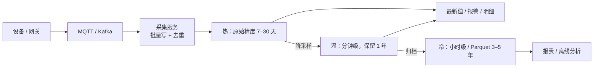
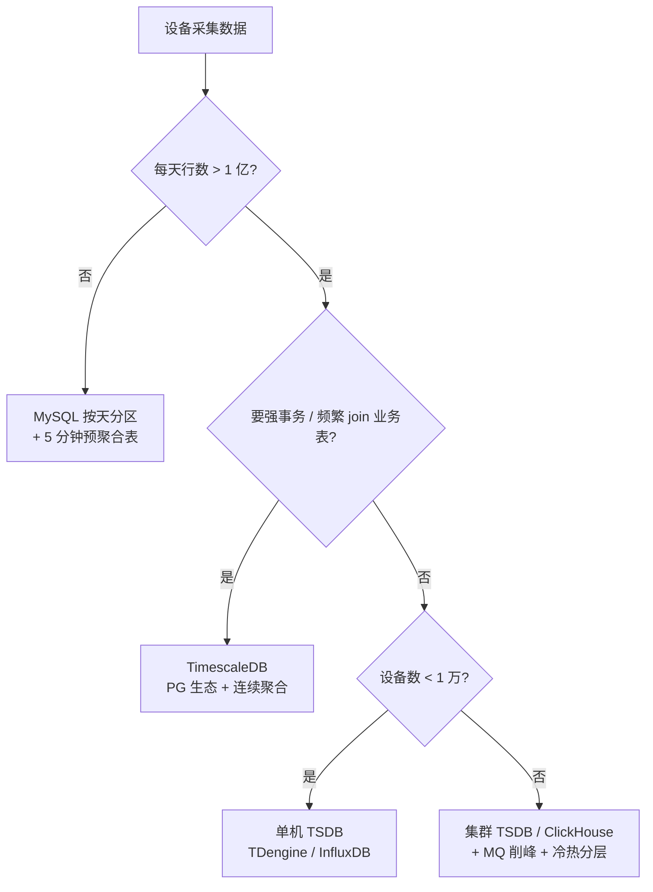

# 采集数据该存时序库还是 MySQL？

> 选型的第一问不是"哪个库更强"，而是"我的数据长什么形状、会被怎么查"。把行数算出来，大多数中小项目会发现 MySQL 分区表完全够用；算出来扛不住，再谈时序库。

设备采集数据（产线、传感器、能耗、环控）几乎都同一个形状：**写多读少、只按时间追加、查询永远是"某设备某点位某时间段"**。但反过来不成立——不是一碰设备数据就得上时序库，先说清量级。

## 先把数据形状算清楚：一天到底有多少行？

一台设备 50 个点位、1 秒采一次：`50 × 86400 = 4,320,000`，也就是**单台每天 432 万行**。1000 台就是 **43 亿行/天**。这个数字先算出来，比任何"MySQL 行不行"的争论都有用。

| 设备数 | 每台点位 | 频率 | 行数/天 | 存储/天（按 50 B/行含索引） |
| ------ | -------- | ---- | ------- | --------------------------- |
| 1      | 50       | 1s   | 432 万  | ≈ 210 MB                    |
| 10     | 20       | 60s  | 28.8 万 | ≈ 14 MB                     |
| 100    | 50       | 10s  | 4320 万 | ≈ 2.1 GB                    |
| 1000   | 50       | 1s   | 43.2 亿 | ≈ 210 GB                    |

50 B/行是个务实估计：`device_id` 8 + `point_id` 4 + `ts` 7 + `value` 8 + 行头与变长开销约 10，再算上索引里的重复存储，实际在 40–60 B 之间浮动。按 1000 台秒级算，一年 1.5 万亿行、约 76 TB——这个量级单实例 MySQL 不用讨论，备份、DDL、索引维护会先把它拖死。查询侧反而很固定，而且**冷热分明**——占比最高的最新值、报警只碰最近几条，占比最低的报表才要全量扫描；很多系统慢，就是把这两类查询塞进了同一张原始表：

| 查询模式     | 典型说法                      | 频次 | 对存储的真实要求             |
| ------------ | ----------------------------- | ---- | ---------------------------- |
| 最新值       | 大屏上每台设备的当前温度      | 极高 | 定位到最后一行要 O(log n)    |
| 时间范围明细 | 这个点位最近 1 小时的原始曲线 | 高   | 按（设备, 点位, 时间）连续读 |
| 窗口聚合曲线 | 近 7 天的 5 分钟均值          | 高   | 能下推存储，或直接查预聚合表 |
| 报警判定     | 最近 10 个点是否越限          | 极高 | 低延迟、可批量，不能扫历史   |
| 报表导出     | 全厂上月能耗汇总              | 低   | 吞吐优先，可走离线/归档      |

## MySQL 到底扛不扛得住？

先纠正一个流传很广的说法："行存 + B+ 树，写时序数据就是随机写，肯定不行。"一半对一半错。

InnoDB 是索引组织表，数据按主键顺序排在聚簇索引叶子上。主键用自增 ID，插入确实一直往 B+ 树最右端追加；但时序查询要的恰恰是 `(device_id, point_id, ts)` 这个顺序，真按它建主键，上千台设备并发往不同位置插，聚簇索引立刻变成多路随机写，补传历史数据时插入点还会跳到树中间。**"顺序写"不是天然属性，而是你为它做的设计，而时序查询需要的主键顺序恰好和它冲突。**

即使主键处理好了，瓶颈也在扫描侧：

- **行存读整行。** 一行 40–60 B 里只有一个 `value` 是聚合要用的，其余白读；列存只读数值列。
- **范围聚合要扫大量行。** 算一个点位 7 天的 5 分钟均值，原始精度下要读 60 万行，行存没法跳过。
- **二级索引很贵。** 每行在每个二级索引里再存一份带主键的索引项，写入放大，缓冲池被索引页挤占。
- **海量 INSERT 会长出大量 undo/redo**，purge 跟不上时 history list 一路涨。

能扛的边界大致是：**千万到亿级行、按天/月分区、有预聚合表、冷数据定期归档**——这个组合下 MySQL 表现得相当好，短板（扫行）被预聚合绕开，长处（点查、事务、SQL 生态）还在。按天分区是最要紧的一条，但 MySQL 有个硬限制：**分区键必须出现在表的每个唯一键（包括主键）里**，所以想用自增 `id` 做主键就没法按天分区，除非加一个 `dt` 生成列并塞进主键——代价是 `id` 不再全局唯一。

```sql
CREATE TABLE ts_point_value (
  device_id BIGINT UNSIGNED NOT NULL,
  point_id  INT UNSIGNED    NOT NULL,
  ts        DATETIME(3)     NOT NULL,
  value     DOUBLE          NOT NULL,
  quality   TINYINT UNSIGNED NOT NULL DEFAULT 0,
  PRIMARY KEY (device_id, point_id, ts)
) ENGINE = InnoDB
PARTITION BY RANGE COLUMNS (ts) (
  PARTITION p20261115 VALUES LESS THAN ('2026-11-16'),
  PARTITION p20261116 VALUES LESS THAN ('2026-11-17'),
  PARTITION pmax       VALUES LESS THAN (MAXVALUE)
);
```

分区不会自己滚动，要靠定时任务把 `pmax` 拆开（`ALTER TABLE ... REORGANIZE PARTITION pmax INTO (...)`）。**忘了滚动，新数据全进 `pmax`，分区等于没做。** 第二件要紧的事是"先聚合后查询"：

```sql
-- 聚合表主键 (device_id, point_id, bucket_ts)，聚合列 v_avg/v_max/v_min/cnt
-- 每 5 分钟跑一次，只补上一批桶，可重复执行
INSERT INTO ts_point_5m (device_id, point_id, bucket_ts, v_avg, v_max, v_min, cnt)
SELECT device_id, point_id, FROM_UNIXTIME(FLOOR(UNIX_TIMESTAMP(ts) / 300) * 300),
       AVG(value), MAX(value), MIN(value), COUNT(*)
FROM ts_point_value
WHERE ts >= ? AND ts < ?
GROUP BY device_id, point_id, FLOOR(UNIX_TIMESTAMP(ts) / 300)
ON DUPLICATE KEY UPDATE v_avg = VALUES(v_avg), v_max = VALUES(v_max),
                        v_min = VALUES(v_min), cnt = VALUES(cnt);
```

7 天曲线从 60 万行变成 2016 行，查询从秒级降到毫秒级；`ON DUPLICATE KEY UPDATE` 让它能安全重跑。

> 隐蔽的时区坑：`UNIX_TIMESTAMP()` / `FROM_UNIXTIME()` 依赖会话 `time_zone`。应用连过来是 `+08:00`、定时任务连过来是 UTC，桶就对不齐，聚合表会缺一半。**统一 UTC 存、展示层再转。**

## 时序库凭什么更快？

1. **按时间分块。** 数据切成 chunk / block / part，时间范围查询只打开少数几块，过期直接丢整块。
2. **列式存储。** 同一列连续存放，聚合只读需要的那一列，CPU 缓存命中率高。
3. **专用编码。** 时间戳用差分（甚至 delta-of-delta），浮点用 XOR（Gorilla），整数用 RLE，标签用字典编码——稳定信号的时间戳几乎不占空间，这才是 5–10 倍压缩比的真正来源。
4. **标签索引。** tag 单独建倒排或标签表，`device_id + point_key` 一上就路由到少数几块；TDengine、IoTDB 干脆把一个设备建成一张子表。
5. **预聚合物化。** 连续聚合、流式任务在写入侧算好，查询侧只对小结果集再聚合。
6. **只追加不改写。** 块写满就封存，没有随机更新、没有 undo、没有大事务，刷盘路径极短。

代价同样要摆在桌面上——**别以为上了时序库就自动变快，tag 设计错了、不批量写、乱序补采全走慢路径，照样慢**：

- **事务与 join 都弱。** 跨 measurement / 子表的写入通常不原子；关联设备台账要么应用层拼，要么把维度冗余成 tag。别指望它替代业务库。
- **更新删除受限。** 删除往往只能按时间范围或整条 series 删；ClickHouse 的 mutation 是异步重写整个 part；InfluxDB 1.x 连改一个 field 都做不到。
- **点查与运维都不占优。** "按主键取一行"普遍不如 MySQL，ClickHouse 尤其明显；SQL 方言、备份方式、监控指标、DBA 经验也得另学一套。

## 主流方案到底差在哪？

| 方案             | 数据模型                           | 写入吞吐      | 典型压缩          | 查询强项                 | 运维成本      | 适合规模           |
| ---------------- | ---------------------------------- | ------------- | ----------------- | ------------------------ | ------------- | ------------------ |
| MySQL 8 分区表   | 行表 + RANGE COLUMNS 分区          | 中（万级/秒） | ≈ 1x（页压缩 2x） | 点查、事务、复杂 SQL     | 低            | 亿级以内           |
| TDengine 3.x     | 超级表 + 子表，tag 独立存          | 高            | 官方称 10x+       | 按设备/时间窗口聚合      | 中            | 单机到集群         |
| InfluxDB 1.x     | measurement + tag + field（TSM）   | 高            | 常见 5–10x        | InfluxQL 窗口、`last()`  | 中            | 中高基数需谨慎     |
| InfluxDB 2.x/3.x | 2.x：bucket + Flux；3.x：SQL/列式  | 高            | 3.x 更高          | 3.x 支持 SQL、基数压力小 | 中高          | 新项目优先看 3.x   |
| TimescaleDB      | PG hypertable + chunk              | 中高          | 列式压缩 5–10x    | 真 SQL、join、连续聚合   | 低（复用 PG） | 已有 PG 体系最省事 |
| Apache IoTDB     | 树形路径 `root.sg.dev.s1` + TsFile | 高            | 常见 5–15x        | 按设备路径查询、边缘协同 | 中            | 设备层级深的场景   |
| ClickHouse       | MergeTree，`ORDER BY (dev,pt,ts)`  | 极高          | 5–10x             | 大宽表扫描、报表、日志   | 中高          | 报表型，不擅点查   |
| Prometheus       | 指标 + label，拉模型               | 中            | 约 1–2 B/样本     | PromQL 指标聚合          | 低            | 监控指标，不做明细 |

这张表最容易过时，**结论严重依赖版本**，选型前先锁定版本再读对应文档：

- "InfluxDB 高基数就炸"在 1.x/2.x 成立；3.x 换成 Parquet 列式、tag 退化成普通列后压力小得多。
- "TDengine 只能单机、集群收费"是 2.x 时代的话，3.x 已开源集群能力。
- "TimescaleDB 不支持压缩/没有保留策略"也是老黄历，现在是 `add_compression_policy` + `add_retention_policy`；压缩比是官方宣称值，实际跟数据形态强相关，别拿宣传数字当容量规划的唯一依据。

## 建模时 tag、field、ts 怎么摆？

一句话原则：**维度进 tag（低基数），测量值进 field（高基数），时间进 ts。** 注意这不是"标签越多越好"——每多一个 tag 就多一层 series（子表）组合，索引和元数据都要跟着涨。TDengine 用超级表描述一类点位，每个设备点位一张子表，tag 只存一份：

```sql
CREATE DATABASE iot KEEP 365 DURATION 10 PRECISION 'ms';
CREATE STABLE s_point_value (
  ts TIMESTAMP, value DOUBLE, quality TINYINT
) TAGS (device_id BIGINT, point_key VARCHAR(64), area VARCHAR(32));
CREATE TABLE d1001_temp_in USING s_point_value TAGS (1001, 'temp_in', 'A');
INSERT INTO d1001_temp_in VALUES (NOW, 36.52, 0);
```

InfluxDB 用 line protocol，tag 是索引列，field 是值列：

```text
point_value,device_id=1001,point_key=temp_in,area=A value=36.52,quality=0i 1794787200000000000
```

为什么设备维度绝对不能放 field：field 不建索引，`WHERE device_id = 1001` 写在 field 上等于全表扫；field 不能用来分组，按设备出曲线、按产线汇总全得靠 tag；field 每行重复存，字符串维度放进去压缩和内存都吃亏。

反向的错误同样致命：**高基数 tag 是时序库的性能杀手**。有人图省事把 `reqId`、`traceId`、写入时间戳做成 tag，每次采集都产生新的 tag 组合——InfluxDB 里每个唯一组合是一条 series，基数直接决定索引内存，涨到百万级就 OOM 或写入超时；TDengine 里每个唯一组合是一张子表，子表爆炸后元数据、`SHOW TABLES`、启动恢复全部变慢。判断标准很简单：**这个 tag 的取值数量，将来会不会无限增长？** 会，就不是 tag——设备台账那类静态信息（型号、安装位置、所属工单）放业务库按 `device_id` 关联；tag 只留真正会用来过滤和分组的维度，通常 3–5 个就够。

## 写入路径要怎么做才不会丢也不会慢？

- **批量写。** 一条一条提交，每次一个网络往返加一次刷盘，吞吐就锁死了。常见批量 500–2000 行，或攒 200–500 ms 先到先发。
- **默认接受乱序。** 网络重传、补采回放、设备时钟回拨都会制造乱序。多数时序库只容忍有限窗口内的乱序，这个窗口要按最坏补采时长配。
- **去重键定死。** `(device_id, point_id, ts)` 相同即同一个点，后写覆盖：MySQL 用唯一键 + `ON DUPLICATE KEY UPDATE`，TimescaleDB 用 `ON CONFLICT`，TDengine 同子表同 ts 默认覆盖。
- **时间精度统一，并区分两个时间。** 全链路定成 ms（或 us），写库前显式截断；`DATETIME(3)`、13 位毫秒、19 位纳秒混用会把同一个点存成两条，图上看就是锯齿。同时存 `event_time`（采集时刻，业务真相）和 `ingest_time`（入库时刻，用来算链路延迟、识别迟到数据、排查补采）。
- **失败必须落地。** 写库失败直接丢，等于扔了最贵的那份原始数据。落本地磁盘队列，按 `ts` 升序补传——和[设备数据粘包、丢包怎么兜住？](./iot-frame-parsing-reliability.html)里的补采是同一套思路，只是缓冲从内存挪到了磁盘。

```java
public class PointBuffer {
    private static final int BATCH = 1000;
    private final List<Point> buf = new ArrayList<>(BATCH);
    private final Path spool = Path.of("/var/lib/agent/spool");

    public synchronized void add(Point p) {          // 攒够一批再发
        buf.add(p);
        if (buf.size() >= BATCH) flush();
    }

    public synchronized void flush() {
        if (buf.isEmpty()) return;
        List<Point> batch = List.copyOf(buf);
        buf.clear();
        try {
            client.writeBatch(batch);                // 一次往返写完一批
        } catch (Exception e) {
            spoolToDisk(batch);                      // 落盘，保留 ts 便于去重
            if (spoolBytes() > MAX_SPOOL) dropOldest(); // 有配额，别把设备盘写满
        }
    }

    public void replay() {                           // 启动时 + 定时，按 ts 升序补传
        for (List<Point> b : readSpoolSortedByTs()) {
            try { client.writeBatch(b); removeFromSpool(b); }
            catch (Exception e) { return; }           // 下个周期再来，配合指数退避
        }
    }
}
```

## 查询和降采样怎么写？

最新值——只取一行，别写成"按设备分组求 max(ts) 再回表"：

```sql
SELECT ts, value FROM ts_point_value WHERE device_id = 1001 AND point_id = 3
ORDER BY ts DESC LIMIT 1;
```

5 分钟均值曲线——优先查聚合表，只有看细节时才查原始表并现场取整：

```sql
SELECT bucket_ts, v_avg, v_max, v_min FROM ts_point_5m
WHERE device_id = 1001 AND point_id = 3 AND bucket_ts >= '2026-11-16' AND bucket_ts < '2026-11-17'
ORDER BY bucket_ts;
```

某点位某天的最大最小值——要连发生时刻一起取，用窗口函数而不是 `MAX(ts)`（那个取到的是最晚时刻，不是峰值时刻）：

```sql
SELECT ts, value FROM (
  SELECT ts, value, ROW_NUMBER() OVER (ORDER BY value DESC, ts) AS rn FROM ts_point_value
  WHERE device_id = 1001 AND point_id = 3 AND ts >= '2026-11-16' AND ts < '2026-11-17'
) t WHERE rn = 1;
```

换到时序库，窗口由数据库自己切，不用在 `GROUP BY` 里手写取整，这是它们最实用的语法糖：

| 产品         | 5 分钟窗口聚合                                                         | 最新值                     |
| ------------ | ---------------------------------------------------------------------- | -------------------------- |
| TDengine     | `SELECT _wstart, AVG(value) FROM s_point_value WHERE ... INTERVAL(5m)` | `LAST_ROW(ts, value)`      |
| TimescaleDB  | `SELECT time_bucket('5 minutes', ts), avg(value) ... GROUP BY 1`       | `ORDER BY ts DESC LIMIT 1` |
| InfluxDB 1.x | `SELECT mean("value") ... GROUP BY time(5m) fill(none)`                | `SELECT last("value")`     |
| ClickHouse   | `GROUP BY toStartOfFiveMinute(ts)` 或 `argMax(value, ts)`              | `argMax(value, ts)`        |

两件配套动作：**把窗口聚合物化**（MySQL 定时任务写聚合表、TimescaleDB 连续聚合 + policy、TDengine 流式计算、InfluxDB 2.x task），在写入侧算一次，别在查询侧算一万次；**报警不要实时扫历史**，判定输入是"最新值 + 最近 N 个点"，用状态表去抖（连续 3 次越限才报），报警查询一旦慢，会连带把 TSDB 的连接池占满。

## 历史数据留多久？冷热怎么分层？



| 层  | 精度                  | 保留期  | 存储位置             | 服务对象       |
| --- | --------------------- | ------- | -------------------- | -------------- |
| 热  | 原始 1s / 10s         | 7–30 天 | TSDB 主库 / 本地 SSD | 报警、明细曲线 |
| 温  | 1 分钟聚合            | 1 年    | 同库聚合表 / 廉价盘  | 大屏、趋势分析 |
| 冷  | 1 小时聚合 + 原始导出 | 3–5 年  | 对象存储 / 数仓      | 年度报表、追溯 |

- **过期删除的实现方式差别很大（面试常考）：MySQL 用 `DROP PARTITION`，别用 `DELETE`。** 删分区是元数据操作，秒级完成；`DELETE FROM ... WHERE ts < ?` 删几百万行是巨型事务——undo 暴涨、binlog 暴涨、从库延迟越拖越长、purge 追不上。真要删就分小批慢慢来。
- **时序库的 TTL 是内建能力。** TDengine 的 `KEEP`/`DURATION`、InfluxDB 的 bucket retention、TimescaleDB 的 `add_retention_policy`（直接 drop chunk）、IoTDB 的 TTL，都按块过期，基本零成本。ClickHouse 的 `TTL` 要配 `ttl_only_drop_parts = 1`，让它整 part 过期，否则退化成行级重写；过期本身也是后台任务，会抢 IO，保留期别设得比磁盘能撑的还长。

## 采集库能不能和业务库放一台实例？

不能，理由不是"规范这么写"，而是几条会真出事的机制：

1. **缓冲池被污染。** 一条扫几千万行的聚合查询会把业务热页挤出 Buffer Pool，查询结束后业务 P99 明显抬升，加索引救不了。
2. **长查询拖住 purge。** 跑几分钟的聚合查询持有旧 MVCC 快照，undo 没法回收，history list 一路涨，极端情况打满磁盘。
3. **写入高峰互相抢资源。** 补采回放时几万行/秒吃满 redo 和刷盘 IO，业务提交延迟跟着抖。
4. **容量规划、运维窗口、权限互相绑架。** 采集数据按天线性增长，业务库要的是稳定；分区滚动 DDL、大表备份、升级还得抢同一个窗口；大屏和报表账号也不该有权限碰订单表。

加个只读副本够不够？不够。**副本要扫的数据量和主库一样**，重聚合在副本上照样打满 IO；副本还有复制延迟，"最新值"读不准。合理做法是独立实例或独立 TSDB，业务侧通过 API 或预聚合物化视图取数，大屏再加一层缓存——**问题出在查询形状上，加机器解决不了。**

## 数据脏了怎么办？

采集链路的现实是：传感器会坏、线会松、PLC 会返回 `-32768` 这种哨兵值。存储层要能区分"真值"和"没采到 / 采错了"：

- **量程过滤 + 死区上报。** 每个点位配 `min/max/单位`，越界标 `quality = 2`（可疑）而不是直接丢——留下来才能查是不是探头坏了；上报侧做 deadband，变化量小于阈值不上报、另加固定周期心跳全量上报，这一条通常能把写量砍掉一半以上。
- **入库前去噪。** 滑动中位数压抖动，但别把尖峰全磨平——设备的真实冲击往往就在尖峰里。
- **缺失标记，绝不补 0。** 补 0 会把均值拉低、把 `MIN` 变成 0、让报警误判，而且事后**无法区分"真的是 0"和"没采到"**。用 `NULL`、`fill(none)`、`quality = 1` 三选一。
- **raw 与 clean 双份。** 原始值原样存（含异常），清洗后的另存一份并带 `quality` 和规则标识，出问题能回溯"这条为什么被丢了"；入库统一成 SI 单位，别让摄氏度、华氏度、Pa、kPa 在同一列里混着。

## 中小项目到底怎么选？



| 规模                | 推荐                | 必须做的动作                                           |
| ------------------- | ------------------- | ------------------------------------------------------ |
| < 1000 台，分钟级   | MySQL 分区 + 预聚合 | 按天分区、滚动脚本、5m 聚合表、30 天后归档             |
| 1000–10000 台，秒级 | 单机 TSDB           | 批量写、子表/tag 设计、TTL、降采样任务、定期快照备份   |
| 更大 / 多厂区       | 集群 + MQ + 分层    | Kafka 削峰、按设备哈希分片、副本、温冷层、独立报表通道 |

结论就一句：**先演进，不要一步到位。** 第一版用 MySQL 按天分区加预聚合，足够撑到上千台设备、分钟级采集；同时留两个后手——写入抽象成 `PointWriter` 接口，换存储不动业务代码；**从第一天就把 `(device_id, point_key, ts)` 的语义和精度定死**，这才是迁移时唯一真正难改的东西，存储本身反而好换。

## 容易踩的坑

- **按天分区却做跨年查询。** 一年就是几百个分区，光打开表就够呛；`WHERE DATE(ts) = ?` 在分区键上套函数还会让分区裁剪失效。分区总数控制在几十到一两百；`pmax` 忘了滚则新数据全进最大分区，等于没分区。
- **用 `DELETE` 清历史。** 大事务 + 海量 undo + 主从延迟，删除期间业务和复制一起受罪。用分区 drop 或小批删。
- **tag 用错。** `reqId`、`traceId`、写入时间做 tag，series 或子表数量爆炸，先崩的是元数据；反过来把测量值放 tag，每个不同浮点值一条 series，写入直接雪崩。
- **字段类型用错。** field 里存 `status = 'RUNNING'` 这种字符串，聚合算不了、压缩也差，该拆成维度或数值编码；字符串维度放进 field，每行重复存，白占空间。
- **时区与精度混用。** UTC 和本地时混存、ms 和 ns 混写、`UNIX_TIMESTAMP` 依赖会话时区，同一个点变成两条。
- **采集写入没有批量。** 一条一提交，QPS 上不去，磁盘先被打满。
- **TSDB 单机无副本。** 它偏偏是原始数据的唯一一份，机器挂掉历史就没了；至少定期快照到对象存储。
- **报警实时跑聚合。** 每次判定扫一周数据，接口一多就雪崩，报警和查询互相拖死。
- **把采集库和业务库放一台实例。** 大聚合会污染缓冲池、拖住 purge、抢 IO，业务跟着抖。

## 小结

- **先算行数再选型。** 50 点位 × 1s = 432 万行/台/天；1000 台就是 43 亿行/天、约 210 GB/天。这个量级 MySQL 单实例撑不住，几百台分钟级则毫无压力。
- **MySQL 的边界靠三件事划出来：** 按天 `RANGE COLUMNS` 分区（分区键必须在主键里）、5 分钟预聚合表、冷数据归档；聚合查询永远先查聚合表，不扫原始表。
- **时序库快在结构不在魔法：** 时间分块、列存压缩、差分编码、tag 索引、预聚合物化、只追加；代价是事务/join/更新弱、点查不占优，且结论随版本变化，选型必须锁定版本。
- **建模口诀：** 维度进 tag（低基数）、测量值进 field、时间进 ts；高基数 tag 是性能杀手，判断标准是"取值会不会无限增长"。
- **工程上三条不能省：** 批量写 + 失败落盘补传；采集库与业务库分实例；热温冷分层，MySQL 用分区 drop、时序库用 TTL，都别把 `DELETE` 当日常手段。

## 参考

综合自 MySQL 8.0 Reference Manual（Partitioning 与 RANGE COLUMNS、分区限制、InnoDB 索引组织表与 undo、Online DDL）、TDengine 官方文档（超级表/子表、`INTERVAL` 窗口、`KEEP`/`DURATION`、批量写入建议）、InfluxDB 1.x / 2.x / 3.x 官方文档（line protocol、series cardinality、Flux 与 3.x 列式模型）、TimescaleDB 官方文档（hypertable、continuous aggregate、compression、retention policy）、Apache IoTDB 官方文档（TsFile、树形路径模型）、ClickHouse 官方文档（MergeTree、TTL、mutation）、Prometheus 官方文档（抓取模型与 TSDB 保留）。

做的核对与改写：① 行数与存储按 50 B/行重算（含行头、变长开销与索引重复存储），给 40–60 B 区间而不是单一数字；② "分区键必须包含在每个唯一键内"按 8.0 Partitioning Limitations 核对，故示例把 `ts` 放进主键，并说明改用自增 `id` 的代价；③ "InfluxDB 怕高基数"限定在 1.x/2.x，3.x 换列式后不再成立；④ 压缩比一律给区间并注明是官方宣称值，实际随数据形态波动；⑤ `DELETE` 与 `DROP PARTITION` 的代价差异按 InnoDB 的 undo/binlog 与复制行为重写，未沿用"删除就是慢"这类笼统说法。
