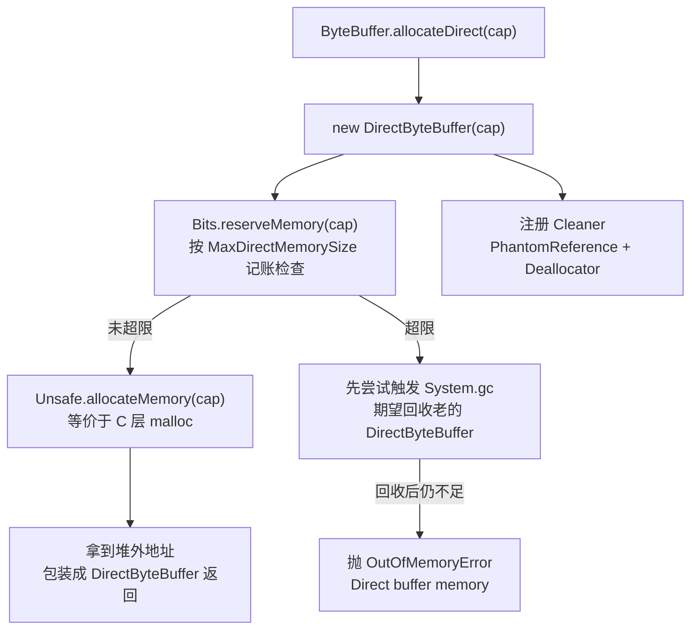
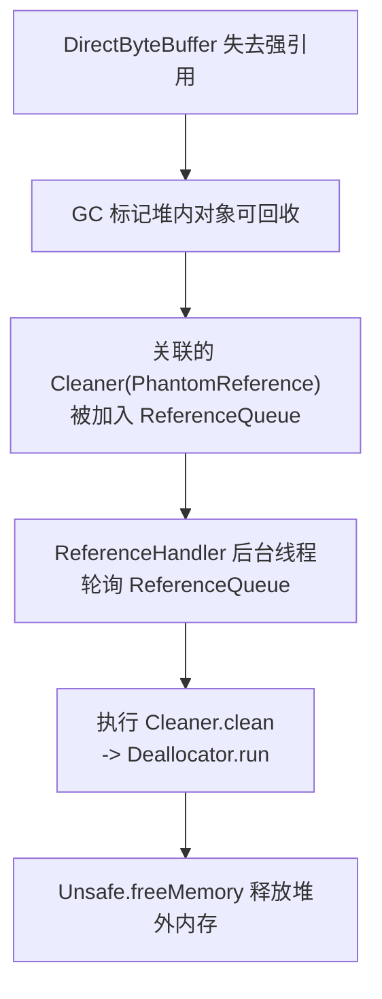

## 直接内存到底是什么

讲 JVM 内存，大部分人脑子里先冒出来的是堆、方法区、虚拟机栈这些"运行时数据区"。直接内存比较特别——它压根不在 JVM 规范定义的运行时数据区里，也不在 Java 堆里，它是 Java 进程向操作系统申请的一块本地内存（native memory），由操作系统而不是 JVM 堆管理器来分配回收。

它最常见的出场方式，是 JDK 1.4 引入的 NIO 里的 `DirectByteBuffer`：你在 Java 堆里拿到一个 `DirectByteBuffer` 对象，但这个对象背后真正存数据的那块缓冲区，是 `malloc` 在堆外申请的，堆里的对象只是一张"房卡"，记录着堆外那块内存的起始地址和长度。

这里有几个容易缠在一起的概念，先掰开：

| 概念     | 范围                                               | 典型代表                                                           |
| -------- | -------------------------------------------------- | ------------------------------------------------------------------ |
| 直接内存 | 通常特指 NIO `DirectByteBuffer` 在堆外分配的缓冲区 | `ByteBuffer.allocateDirect()` 的产物                               |
| 堆外内存 | 范围更大，凡是不在 JVM 堆里的本地内存都算          | `DirectByteBuffer`、JNI 里自己 `malloc` 的、JVM 自身的 native 内存 |
| 零拷贝   | 操作系统层面的概念，指减少内核态与用户态的数据拷贝 | `sendfile`、`mmap`                                                 |

> 纠偏：不少资料把"直接内存""堆外内存""零拷贝"三者混为一谈。严格说，"直接内存"通常特指 NIO `DirectByteBuffer` 在堆外通过 native 调用分配的那块缓冲区；"堆外内存"范围更大，凡是分配在 JVM 堆之外的内存都算（包括 `DirectByteBuffer`、JNI 自己 `malloc` 的、JVM 自身的本地内存等）。而"零拷贝"是操作系统层面的概念（`sendfile`/`mmap`），和"用 `DirectBuffer` 省一次堆到堆外的拷贝"是两个不同层面的优化，别画等号。

## 为什么要绕开堆：I/O 多出的那一次拷贝

知道了直接内存是什么，下一个问题自然是：明明 JVM 堆已经能放数据了，为什么非要绕出去再开一块？

答案藏在 I/O 的细节里。Java 做网络或文件 I/O 时，最终都要把数据交给操作系统内核去发出去。而 JVM 堆里的对象，地址是不固定的——垃圾回收一旦发生，对象可能被整理、被搬走。内核要拿数据的这一刻，如果数据还放在随时可能被搬走的堆里，就有风险：内核刚记下一个地址，GC 一搬，地址就失效了。

所以 JVM 在用**堆内** `ByteBuffer` 做 I/O 时，会临时开一块堆外缓冲区，先把堆里的数据拷一份过去，再把这块稳定地址交给内核。这次拷贝是 JVM 背着你偷偷做的，对程序员透明，但开销真实存在。

`DirectByteBuffer` 把这块临时缓冲区直接做成了"常驻"的：数据一开始就放在堆外，地址稳定，GC 不会动它，I/O 时就不用再临时拷一遍。这就是 NIO 文档里那句"避免在 Java 堆和 Native 堆之间来回复制数据"的真正含义。

除了省拷贝，把大块数据放在堆外还有一个好处：它们不计入堆的对象图，GC 扫描时不会把它们当对象遍历。对那些动辄几百兆、生命周期又长的大缓冲区来说，放在堆里意味着每次 Full GC 都得扛着它们标记、整理，放在堆外就能让堆的 GC 压力小很多。

> 纠偏：NIO 文档里说 `DirectByteBuffer`"避免了 Java 堆和 Native 堆之间来回复制数据"，指的是做 I/O 时堆内 `ByteBuffer` 会被 JVM 临时拷一份到堆外再交给内核（因为堆内对象可能被 GC 移动、地址不固定），而 `DirectByteBuffer` 本身就在堆外，省掉了这"额外一次"。这和操作系统教科书里 `sendfile`/`mmap` 那种"省掉内核↔用户态拷贝"的零拷贝不是一回事，两者可以叠加使用，但别混为一谈。`MappedByteBuffer`（基于 `mmap`）才是操作系统层面零拷贝在 Java 里的体现。

## 分配链路：从 allocateDirect 到一次 malloc

光说概念不够，落到代码上，一次 `ByteBuffer.allocateDirect(1024)` 究竟发生了什么，大致是这样一条链路：



几个关键点值得记一下：

- **记账在 `Bits` 类里**。每次分配前，`Bits.reserveMemory` 会把申请的大小累加到一个全局计数器，跟 `-XX:MaxDirectMemorySize` 比一比。超了不是立刻 OOM，而是先想办法触发一次 GC，把没人引用的旧 `DirectByteBuffer` 收掉、腾出堆外空间，再重试；实在腾不出来才抛 `java.lang.OutOfMemoryError: Direct buffer memory`。
- **真正的分配是 `Unsafe.allocateMemory`**，它底层就是一次 `malloc`，从操作系统的进程地址空间里要一块。这块内存 JVM 堆管不到，所以不会随堆 GC 自动回收。
- **分配的同时顺手注册了一个 `Cleaner`**。这个 `Cleaner` 是个 `PhantomReference`（虚引用），它内部绑着一个 `Deallocator`，记录着刚申请那块堆外内存的地址和大小。它的作用下一节细说。

堆内 `ByteBuffer` 和直接 `ByteBuffer` 的对照，可以帮你看清差别：

| 对比项                            | 堆内 `ByteBuffer` | 直接 `ByteBuffer`                   |
| --------------------------------- | ----------------- | ----------------------------------- |
| 数据存放位置                      | Java 堆           | 堆外 native 内存                    |
| 受 `-XX:MaxDirectMemorySize` 约束 | 否                | 是（经 `Bits` 记账）                |
| GC 扫描数据本身                   | 是                | 否，数据不在堆里                    |
| 做 I/O 是否需要临时拷贝           | 需要，先拷到堆外  | 不需要                              |
| 释放方式                          | 随堆 GC 自动回收  | 堆内对象 GC 后由 `Cleaner` 释放堆外 |

## 回收链路：Cleaner 和那根绑在 GC 上的细线

分配好说，回收才是直接内存最容易出事的地方，也是很多人没想清楚的地方。

堆外那块 native 内存，JVM 堆的 GC 是管不到的——它不在堆里，GC 扫不到。那它靠什么回收？答案是：靠堆里那个 `DirectByteBuffer` 对象被 GC 回收时，顺带触发的 `Cleaner`。

整条链路是这样接上的：



这里有个机制值得拆开看：`PhantomReference`（虚引用）的引用强度比软引用、弱引用都低，对象一旦只剩虚引用可达，GC 就可以回收它，并且 JVM 会把这个虚引用对象包装的 `Cleaner` 塞进它绑定的 `ReferenceQueue`。有一个叫 `ReferenceHandler` 的后台守护线程专门盯着这些队列，一旦取到 `Cleaner`，就调用它的 `clean` 方法，进而触发 `Deallocator.run`，用 `Unsafe.freeMemory` 把堆外那块内存还给操作系统。

所以这里有一条很关键的因果链：**堆外内存的释放，前提是堆内的 `DirectByteBuffer` 被回收**。这带来两个工程上的坑：

1. **堆外内存释放有滞后**。得等 `DirectByteBuffer` 被 GC，再等 `ReferenceHandler` 线程跑到。如果 JVM 一直不 GC（比如堆还很空，没触发 GC），哪怕你已经把 `DirectByteBuffer` 的引用置成 `null`，那块堆外内存也还占着。这就是为什么 NIO 在分配超限时宁可主动调一次 `System.gc()`——它指望用一次显式 GC 把那些"已经没人用但还没被回收"的 `DirectByteBuffer` 收掉，连带释放堆外。
2. **禁用 `System.gc()` 要小心**。很多线上服务会用 `-XX:+DisableExplicitGC` 屏蔽代码里的 `System.gc()`，免得被乱触发 Full GC。但 NIO 的 `Bits.reserveMemory` 在直接内存吃紧时恰恰要靠 `System.gc()` 救场，禁掉之后这条释放路径就被堵了，直接内存 OOM 的概率会明显上升。如果一定要禁，配合 `-XX:MaxDirectMemorySize` 给够余量，或者用 `-XX:+ExplicitGCInvokesConcurrent` 让显式 GC 走并发回收而不是 Full GC，是个折中。

## 当直接内存撑爆：OOM 和那道容易踩坑的上限

直接内存既然是内存，就会有用爆的时候，表现形式就是：

```text
java.lang.OutOfMemoryError: Direct buffer memory
```

这道上限由 `-XX:MaxDirectMemorySize` 控制。不设的话，默认值通常和最大堆 `-Xmx` 一致（具体看版本），所以有人觉得"我没设过它，怎么直接内存还能涨那么大"，原因就在这——它默认跟着堆走，堆给多大它就能用多大。

> 纠偏：`-XX:MaxDirectMemorySize` 这个上限，约束的是通过 NIO `Bits` 类记账的 `DirectByteBuffer` 分配（`reserveMemory` 会先检查是否超限），而不是所有堆外内存。你自己用 `Unsafe.allocateMemory` 或 JNI 调 `malloc` 分配的内存不经过这套记账，所以这个参数管不到它们——这也是后面 Netty 池化堆外内存需要独立监控的原因之一。

直接内存 OOM 常见的几种诱因：

- **`DirectByteBuffer` 被长期持有引用不释放**。比如某个缓存把 `DirectByteBuffer` 当 value 存着，堆内对象不 GC，堆外内存就一直不还。
- **分配速度快于 GC 释放速度**。短时间高频创建 `DirectByteBuffer`，`ReferenceHandler` 来不及清理，计数器蹭蹭涨到上限。
- **`-XX:+DisableExplicitGC` 配合不当**，前文说的那条救场路径被堵。
- **Netty 等框架的池化堆外内存**有自己的生命周期，下面单说。

## Netty 为什么要自己管堆外内存

写到这可能会有人问：既然 `DirectByteBuffer` 这套机制够用了，Netty 为什么还要搞一套池化的 `PooledDirectByteBuf`？

原因有几个，而且都挺实在：

- **`malloc`/`free` 本身不便宜**。每次 `allocateDirect` 都是一次系统调用级别的内存申请，频繁分配释放小内存，开销和碎片都受不了。
- **`DirectByteBuffer` 的释放绑在 GC 上**，时延不可控。在高性能网络框架里，你不会希望"内存能不能还回来"这件事取决于 GC 什么时候发善心。
- **Netty 想自己掌握内存的复用和分配策略**。

所以 Netty 借鉴 jemalloc 的思路，实现了 `PooledByteBufAllocator`：它先按页（PoolChunk）一次性申请一大块堆外 native 内存，再切成各种规格的小块（PoolSubpage、PoolChunkList）按需分配、用完归还复用。这样分配释放都成了内存池里的指针操作，不走 `malloc`，也不依赖 GC 触发。

代价是 Netty 的池化堆外内存**往往绕过 NIO `Bits` 的记账**：底层申请 native 内存时用 `Unsafe.allocateMemory`，并不累加到那个全局计数器。于是 `-XX:MaxDirectMemorySize` 对 Netty 池化堆外的约束很有限，你光盯着这个参数监控，可能 Netty 的堆外早就涨上去了你都不知道。

Netty 自己留了口子：

- `-Dio.netty.maxDirectMemory` 用来设 Netty 侧的堆外内存上限（0 表示跟随 JVM 的 `MaxDirectMemorySize`，设具体值则独立限制）。
- `PooledByteBufAllocatorMetric` 能拿到已分配、已使用、各 PoolArena 的占用，可以通过 JMX 或 `io.netty.allocator` 相关 logger 暴露。

所以一条经验：用了 Netty，堆外内存的监控别只看 JVM 的 DirectBuffer 池，Netty 自己的 allocator 指标才是主战场。

## 出事了怎么排查

直接内存出问题，症状常常是"堆没满、GC 看着也正常，但进程 RSS 一直涨，最后 `Direct buffer memory` 或者干脆被 OOM Killer 干掉"。排查可以从几个方向入手：

| 手段                                                                      | 看什么                                  | 注意                                                                             |
| ------------------------------------------------------------------------- | --------------------------------------- | -------------------------------------------------------------------------------- |
| `java.nio.BufferPoolMXBean`（JMX）                                        | `DirectBuffer` 池的 count 和 memoryUsed | 最直接看 NIO `DirectByteBuffer` 占用的方式，注意 `memoryUsed` 是按 capacity 估算 |
| `-XX:NativeMemoryTracking=detail` + `jcmd <pid> VM.native_memory summary` | JVM 各类本地内存分类占用                | 需要 JVM 启动时就带上 NMT 参数                                                   |
| `jcmd <pid> VM.native_memory baseline/diff`                               | 对比基线看增长                          | 适合排查"慢慢涨"的泄漏                                                           |
| Netty `PooledByteBufAllocatorMetric`                                      | Netty 池化堆外占用                      | 用了 Netty 必看，JVM 的 DirectBuffer 池看不全                                    |
| `top`/`pmap` 看进程 RSS                                                   | 进程整体内存                            | RSS 涨不等于堆外涨，但能定位量级                                                 |

> 纠偏：`-XX:NativeMemoryTracking=detail` 主要跟踪 JVM 自身 C++ 层分配的本地内存（元空间、线程栈、Code Cache、GC 数据结构等），对 Java 应用层通过 `DirectByteBuffer` 分配的堆外内存跟踪有限。监控 `DirectByteBuffer` 占用最直接的手段是 JMX 的 `java.nio.BufferPoolMXBean`，它能拿到 DirectBuffer 池的 count 和总容量；Netty 的堆外则要看 Netty 自己的 allocator 指标。

定位泄漏时常见的一招是配合 `jmap`/堆 dump：如果看到大量 `DirectByteBuffer` 对象还活着、被某些容器（`HashMap`、缓存）引用着，那就是堆外泄漏的源头——堆外没释放，本质是堆里的 `DirectByteBuffer` 没被 GC。把这些引用清掉，GC 一回收 `DirectByteBuffer`，`Cleaner` 就会把堆外还回去。

## 小结

- 直接内存是一块在 JVM 堆外、由操作系统分配管理的 native 内存，最常见的载体是 NIO 的 `DirectByteBuffer`；它不在 JVM 规范的运行时数据区里。
- 它解决两件事：避免堆内 `ByteBuffer` 做 I/O 时被 JVM 临时拷一份到堆外，以及让大缓冲区不进堆、减轻 GC 扫描压力。
- 分配走 `ByteBuffer.allocateDirect` → `Bits.reserveMemory`（按 `MaxDirectMemorySize` 记账）→ `Unsafe.allocateMemory`（`malloc`），同时注册 `Cleaner`。
- 回收靠 `Cleaner`（`PhantomReference` + `ReferenceQueue`）在 `DirectByteBuffer` 被 GC 后由 `ReferenceHandler` 触发 `freeMemory`，所以堆外释放依赖堆内对象被回收，有滞后，禁用 `System.gc` 时尤其要当心。
- 排查用 `BufferPoolMXBean` 看 NIO 直接内存、用 NMT 看 JVM 本地内存、用 Netty allocator 指标看 Netty 堆外，三者覆盖范围不同，别只盯一个。

## 参考

- 公开的 JVM 与 NIO 教材
- Netty 官方文档
- OpenJDK 源码注释（`Bits.java`、`DirectByteBuffer.java`、`Cleaner` 实现）
- Linux 内核手册关于 `sendfile` 与 `mmap` 的说明
