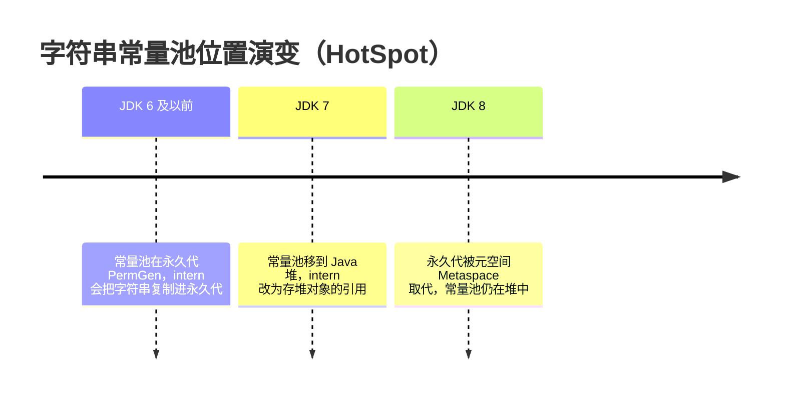
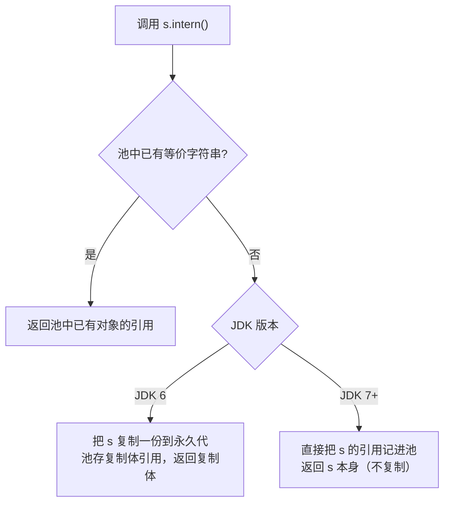

# 字符串常量池在哪个区域？intern 到底做了什么？

> 字符串常量池的位置和 intern 的行为，都和 JDK 版本强绑定。不把版本讲清楚，结论就是错的。

## 字符串常量池到底是什么

字符串常量池是 JVM 专门给 `String` 开的一块去重缓存，目的只有一个：**避免内容相同的字符串被反复创建**。代码里到处都是 `"ab"` 这种字面量，如果每用一次就 new 一个对象，堆早就炸了。于是 JVM 维护一张表，看到 `"ab"` 就先查表，有就返回现成的，没有就建一个登记进去。

```java
// 池里没有 "ab"：建一个并登记，把引用赋给 aa
String aa = "ab";
// 池里已有 "ab"：直接返回同一个引用给 bb
String bb = "ab";
System.out.println(aa == bb); // true
```

这里有个容易混的点要先理清：别把"字符串常量池"和每个类自己的"运行时常量池"当成一个东西。

- **运行时常量池**是每个 Class 文件加载后落到方法区里的那张表，存的是这个类自己的字面量和符号引用，**每个类一份**。
- **字符串常量池**（HotSpot 里叫 `StringTable`）是一张**全局**的哈希表，所有线程共享一份。代码里的字符串字面量在解析时会去 `StringTable` 查重。

所以字符串常量池本质是 JVM 给 `String` 做的一层全局去重缓存，不是方法区里某个类私有的那张常量池表。

顺带回答一个经典追问：**常量池里存的到底是对象还是引用？** 是引用。`StringTable` 存的是 `String` 对象的引用，真正那个 `String` 对象本身住在哪里，取决于版本——这就引出下一个问题。

## 它到底在哪个区域：从永久代到堆

这块结论很硬，但必须带版本说：



- JDK 6 及以前：字符串常量池在**永久代**（PermGen，方法区的 HotSpot 实现）。由它登记的 `String` 对象也住在永久代。
- JDK 7 起：字符串常量池和静态变量一起从永久代**移到了 Java 堆**。此后由它登记的 `String` 对象就住在堆里。
- JDK 8：永久代被元空间（Metaspace，用本地内存）取代。但注意——**常量池的位置在 JDK 7 就已经搬完了，JDK 8 只是顺手拆了永久代**，常量池并没有再搬家。

> 这是个高频踩坑点：很多人说"JDK 8 把字符串常量池移到了堆"，这个说法是错的。搬家发生在 JDK 7，JDK 8 干的另一件事是用元空间替换永久代。两件事别搅在一起。

为什么 JDK 7 非要把它从永久代挪到堆？两条原因，都是永久代的毛病：

- **永久代太小、又固定**，程序里大量字符串塞进去很容易撑出 `java.lang.OutOfMemoryError: PermGen space`。
- **永久代 GC 效率太低**，正常情况下只有 Full GC 才会回收它。而字符串又特别多、很多是临时的，堆在永久代里迟迟回收不掉，既浪费又危险。放到堆里就能跟着普通 GC 及时回收。

## intern() 到底做了什么

`String.intern()` 是个 `native` 方法，主动去动字符串常量池。它干的事一句话能说清，但**这句话在不同版本里含义不一样**：

- 如果池里已经有内容相同的字符串，`intern()` 直接返回池里那个引用。
- 如果池里还没有，就把当前字符串"登记"进池，并返回登记后的引用。

关键就在"登记"这两个字上，JDK 6 和 JDK 7+ 的做法不同：

| 维度              | JDK 6 及以前                                               | JDK 7+                                                         |
| ----------------- | ---------------------------------------------------------- | -------------------------------------------------------------- |
| 常量池位置        | 永久代 PermGen                                             | Java 堆                                                        |
| `intern` 命中已有 | 返回池中已有引用                                           | 返回池中已有引用                                               |
| `intern` 未命中   | 把字符串**复制一份**到永久代，池存复制体的引用，返回复制体 | 直接把**堆里这个 String 的引用**记进池，不复制，返回同一个对象 |



> 这里要纠个偏：有的资料在讲 intern 时只说一句"把当前字符串对象的引用添加到常量池，并返回该引用"，描述的其实是 JDK 7+ 的行为。在 JDK 6 里 intern 是要**复制**字符串进永久代的，不是存引用。不区分版本地复述这句话，遇到"为什么 JDK 6 和 JDK 7 结果不一样"就答不上来。

先看一个不挑版本、单纯展示 intern 用法的基础例子（JDK 7+）：

```java
String s1 = "Java";              // 池里有 "Java"，s1 指向池里
String s2 = s1.intern();         // 池里已有，返回同一个
String s3 = new String("Java");  // 堆上新建一个 "Java"，s3 指向堆
String s4 = s3.intern();         // 池里已有 "Java"，返回池里的那个，不是 s3
System.out.println(s1 == s2);   // true
System.out.println(s3 == s4);   // false（s3 是堆对象，s4 是池对象）
System.out.println(s1 == s4);   // true
```

而真正能体现版本差异的，是下面这道经典题。

## 经典面试题拆解

### new String("ab") 创建几个对象

答案是 **1 或 2 个**，取决于池里原来有没有 `"ab"`。看一眼字节码就明白：

```
0 new String            // 堆上分配一个还没初始化的 String 对象
3 dup
4 ldc "ab"              // 去池里查 "ab"：没有就建一个并登记，有就返回现成的
6 invokespecial String.<init>
9 astore_1
```

| 池里是否已有 `"ab"` | ldc 干的事          | new 干的事          | 一共创建            |
| ------------------- | ------------------- | ------------------- | ------------------- |
| 没有                | 在池里建一个 `"ab"` | 在堆上建一个 `"ab"` | 2 个（池 1 + 堆 1） |
| 已有                | 直接返回池里的引用  | 在堆上建一个 `"ab"` | 1 个（只堆 1）      |

所以 `new String("ab")` 一定会因为 `new` 在堆上建一个对象，至于池里那个建不建，要看之前有没有人把 `"ab"` 弄进过池。

### "a" + "b" 和 a + b 不是一回事

这题考的是编译期的**常量折叠**。

```java
String str1 = "str";
String str2 = "ing";
String str3 = "str" + "ing";  // 两个字面量拼接，编译期就折叠成 "string"
String str4 = str1 + str2;   // 变量拼接，编译期确定不了，运行期拼
String str5 = "string";
System.out.println(str3 == str4); // false
System.out.println(str3 == str5); // true
System.out.println(str4 == str5); // false
```

- `"str" + "ing"`：两个都是字面量，编译器在编译期就能算出 `"string"`，直接当成一个字面量放进常量池。所以 `str3 == str5` 为 `true`。
- `str1 + str2`：是变量，编译期算不出值，编译器没法折叠。它会被展开成 `new StringBuilder().append(str1).append(str2).toString()`，结果是一个**堆上的新对象**，不进池。所以 `str4 == str5` 为 `false`。

一句话区分：**编译期能确定值的才折叠进池，运行期才能确定值的走 StringBuilder 在堆上拼。**

补充一个边界：变量一旦用 `final` 修饰且编译期可确定，就会被当成常量参与折叠：

```java
final String str1 = "str";
final String str2 = "ing";
String c = "str" + "ing";  // 池中
String d = str1 + str2;    // 等价于上一行，也在池中
System.out.println(c == d); // true
```

但要注意，`final` 变量的值如果得运行期才能知道（比如 `final String s = getStr()`），编译器照样折叠不了，结果还是在堆上。

### intern() == 的结果为什么随版本变

这是最能拉开差距的一题。先给结论再讲为什么：

```java
// "1" 是字面量，new String("1") 里的 ldc 会把 "1" 放进池
// 但 "11" 从没作为字面量出现，拼接结果只在堆上，池里没有
String s3 = new String("1") + new String("1"); // 堆上有 "11"，池里没有 "11"
s3.intern();            // 关键：把 s3 登记进池
String s4 = "11";       // ldc "11"，命中池
System.out.println(s3 == s4); // JDK 6：false，JDK 7+：true
```

原因就藏在上一节那张表里：

- **JDK 6**：`intern` 发现池里没有 `"11"`，于是把 `"11"` **复制**一份到永久代，池里存的是永久代那份的引用。`s4 = "11"` 命中池，拿到的是永久代那份，和堆上的 `s3` 不是同一个对象 → `false`。
- **JDK 7+**：`intern` 发现池里没有 `"11"`，直接把堆上 `s3` 的引用记进池，**不复制**。`s4 = "11"` 命中池，拿到的就是 `s3` 同一个堆对象 → `true`。

所以这道题想答对，核心就一句：**JDK 6 是复制，JDK 7+ 是存引用**，这俩行为的差异最终体现在 `==` 的结果上。

这里也有个坑要提醒：这道题能体现差异，前提是 `s3` 这个字符串**之前不在池里**。如果是 `new String("ab")`（`"ab"` 是字面量，ldc 已经把它放进池了），那 `intern` 会直接返回池里那个，`s.intern() == s` 在两个版本里都是 `false`——因为池里早有了一个和 `s` 不同的对象。判断版本差异题，先想清楚"这个字符串在 intern 之前到底进没进池"。

## 常量池和 GC

既然 JDK 7+ 常量池搬到了堆，那它登记的 `String` 对象也就是普通堆对象，能被正常 GC 回收。一旦这个字符串没有任何引用了（常量池里的引用被清理、业务代码也没人持有它），GC 就能把它回收掉。这正当年把它搬下来的初衷——别让一堆临时字符串堆在永久代里等 Full GC。

反过来想，JDK 6 那会儿它在永久代，回收只能等 Full GC，而且永久代空间又小，所以才那么容易 OOM。

## 工程上要注意的

- **别为了省内存乱用 intern。** intern 把对象的生命周期和常量池绑在一起，等于让本该很快回收的字符串长期留在堆里，反而可能占更多内存。只有在"同一段字符串会反复出现、且需要靠 `==` 做高频比较"的场景才有意义。
- **大量 intern 会让常量池变大。** 池在堆里，所以它会占堆，不会像 JDK 6 那样去撑永久代，但占的还是你宝贵的堆内存。
- **可以用 `-XX:StringTableSize` 调桶数。** `StringTable` 是个定长哈希表，桶少了哈希冲突就重、intern 变慢。这个参数早期版本默认值不大（1009 量级），后续版本有所上调。如果确实有大量字符串需要驻留，可以适当调大这个值减少冲突。注意它是**桶数**，不是池能存多少字符串的上限。
- **拿 `==` 比字符串内容是反模式。** intern 能让某些场景下 `==` 成立，但这不该成为业务代码依赖 `==` 比字符串的理由。要比内容就用 `equals`，这点在哪篇资料里都是一致的。

## 小结

- 字符串常量池是 JVM 给 `String` 做的**全局去重缓存**（HotSpot 里是 `StringTable` 哈希表），存的是 `String` 对象的引用，不是字符串内容本身；要和每个类自己的运行时常量池区分开。
- 位置演变：JDK 6 及以前在永久代，**JDK 7 起移到 Java 堆**；JDK 8 用元空间替换永久代是另一件事，别混为一谈。
- intern 的版本差异是核心：**JDK 6 是把字符串复制进永久代，JDK 7+ 是直接存堆里那个对象的引用、不复制**。这才是 `s3 == s4` 在两个版本结果不同的根本原因。
- `new String("ab")` 创建 1 或 2 个对象：池里没有则池 1 + 堆 1 = 2 个，池里已有则只堆 1 个。
- 编译期能确定值的字符串拼接会被常量折叠进池，变量拼接走 StringBuilder 在堆上生成新对象；`intern` 别滥用，必要时用 `-XX:StringTableSize` 调桶数。

## 参考

- 公开 JVM 教材与 OpenJDK 文档，并对照了多个版本的 String 行为
- OpenJDK HotSpot 源码中 `StringTable` 的实现（`src/hotspot/share/classfile/stringTable.cpp`）
- 《Java 虚拟机规范》关于运行时常量池与字符串常量的描述
- 多篇公开技术文章对 `String#intern` 在不同 JDK 版本下行为的对比验证
