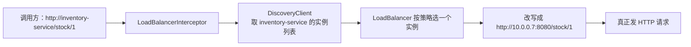
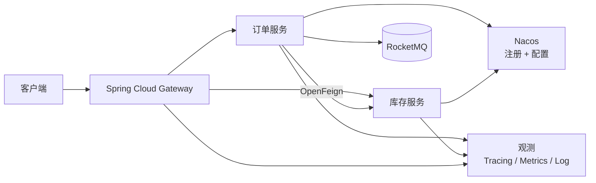

# Spring Cloud 解决的是什么问题？和 Dubbo、K8s 的边界在哪？

> Spring Cloud 自己没发明任何分布式能力，它做的是把注册发现、配置、调用、入口、熔断这些通用模式抽成一组可替换的接口，再给每个接口配一套默认实现；所以它的价值是“换中间件不换业务代码”，而不是“用了它就有了微服务”。

## 先看两个真实问题

**问题一：新项目的 pom 该写什么？** 很多人的答案还停在 2019 年的那份清单：Eureka + Ribbon + Hystrix + Zuul + Config。这份清单里的 Ribbon、Hystrix、Zuul 早就被请出了官方发布列车，照着抄的人大概率连启动都过不去，报的是 `NoSuchMethodError`、类找不到这一类错误。

**问题二：K8s 都有 Service、ConfigMap、Ingress 了，还要 Spring Cloud 吗？** 答“要”或“不要”都不对，这取决于你打算让谁负责“应用怎么找到彼此、配置怎么变”。

这两个问题最后指向同一件事：**Spring Cloud 里哪部分是不可替代的**。这篇就把那部分单独拎出来。

## 它到底提供了什么：一层抽象，而不是一堆 jar

先看一段最常见的代码：

```java
@Bean
@LoadBalanced
RestTemplate restTemplate() {
    return new RestTemplate();
}

// 业务代码里只写服务名，不写 IP
Stock stock = restTemplate.getForObject("http://inventory-service/stock/{sku}", Stock.class, sku);
```

`http://inventory-service/stock/1` 这个 URL 里的 host 根本不是合法域名，请求却能发出去。原因是它被 `@LoadBalanced` 装上了一个拦截器，整个过程是这样：



注意业务代码从头到尾没出现过 Nacos、Eureka 的类名。这就是抽象层的位置：**代码只依赖 `DiscoveryClient`、`LoadBalancerClient` 这类接口，具体是哪个注册中心由依赖和配置决定。** 换句话说，选型被从“写代码时”推迟到了“打包时”。

这层抽象具体有这些拼图：

| 能力           | 抽象接口 / 注解                                                                           | 所在模块                           |
| -------------- | ----------------------------------------------------------------------------------------- | ---------------------------------- |
| 服务发现       | `DiscoveryClient`、`ReactiveDiscoveryClient`、`ServiceInstance`                           | spring-cloud-commons               |
| 客户端负载均衡 | `LoadBalancerClient`、`ReactorServiceInstanceLoadBalancer`、`ServiceInstanceListSupplier` | commons / loadbalancer             |
| 声明式调用     | `@FeignClient`、`FeignClientFactoryBean`                                                  | spring-cloud-openfeign             |
| 配置           | `PropertySourceLocator`、`ContextRefresher`、`@RefreshScope`                              | spring-cloud-context               |
| 入口网关       | `RouteLocator`、`GatewayFilter`、`GlobalFilter`                                           | spring-cloud-gateway               |
| 熔断           | `CircuitBreakerFactory`、`ReactiveCircuitBreaker`                                         | commons 接口 / circuitbreaker 实现 |

抽象是不是真的在，有个很便宜的自证办法：类路径上一个注册中心实现都没有时，Commons 会退回 `SimpleDiscoveryClient`，实例列表直接从一个静态配置里读：

```yaml
spring:
  cloud:
    discovery:
      client:
        simple:
          instances:
            inventory-service:
              - uri: http://10.0.0.1:8080
              - uri: http://10.0.0.2:8080
```

同一段 `@LoadBalanced` 代码、同一个 `DiscoveryClient` 用法，换成 Nacos 只改依赖和 `spring.cloud.nacos.discovery.*`，换成 Eureka 只改 `eureka.client.*`。这就是“抽象 + 默认实现”的组合，也是 Spring Cloud 唯一不能替代的部分。

## 组件拼图：能力、组件和退路

Spring Cloud 官方 release train 里只有第一部分那些抽象和它们的配套；面试里常被归到“Spring Cloud”名下的其余东西，其实是第三方集成或者干脆是另一个产品。

| 能力           | 常见实现                                      | 替代 / 退路                                  | 一句话提醒                                                                                        |
| -------------- | --------------------------------------------- | -------------------------------------------- | ------------------------------------------------------------------------------------------------- |
| 注册发现       | Nacos、Eureka、Consul、Zookeeper              | K8s Service + CoreDNS、直接用 Dubbo 注册中心 | K8s 只给 DNS 名，没有权重、分组、元数据                                                           |
| 配置管理       | Nacos Config、Apollo、Spring Cloud Config     | K8s ConfigMap / Secret、Vault                | 推送实时性、灰度、审计差别很大，见 [配置中心](/distributed-system/distributed-config-center.html) |
| 声明式调用     | OpenFeign                                     | `RestClient` + `@HttpExchange`、Dubbo、gRPC  | Feign 已被官方标记 feature-complete                                                               |
| 客户端负载均衡 | Spring Cloud LoadBalancer                     | K8s Service、Service Mesh、Dubbo 内置 LB     | 策略、权重、同机房优先，K8s 原生都没有                                                            |
| 入口网关       | Spring Cloud Gateway                          | APISIX、Kong、Nginx Ingress                  | 见 [API 网关](/distributed-system/distributed-api-gateway.html)                                   |
| 流控熔断       | Sentinel、Resilience4j                        | Mesh 层限流、网关限流                        | 熔断器原理见 [熔断器设计](/high-availability/high-availability-circuit-breaker.html)              |
| 分布式事务     | Seata                                         | 本地消息表、MQ 最终一致、TCC                 | 绝大多数链路不用全局事务，先想能不能避开                                                          |
| 链路追踪       | Micrometer Tracing（接 Brave / OTel）         | SkyWalking Agent、Tempo、Jaeger              | Sleuth 在 2022.0 已退场                                                                           |
| 消息           | RocketMQ、Kafka（Spring Cloud Stream 做抽象） | 云厂商 MQ                                    | Stream 只是编程模型，不提供可靠性                                                                 |

## 从 Netflix 全家桶到今天：哪些结论已经过期

先给结论：**讲 Netflix 那套组件的“设计思想”没问题，讲“新项目选型”就脱节了。**

| 时间点                 | 典型组合                                          | 状态                                                               |
| ---------------------- | ------------------------------------------------- | ------------------------------------------------------------------ |
| Hoxton（Boot 2.2/2.3） | Eureka + Ribbon + Hystrix + Zuul 1.x + Config     | 这就是大部分中文面经的来源                                         |
| 2020.0（Ilford）       | Hystrix、Ribbon、Zuul 1.x 退出官方发布列车        | 换成 Resilience4j、Spring Cloud LoadBalancer、Spring Cloud Gateway |
| 2022.0（Kilburn）      | 要求 Java 17，Sleuth 退场                         | 追踪改 Micrometer Tracing                                          |
| 现在（Boot 3.x）       | Nacos + OpenFeign + LoadBalancer + SCG + Sentinel | 国内主流组合                                                       |

证据不用猜，看 Maven 元数据就够了：`spring-cloud-starter-netflix-hystrix`、`spring-cloud-starter-netflix-ribbon`、`spring-cloud-starter-netflix-zuul` 的最后一个版本都停在 `2.2.10.RELEASE`，`hystrix-core` 停在 `1.5.18`。它们不是“又发了新版”，而是从 2020.0 起不再随发布列车走。

退场原因也不是单纯的“性能差”：

- **Hystrix** 的线程池隔离要额外占线程，上下文传播和排障都更麻烦，后面 Resilience4j 用装饰器模型把它替掉；
- **Ribbon** 长期维护模式，Spring 自己写了 LoadBalancer 收编这块能力；
- **Zuul 1.x** 是 Servlet 同步阻塞模型，而 Spring Cloud Gateway 建在 WebFlux 上。

还有一个几乎没人提、但很能体现“结论有时效”的点：**OpenFeign 从 2022.0 起被官方标记为 feature-complete**，只修 bug、不再加新特性，官方建议迁到 Spring 自己的 HTTP Service Clients（`@HttpExchange` + `RestClient` / `WebClient`）。所以“Spring Cloud 的服务调用就是 Feign”这句话，在 2026 年也得加个限定语。

## 版本列车：为什么错配的表现是“启动就炸”

Spring Cloud 从 2020 年起改用日历版本号 `YYYY.MINOR.MICRO`，**前两段才是一个发布列车**：`2023.0.1` 指的是 2023.0 这条列车的第 2 个补丁，不是“2023 年第 0.1 版”。列车本身不定义能力，它的意义是“这一批组件版本彼此验证过”。

| 发布列车（代号）      | Spring Boot | JDK | 备注                                          |
| --------------------- | ----------- | --- | --------------------------------------------- |
| 2020.0（Ilford）      | 2.4.x/2.5.x | 8+  | 移除 Hystrix、Ribbon、Zuul 1.x                |
| 2021.0（Jubilee）     | 2.6.x/2.7.x | 8+  | 最后一条 Boot 2 主线                          |
| 2022.0（Kilburn）     | 3.0.x/3.1.x | 17+ | Sleuth 退场；OpenFeign 标记 feature-complete  |
| 2023.0（Leyton）      | 3.2.x/3.3.x | 17+ | 网关自 4.1 起有 WebFlux 与 MVC 两种服务端实现 |
| 2024.0（Moorgate）    | 3.4.x       | 17+ | 更新版本请直接查官方兼容矩阵                  |
| 2025.0（Northfields） | 3.5.x       | 17+ | 写作时 2025.1 面向 Boot 4.0，仍在开发中       |

第三方集成项目通常用“前两段对齐列车 + 后面自有版本”的编号，比如 Spring Cloud Alibaba 的 `2023.0.1.0` 表示对齐 2023.0 列车、后两段是它自己的迭代。看到四段版本号不用慌，先对前两段。

错配的症状就那么几类，认出来能省半天：

| 症状                                                 | 真实原因                                                           |
| ---------------------------------------------------- | ------------------------------------------------------------------ |
| `NoSuchMethodError` / `NoClassDefFoundError`         | 新旧 commons、context 的方法签名或包路径变了                       |
| `ClassNotFoundException`                             | Boot 3 删掉了 Boot 2 里的类，自动配置类还在按老名字找              |
| 自动配置“静默不生效”，最后表现成注册不上、配置没加载 | `@ConditionalOnClass` 不满足时不会报错，只是 Bean 不存在           |
| `No spring.config.import property has been defined`  | Boot 2.4+ 默认关掉 bootstrap 上下文，老教程的 `bootstrap.yml` 失效 |

工程上的做法只有两条：**版本交给 BOM，别手写**（`spring-cloud-dependencies` 管住整条列车，`spring-cloud-alibaba-dependencies` 管住 Alibaba 那批）；出问题就先看真实版本，`mvn dependency:tree -Dincludes=org.springframework.cloud:*` 比翻代码快，再看启动日志 `--debug` 的条件评估报告。

## 和 Dubbo 的边界：两种风格，不是两代技术

| 维度         | Spring Cloud 一侧（OpenFeign / HTTP）                            | Dubbo                                                                |
| ------------ | ---------------------------------------------------------------- | -------------------------------------------------------------------- |
| 协议与序列化 | HTTP/1.1 或 HTTP/2 + JSON，人能读、抓包能看                      | dubbo 协议（TCP 长连接 + 二进制序列化）；Triple 走 HTTP/2 + protobuf |
| 性能         | 文本序列化、报文头开销更大，具体差多少看 payload                 | 同栈小对象 RPC 更省带宽和 CPU，但差距不是固定的倍数                  |
| 跨语言       | 天然跨语言，任何能发 HTTP 的客户端都能调                         | Triple/gRPC 互通；老协议基本要带 SDK                                 |
| 治理粒度     | 路由、灰度、熔断要网关 + LoadBalancer + Resilience4j/Sentinel 拼 | 内置条件路由、标签路由、多种负载均衡策略、Cluster 容错、方法级超时   |
| 生态绑定     | 绑定 Spring 家族，跟着 Boot 版本走                               | Java 为主，国内中间件与运维体系更成熟                                |

正确的结论是**不是替代关系**。国内很常见的落法是“对外 HTTP/Feign、对内 Dubbo”：外部要跨端、跨语言、好调试，内部要低延迟、强治理。

一个容易说错的细节：两者可以共用 Nacos，但共用的是**实例清单**，不是协议。Feign 不能直接调 `dubbo://` 的接口，要互通得走 Triple/gRPC 或网关做协议转换。Dubbo 3 的应用级服务发现让注册中心压力小很多，具体迁移策略看 [Dubbo 服务发现与负载均衡](/distributed-system/rpc/dubbo-discovery-loadbalance-faulttolerance.html)。

## 和 K8s 的边界：先看谁已经在提供这件事

这是最容易答糊的一段。K8s 是**基础设施层**，它管进程怎么跑、域名怎么解析；Spring Cloud 是**应用层**，它管应用怎么找到彼此、按什么规则调、配置怎么变。两者的重叠区恰好是“服务发现”和“配置”，所以要不要叠，得看重叠那部分谁做得更合手。

| 维度     | K8s 原生                                      | Spring Cloud 一侧                   | 边界提示                                          |
| -------- | --------------------------------------------- | ----------------------------------- | ------------------------------------------------- |
| 服务发现 | Service + CoreDNS（`svc.cluster.local`）      | `DiscoveryClient` + 注册中心        | K8s 只给一个 DNS 名，没有权重、分组、业务元数据   |
| 负载均衡 | kube-proxy（iptables/IPVS）**连接级**随机     | 客户端 LB，可按策略、权重、同机房选 | gRPC、HTTP/2、连接池这类长连接会被钉在一个 Pod 上 |
| 配置     | ConfigMap / Secret                            | Nacos、Apollo、Spring Cloud Config  | 挂载方式更新是分钟级，环境变量方式根本不更新      |
| 入口     | Ingress（规范已冻结）/ Gateway API            | Spring Cloud Gateway、APISIX        | 入口层二选一即可，别两头都维护一套路由            |
| 健康检查 | liveness / readiness / startup 探针           | Actuator health 端点                | 探针回答“进程活没活”，回答不了“业务还能不能服务”  |
| 灰度     | 没有原生能力，靠多 Deployment + 入口/网格分流 | 网关灰度 + 标签路由                 | 业务级灰度最终还是要应用侧配合                    |

关于“K8s 已经做了负载均衡”，有个必须补的前提：kube-proxy 的选择发生在连接建立时，且策略基本只有随机/轮询。对 HTTP/1.1 短连接无所谓，对 gRPC、HTTP/2、长连接池就是灾难——**一个连接建好后，后续成百上千次调用全压在同一台 Pod 上**。这也是应用侧负载均衡在 K8s 里仍然值钱的原因，Service Mesh 解决的也是同一个问题，只是把这件事从 SDK 挪到了 Sidecar。

落地时有三种典型落位：

| 落位     | 服务发现                                 | 配置                                     | 适合谁                                     |
| -------- | ---------------------------------------- | ---------------------------------------- | ------------------------------------------ |
| 纯 K8s   | Service + `spring-cloud-kubernetes` 桥接 | ConfigMap / Secret（挂载 + reload 开关） | 团队只有 K8s、组件越少越好                 |
| 纯中间件 | Nacos                                    | Nacos Config                             | 跑在 VM / 裸金属 / 多集群，不想被 K8s 绑死 |
| 混合     | K8s 管网络与部署，Nacos 管配置与业务灰度 | Nacos Config                             | 大部分中大型团队的实际状态                 |

判断依据就三条：**配置要不要秒级热更新与灰度发布**（要，就别只靠 ConfigMap）；**有没有多集群、多云、VM 存量**（有，注册配置就放在 K8s 之外）；**团队能不能自己维护注册配置中心**（不能，就用 K8s 原生能力，少一个组件少一类故障）。Service Mesh 的位置另有一套判断，见 [服务网格的落位](/distributed-system/distributed-service-mesh-placement.html)。

## 给你一个需求，你怎么搭

假设要落地一个 8 个服务的业务域，JDK 17、Spring Boot 3.x，我的默认清单是这样：

| 层       | 选型                                    | 理由                                                                      |
| -------- | --------------------------------------- | ------------------------------------------------------------------------- |
| 注册配置 | Nacos                                   | 一套中间件同时给注册和配置，控制台够用，国内运维成本低                    |
| 服务调用 | OpenFeign + Spring Cloud LoadBalancer   | 声明式写起来快；同时知道它 feature-complete，新代码可以试 `@HttpExchange` |
| 入口     | Spring Cloud Gateway                    | 和注册中心天然联动，鉴权、限流、灰度都在入口做                            |
| 流控熔断 | Sentinel                                | 规则能热更新、有控制台；纯函数式偏好就换 Resilience4j                     |
| 事务     | Seata（仅必要时）                       | 只在“跨库且必须强一致”的少数链路开，别当默认配置                          |
| 链路     | Micrometer Tracing + SkyWalking / Tempo | 网关、Feign、JDBC 都能埋点，指标日志统一进观测平台                        |
| 消息     | RocketMQ                                | 削峰、解耦、最终一致的主力                                                |



三个“不要”：

1. **不要一上来就 Seata。** 先问这条链路能不能靠幂等 + 消息最终一致解决，能就不上全局事务。
2. **不要过早做双层网关。** 外部流量和内部路由还没互相干扰时，一层 SCG 更省事。
3. **不要给所有调用开重试。** 重试要配幂等和总超时预算，否则一次抖动会被放大成重试风暴。

版本组合上，Boot 3.2/3.3 + Spring Cloud 2023.0.x + Spring Cloud Alibaba 2023.0.x 是一组被验证过的搭配（Seata 2.x 的坐标已经迁到 `org.apache.seata`，老的 `io.seata` 停在 2.0.0，别照抄旧博客）；想用更新版本，先到官方兼容矩阵核一遍再动手。

## 面试怎么组织这个答案

按这条线讲，既不会被追问打穿，也显得知道现状：

1. **先定位**：Spring Cloud 是一组分布式通用模式的实现集合 + 一层可替换抽象（`DiscoveryClient`、`LoadBalancerClient`、`@LoadBalanced`、`PropertySourceLocator`），所以业务代码能不跟着注册中心换。
2. **再说现状**：Netflix 五件套里 Hystrix、Ribbon、Zuul 1.x 在 2020.0 就退出了发布列车，现在的主流组合是 Nacos + OpenFeign/LoadBalancer + SCG + Sentinel + Micrometer Tracing。
3. **划清边界**：Dubbo 是“RPC 协议 + 治理”的另一种风格，不是替代；K8s 是基础设施层，和 Spring Cloud 只在“服务发现 + 配置”上重叠，叠不叠看配置热更新、多集群、团队运维能力。
4. **补时效性**：Feign feature-complete、Sleuth 退场、版本列车必须对齐——这三点能立刻把你和背八股的人区分开。

## 容易踩的坑

- **把 Spring Cloud 说成“规范/标准”。** 它不是 JSR 那种跨厂商标准，只是 Spring 生态内的抽象 + 自动配置约定；Sentinel、Seata、Dubbo 都不在官方发布列车里，用了 Spring Cloud 也不会自动拥有它们的能力。
- **以为换注册中心零成本。** 抽象层统一的是 SPI 和调用侧 API，没统一配置项、元数据和扩展点：一旦用了 `@NacosValue`、`ribbon.*`、`eureka.instance.metadata-map`，就已经绑定了具体实现。
- **把 Netflix 五件套当现状背。** 讲状态机、隔离、过滤器链这些设计思想没问题，讲选型就是 2019 年的答案。
- **拿“Feign 比 Dubbo 慢”直接下结论。** 性能差多少取决于 payload、序列化、连接复用和调用频次，架构选型的决定因素通常也不是这几毫秒。
- **认为 K8s 的 Service 能替代客户端负载均衡。** 连接级随机 + 长连接会被钉死在单 Pod，这是 Mesh 和客户端 LB 仍然存在的原因。
- **以为 ConfigMap 改完就秒级生效。** 挂载卷的更新要等 kubelet 同步与缓存过期，量级是分钟；环境变量注入的配置则完全不会更新。
- **把 `2023.0.1` 读成“2023 年第 0.1 版”。** 前两段是发布列车，第三段才是补丁号。

## 小结

1. Spring Cloud 的核心不是某个组件，而是 `spring-cloud-commons` / `spring-cloud-context` 那层抽象（`DiscoveryClient`、`LoadBalancerClient`、`@LoadBalanced`、`PropertySourceLocator`）加上每个能力的默认实现，业务代码因此不跟注册中心、配置中心绑定。
2. 组件只是实现：注册配置 Nacos/Apollo、调用 OpenFeign、客户端 LB 用 LoadBalancer、入口 SCG、流控 Sentinel/Resilience4j、追踪 Micrometer Tracing；Seata 只在跨库强一致的必要链路出现。
3. Hystrix、Ribbon、Zuul 1.x 自 2020.0 起退出官方发布列车，Netflix 那套只能讲设计思想；OpenFeign 自 2022.0 起是 feature-complete，官方推荐迁向 `@HttpExchange` 系列。
4. 版本列车必须和 Spring Boot 对齐，错配的典型表现是启动即 `NoSuchMethodError`、类找不到，或者自动配置静默失效；版本统一交给 BOM。
5. 和 Dubbo 是两种风格（HTTP/JSON 集成 vs 二进制 RPC + 治理），和 K8s 是两层（基础设施 vs 应用），叠不叠只看配置热更新与灰度、多集群、团队运维能力三条。

## 参考

综合 Spring Cloud 官方文档与发布说明整理，并做了以下核对：发布列车与 Spring Boot 的对齐关系取自 Spring Cloud Release Train 的 Supported Versions / Historical Versions 兼容矩阵；Hystrix、Ribbon、Zuul 1.x 的退场状态用 Maven Central 元数据验证（对应 starter 止于 `2.2.10.RELEASE`，`hystrix-core` 止于 `1.5.18`）；OpenFeign 的 feature-complete 状态取自项目 README 的官方提示；Seata 坐标迁移（`io.seata` 止于 `2.0.0`，其后在 `org.apache.seata` 发布）同样以 Maven 元数据为准；K8s 侧关于 Service 连接级负载均衡、ConfigMap 更新传播延迟、探针语义的描述对照 Kubernetes 官方文档。

- [Spring Cloud Release Train 兼容矩阵](https://github.com/spring-cloud/spring-cloud-release/wiki/Supported-Versions)
- [Spring Cloud Commons 文档](https://docs.spring.io/spring-cloud-commons/reference/)
- [Spring Cloud OpenFeign 文档](https://docs.spring.io/spring-cloud-openfeign/reference/)
- [Spring Cloud Gateway 文档](https://docs.spring.io/spring-cloud-gateway/reference/)
- [Spring Cloud Kubernetes 文档](https://docs.spring.io/spring-cloud-kubernetes/reference/)
- [Kubernetes：ConfigMap 与卷更新传播](https://kubernetes.io/docs/concepts/configuration/configmap/)
- [Apache Dubbo 官方文档](https://dubbo.apache.org/)
