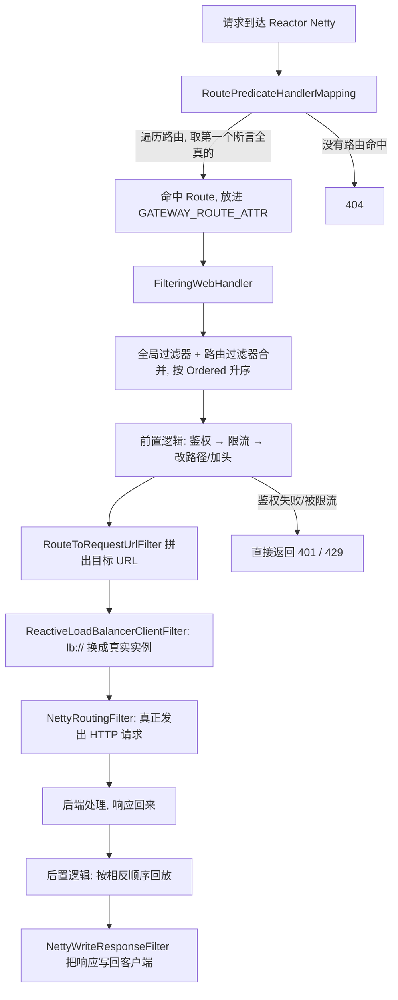

# Spring Cloud Gateway 的路由和过滤器怎么工作？限流该落在哪一层？

> 网关"该做什么"是概念问题，"它到底怎么把一个请求转出去"才是实现问题。这篇只讲后者：断言怎么匹配、过滤器链怎么排序、请求在哪一刻被真正发出去，以及限流挂在这一层时具体怎么落、该不该只放这一层。

## 先把边界划清：实现机制 vs 职责取舍

周边两篇已经把概念层讲透了，这篇不重复：网关的职责边界、双层网关、Zuul/Kong/APISIX 怎么选，见 [API 网关做了什么？](/distributed-system/distributed-api-gateway.html)；令牌桶、漏桶、滑动窗口的算法差异，见 [限流算法怎么选](/high-availability/high-availability-rate-limiting.html)。

需要先立住一个模型差异：SCG 建立在 Spring WebFlux + Reactor Netty 上，一条请求从头到尾是**异步非阻塞**的——没有"一个请求占一个线程从头跑到尾"，线程只在有数据可处理时被调度。Servlet 栈的 Zuul 1.x 则是每请求占住一个容器线程等下游返回（Zuul 为什么被放弃、生态现状如何，前面那篇讲过）。这不是性能对比里的一个数字，而是下面所有坑的总根源：Servlet 模型里最多是"这个线程慢"，Reactor Netty 模型里是"event loop 被占住，所有路由一起慢"。

## 三个核心模型：RouteDefinition → Route → 匹配执行

| 概念              | 是什么                                                                      | 谁消费它                                             |
| ----------------- | --------------------------------------------------------------------------- | ---------------------------------------------------- |
| `RouteDefinition` | 配置里的路由定义：id、uri、predicates、filters、metadata                    | `RouteDefinitionLocator`（配置文件、内存、注册中心） |
| `Route`           | 运行时对象：多个断言 AND 后的 `Predicate` + 一组 `GatewayFilter` + 目标 URI | `RouteLocator` 负责转换与缓存                        |
| 匹配与执行        | `RoutePredicateHandlerMapping` 找路由，`FilteringWebHandler` 跑过滤器链     | WebFlux 的 HandlerMapping / WebHandler               |

一条能跑的 YAML（`spring.cloud.gateway.routes` 是 3.x/4.x 的常见前缀）：

```yaml
spring:
  cloud:
    gateway:
      routes:
        - id: order-route
          uri: lb://order-service # lb:// 交给负载均衡过滤器换成真实 ip:port
          predicates:
            - Path=/api/order/**
          filters:
            - StripPrefix=1 # /api/order/1 -> /order/1
            - name: RequestRateLimiter
              args:
                redis-rate-limiter.replenishRate: 50
                redis-rate-limiter.burstCapacity: 100
                key-resolver: "#{@ipKeyResolver}"
```

两个容易忽略的语义：**同一路由里的断言是"与"关系**（全部为真才算命中，没有"或"，要表达或只能拆路由）；**路由 URI 里写的 path 会被忽略**（官方明确说了），改路径只能靠 `StripPrefix`/`PrefixPath`/`RewritePath` 这类过滤器，`uri: lb://order-service/order` 是无效的。

> 版本边界：5.x 起配置前缀挪到了 `spring.cloud.gateway.server.webflux.*`，实现也拆成 `spring-cloud-gateway-server-webflux` 与 `spring-cloud-gateway-server-webmvc` 两个模块（后者是 Servlet 栈的新选择）。抄配置前先对一眼官方配置元数据。

## 一次请求在网关内部走了哪几步



**① 路由匹配**：`RoutePredicateHandlerMapping` 拿 `RouteLocator` 的 Route 列表，**按顺序取第一个断言全真的路由**，不是"最精确者胜"。所以路由顺序本身就是配置语义：`Path=/api/order/**` 必须排在 `Path=/api/**` 前面，否则细粒度规则永远轮不到。路由内部各断言工厂（`PathRoutePredicateFactory` 等）按 `Ordered` 排好后组合成一个 `Predicate`——工厂顺序只影响短路顺序，不影响真假结果，别把"工厂的 order"当"匹配优先级"。

**② 过滤器链组装**：`FilteringWebHandler` 把**全局过滤器**（所有路由生效）和**路由过滤器**（YAML `filters` 配的）合并成一条链，统一按 `Ordered` 排序。排序结果决定两个阶段：前置按升序走一遍，后置再按降序回放一遍（洋葱模型）——`order` 小的先进入、后退出。

**③ 从"路由 uri"到"真实 URL"**：`RouteToRequestUrlFilter` 用请求 path 拼出目标 URL 放进 `GATEWAY_REQUEST_URL_ATTR`；`ReactiveLoadBalancerClientFilter` 发现 scheme 是 `lb`，就调 Spring Cloud LoadBalancer 把服务名解析成一个实例并**原地替换 URI**——这是网关与服务发现/负载均衡的接缝（实例怎么挑见 [服务发现](/distributed-system/distributed-service-discovery.html)）。解析不到实例默认 503，可配 `spring.cloud.gateway.loadbalancer.use404=true` 改成 404。

**④ 真正发请求**：`NettyRoutingFilter` 看到 scheme 是 `http`/`https` 才用 Netty `HttpClient` 发出去，响应存进 `CLIENT_RESPONSE_ATTR`。它排在链尾，前置阶段是最后一个动手的人——在它之前改 exchange 都来得及，之后只是收尾。

**⑤ 写回响应**：`NettyWriteResponseFilter` 的 order 很小，前置最早进入、后置最后收尾，负责把后端响应写回客户端。这也解释了经典报错 `response already committed`：谁想在它之后再写响应，都会撞上。

## 断言工厂和过滤器工厂：常用的就这些

断言决定"这条路由接不接这个请求"：

| 断言                       | 写法                                                                                        | 典型用途                                                                                 |
| -------------------------- | ------------------------------------------------------------------------------------------- | ---------------------------------------------------------------------------------------- |
| `Path`                     | `Path=/api/order/**,/api/pay/**`                                                            | 按路径前缀分流，最常用                                                                   |
| `Method`                   | `Method=GET,POST`                                                                           | 只放行规定方法，减少无意义转发                                                           |
| `Header`                   | `Header=X-Tenant, vip\d+`                                                                   | 多租户分流、灰度标（配合 [灰度发布](/distributed-system/distributed-gray-release.html)） |
| `Query`                    | `Query=debug`                                                                               | 内部调试入口、开关类接口                                                                 |
| `Host`                     | `Host=**.example.com`                                                                       | 多域名共用一套网关                                                                       |
| `Weight`                   | `Weight=order-group, 90`                                                                    | 按比例灰度，同组多条路由权重和为 100                                                     |
| `After`/`Before`/`Between` | `Between=2026-01-01T00:00:00+08:00[Asia/Shanghai],2026-02-01T00:00:00+08:00[Asia/Shanghai]` | 活动窗口、定时放开                                                                       |

过滤器决定"转发前后做什么"，语法都是 `Name=参数` 或 `name: Name` + `args:`：

| 过滤器                                   | 作用                 | 备注                                                                                 |
| ---------------------------------------- | -------------------- | ------------------------------------------------------------------------------------ |
| `StripPrefix` / `PrefixPath`             | 去/加路径前缀        | 与后端 `context-path` 叠加会 404                                                     |
| `RewritePath`                            | 正则改写路径         | YAML 里写 `$\{segment}`，否则被占位符解析吃掉                                        |
| `AddRequestHeader`/`RemoveRequestHeader` | 增删请求头           | 传租户、链路标识；删掉客户端伪造的内部头                                             |
| `SetResponseHeader`                      | 改响应头             | 统一打版本号、缓存策略                                                               |
| `DedupeResponseHeader`                   | 去重响应头           | `RETAIN_UNIQUE` 治 CORS 双份头                                                       |
| `Retry`                                  | 失败重试             | 只对幂等接口开，见后面的坑                                                           |
| `CircuitBreaker`                         | 接 Resilience4j 熔断 | 状态机与降级策略见 [熔断](/high-availability/high-availability-circuit-breaker.html) |
| `RequestRateLimiter`                     | 限流                 | 本篇重点，下面单开一节                                                               |

两条判断：**能靠断言表达的别用过滤器**（断言不通过直接 404，链都不用进）；**涉及业务语义的校验别写成过滤器**（"这个用户能不能看这条订单"是业务服务的活）。

## 自定义扩展：GatewayFilter、GlobalFilter 和 Order

```java
// 只对配了它的路由生效, 可带参数; 类名必须以 GatewayFilterFactory 结尾, YAML 里简写成 TenantHeader
@Component
public class TenantHeaderGatewayFilterFactory
        extends AbstractGatewayFilterFactory<TenantHeaderGatewayFilterFactory.Config> {

    public TenantHeaderGatewayFilterFactory() { super(Config.class); }

    @Override
    public GatewayFilter apply(Config config) {
        return (exchange, chain) -> chain.filter(exchange.mutate()
                .request(exchange.getRequest().mutate()
                        .header("X-Tenant-Id", config.getTenantId())
                        .build())
                .build());
    }

    public static class Config {
        private String tenantId; // getter / setter 略
    }
}
```

```java
// 全局生效: 所有路由都过, 顺序全靠自己声明
@Component
public class AuthGlobalFilter implements GlobalFilter, Ordered {
    @Override
    public Mono<Void> filter(ServerWebExchange exchange, GatewayFilterChain chain) {
        if (!valid(exchange.getRequest().getHeaders().getFirst("Authorization"))) {
            exchange.getResponse().setStatusCode(HttpStatus.UNAUTHORIZED);
            return exchange.getResponse().setComplete(); // 到此为止, 不再往后走
        }
        return chain.filter(exchange).then(Mono.fromRunnable(() -> recordCost(exchange)));
    }

    @Override
    public int getOrder() { return -100; } // 明确写死: 要比限流、改路径、发请求都早
}
```

`Order` 是这篇最该记住的工程细节，因为**写错不报错，只变行为**：

- **不实现 `Ordered` 的 `GlobalFilter` 会被当成最低优先级**（等价 order 最大）：它的"前置"跑在链尾、"后置"跑在链头。你想"请求进来先鉴权"，实际变成"什么都做完了才鉴权"。
- **顺序写反会把限流额度打光**：限流排在鉴权前面，未认证的垃圾流量先消耗令牌桶，正常用户被 429。正确顺序是"先认出你是谁，再决定给不给你配额"。
- **后置阶段重复写响应**：order 最小的过滤器后置最后执行，那时响应已经写出去了，再 `setStatusCode`/`writeWith` 就是 `response already committed`。后置逻辑一律先判断 `exchange.getResponse().isCommitted()`。

一个可操作约定：全局过滤器按"身份 → 配额 → 观测"分段分配 order（鉴权 -200~-100、限流 -99~0、日志埋点 100+），团队内固定，比每人拍一个 `@Order(-1)` 靠谱。

## 线程模型：过滤器里绝对不要阻塞

event loop 线程数是 CPU 核数量级，一个实例可能只有 4~8 个。**任何过滤器里做阻塞调用，等于把一个 event loop 钉死在那儿**，这段时间它处理不了其他连接的读写事件。现象很有辨识度：

> 某个过滤器里加了一次 JDBC 查询做鉴权 → 该接口 QPS 一高，网关所有路由 P99 一起抬升，连无关的健康检查也慢；CPU 不高（线程在等 IO），但吞吐上不去，栈里一片 `reactor.netty` 线程卡在 JDBC 的 socket read 上。

| 看起来无害的写法                                       | 后果                                        |
| ------------------------------------------------------ | ------------------------------------------- |
| JDBC / MyBatis 查库做鉴权                              | 连接池等待 + socket 读，直接钉死 event loop |
| `RestTemplate`、`HttpURLConnection`、同步 SDK          | 同步等下游返回                              |
| `Thread.sleep`、`CountDownLatch.await`、`future.get()` | 显式阻塞，最致命                            |
| `synchronized` 大段临界区 / 全局锁                     | 不是 IO 阻塞，但把并发压成串行              |

三条出路，按推荐度排序：**别在网关做**（查库鉴权改成"验 JWT 签名 + 看声明"，或交给业务服务）；**换非阻塞客户端**（`WebClient`、Reactive Redis，返回 `Mono`/`Flux` 自然不占线程）；**实在要阻塞就切线程池**——`Mono.fromCallable(...).subscribeOn(Schedulers.boundedElastic())`。注意是 `subscribeOn`（决定整条链在哪个线程跑）而不是 `publishOn`（只影响下游操作符），且 `boundedElastic` 队列有界，堆积时会拒绝而不是无限吃内存。

测试期就该拦住它：接 `BlockHound`，单测里 `BlockHound.install()`，非允许线程上的阻塞调用直接抛异常（JDK 13+ 需加 `-XX:+AllowRedefinitionToAddDeleteMethods`）。压测只能证明"当时没炸"，BlockHound 才能证明"这段代码不会炸"。

## 限流落在网关这一层怎么实现

`RequestRateLimiter` 是内置的限流过滤器（需 `spring-boot-starter-data-redis-reactive`），背后是 `RedisRateLimiter`：**Redis + Lua 实现的令牌桶**。逻辑在 Lua 里一次执行完——取时间、按 `replenishRate` 补令牌、判断够不够、扣减、写回，靠脚本原子性避免"读-改-写"竞态。因此它是**跨实例的全局限流**：三个网关实例共享同一个 key，合计不超配置值，这是本地 `RateLimiter`（Guava、Semaphore）做不到的。

| 参数                                 | 含义                           | 调错会怎样                                             |
| ------------------------------------ | ------------------------------ | ------------------------------------------------------ |
| `redis-rate-limiter.replenishRate`   | 每秒补多少令牌，即长期平均速率 | 调小 → 平时就 429；调大 → 起不到保护                   |
| `redis-rate-limiter.burstCapacity`   | 桶容量，即单秒最多放行多少     | 等于 `replenishRate` → 匀速无突发；设 0 → **全部拒绝** |
| `redis-rate-limiter.requestedTokens` | 一次请求消耗几个令牌，默认 1   | 调大 → 该路由更"贵"，可给重接口加权                    |

两个官方文档里给了、但很多人不知道的技巧：**想要低于 1 次/秒**，配 `replenishRate=1`、`requestedTokens=60`、`burstCapacity=60`，等价每分钟 1 次，不用自己造窗口；**想给接口定不同"价格"**，重接口 `requestedTokens: 5`、轻接口 1，比拆多个桶省事。

`KeyResolver` 决定"按什么维度限"，返回值就是 Redis key 的后缀：

```java
@Bean
public KeyResolver ipKeyResolver() { // YAML 里用 #{@ipKeyResolver} 引用
    return exchange -> Mono.just(Objects.requireNonNull(
                    exchange.getRequest().getRemoteAddress()).getAddress().getHostAddress());
}
```

常见维度：按 IP（挡匿名刷量）、按用户（挡单账号刷接口，通常比 IP 更贴业务）、按租户（配合配额售卖）、按接口（key 里拼 path）、按 `Header` 里的调用方 ID（开放平台）。

**这里纠正一个流传很广的说法**：默认的 `PrincipalNameKeyResolver` 在"没有认证信息"时**不是退化成"单 key 全局限流"，而是取不到 key**。官方文档写得很清楚：默认取不到 key 时**请求会被拒绝**，可用 `spring.cloud.gateway.filter.request-rate-limiter.deny-empty-key`（true/false）和 `empty-key-status-code` 调整。所以真实事故长这样：网关没做认证、又没配 `KeyResolver`，所有请求都因"空 key"被挡，且现象不是 429，排查时容易往鉴权方向找错。**结论：生产必须显式提供 `KeyResolver`。**

超限默认 `429 Too Many Requests`，可用过滤器的 `statusCode` 参数改掉；再配合统一错误体，客户端才能区分"被限流"和"服务挂了"。

## 限流该落在哪一层：网关总闸 + 服务内配额

标题后半句直接回答：**边缘总闸放网关，业务配额和热点参数放服务内，两层都得有**。理由不是"分层更优雅"，而是两层看到的信息根本不同：

| 维度     | 网关这一层能看到                       | 只有服务内才知道                        |
| -------- | -------------------------------------- | --------------------------------------- |
| 请求特征 | IP、Header、Path、Method、认证后的主体 | 这个用户本月配额还剩多少                |
| 业务状态 | 基本看不到                             | 哪个 SKU 是热点、哪个租户买了多少 QPS   |
| 保护对象 | 自身连接数、内网入口、下游整体         | 自己的线程池、DB 连接池、第三方通道配额 |
| 变更节奏 | 改规则走网关发布，影响全局             | 跟业务代码走，改一个接口不影响别人      |

只留网关：它不知道业务配额，只能做粗粒度限流，差异化配额全塞进网关配置，网关就变成"谁都要改"的瓶颈——正是 [API 网关做了什么？](/distributed-system/distributed-api-gateway.html) 说的巨石网关。只留服务内：脏流量已经过网关、进内网、占了一次连接和转发，且每个服务都得自己扛入口级刷量。落地上，服务内用 Sentinel 补业务维度（它的 SCG 适配模块可以把"路由"和"自定义 API 分组"当资源来限流），热点参数、租户配额、依赖保护都在服务里做；算法层怎么选见 [限流算法怎么选](/high-availability/high-availability-rate-limiting.html)。

还有一个必须在设计阶段定下来的问题：**Redis 挂了怎么办**。`RedisRateLimiter` 强依赖 Redis，Redis 超时时每个请求都多一次失败等待。两条策略，本质是可用性取舍，不是技术细节：fail-open（限流失效、业务继续可用，适合浏览查询类）与 fail-closed（全拒、保护后端，适合支付下单登录）。工程上常见的是**按接口分级 + 提前演练**：关键接口 fail-closed，其余 fail-open，并给 Redis 调用设短超时加本地兜底（本地计数器先挡一刀），把"限流组件自己成为单点"显式处理掉。

## 超时、缓冲与响应回写

```yaml
spring:
  cloud:
    gateway:
      httpclient:
        connect-timeout: 1000 # 毫秒
        response-timeout: 5s # java.time.Duration
```

按路由覆盖写在 `metadata` 里，**单位不一样**：全局 `response-timeout` 是 `Duration`（`5s`），按路由的 `response-timeout` 是**毫秒数**（如 `3000`），写 `5s` 会解析失败或语义走偏；按路由配负值可关掉全局超时。

超时值只有一条原则：**网关必须比后端服务超时大一点**。链路是"客户端 → 网关 → 服务 → DB"，如果服务和网关都是 5s，两者进入竞态：网关先断、给用户 504，服务还在跑甚至继续写库、继续调下游。留 1~2s 余量，让"正常超时"由最内层先触发、业务自己降级，网关超时只兜"服务彻底卡死"。

响应体两件事：**没人读 body 时是流式转发**，SCG 不会把整个响应读进内存；一旦加了 `ModifyResponseBody`、`CacheRequestBody` 或任何读 body 的过滤器，整个 body 就进内存，受编解码缓冲上限约束（`spring.codec.max-in-memory-size` 一类配置，默认 256KB 量级），超了抛 `DataBufferLimitException`——大文件上传下载要么不碰 body，要么绕开网关。**`response already committed`** 几乎总是"有第二个地方在写响应"（兜底过滤器、`ErrorWebExceptionHandler`、后置阶段又 `writeWith`），修法是写前判断 `isCommitted()`，并把"谁能写响应"收敛到一处。

## 动态路由与运维

`RouteDefinitionRepository` 是路由存储抽象，官方内存实现（`InMemoryRouteDefinitionRepository`）**只适合静态配置**：路由放堆里，改了不落盘、重启回到配置文件、多实例也不共享——A 实例 POST 一条路由，B 实例完全不知道。

生产常见三种做法：**配置中心**（Nacos/Config 存路由，收到变更后发 `RefreshRoutesEvent` 重建路由表，多实例一起生效）；**数据库 + 自定义 `RouteDefinitionRepository`**（路由入库、管理后台增删改，自己处理多实例一致性与缓存）；**`DiscoveryClient` 自动路由**（按服务名生成 `/{serviceId}/**` 默认路由，适合"服务名即路径"，路径语义复杂时不好用）。

运维入口是 Actuator：`GET /actuator/gateway/routes` 看生效路由，`POST /actuator/gateway/refresh` 强制刷新，`POST /actuator/gateway/routes/{id}` 增改、`DELETE` 删除（记得开 `management.endpoint.gateway.enabled`，具体端点行为以官方 Actuator API 文档为准）。**这些端点必须鉴权，最好只在内网端口暴露**：能改路由等于能把流量导到任意地址，把 `/api/pay/**` 指到自己机器上，就是一次不需要任何漏洞的中间人。把 `exposure.include=*` 和网关一起放公网，等于开了个路由改写后门。

## 容易踩的坑

- **CORS 双份响应头**：网关配了 `globalcors`、下游又配一遍，浏览器判非法。用 `DedupeResponseHeader=Access-Control-Allow-Origin Access-Control-Allow-Credentials, RETAIN_UNIQUE` 收敛；预检 `OPTIONS` 没有匹配路由时还要 `add-to-simple-url-handler-mapping: true` 才进 CORS 处理。
- **`lb://` 服务名不匹配**：注册中心里的大小写、连字符与配置不一致，表现是 503（配 `use404` 后变 404）。先在 `/actuator/gateway/routes` 看 uri，再和注册中心名字逐字符比对。
- **`StripPrefix` 撞上后端 `context-path`**：后端是 `/order`、YAML 里又 `StripPrefix=1`，最终变成 `/order/order/1` 或直接 404。写清"客户端路径 → 网关处理后 → 后端收到"，比在日志里猜快。
- **重试打在非幂等接口上**：`Retry` 遇超时再发一次 POST，用户下两单。只给 GET 或明确幂等的接口开，用 `methods`/`series`/`exceptions` 限定范围，下游还要有幂等键兜底（[幂等设计](/high-availability/high-availability-idempotency-design.html)）。
- **全局过滤器忘写 `Ordered`**：默认最低优先级，前置跑最后、后置跑最前，日志埋点响应改写全乱，而且日志看着一切正常。
- **WebFlux 里混进 `spring-boot-starter-web`**：启动直接失败，报 `Spring MVC found on classpath, which is incompatible with Spring Cloud Gateway`。多半不是自己加的，而是某公共模块传递依赖带进来的，用 `mvn dependency:tree` 揪出来 `<exclusion>` 掉。
- **过滤器里做阻塞调用**：见线程模型那节。压测能过不代表没事，并发一上来就是全站 P99 抬升。
- **限流 key 选错**：用官方示例里从 query 取 `user` 的 `KeyResolver`（文档自己都标注不建议生产），等于谁都能换 key 绕过；反过来用默认 `PrincipalNameKeyResolver` 又没做认证，就是空 key 全拒。

## 小结

1. SCG 三层模型是 `RouteDefinition`（配置）→ `Route`（`Predicate` + 过滤器 + 目标 URI）→ 匹配执行；同一路由的断言是"与"，路由之间"先命中先赢"，所以路由顺序本身就是配置语义。
2. `FilteringWebHandler` 把全局过滤器与路由过滤器合并后按 `Ordered` 排序，前置升序、后置降序，`order` 小的先进入后退出；`ReactiveLoadBalancerClientFilter` 把 `lb://` 换成真实实例，`NettyRoutingFilter` 才真正发包，`NettyWriteResponseFilter` 最后回写响应。
3. 全链路异步非阻塞意味着过滤器里任何阻塞调用都会钉住 event loop，现象是"所有路由一起慢、CPU 还不高"；要阻塞就 `subscribeOn(Schedulers.boundedElastic())`，测试期用 BlockHound 兜住。
4. 网关限流是 `RequestRateLimiter`（Redis + Lua 令牌桶，跨实例全局），三个参数为 `replenishRate`／`burstCapacity`／`requestedTokens`，`KeyResolver` 必须显式配——空 key 默认被拒，不是"退化成全局限流"。
5. 限流分两层：网关管入口总闸（挡脏流量、保护内网），服务内管业务配额与热点参数；Redis 故障时 fail-open 还是 fail-closed 必须按接口提前定。

## 参考

综合自仓库内 JavaGuide 的 Spring Cloud Gateway 面试资料与站内网关、限流两篇笔记，并对照 Spring Cloud Gateway 官方参考文档的 How It Works、Global Filters、RequestRateLimiter GatewayFilter Factory、Http timeouts configuration 等章节核对了类名、参数名与默认行为。

核对中纠正或补充的几点：资料里"底层基于 Netty 实现同步非阻塞 I/O"不准确，WebFlux/Reactor Netty 是异步非阻塞；"`RateLimiter` 只有一个实现类 `RedisRateLimiter`"已过时，新版本另有 Bucket4j 实现与自定义 `RateLimiter` bean 的扩展方式；"`PrincipalNameKeyResolver` 无认证信息时退化成单 key 全局限流"与官方文档不符，实际是取不到 key 即拒绝，可用 `deny-empty-key` 调整。配置前缀（`spring.cloud.gateway.*` 与 5.x 的 `spring.cloud.gateway.server.webflux.*`）、超时单位（全局 `Duration` vs 路由 metadata 毫秒）这类细节，落地前请再对一遍官方配置元数据。
