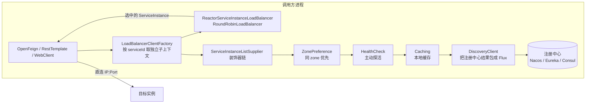

# LoadBalancer 怎么挑实例？缓存、健康检查和同可用区优先怎么算？

> 注册中心只回答"现在有谁"，**LoadBalancer 回答的是"这一次打谁"**。它由两截拼起来：一截负责交出候选实例列表（可套缓存、健康检查、zone 过滤），一截负责从列表里选一个；线上"扩容没流量、下线还在打、流量打偏"几乎都出在前一截。

## 先把位置摆正：服务端 LB 和客户端 LB 不是替代关系

同样是"把请求分到多台机器"，决策地点不同，代价完全不同：

| 维度         | 服务端 LB（Nginx / LVS / F5）    | 客户端 LB（Spring Cloud LoadBalancer）        |
| ------------ | -------------------------------- | --------------------------------------------- |
| 决策在哪     | 独立进程/设备里，调用方只认 VIP  | 调用方进程内，直接用 `IP:Port` 发请求         |
| 网络跳数     | 多一跳：客户端 → LB → 实例       | 少一跳：客户端 → 实例                         |
| 注册中心依赖 | 依赖（自己查或靠上游配置喂列表） | 依赖（启动期订阅，运行期用本地缓存）          |
| 跨语言       | 天然支持，一切 TCP/HTTP 流量都行 | 受限于 SDK，Java 生态才有这个抽象             |
| 灰度能力     | 靠权重/规则分流，改配置才生效    | 可读实例 metadata（版本、标签）做精确过滤     |
| 连接池复用   | 客户端↔LB、LB↔实例两段各自维护   | 调用方自己的连接池直连目标，可复用 keep-alive |

一句话取舍：**入口流量（南北向）用服务端 LB，内部服务间调用（东西向）用客户端 LB。** 前者要的是协议无关和集中管控，后者要的是少一跳、能按业务标签选实例。所以真实系统里两者常常同时存在：Nginx 收外部流量 → 网关 → 网关内部再对每个下游服务做一次客户端 LB。

## 骨架：一条 supplier 装饰器链 + 一个选择器

Spring Cloud LoadBalancer 把所有复杂度拆成两个可替换接口，这是理解它的唯一入口：

- `ServiceInstanceListSupplier`：**给我候选列表**。返回 `Flux<List<ServiceInstance>>`，是个响应式流，天然支持"列表变了就推新的"。
- `ReactorServiceInstanceLoadBalancer`：**从候选里选一个**，只有一个核心方法 `choose(request)`。

两者都不自己造数据：最里层的 supplier 是个"适配器"，把注册中心客户端（`DiscoveryClient` / `ReactiveDiscoveryClient`）的结果包成 Flux；外面再套一层层装饰器加能力。



三个消费方的接缝都在这张图里，细节不重复：`@LoadBalanced RestTemplate` 靠 `LoadBalancerInterceptor` 在发请求前把服务名换成真实地址；`WebClient` 用 `ReactorLoadBalancerExchangeFilterFunction`；OpenFeign 用 `FeignBlockingLoadBalancerClient`，也就是说 **Feign 的 `Client` 那一层里嵌着一次 LB 调用**——这条链上超时怎么收敛、重试在哪层打开，见 [OpenFeign 调用链](/system-design/spring-cloud/spring-cloud-openfeign-call-chain.html)。

还有个容易忽略的细节：`LoadBalancerClientFactory` 会给**每个 serviceId 建一份独立的子上下文**，所以"给订单服务换算法、库存服务保持默认"是天然支持的，配置按服务名隔离，不是全局开关。

## 装饰器链里每一层在干什么

官方用 `spring.cloud.loadbalancer.configurations` 提供几套"配方"（可选值随版本演进，以官方配置元数据为准），常见的是默认轮询、`zone-preference`、`health-check`、`same-instance-preference` 这几套——注意它是**整体换一套供应商组合**，不是叠加开关。自己拼链时，**谁套在谁外面，就决定了"先过滤什么"**：

| 装饰器                                       | 职责                                   | 不套它会怎样                             |
| -------------------------------------------- | -------------------------------------- | ---------------------------------------- |
| `DiscoveryClientServiceInstanceListSupplier` | 最内层，把注册中心结果转成 `Flux`      | 没有数据源，链根本跑不起来               |
| `CachingServiceInstanceListSupplier`         | 把列表缓存住，按 TTL 刷新              | 每次调用都打一次注册中心，QPS 直接压过去 |
| `HealthCheckServiceInstanceListSupplier`     | 定期对每个实例发健康探测，剔除探不通的 | 注册中心里"假活"的实例照打               |
| `ZonePreferenceServiceInstanceListSupplier`  | 有同 zone 实例就只留同 zone 的         | 跨 AZ 流量费和延迟白付                   |
| `HintBasedServiceInstanceListSupplier` 等    | 按 hint（版本、标签）过滤候选          | 灰度只能靠注册中心分组实现               |

顺序上有个判断标准值得记住：**过滤类装饰器要套在缓存外面**。如果把 zone 过滤放在缓存里层，缓存的就是"已过滤"结果，zone 配置变了要等 TTL 过期才生效；反过来放外面，缓存的是全量列表，过滤每次现算，改 zone 立刻生效。

## 选择器：轮询到底怎么"轮"，自定义从哪下手

默认实现 `RoundRobinLoadBalancer` 简单到可以一句话讲完：维护一个 `AtomicInteger` 计数器，`choose` 时自增并对实例数取模，取下标。写成伪代码就是 `instances.get(counter.incrementAndGet() % size)`。

两个读源码才注意得到的点：

- **下标必须保证非负**。计数器是 `int`，极端情况会溢出成负数，早期实现用 `Math.abs(...)` 兜，新版本改成了位运算取非负——排查"莫名 IndexOutOfBounds"时先确认版本行为。
- **列表为空时返回的是空响应而不是异常**，最后由上层翻译成 `503`。所以看到 503 时不要先去怀疑网络，先看候选列表是不是空的。

`RandomLoadBalancer` 只是把取下标换成随机数。想要权重，原生这两个实现**都不读权重**——这是最容易被"我知道 Nacos 有权重"带偏的地方：权重能否生效取决于你用的实现，`spring-cloud-alibaba` 提供的 `NacosLoadBalancer` 会读 Nacos 实例权重和同集群偏好，而原生 `RoundRobinLoadBalancer` 对权重一无所知。通用算法的取舍（加权轮询、最少活跃、一致性 Hash、P2C）在 [Dubbo 的负载均衡与容错](/distributed-system/rpc/dubbo-discovery-loadbalance-faulttolerance.html) 里已经讲过，这里不重复，只强调**框架抽象不同**：Dubbo 是 `Router + LoadBalance` 两级，Spring Cloud LB 是"整条 supplier 链 + 一个选择器"，过滤和选择被拆到了两个组件里。

## 列表是缓存的：这就是"扩容没流量"的总病根

一次调用**不会**去问注册中心。列表要经过至少三层缓存才送到选择器手里，任何一层没刷新，都会表现为"客户端视角的集群和注册中心视角的集群不是同一个"。排查就按这条链自外向内走，每层都有确定性的验证手段：

| 层               | 里面有谁                                    | 怎么验证                                                                                                                             |
| ---------------- | ------------------------------------------- | ------------------------------------------------------------------------------------------------------------------------------------ |
| ① 注册中心       | 服务端实例表（心跳/健康状态）               | Nacos 控制台服务列表，或 `curl "http://NACOS:8848/nacos/v1/ns/instance/list?serviceName=APP&namespaceId=NS"`（开启鉴权后需带 token） |
| ② 注册中心客户端 | `DiscoveryClient` 的本地缓存/快照           | `/actuator/health` 的 `discoveryComposite` 分组；先确认本地这份列表里到底有没有新实例                                                |
| ③ LB supplier    | `CachingServiceInstanceListSupplier` 的缓存 | 临时把 `spring.cloud.loadbalancer.cache.ttl` 调小对比；或打开 `org.springframework.cloud.loadbalancer` 的 DEBUG 日志看过滤前后数量   |
| ④ 连接层         | keep-alive 长连接 + 连接池里的陈旧连接      | `ss -tnp` / `netstat` 看 ESTABLISHED 是否长期固定指向同几台；抓包看有没有新 SYN                                                      |
| ⑤ 网关/入口      | 路由与实例列表缓存                          | 看网关侧日志里解析出的目标实例，和 ①②③ 逐层对比                                                                                      |

这条顺序的价值在于：**它能立刻把"框架问题"和"我的配置问题"分开**。如果 ① 里根本没有新实例，后面全都不用看，问题在 Provider 注册（namespace/group 不一致、健康检查没过、启动没注册）。如果 ① 有、②③ 也有，但流量就是不来，那多半是 ④⑤——长连接把新实例饿死了，这种现象在压测场景特别常见：老连接一直在用，没有新建连，轮询根本没机会轮到新机器。

## 权重、zone、标签：三个维度谁先谁后

生产上真正要控的是"往哪台多给点"，这需要三个维度。它们的语义完全不同，套错顺序结果会南辕北辙：

1. **标签/版本（能不能打）**：`version=v2`、`canary=true` 这类 metadata，决定某批实例**是否在候选集里**。属于准入判断，必须最先做。
2. **zone（打哪儿更便宜）**：同 AZ 优先，决定候选集的**空间范围**，属于第二层。
3. **权重（在剩下的里面怎么分）**：只在过滤后的子集内生效，**分母是子集，不是全量**。放最后。

用一个具体例子走一遍。6 个实例，`az-a` 有 s1/s2/s3（权重 100/100/50），`az-b` 有 s4/s5/s6（权重 100/100/50），配了 `spring.cloud.loadbalancer.zone=az-a`：

| 场景                    | 实际候选 | 流量分布                       |
| ----------------------- | -------- | ------------------------------ |
| 正常，zone=az-a         | s1,s2,s3 | 40% / 40% / 20%，az-b 三台吃 0 |
| az-a 全部不健康         | s4,s5,s6 | 退化到全量，40% / 40% / 20%    |
| 权重全是 0              | 全部     | 谁都不该接，实际取决于实现     |
| 灰度 version=v2 只有 s3 | s3       | 100% 打 s3，权重失去意义       |

最后一行是重点：**灰度和权重会互相"吃掉"**。按版本标签过滤后只剩一台时，再怎么加权也只有一台接流量，这时候观察到的"权重没生效"其实是候选集被缩成了单点。灰度这套玩法本身的设计取舍见 [灰度发布](/distributed-system/distributed-gray-release.html)。

## 同可用区优先：配错了等于白配

`spring.cloud.loadbalancer.zone` 一旦配上，`ZonePreferenceServiceInstanceListSupplier` 就开始工作：先在同 zone 里选，同 zone **一个健康实例都没有**时才退化到全部实例。为什么值得单独配：跨 AZ 调用既多几毫秒延迟，又按流量计费，高峰期这笔钱很实在。

三个必须知道的边界：

- **zone 不会自动猜**。K8s 里 zone 来自节点拓扑标签 `topology.kubernetes.io/zone`，但框架不会自己从 Pod 元数据里读出来喂给这个配置项，要么显式配，要么靠 spring-cloud-kubernetes 这类适配层注入。配了个没人认识的字符串，过滤器就一直是空集、一直退化，**看起来"在工作"，实际一次都没生效**。
- **要能从日志/指标上确认过滤真的发生了**。把 `org.springframework.cloud.loadbalancer` 调到 DEBUG（不同版本措辞不同），看过滤前后的实例数；或者干脆临时把 zone 配成一个不存在的值，如果流量分布毫无变化，说明这条链压根没装上。
- **zone 和注册中心的"集群/分组"是两套东西**。Nacos 的 cluster 名字、Eureka 的 zone 字段，都要显式映射到 LB 的 `zone` 语义上，名字对不上就是永久退化。

## 主动健康检查：开销是乘数，不是加法

`HealthCheckServiceInstanceListSupplier` 是个很诱人的开关——注册中心说有实例，但它自己定期去 ping 一遍，只把探通的留下。探测节奏和探测路径分别由 `spring.cloud.loadbalancer.health-check.interval`、`health-check.path` 这类配置控制。代价藏在乘数关系里：

```text
探测 QPS ≈ 实例数 ÷ 探测间隔 × 调用方实例数
```

按 1000 个下游实例、探测间隔 25 秒这个量级算，单个调用方就是每秒 40 个探测请求（间隔具体默认值以官方配置元数据为准，这里只看数量级）；如果这个 supplier 被 50 个调用方进程同时启用，就是 2000 QPS 全打在别人的健康端点上——而且每个调用方各探各的，注册中心的共享探测省不下来。所以结论很直接：**成百上千实例的集群，别靠客户端逐实例主动探活**，把探活交给注册中心或服务网格。

还要分清这是**第三套机制**，和另外两套不能互相替代：

| 机制          | 谁发起              | 影响什么                             | 典型周期         |
| ------------- | ------------------- | ------------------------------------ | ---------------- |
| K8s readiness | kubelet → Pod       | Pod 是否进 Endpoints，决定能否接流量 | 秒级，由探针配置 |
| 注册中心心跳  | Provider → 注册中心 | 实例在目录里是否 healthy             | 与心跳间隔相关   |
| LB 主动探测   | 调用方 → Provider   | 这次调用能不能选它                   | 由 LB 配置决定   |

最常见的误判是拿 readiness 探针去解释"注册中心里还有这台机器"——它们看的是不同的事，一个是 K8s 的 Endpoints 视角，一个是注册中心的实例表视角。

## 失败与重试：LB 层换实例，Feign 层再试一次就乘起来了

LB 层的重试语义很具体：**从候选里排除掉刚失败的那台，换一台重发**。实现上靠 `RetryAwareServiceInstanceListSupplier` 把上次失败的实例塞进请求上下文（`RetryableRequestContext` 这一类，类名随版本演进），下次选的时候过滤掉，避免"重试又打回同一台"。配置入口是 `spring.cloud.loadbalancer.retry.*`，默认倾向于只对 GET 这类幂等操作换实例重试，`retry-on-all-operations` 改这个行为（具体默认值以官方配置元数据为准）。

这层和 Feign 的 `Retryer` 是**两层独立开关**，同时打开就是乘法：LB 试 3 次 × Feign 试 3 次，一个业务请求最坏变 9 次下游调用，再加网关重试就是 27 次。工程口径只有两条：**只在一层重试**（同步链路通常放最外层，内层保持不重试让失败快速冒泡），**只对幂等操作重试**。机制推导见 [重试风暴](/high-availability/high-availability-retry-storm.html)，Feign 侧的默认值细节见 [OpenFeign 调用链](/system-design/spring-cloud/spring-cloud-openfeign-call-chain.html)。

## 换算法、改配置怎么落地，怎么证明生效

按服务定制的最小写法：

```java
// 只对 order-service 生效：挂在子上下文里，别的服务不受影响
@LoadBalancerClient(name = "order-service", configuration = OrderLbConfig.class)
public class OrderLbConfig {

    @Bean
    ReactorServiceInstanceLoadBalancer orderLb(Environment env, LoadBalancerClientFactory factory) {
        String name = env.getProperty(LoadBalancerClientFactory.PROPERTY_NAME);
        return new RoundRobinLoadBalancer(
                factory.getLazyProvider(name, ServiceInstanceListSupplier.class), name);
    }
}
```

两个坑：`@LoadBalancerClients(defaultConfiguration = ...)` 是全局默认，和按服务定制可同时存在、按服务优先；以及这个 configuration 类**别加 `@Configuration`**——加了会被主容器扫描成全局 Bean，全站算法一起变。

换完之后必须验证，否则"配了但没生效"根本看不出来：

1. 注册中心侧：实例的权重/元数据/zone 字段确实是你以为的值（接口或控制台直接看）。
2. 客户端侧：DEBUG 日志里链上到底装了哪几个 supplier（装的顺序对不对）。
3. 候选集：过滤后还剩几台。只剩一台时，权重和算法都无从体现。
4. 长连接：先在短连接下验证算法，再在 keep-alive 下验证真实分布——一条连接上的连续请求会落在同一台，短时间压测的分布必然不均匀。
5. 计数：按实例统计请求数（访问日志里的上游地址或自定义 metric），别只看 CPU——CPU 均匀不代表请求数均匀。

## 常见故障对照表

| 现象                                                                                   | 最可能的原因                                                              | 先验证什么                                       |
| -------------------------------------------------------------------------------------- | ------------------------------------------------------------------------- | ------------------------------------------------ |
| `503` + `Unable to find instance for xxx`（Feign 侧措辞类似 `No instances available`） | 候选列表为空：服务名大小写不一致、namespace/group 配错、实例没注册成功    | 注册中心接口里用**完全一样**的服务名查一次       |
| 扩容后新实例零流量                                                                     | ②③④ 某一层缓存没刷新，或长连接一直复用旧连接                              | 逐层打点对比，再看 `ss -tnp` 有没有新连接        |
| 下线实例还在收流量                                                                     | 优雅下线没走完、缓存未过期、连接未断                                      | 注册中心列表是否已摘除；摘除后客户端列表是否更新 |
| 流量打偏（几乎全压一台）                                                               | zone 配错导致退化、权重全 0、客户端只有一条长连接                         | 先确认候选集大小，再看连接数                     |
| 偶发连接超时/`Connection reset`                                                        | 选到了已下线实例，或连接池里的陈旧连接被对端先关                          | 抓包看失败请求是否集中在少数几个 IP              |
| 压测 QPS 上不去，CPU 却不忙                                                            | 每个请求都重建连接（默认 `Client.Default` 无连接池、`Connection: close`） | 抓包数 SYN 数量、看 TIME_WAIT                    |

## 面试怎么答

分三层递进，别一上来背算法：

1. **分工**：南北向用服务端 LB（Nginx/LVS，多一跳、跨语言、集中管控），东西向用客户端 LB（少一跳、能读实例标签做灰度）；两套经常同时存在。
2. **结构**：客户端 LB = `ServiceInstanceListSupplier` 装饰器链（发现 → 缓存 → 健康检查 → zone/hint 过滤）+ `ReactorServiceInstanceLoadBalancer` 选择器，按 serviceId 隔离子上下文，`RestTemplate`/`WebClient`/Feign 共用这套抽象。
3. **真会出故障的点**：列表是**缓存**的（五层排查），zone 配错会**静默退化**，权重只在过滤后的子集里生效，主动探测的开销是**乘数**，LB 重试和 Feign 重试叠起来会放大请求量。

只背"轮询/随机/加权"拿不到分，因为面试官想听的是第 3 层——**你知道它在哪里骗你**。

## 容易踩的坑

- **把 Nacos 权重当成自动生效**。原生 `RoundRobinLoadBalancer` 不读权重，权重生效的前提是用了读权重的实现（如 `NacosLoadBalancer`）。
- **以为每次调用都查注册中心**。查的是本地缓存，所以"注册中心已经更新"和"客户端已经知道"之间永远有时间差。
- **把 `spring.cloud.loadbalancer.cache.ttl` 当成唯一开关**。注册中心客户端自己还有一层缓存，两层都要看。
- **配了 zone 就当省了跨区流量**。名字对不上就是永久退化，退化时不报错，只在账单和延迟上体现。
- **在大集群打开主动健康检查**。开销是"实例数 × 调用方数 ÷ 间隔"，不是"每台一个"。
- **同时开 LB 重试和 Feign 重试**。乘法放大，非幂等写操作还会重复执行。

## 小结

1. 负载均衡分服务端（Nginx/LVS，多一跳、跨语言、集中管控）和客户端（Spring Cloud LoadBalancer，少一跳、能按标签选实例），入口和内部调用各用各的。
2. 结构是"两截"：`ServiceInstanceListSupplier` 装饰器链交候选列表（发现 → 缓存 → 健康检查 → zone 过滤），`ReactorServiceInstanceLoadBalancer` 从里面选一个，默认轮询就是计数器取模。
3. 列表是有缓存的，至少三层（注册中心端、注册中心客户端、LB supplier），再加连接层和网关，构成"扩容没流量/下线还在打"的五层排查顺序。
4. zone 优先、权重、版本标签的优先级是"准入 → 空间 → 分配"：先按标签筛能不能打，再按 zone 收范围，最后在子集内按权重分；zone 配错会静默退化。
5. 主动健康检查的开销是乘数关系；LB 重试（换实例）和 Feign 重试是两层，只留一层、只对幂等操作开。

## 参考

综合自 Spring Cloud Commons / LoadBalancer 官方参考文档中的类与配置项口径（`ServiceInstanceListSupplier`、`RoundRobinLoadBalancer`、`spring.cloud.loadbalancer.*`），并与站内 [服务发现](/distributed-system/distributed-service-discovery.html)、[Dubbo 的负载均衡与容错](/distributed-system/rpc/dubbo-discovery-loadbalance-faulttolerance.html) 两篇交叉核对：注册发现侧只保留"列表怎么来"的一句衔接，算法取舍交给 Dubbo 篇，本篇只讲 Spring Cloud 的实现结构与排障。

缓存 TTL、健康检查间隔、重试相关开关的默认值，不同小版本反复调整过，正文一律标注"以官方配置元数据为准"并只用数量级举例（如 25 秒 × 1000 实例 ≈ 每秒 40 个探测），没有写死任何未经验证的默认数值；对"原生实现是否读权重""zone 能否自动获取"两处做了显式纠偏。
