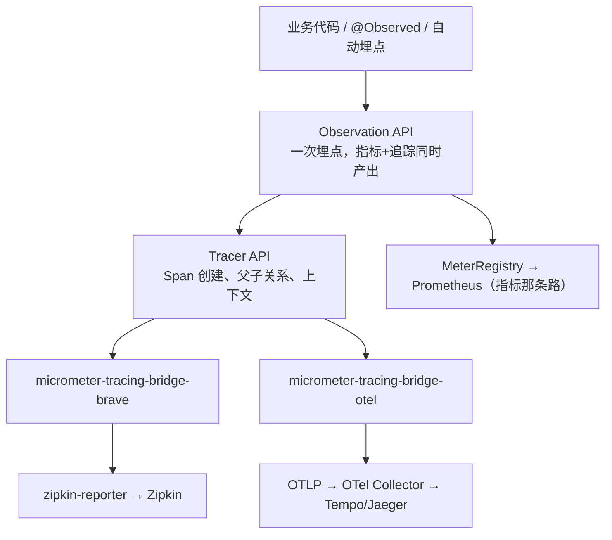

# 跨服务调用的 traceId 怎么串起来？断链了去哪查？

> “串起来”不是框架的魔法，而是一次显式搬运：把上游的 `traceId` 和当前 `spanId` 塞进某个载体，让下游读出来，当成自己这段操作的父上下文。

先看一个每个团队都遇到过的现场：用户下单报错，你从网关日志拿到 `traceId=4bf92f35...`，去订单服务搜，一条都搜不到；按时间段搜，发现订单服务那几行日志里确实有 `traceId`，但是另一个值，并且它是那段日志的起点——网关的 `spanId` 根本没出现在里面。两边数据都完整，就是接不上，这就是**断链**。

[可观测三支柱与 RED 指标](/high-availability/high-availability-observability-pillars.html) 讲清了三类信号的分工，[慢请求证据链怎么查](/high-availability/high-availability-slow-request-tracing.html) 讲了拿到 `traceId` 之后怎么按层切段。这篇是它们共同的上游问题：**`traceId` 到底怎么从网关一路传到数据库那一跳，传丢了往哪儿找。**

## 先把数据结构摆清楚：一个 trace，一棵 span 树

一次请求对应一个 trace，trace 由若干 span 组成，字段各司其职：

| 字段           | 是什么                  | 谁生成                  | 关键性质                       |
| -------------- | ----------------------- | ----------------------- | ------------------------------ |
| `traceId`      | 一次请求的全局唯一标识  | 链路入口（网关/首服务） | 全链路不变，所有 span 共享     |
| `spanId`       | 当前这段操作的标识      | 每个 span 开始时生成    | 每个 span 都不同               |
| `parentSpanId` | 上游那段操作的 `spanId` | 从请求载体里读出来      | **这一根指针就是“串起来”本身** |
| 起止时间+标签  | 耗时、状态码、SQL 摘要  | 埋点代码                | 算耗时占比、按错误过滤         |

没有 `parentSpanId`，你手里只是“一堆 span”，不是“一棵树”。树长这样：

```text
traceId = 4bf92f3577b34da6a3ce929d0e0e4736   ← 整棵树只有这一个值
gateway             GET /api/order/create    span=a1  parent=—   210ms
└── order-service   POST /api/order           span=b1  parent=a1  195ms
    ├── inventory-service POST /stock/lock    span=c1  parent=b1   62ms
    │   └── jdbc      select ... for update   span=c2  parent=c1   48ms
    ├── payment-service   POST /pay           span=d1  parent=b1   88ms
    └── kafka produce     order-created       span=e1  parent=b1    3ms
        └── (异步) coupon-service consume      span=f1  parent=e1   15ms
```

串链永远是这三步，换任何载体、任何框架都不变：**入口**取出 `traceId` 和上游 `spanId`（取不到就自己生成）；**建 span** 时令 `parentSpanId = 上游 spanId`；**出站**时把 `traceId` + **当前这个 span 的 `spanId`** 写进载体。第三步最容易写错：塞进去的必须是**当前** `spanId`，不是入口那个，塞错了树会塌成一层——所有服务都挂在网关下面变成星形，耗时占比再也算不对。

## 载体怎么选：四种场景，四类载体

### 进程内：ThreadLocal + 可关闭的 Scope

同一线程里从 Controller 走到 Service 不需要“传递”，只需要一个“当前 span 是谁”的登记簿。它就是 ThreadLocal（Brave 的 `CurrentTraceContext`、OTel 的 `Context`、Micrometer 的 `ThreadLocalAccessor` 都是在它上面做的封装），框架再给它套一个**可关闭的句柄**，也就是 Scope：`try (var ws = tracer.withSpan(span.start())) { ... }`，关闭时恢复成进入前的 span。[ThreadLocal](/java/concurrent/java-concurrency-threadlocal.html) 在这里的唯一意义，正好也是它全部局限的来源：**只对同一个线程有效。** 后面六个断链根因里有五个都是这句话的变体。

### HTTP：W3C `traceparent` 是标准，`X-B3-*` 是 Brave 的老格式

```text
traceparent: 00-4bf92f3577b34da6a3ce929d0e0e4736-00f067aa0ba902b7-01
             │  └────── traceId，32 位 hex ──────┘ └─ 上游 spanId ┘ └ 采样标志
             版本号
```

采样标志 `01` 表示“上游已决定采样”，下游按 parent-based 规则跟采，别自作主张丢掉。Brave 的老格式 B3 有两个变体：多头 `X-B3-TraceId` / `X-B3-SpanId` / `X-B3-ParentSpanId` / `X-B3-Sampled`，或单头 `b3: {traceId}-{spanId}-{sampled}-{parentSpanId}`。还有个真实细节：Brave 历史上默认 64 位 `traceId`（16 hex），W3C 要求 128 位（32 hex），桥接时高位补 0——所以“上游 16 位、下游 32 位”往往是同一个 ID 的两种写法，别急着判定断链。

### MQ：消息头是唯一的跨进程载体

生产端把上下文写进消息头（Kafka record header、RabbitMQ message header、RocketMQ user property）；消费端在**反序列化之后、业务方法之前**读出来，作为消费 span 的父上下文。这里要纠正一个观念：消费端“另起一个 trace”不是优雅降级，它就是断链——消息的因果是确定的，生产是消费的父操作，断了之后“这条消息是谁在哪个请求里发出来的”就永久丢了。

### 定时任务/批处理：没有上游，就自己当入口

定时任务不是断链，它压根没有上游。正确做法是**每次执行新建一个 trace**，把 `traceId` 打进日志，再用批次号/任务名做 tag。两个反向错误都常见：每条记录生成一个随机 `traceId`（图上一堆点，看不出属于同一次任务）；进程启动时生成一次然后一直复用（一个月所有执行挤在一个 trace 里，没法查）。

| 载体        | 谁写           | 谁读               | 断链高发点                         |
| ----------- | -------------- | ------------------ | ---------------------------------- |
| ThreadLocal | 框架进出时设置 | 同线程的下一行代码 | 换线程（线程池、`@Async`、并行流） |
| HTTP 头     | 客户端拦截器   | 服务端入口过滤器   | 自写客户端、手搓 `RestTemplate`    |
| MQ 消息头   | 生产者拦截器   | 消费者容器         | 一端没配、或用了原生 client        |

## Spring Boot 3 时代的实现栈：一次埋点，指标和追踪都拿到

老版本（Spring Cloud Sleuth）和新版本（Micrometer Tracing）分层几乎一样，只是每层换了名字：



中间那层 **Observation** 是重点：`Observation.createNotStarted("xxx", registry).observe(...)` 写一次，指标那条路出 Timer/计数，追踪那条路出 span，两边标签含义一致；这就是新代码推荐用 `Observation` 而不是只抓 `Tracer` 的原因。

Sleuth 和 Micrometer Tracing 的关系，面试口径可以这样说：**原理同源**（Brave 打底、B3/W3C 头、ThreadLocal 上下文，断链根因一模一样）；**API 与配置换代**（`spring.sleuth.sampler.probability` → `management.tracing.sampling.probability`，依赖换成 `micrometer-tracing-bridge-brave` 或 `-otel`）；**Sleuth 已进入维护状态、不再跟 Boot 3 主线**。所以“面试还在问 Sleuth”是因为存量系统多，“项目该说 Micrometer Tracing”是因为新项目只能这么选。上报端属性名在大版本间有调整（如 Boot 4 改了 zipkin 前缀），具体以官方文档为准。

```yaml
management:
  tracing:
    sampling:
      probability: 0.1 # 不写也是 0.1，别以为默认全采
    propagation:
      type: W3C # 过渡期可写 W3C,B3，让两种头都能收
```

## 自动埋点覆盖到哪，哪里必须自己动手

“加了依赖就有全链路”是最大的误解。默认覆盖大概是这样：

| 组件                                            | 默认有 span？                                                 | 说明                                                                                        |
| ----------------------------------------------- | ------------------------------------------------------------- | ------------------------------------------------------------------------------------------- |
| Web 入站（Spring MVC / WebFlux）                | 有                                                            | 入口建 span，并提取请求头上下文作父 span                                                    |
| `RestTemplate`/`RestClient`/`WebClient`         | 有，**前提是用自动配置的 Builder**                            | 自己 `new RestTemplate()` 没有拦截器，头不会带 → 直接断链                                   |
| OpenFeign                                       | 有（需 `feign-micrometer` + 自动装配 `MicrometerCapability`） | 详见 [OpenFeign 调用链](/system-design/spring-cloud/spring-cloud-openfeign-call-chain.html) |
| Kafka 生产/消费                                 | 有（Spring Kafka 集成 observation）                           | 生产塞头、消费提取；绕开 `KafkaTemplate` 用原生 client 就没有                               |
| JDBC                                            | **默认没有 SQL 语句级 span**                                  | 官方口径是 SQL 级观测靠独立的 `datasource-micrometer`（或 p6spy / datasource-proxy）补      |
| `@Async` / 自建线程池 / `CompletableFuture`     | **没有**                                                      | 必须在提交任务时搬运上下文                                                                  |
| 自写 `HttpURLConnection` / 裸 OkHttp / 自研 RPC | **没有**                                                      | 自己加拦截器写头                                                                            |

没覆盖到的地方手动补一层。只要 span 用 `Tracer`；要 span 又要指标用 `Observation`：

```java
// 只要 span
Span span = tracer.nextSpan().name("calc-discount").tag("sku", sku);
try (Tracer.SpanInScope ws = tracer.withSpan(span.start())) {
    return doCalc();
} finally {
    span.end();
}
// span + 指标：低基数标签进指标，高基数只进 span
Observation.createNotStarted("calc-discount", registry).lowCardinalityKeyValue("channel", "app").observe(() -> doCalc());
```

## 日志怎么和 trace 关联（以及“traceId 全是空”的排查）

链路后端只告诉你“慢在哪一跳”，具体报错还得回日志翻，所以每行日志都得带 `traceId`。Boot 3 + Micrometer Tracing 默认就带关联字段，想自定义格式改这里：

```yaml
logging:
  pattern:
    correlation: "[${spring.application.name:},%X{traceId:-},%X{spanId:-}] " # 是 correlation，不是 level
  include-application-name: false # 上面已带应用名，避免重复
```

打出来是 `[order-service,4bf92f3577b34da6a3ce929d0e0e4736,00f067aa0ba902b7]`，一眼能从网关跳到下游。有资料说“把 `traceId` 塞进 `logging.pattern.level` 也能让每行都有”——能生效（那一段同样是 pattern 的一部分），但语义错了：`level` 管日志级别那一段，关联字段的官方位置是 `logging.pattern.correlation`。另外 `%X{traceId}` 不带 `:-` 时，MDC 缺值会打出 `traceId_IS_UNDEFINED` 之类字样，反而更乱。

日志里 `traceId` 全是空，八成是五种之一：

1. **依赖不完整**：只有 actuator 没有 bridge，`Tracer` 是 no-op，MDC 永远不写；
2. **打日志的线程不是处理请求的线程**：线程池 / `@Async` / `CompletableFuture`；
3. **日志发生在埋点生效之前**：自定义 `Filter` 顺序在观测过滤器之前、`@PostConstruct` 里、启动期、探针；
4. **没走 slf4j**：`System.out`、自研 logger；
5. **采集侧丢字段**：JSON 编码器没开 MDC 输出（`includeMdcKeyName` 之类），或采集配置只留白名单——应用日志有、进 ES 没有，属于采集问题。

还有个反向的坑：**MDC 串味**。手写 `MDC.put("traceId", ...)` 却不在 `finally` 清，线程复用后下一个请求的日志会带着上一个请求的 `traceId`。这跟[线程池](/java/concurrent/java-concurrency-thread-pool.html)里“ThreadLocal 不清就串数据”是同一个坑，修法也一样：`try/finally MDC.remove`，或者干脆交给框架的 Scope 去关。

## 断链的六大根因

除了第 6 条，其余五条本质都是“上游上下文没搬到下游”，只是断在不同位置。每条按“现象 → 机制 → 验证/修法”过一遍。

### 1. 自建线程池：ThreadLocal 不跨线程

- **现象**：接口日志 `traceId=X`，它提交给线程池的任务日志 `traceId=Y`，且 `Y` 是新 trace 的起点。
- **机制**：任务在**另一个线程**上跑，那线程的登记簿里没有当前 span，`tracer.currentSpan()` 返回 null，自动埋点顺手新建了一个 trace。
- **验证/修法**：在任务体第一行打日志对比 `traceId`。修法是给线程池装 `TaskDecorator`，提交时快照上下文、执行时还原：

```java
@Bean
ThreadPoolTaskExecutor bizExecutor() {
    ThreadPoolTaskExecutor executor = new ThreadPoolTaskExecutor();
    executor.setCorePoolSize(16);
    executor.setTaskDecorator(new ContextPropagatingTaskDecorator()); // 关键这一行
    return executor;
}
```

不是 Spring 管的池子（`Executors.newFixedThreadPool`、第三方库内部线程），就手写包装：`ContextSnapshot.captureAll().wrap(task)`，或引入 `TransmittableThreadLocal`（TTL）配合它的 executor 包装兜底。

### 2. `@Async` / `CompletableFuture`：同一条坑的两种写法

- **现象**：主流程 `traceId` 正常，`@Async` 方法里的日志没有 `traceId`，或换成了新值。
- **机制**：`@Async` 最终也是把任务丢进 `AsyncTaskExecutor`，是否传播取决于该执行器有没有 `TaskDecorator`；`CompletableFuture.supplyAsync` 更彻底——默认用公共 ForkJoinPool，任何框架都碰不到。
- **验证/修法**：看子线程日志的 `traceId`，顺便打一行线程名确认换了线程。较新的 Boot 给自动配置执行器提供了 `spring.task.execution.propagate-context` 开关（版本边界以官方文档为准）；没有开关就注册 `ContextPropagatingTaskDecorator` Bean，Boot 会把它套到自动配置的 `ThreadPoolTaskExecutor` 上；`CompletableFuture` 必须显式 `ContextSnapshot.captureAll().wrap(...)`，没有可依赖的自动路径。

### 3. 自写 HTTP 客户端：头根本没带出去

- **现象**：本服务日志有 `traceId`，下游入站是另一个 `traceId`（或干脆没有）。
- **机制**：`HttpURLConnection`、裸 OkHttp、自研 RPC 没有拦截器，出站头里没有 `traceparent`/`b3`，下游取不到上下文只能自己新建。
- **验证/修法**：抓一次真实请求看有没有 `traceparent`——这一刀能立刻切分“埋点问题”和“采样问题”。修法是加拦截器，从 `tracer.currentSpan()` 取上下文注入头：OkHttp 用 `Interceptor`，Feign 用 `RequestInterceptor`，自研协议自己定字段并写进[接口契约](/engineering/engineering-api-contract-testing.html)。

### 4. MQ 断链：生产端没塞，或消费端没取

- **现象**：消费端日志的 `traceId` 和生产者那次请求毫无关系，图上是两条独立链。
- **机制**：生产端绕过了带观测能力的 `KafkaTemplate`（或用了原生 client），消息头里没上下文；或者塞了但消费端没提取——提取时机必须在业务方法之前，`@KafkaListener` 方法体里已经晚了。
- **验证/修法**：直接看消息里有没有 `traceparent`（Kafka 看 record header），再看消费 span 的 parent 是否为空。生产端用注入了 `ObservationRegistry` 的模板 Bean，消费端确认 `DefaultKafkaConsumerFactory` 侧也接上了观测配置；RocketMQ 这类没有开箱支持的，自己在生产 hook / 消费外层拦截器里塞头和取头。

### 5. 网关/过滤器短路：链路本来就这么短

- **现象**：网关有 `traceId`，下游一条日志都没有，接口返回 401 / 403 / 429。
- **机制**：`GlobalFilter` 里鉴权或限流判定失败后没有 `chain.filter(exchange)`，或直接 `exchange.getResponse().setComplete()` 返回，请求没进业务，自然没有下游 span。
- **验证/修法**：看网关 span 的标签里状态码与路由信息。**这不是 bug**，别去“修断链”；要做的是在网关 span 上打 tag（`auth.result=fail`、`ratelimit.hit=true`），否则排障时会把“没进业务”误判成“埋点丢了”，白查半小时。

### 6. 采样：不是断了，是压根没采到

- **现象**：两个服务日志里都有同一个 `traceId`，但追踪后端按它搜不到完整树，或只搜到半棵树。
- **机制**：head-based 采样在入口就做了决定，Boot 默认 `probability=0.1`——九成请求只留日志不产生 trace；上游决定不采样时，下游按 parent-based 规则也不会自己采。上报又是批量异步的，进程重启前没 flush 也会丢。
- **验证/修法**：把入口采样临时调到 `1.0` 复现一次，或构造一个确定报错的请求看能否出现——能出现就是采样问题，仍不出现才是埋点问题，两者修法完全不同。修法见下一节。

还有两类环境级原因，往往跨团队才暴露：

| 环境级原因                       | 现象                                                  | 排查与修法                                                               |
| -------------------------------- | ----------------------------------------------------- | ------------------------------------------------------------------------ |
| header 名不统一（跨团队/跨语言） | 上游发 `b3`，下游只认 `traceparent`，于是下游自成一根 | 抓一次真实请求的头即可确认；边界上把传播类型配成多格式（`W3C,B3`）做过渡 |
| 日志采集丢 MDC 字段              | 应用日志有 `traceId`，进 ES/Kibana 就没了             | 查采集端字段映射；JSON 编码器要显式包含 MDC 键，采集配置别只留白名单     |

## 采样：便宜的是丢样本，贵的是丢细节

| 策略       | 何时决定             | 好处                               | 代价                                                     |
| ---------- | -------------------- | ---------------------------------- | -------------------------------------------------------- |
| head-based | 请求入口             | 实现简单、开销低、同一条链决策一致 | 入口看所有请求都差不多，慢请求和错误请求一样会被概率丢掉 |
| tail-based | 后端收齐全部 span 后 | 能保住错误和慢请求，规则可动态调整 | 全量 span 得先送进来，collector 内存与吞吐压力大         |

生产上比较稳的是三层组合，而不是单选：

1. **入口按概率采**：`probability` 压到 1%–10%（按 QPS 与存储成本算）。OTel 桥接默认采样器是 parent-based 比例采样，即“有父跟随父的决定，没有父才按比例”。
2. **错误与慢请求强制保**：在入口过滤器里判断（5xx、耗时超阈值），或注册 `ObservationPredicate`、自定义 sampler 绕开概率；也可以在 tail-based collector 侧统一做，代价是接受全量上报。
3. **告警侧兜底**：告警文案里带上“该时间窗内几条样本 `traceId`”，配合 RED 指标覆盖 100% 请求（指标不采样）。用户报的那一次没被采到是常态，靠同类样本比对，别死磕那一条。顺带一句：**采样率一改，历史数据的可比性就变了**，改采样率要走变更记录，否则事后看图会怀疑人生。

## 落地清单（可执行）

1. **统一 header 名并写进接口契约**：内部统一 W3C `traceparent`，网关对外兼容 `b3` 并在边界转换，写进文档而不是口头约定。
2. **统一日志 pattern**：所有服务用同一套关联格式（应用名 + `traceId` + `spanId`），ELK 按字段建索引。
3. **采样率显式配置**：别依赖默认值（默认 0.1 常被误认为 1.0），配置中心里能看到每个服务的值。
4. **`traceId` 回传前端**：网关在响应头回写 `X-Trace-Id`，前端报错弹窗带上它，用户报障一句话就能定位这次请求。
5. **告警文案带 `traceId`**：值班的人不用先去翻日志找样本。
6. **保留期与成本分开定**：错误/慢请求的 trace 留 7–30 天，全量概率样本留 1–3 天，别一个策略打天下。
7. **`traceId` 和 `requestId`/`bizId` 各司其职**：订单号、支付流水号必须独立存在并落库；`traceId` 只在一次调用链里稳定，重试、补偿、异步重放都会让它变。

## 排障顺序：一条可复制的 checklist

1. **网关有没有 `traceId`？** 没有 → 问题在入口（观测依赖缺失、探针、日志配置），与下游无关。
2. **第一个下游服务的入站日志有同一个 `traceId` 吗？** 没有 → 头没带出去或没被提取，回到“自写客户端 / MQ 生产端”。
3. **这次调用有没有跨线程或跨 MQ？** `@Async`、线程池、`CompletableFuture`、`parallelStream`、MQ 先怀疑上下文没搬运——命中率最高。
4. **看 span 树，缺的是哪一段？** 整段没有 = 没埋点；有但 parent 为空 = 断链；只有部分 span = 采样或上报丢。三种修法完全不同。
5. **缺的那段去看埋点和 header**：组件在不在自动埋点表里？客户端用的是不是自动配置的 Builder？抓包看头。
6. **最后才怀疑上报链路**：collector 队列满、采样率配错、`endpoint` 写错导致静默失败、批量未 flush 就重启，都会让“埋点全对”变成“图上看不见”。
7. **顺带看一眼时钟**：跨机器时间不同步会让 span 时间倒挂（子 span 比父 span 早结束），图上像“断了一截”。后端一般有 skew 修正，前提是机器都接了 NTP。

## 容易踩的坑

### 把 `traceId` 说成“服务里随机生成的 UUID”

那样每个服务生成的值都不一样，天然串不起来。规则是**入口生成一次、全链路只为读取而复制**：同一个请求进十个服务，十个服务的日志里必须是同一个值——这也是它能当日志检索主键的唯一理由。

### 以为加了依赖就自动全链路

默认覆盖的只是“框架自己发起的调用”。自建线程池、`CompletableFuture.supplyAsync`、裸 HTTP 客户端、原生 MQ client，这四类一定断。判断标准很朴素：**这次调用是不是由 Spring 组件发起、在同一个线程上、出站时经过它的拦截器。**

### 把 `traceId` 当业务流水号用

`traceId` 的生命周期只有一次调用链，重试会换、补偿会换；业务流水号要求跨重试稳定、要落库、要能对外查询。混用的后果是对账时拿 `traceId` 找不到订单，或者把两次重试误认为两次独立业务。也别用“日志里有 `traceId`”证明链路没断——那只能证明这一行属于这个 trace，不能证明它挂在了正确的父亲下面，真验证要看 span 的 `parentSpanId`。

## 小结

- 一次请求一个 `traceId`，trace 是一棵 span 树；“串起来”的本质是把上游 `traceId` + **当前** `spanId` 经载体带到下游，作为下游的 `parentSpanId`。
- 载体只有四类：进程内 ThreadLocal/Scope、HTTP 头（W3C `traceparent` 或 B3）、MQ 消息头、无上游时自己当入口（一次执行一个 trace，别用随机值）。
- Boot 3 之后是 `micrometer-tracing` + Brave/OTel 桥接 + `Observation` 统一埋点；Sleuth 已进入维护状态，原理相同、API 与配置换代。
- 断链六大根因：自建线程池、`@Async`/`CompletableFuture`、自写 HTTP 客户端、MQ 一端没配、网关短路（其实不算断）、采样没采到；前五条本质都是“上下文没搬过去”，第六条要单独区分。
- 排障顺序固定：网关有没有 → 第一跳有没有 → 有没有跨线程/跨 MQ → span 树缺哪段 → 埋点与 header → 上报链路与时钟。

## 参考

综合自 Spring Boot 官方 Observability 与 Tracing 参考文档（Observation API、上下文传播、`logging.pattern.correlation`、默认采样率、OTel 采样器语义、JDBC 观测依赖独立项目）、Micrometer Tracing 与 OpenTelemetry / OpenZipkin Brave 的规范说明（W3C `traceparent` 结构、B3 多头与单头格式），并结合仓库内[可观测三支柱](/high-availability/high-availability-observability-pillars.html)、[慢请求证据链](/high-availability/high-availability-slow-request-tracing.html)、[ThreadLocal](/java/concurrent/java-concurrency-threadlocal.html)、[线程池](/java/concurrent/java-concurrency-thread-pool.html) 的既有口径做了交叉验证。写作中对两处常见说法做了纠偏：关联字段的官方配置项是 `logging.pattern.correlation` 而非 `logging.pattern.level`；JDBC 语句级 span 默认不存在，需独立观测项目或代理数据源补齐。依赖名与属性名以官方文档为准。
