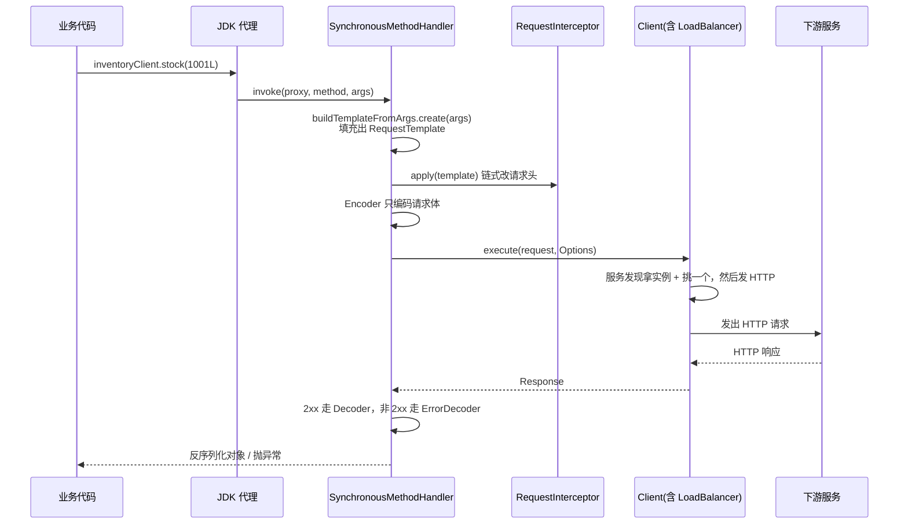

# OpenFeign 一次调用经过了哪些环节？超时和重试为什么总配错？

> Feign 的全部魔法集中在**启动期把接口变成 JDK 动态代理**这一件事上；而线上事故几乎都出在运行期的两件事上——**超时没有逐层收敛，重试在多层同时打开**。

写一个 Feign 客户端只要一个接口加几个注解：

```java
@FeignClient(name = "inventory-service", path = "/api/inventory")
public interface InventoryClient {

    @GetMapping("/stock/{skuId}")
    StockDTO stock(@PathVariable("skuId") Long skuId);
}
```

注入 `InventoryClient` 就能当本地对象用，真正发出去的却是一个 HTTP 请求，中间被塞进了代理、模板、拦截器、编码器、负载均衡客户端、解码器一整串东西，任何一环的默认值都可能咬人。

先对齐定位：**Feign 不是 Dubbo 那种自带私有协议的 RPC 框架**，它是"声明式 HTTP 客户端"——用接口 + 注解生成 HTTP 请求。有资料据此认为 Feign 不能算 RPC 框架，这在"协议自研"的语境下成立；但调用心智上它和 RPC 共用同一条主线（代理 → 组装 → 发送 → 解码），所以 [RPC 调用流程](/distributed-system/rpc/rpc-call-flow.html) 的骨架完全适用，本篇只补 Feign 特有的环节。

## 启动期：接口是怎么变成代理对象的

`@EnableFeignClients` 上挂了 `@Import(FeignClientsRegistrar.class)`，这一步定了 Feign 的架构：它不做运行期扫描，而是**启动时把每个 Feign 接口注册成一个 `FeignClientFactoryBean`**。整条链路是：`FeignClientsRegistrar`（扫接口）→ 注册 `FeignClientFactoryBean`（beanName 是 `contextId` 或接口全名）→ 注入点触发 `getObject()` → `Feign.Builder` 装配 `Contract/Encoder/Decoder/Client/Retryer` → `ReflectiveFeign.newInstance()` → `Contract` 解析出 `MethodMetadata`、每方法一个 `MethodHandler` → `Proxy.newProxyInstance()` 返回 JDK 代理（基于接口，所以 `@FeignClient` 只能标在接口上，原理见 [动态代理](/java/basis/java-basis-dynamic-proxy.html)）。

再补两个要点：

1. **`MethodMetadata` 启动期解析一次就缓存住了**：`Contract.parseAndValidateMetadata()` 把 `@GetMapping`、`@PathVariable`、返回值类型都解析成元数据，之后每次调用只是"填参数"。所以别把 Feign 的耗时归到"注解反射"上，那是启动成本，不是运行成本。
2. **`Contract` 决定注解能被谁认出来**。原生 Feign 只认 `@RequestLine` / `@Param`；Spring Cloud 换成 `SpringMvcContract`，这才让 `@GetMapping` / `@PathVariable` 直接可用，也是 Feign 接口能近乎照抄 Controller 的原因。副作用：**照抄时容易把类级别的路径前缀抄漏或抄重**，后面 404 那节展开。

## 运行期：一次调用要过五道关



`SynchronousMethodHandler.executeAndDecode()` 的骨架就是这四步：建模板 → 套拦截器 → 发请求 → 解码或抛错。

| 环节       | 由谁接管                                                           | 常见替换点                   |
| ---------- | ------------------------------------------------------------------ | ---------------------------- |
| 模板生成   | `Contract` 产出的 `MethodMetadata`                                 | 换 `Contract` 支持自定义注解 |
| 请求头改写 | `RequestInterceptor` 链（按 `Order` 排序）                         | 透传 token、租户、traceId    |
| 请求体编码 | `Encoder`，默认 `SpringEncoder`                                    | 换 JSON 库、加密请求体       |
| 网络发送   | `Client`，默认 `Client.Default`                                    | OkHttp / Apache HttpClient   |
| 结果处理   | 2xx 走 `Decoder`（默认 `SpringDecoder`），非 2xx 走 `ErrorDecoder` | 统一拆包、加解密、错误码翻译 |

一个容易忽略的细节：**`Encoder` 只管请求体**。GET 的查询参数是 `RequestTemplate` 按 `MethodMetadata` 里的参数索引拼上去的，不经过 `Encoder`；想改 query 参数得动 `RequestInterceptor` 或 `Contract`。

## name、url、path、configuration：四个属性三种语义

| 属性             | 语义                             | 走不走 LoadBalancer | 典型用途                              |
| ---------------- | -------------------------------- | ------------------- | ------------------------------------- |
| `name` / `value` | **服务名**，去注册中心查实例列表 | 走                  | 正常微服务调用                        |
| `url`            | 写死地址，直连                   | **不走，绕过**      | 压测指单实例、联调指本地、灰度指节点  |
| `path`           | 统一 URL 前缀                    | 不影响              | 下游有 context-path 时收敛配置        |
| `configuration`  | 该客户端的定制组件类             | 不影响              | 定制 `Retryer` / `RequestInterceptor` |
| `contextId`      | 配置与代理的唯一标识             | 不影响              | 同服务名开多个客户端时隔离配置        |

**事故一：`configuration` 类上加了 `@Configuration`。** `configuration` 的语义是"这些组件只作用于当前客户端"，实现方式是把该类注册为**子容器**的配置。一旦加了 `@Configuration`，它会被主容器扫描捞走，里面的 `Retryer`、`RequestInterceptor` 全变成**全局 Bean**——表现是"我只改了库存客户端的超时，订单客户端也变了"。

```java
public class InventoryFeignConfig { // 关键：不加 @Configuration
    @Bean
    public RequestInterceptor tenantInterceptor() {
        return template -> template.header("X-Tenant-Id", TenantHolder.get());
    }
}
```

**事故二：`url` 用来"临时绕一下"然后忘了删。** 带 `url` 的客户端不经过 LoadBalancer，注册中心里实例全挂了它也感知不到（实例名单怎么维护见 [服务发现](/distributed-system/distributed-service-discovery.html)），照样往那个死 IP 发请求，监控上表现为"只有这条链路一直超时"。压测、联调结束后要显式清理。

## 超时：你配的数字到底落在哪一层

Feign 的超时最终落在 `feign.Request.Options` 上，两个毫秒值：`connectTimeout`（建连）与 `readTimeout`（等响应）。Spring Cloud 通过配置覆盖它：

```yaml
spring:
  cloud:
    openfeign:
      client:
        config:
          default: { connectTimeout: 1000, readTimeout: 3000 } # 全局默认
          inventory-service: { readTimeout: 800 } # 按 name / contextId 覆盖
```

三个必须知道的事实：

1. **命名空间迁移过**。老版本是 `feign.client.config.*`，Spring Cloud 2022.0（OpenFeign 4.x）起迁到 `spring.cloud.openfeign.client.config.*`。升级后旧配置**不报错也不生效**，全靠默认值跑——这类"配置静默失效"比配错更难查，升级时 `grep feign.client` 过一遍。
2. **`Options` 管不到连接池取连接的等待时间**。换 Apache HttpClient 后还有 `connectionRequestTimeout`（从池里借连接的排队时间），它是 HttpClient 的参数。池子占满时表现成"连超时都还没开始就卡住了"，只盯 Feign 超时配置永远看不出来。
3. **默认值偏大**。`Options` 的默认在秒级到分钟级（具体数值以官方配置元数据为准，不同小版本有差异），本地开发没感觉，线上遇到"下游进程卡死但 TCP 还连着"，调用线程就会一直等到读超时。

### 经典事故：readTimeout 没配 → 线程池打满 → 雪崩

1. 下游因慢 SQL 变慢，从 50ms 涨到 10s，但连接没断。
2. 上游 Feign 没配 readTimeout，用默认值 60s 在等。
3. Tomcat 线程池 200 线程、QPS 30，按"在途约等于 QPS × 超时"算就是 30 × 60s ≈ 1800 个请求，不到 7 秒线程全占满。
4. 线程池满，请求排队，网关 3s 就超时，用户侧全是 504。
5. 重试再放大一轮，线程池彻底起不来。

关键在于：**上游 3 秒就放弃了，下游的 Feign 调用还在傻等 57 秒**。占着线程等一个没人要的结果，是这类事故最本质的资源浪费。线程占满后的连锁反应见 [线程池](/java/concurrent/java-concurrency-thread-pool.html)。

### 超时预算倒挂：一条必须递减的数字链

正确做法不是"给每层配个看着合理的值"，而是**从用户耐心反推、逐层收敛**：

| 环节                        | 建议值 | 约束关系                       |
| --------------------------- | ------ | ------------------------------ |
| 前端 / App                  | 3s     | 用户可感知上限                 |
| 网关                        | 2.5s   | 小于前端，留 0.5s 给网络与渲染 |
| 服务 A（订单）自身          | 2s     | 自身逻辑 ≤ 0.5s，剩下留给下游  |
| A 调 B 的 Feign readTimeout | 1.5s   | 小于 A 被上游允许的 2s         |
| B 调 C 的 Feign readTimeout | 0.8s   | 小于 B 被 A 允许的 1.5s        |

检查法很土但有效：**把链路上每个超时排成一行，从入口往里走，数字必须严格递减，每层留 10%~20% 余量给"处理 + 回包"**。一旦出现 `网关 2s → A 调 B 的 readTimeout 5s` 这种倒挂，A 一定在网关放弃之后还在等，白占线程。而且**重试会打破这个预算**：`maxAttempts × readTimeout` 才是最坏耗时，3 次 × 1.5s = 4.5s 已超上游给的 2s——上游先放弃，后面的重试全是无效负载。

## 重试：三层来源，乘法放大

重试配错的核心不是"次数配多了"，而是**没人统计过一共有几层在重试**。

| 层                   | 开关                                | 默认行为                                                            | 坑点                                                                                                     |
| -------------------- | ----------------------------------- | ------------------------------------------------------------------- | -------------------------------------------------------------------------------------------------------- |
| ① Feign `Retryer`    | 自定义 `Retryer` Bean               | `FeignClientsConfiguration` 默认给 `Retryer.NEVER_RETRY`            | 很多人以为"Feign 默认会重试"，实际**一次都不重试**                                                       |
| ② LoadBalancer       | `spring.cloud.loadbalancer.retry.*` | 默认只对 GET 换实例重试，写操作不重试（默认值以官方配置元数据为准） | 老版本靠 spring-retry + `RetryableFeignBlockingLoadBalancerClient`，4.x 起该类废弃，改由 LB 配置统一控制 |
| ③ 网关 / 上游 / 前端 | 各自框架配置                        | 网关常配"失败重试 2~3 次"                                           | 最隐蔽，因为不在这条服务的代码里                                                                         |

第 ① 层还有两个反直觉语义：

- **`Retryer.Default` 的 `maxAttempts` 是"总尝试次数"**，配 3 = 首试 + 2 次重试 = 最多 3 次。核对默认值看源码里的三个参数（初始间隔、最大间隔、最大尝试次数），别靠记忆。
- **`Retryer` 只对 `IOException` 一类网络异常生效**，HTTP 5xx 不会因为它重试。5xx 要不要重试取决于 `ErrorDecoder` 是否抛 `RetryableException`（比如响应带 `Retry-After` 头时会转成可重试异常）。所以"配了 Retryer 没重试"和"没配 Retryer 却在重试"都可能是正常现象，先看异常类型。

### 放大倍数是乘出来的

```text
网关(重试 2 次 → 3 次请求)
  └─ 服务 A：Feign Retryer maxAttempts=3
       └─ 服务 B：LoadBalancer 换实例重试 3 次
            └─ 下游 C

最坏打到 C 的请求数 = 3 × 3 × 3 = 27
```

一次用户点击，最脆弱的下游要扛 27 次。如果 C 变慢的原因正是"请求太多"，这三层重试就是在给火浇油——机制与节奏的完整推导见 [重试风暴](/high-availability/high-availability-retry-storm.html)。工程结论两条：**重试归口到一层**（同步链路通常放最外层，内层 Feign 保持 `NEVER_RETRY` 让失败快速冒泡）；**重试必须配退避和抖动**，否则 3 次会在同一毫秒打到同一实例。

## 幂等：重试能不能开的唯一判据

重试的合法性只看一件事：**请求重复执行会不会改变结果**。查询类天然可重试；写操作必须带幂等键或业务唯一约束兜底，否则第 27 次调用就是重复下单。

```java
public OrderResult createOrder(CreateOrderCmd cmd) {
    String key = "order:" + cmd.getRequestId(); // requestId 前端生成，重试复用
    return orderClient.create(cmd, key);        // 拦截器塞进 Idempotency-Key
}
```

服务端拿到 `Idempotency-Key` 后先查/写唯一索引，重复的直接返回首次结果，细节见 [幂等设计](/high-availability/high-availability-idempotency-design.html)。注意幂等键的**有效期与存储位置**也要定：过期太早等于没有，存单机内存则多实例部署等于没有。

## 连接层：默认实现没有连接池

被超时话题盖住、压测时最先暴露的一环，是 Client 的实现选型：

| Client 实现       | 依赖               | 连接池   | 特点                                       |
| ----------------- | ------------------ | -------- | ------------------------------------------ |
| `Client.Default`  | 无（JDK）          | **没有** | 基于 `HttpURLConnection`，建连开销反复发生 |
| OkHttp            | `feign-okhttp`     | 有       | 连接池与复用、HTTP/2 支持好                |
| Apache HttpClient | `feign-httpclient` | 有       | 参数最细，可配每路由最大连接、取连接超时   |

换完还要把池子参数配到位，否则"有池子"和"没池子"差别不大：最大连接数、每路由最大连接数、`connectionRequestTimeout`，以及确认请求头带 `Connection: keep-alive`。**压测判断信号**：平均 RT 200ms 但其中 60ms 花在 TCP 建连，或机器上 `TIME_WAIT` 持续上涨，那基本就是这里——不是业务代码慢，也不是下游慢。

## 请求头透传：`RequestInterceptor` 的两个坑

```java
@Bean
public RequestInterceptor traceAndAuthInterceptor() {
    return template -> {
        template.header("Authorization", "Bearer " + TokenHolder.get());
        template.header("X-Tenant-Id", TenantHolder.get());
        template.header("X-Trace-Id", TraceHolder.traceId());
    };
}
```

- **坑一：用 `RequestContextHolder` 拿原始请求。** 它依赖 `ThreadLocal`，在 `@Async`、自定义线程池、Hystrix 线程隔离里都是空的，结果是"主线程正常、异步分支丢 token"。做法是在入口线程把值抽进上下文对象随任务传过去，见 [线程池](/java/concurrent/java-concurrency-thread-pool.html)。
- **坑二：拦截器里读请求体。** `HttpServletRequest` 的 inputStream 只能读一次，读完下游拿不到 body；要审计就包一层 `ContentCachingRequestWrapper`。
- 另外 `traceparent` 这类链路 header 手写透传容易和 Micrometer Tracing 的自动注入打架，出现两个不同 traceId，排查更乱。

## 阻塞模型：慢下游为什么要单独隔离

Feign 是**同步阻塞**调用：业务线程发起后原地等待，直到响应返回或超时。所以"一次调用"= "一个线程被占用 readTimeout 时长"，隔离手段三选一：

- **并发数限制**：Sentinel 线程数 / 信号量规则，按下游配。简单，但要定义降级。
- **线程池隔离**：每个慢下游一个独立线程池（舱壁模式）。线程变多，上下文传递要自己处理。
- **异步客户端**：`CompletableFuture` 组合或响应式客户端。改造面大，追踪与事务要重设。

判断依据：**看这个下游"慢"会不会传染**。和主业务共享同一个 Tomcat 线程池时，一个慢下游能把整站拖死；给它一个独立小池子，它慢到极致也只是自己那条链路降级。这也是 Hystrix 线程隔离的核心动机，换 Sentinel 或手写线程池，思路没变。

## 报错怎么读：异常到原因的对照表

| 现象                                         | 大概率原因                                                                   | 先查什么                                                    |
| -------------------------------------------- | ---------------------------------------------------------------------------- | ----------------------------------------------------------- |
| 404 / `FeignException.NotFound`              | `path` 与 `@GetMapping` 前缀重复、下游有 context-path、网关前缀没对齐        | 打开 Feign 的 `FULL` 日志看真实 URL，逐段比对               |
| 405 / `MethodNotAllowed`                     | 方法不匹配（GET 打到只收 POST 的接口）、打到静态资源或只读端点               | 下游接口实际 method 与 Content-Type                         |
| 400 / `BadRequest`                           | `@RequestBody` 配了 GET、`@RequestParam` 名字对不上                          | `MethodMetadata` 解析出的参数名（编译是否带 `-parameters`） |
| `DecodeException`                            | 响应体为空（204 或空串）、`Content-Type: text/html` 的错误页、字段类型不匹配 | 抓原始响应体，别只看异常栈                                  |
| `ClassCastException`（拿到 `LinkedHashMap`） | 返回类型写成 `Object` / `Map`，泛型被擦除                                    | 接口返回类型是否精确                                        |
| `RetryableException`                         | 连接被拒、连接重置、读超时、503 且带 `Retry-After`                           | 是网络层还是业务层，决定要不要重试                          |
| 429                                          | 被下游限流                                                                   | 关掉重试，降级或排队                                        |

注意 `DecodeException` 和"泛型擦除导致的 `ClassCastException`"是**两件事**：前者是"解不出来"，发生在解码那一刻；后者是"解出来了但类型不对"，发生在取值强转那一刻。混为一谈，排查方向就会跑偏。

## 面试怎么答

按五段走，每段一句话，最后补两个工程点：

1. **代理生成**：`@EnableFeignClients` 注册 `FeignClientFactoryBean`，启动期 `getObject()` 里由 `ReflectiveFeign` + `Contract` 解析出 `MethodMetadata`，生成 JDK 动态代理。
2. **请求构建**：调用被 `SynchronousMethodHandler` 拦下，用元数据把参数填进 `RequestTemplate`。
3. **拦截器**：`RequestInterceptor` 链改请求头，`Encoder` 处理请求体。
4. **发送**：`Client` 发 HTTP；`name` 走 LoadBalancer 从注册中心挑实例，`url` 直连绕过。
5. **解码与异常**：2xx 走 `Decoder`，非 2xx 走 `ErrorDecoder`，网络异常包成 `RetryableException`。

两个工程点：**超时逐层收敛（下游 < 上游），重试只留一层并配幂等键**。这两句能把"你项目里 Feign 怎么用"从背概念拉到真调过参。

## 容易踩的坑

- `configuration` 类上加了 `@Configuration` → 客户端级配置变成全局配置。
- 升级后还在用 `feign.client.config.*` → 配置静默失效，全跑默认值。
- 以为 Feign 默认会重试（实际 `NEVER_RETRY`）；或以为配了 `Retryer` 就会重试 5xx（实际只管 `IOException`）。
- 只算单次超时、不算 `maxAttempts × readTimeout` → 重试把总耗时撑破上游预算。
- 三层重试同时开着，没人算过 27 倍放大。
- 用 `url` 直连做临时方案后忘记清理，LB 与监控全部失效（事故二）。
- 压测只看 RT 不看建连耗时，默认 `Client.Default` 没有连接池被忽略。
- 拦截器里用 `RequestContextHolder` 取请求，异步线程里全空。

## 小结

1. Feign 的核心是**启动期把接口变成 JDK 动态代理**：`FeignClientFactoryBean.getObject()` → `ReflectiveFeign` → `Contract` 解析出 `MethodMetadata`（只解析一次，运行期复用）→ `Proxy.newProxyInstance()`。
2. 运行期主线是**模板 → 拦截器 → 编码 → 客户端发送 → 解码/异常**；`SpringMvcContract` 让接口能用 `@GetMapping`，代价是路径前缀容易抄重。
3. **超时必须逐层收敛**：客户端 readTimeout 小于上游给自己的超时，并留 10%~20% 余量；只配一次不核对链路，等于没配。
4. **重试默认是关的**（`Retryer.NEVER_RETRY`），一旦打开就要算乘法：Feign × LoadBalancer × 网关可能放大 27 倍，正确做法是重试归口到一层。
5. **重试的前提是幂等**：查询可重试，写操作必须有幂等键或唯一约束；默认 `Client.Default` 没有连接池，压测先看建连耗时。

## 参考

综合自 Spring Cloud OpenFeign 官方参考文档（客户端配置、超时、负载均衡集成、`Retryer` 语义）、OpenFeign 源码结构（`FeignClientFactoryBean`、`ReflectiveFeign`、`SynchronousMethodHandler`、`Request.Options`），以及站内 [RPC 调用流程](/distributed-system/rpc/rpc-call-flow.html)、[重试风暴](/high-availability/high-availability-retry-storm.html)、[幂等设计](/high-availability/high-availability-idempotency-design.html)、[服务发现](/distributed-system/distributed-service-discovery.html) 四篇的口径。跨版本差异处（配置命名空间迁移、`RetryableFeignBlockingLoadBalancerClient` 在 4.x 废弃、`Options` 与 LB 重试的具体默认值）只写"以官方配置元数据为准"并标注行为差异，不写死数字；对"Feign 算不算 RPC 框架"做了边界说明，避免与站内 RPC 篇结论冲突。
