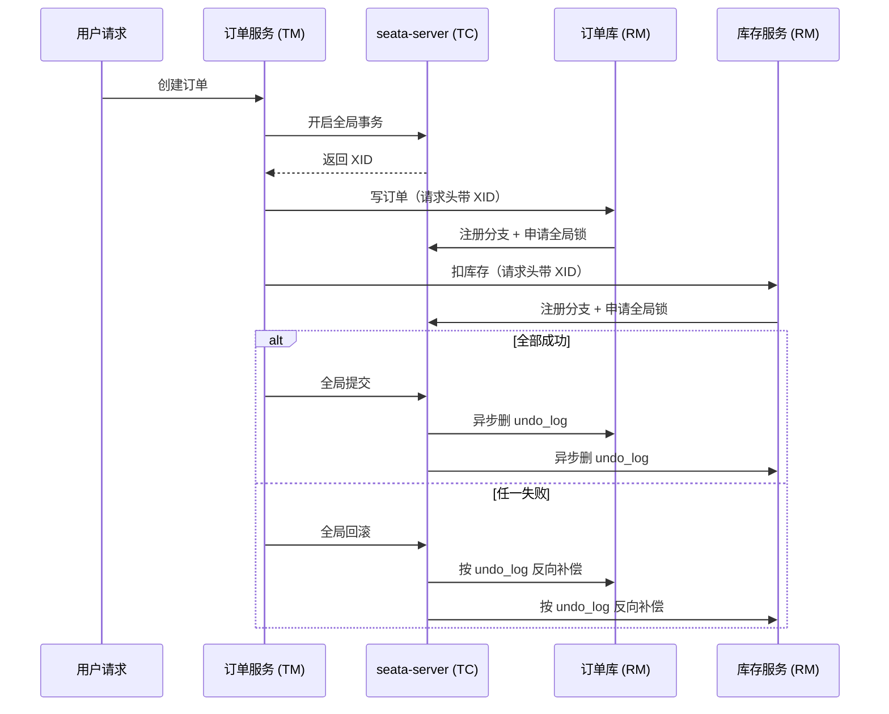

# Seata 的 AT 和 TCC 差在哪？什么时候会回滚不干净？

> Seata 主要是在做“全局事务的协调”，并没有替你画“回滚边界”：AT 的边界画在能被解析的 SQL 镜像上，TCC 的边界画在你 Try 里亲手动过的资源上，边界之外的东西它一概不负责——回滚不干净几乎总是发生在边界之外。

方案之间怎么取舍（2PC、TCC、Saga、本地消息表各自适合谁）已经在 [分布式事务怎么选](/distributed-system/distributed-transaction-selection.html) 里讲透了，这篇不重复，只讲 Seata 的使用模型，以及它在什么情况下会掉链子。

## 先分清角色：TC、TM、RM 各管什么

很多人把 Seata 记成“一个注解开全局事务”，结果一被问 TC 和 TM 谁发起提交就卡住。

| 角色                          | 是谁                                   | 干什么                                                      |
| ----------------------------- | -------------------------------------- | ----------------------------------------------------------- |
| TC（Transaction Coordinator） | 独立部署的 `seata-server`              | 维护全局事务与分支状态，二阶段统一向各分支下发提交/回滚指令 |
| TM（Transaction Manager）     | 打了 `@GlobalTransactional` 的那个入口 | 向 TC 开启全局事务、拿到 `XID`，最后决定全局提交还是回滚    |
| RM（Resource Manager）        | 每个真正改数据的业务库 / 服务          | 执行分支、注册分支、上报状态，二阶段照 TC 指令干活          |

一句话记：**TM 决定“要不要”，TC 决定“什么时候”，RM 决定“怎么做”。**

TC 内部除了全局事务表、分支表，还有一张全局锁表（DB 存储模式下分别是 `global_table`、`branch_table`、`lock_table`，字段与建表脚本以官方文档为准）。真正的全局状态在 TC 手里，这也是它必须做高可用的原因。

## 一次调用里 XID 是怎么传下去的

`XID` 不走业务参数，走“上下文 + 请求头”：



开启全局事务时，拦截器把 `XID` 放进 `RootContext`（本质是 ThreadLocal）；出站调用时通过 RPC 框架的 header 带出去（OpenFeign 用 `RequestInterceptor`，Dubbo 用 filter，gRPC 用 interceptor），入站再解出来重新绑回 ThreadLocal。`XID` 的形态是 `ip:port:transactionId`，能直接看出这次全局事务是在哪台 TC 上开的，跨节点排障时很有用。这段透传链路和 traceId 是同一套机制，细节见 [OpenFeign 调用链](/system-design/spring-cloud/spring-cloud-openfeign-call-chain.html)。

**`XID` 一断，链路就断了**：自己 `new Thread` / 丢进线程池、`CompletableFuture` 异步、手写 HttpClient 没加拦截器、MQ 消费端起了一条新链路——下游拿不到 `XID`，就当普通本地事务提交了，这个分支根本没进全局事务，回滚自然找不着它。

## AT 的一阶段：本地事务里到底提交了什么

假设库存表有一行 `stock(id=1, count=100)`，业务 SQL 是：

```sql
UPDATE stock SET count = count - 1 WHERE id = 1;
```

Seata 代理数据源（`DataSourceProxy`）会把这一句拆成四步：

1. 解析 SQL，按主键把旧值查出来，得到**执行前镜像** beforeImage = `{id: 1, count: 100}`；
2. 执行业务 SQL，行变成 `{id: 1, count: 99}`；
3. 再查一次，得到**执行后镜像** afterImage = `{id: 1, count: 99}`；
4. 把前后镜像序列化写进 `undo_log`，然后**和业务 SQL 在同一个本地事务里提交**。

第四步是整篇的关键：`undo_log` 的 insert 和业务 update 是一个事务。所以全局事务还没定论时，库里的 `count = 99` 已经对外可见了——这既是 AT 快的原因，也是它后面所有麻烦的源头。

同时，RM 向 TC 注册分支，并申请**全局锁**（锁住这几个主键）。全局锁不是数据库行锁，而是 TC 侧的一条记录，含义是“这几行正被全局事务 A 改，别的全局事务先别碰”。

## AT 的二阶段：提交很轻，回滚很重

两个方向的成本完全不对称：

- **提交**：TC 通知后，RM **异步**删掉 `undo_log`、释放全局锁，二阶段几乎不占业务时间。这正是 AT 相对 XA 的性能优势——XA 在 prepare 之后行锁一直不放，AT 一阶段就放掉了。
- **回滚**：按 `undo_log` 生成反向 SQL，例如 `UPDATE stock SET count = 100 WHERE id = 1 AND count = 99;`。

注意 `AND count = 99` 这一段，它就是**脏写检测**：afterImage 被塞进了 where 条件。如果这行已经被别人改成 98，这条 update 影响 0 行，框架判定镜像不匹配、抛脏写异常，回滚失败，只能人工修数据。

所以 AT 的本质是**补偿型**：一阶段已经落地，二阶段是“照着账本倒着记一笔”，并不是 XA 那种“谁都不许动、等我发话”。理解了这一点，AT 的隔离性问题就不用背了。

## AT 的隔离性：为什么说它像“读未提交”

一阶段本地事务已提交，别人读到的就是**还没定论**的数据：

- 全局事务最终回滚 → 别人刚才读到的 `count = 99` 是一个从未存在过的值（脏读）；
- 别人基于这个值又写了一笔 → 回滚时镜像校验失败（脏写）。

Seata 给的补丁是全局锁，落到代码上有两种写法：

| 手段                    | 作用                                                                | 代价                 |
| ----------------------- | ------------------------------------------------------------------- | -------------------- |
| `@GlobalLock`           | 本地事务开始前先抢全局锁，抢不到就重试/失败，防止改到别人正在改的行 | 热点行排队，吞吐下降 |
| `SELECT ... FOR UPDATE` | AT 模式下会被拦截，先拿全局锁再查，相当于跨库加了一把锁             | 读也变成串行         |

正确的用法是**只给真正会被这次回滚波及的那几行加**，而不是给所有查询都套上。面试答“AT 默认相当于读未提交，用 `@GlobalLock` / `FOR UPDATE` 收窄可见性，代价是并发下降”就到位了。

## AT 的边界：哪些 SQL 它救不了

| 限制                           | 具体表现                                                           |
| ------------------------------ | ------------------------------------------------------------------ |
| 只支持有本地事务的关系型数据库 | Redis、MQ、第三方接口没有 `undo_log` 可写，框架无从补偿            |
| SQL 必须能被解析               | 复杂多表关联更新、子查询、存储过程、部分函数解析不了，就拿不到镜像 |
| 表必须有主键                   | 没有主键定位不到行，beforeImage 根本查不出来                       |
| 每个参与库都要建 `undo_log`    | 漏建的库一阶段直接报错，或者干脆没进全局事务                       |
| 热点行                         | 全局锁冲突要重试，同一行并发一高就排队，性能断崖式下降             |

## TCC：把回滚边界从框架手里拿回来

TCC 里没有镜像，也没有全局锁，只有三个你自己写的方法：

| 阶段    | 做什么             | 库存例子                                        |
| ------- | ------------------ | ----------------------------------------------- |
| Try     | 检查并**预留**资源 | `available -= 1; frozen += 1`（冻结，不是真扣） |
| Confirm | 确认消耗预留       | `frozen -= 1`                                   |
| Cancel  | 释放预留           | `available += 1; frozen -= 1`                   |

差别一句话：**AT 的回滚边界是“框架能解析到的 SQL”，TCC 的回滚边界是“你 Try 里动过的一切”**。所以 TCC 能覆盖 Redis 扣减、优惠券锁定、外部额度冻结这些 AT 碰不了的资源；代价是三套方法、一套状态机，以及空回滚、悬挂、幂等全部自己兜。

补充一个容易说错的点：Seata 的 TCC 模式在框架层提供 fence 机制（DB 模式下依赖一张事务控制表，如 `tcc_fence_log`，字段以官方文档为准）来做幂等和悬挂拦截，但它**只能拦住经过框架的调用**，拦不住你 Cancel 里漏写的那段业务逻辑。

## 五种方案摆一张表

| 方案       | 一致性强度                   | 业务侵入            | 性能                         | 适用资源                | 失败处理                        | 运维复杂度                  |
| ---------- | ---------------------------- | ------------------- | ---------------------------- | ----------------------- | ------------------------------- | --------------------------- |
| XA / 2PC   | 强（提交前锁不释放）         | 低                  | 差，持锁时间长               | 支持 XA 的关系库        | 协调者重试 + 数据库恢复         | 中，怕长事务和悬挂分支      |
| AT         | 最终一致 + 全局锁压脏写      | 低（注解 + 建表）   | 好（一阶段即提交），热点行差 | 关系库 CRUD             | `undo_log` 反向补偿，脏写靠人工 | 中，日志表、锁表、TC 都要管 |
| TCC        | 业务自定义，可做到接近强一致 | 高（三套方法）      | 好（不持有长事务锁）         | 关系库、Redis、券、额度 | Cancel + 状态机 + 人工          | 高，三种异常都要自己实现    |
| Saga       | 弱，无隔离性                 | 高（正向 + 补偿）   | 好                           | 任意可补偿步骤          | 反向补偿或正向重试              | 高，要有 Saga log 与编排    |
| 本地消息表 | 最终一致                     | 中（消息表 + 投递） | 好                           | 只要能写本地库          | 重试 + 死信 + 对账              | 中，但链路最长、证据最全    |

## 回滚不干净的七种现场

下面每一条都按“现象 → 机制 → 怎么防”写，基本就是线上故障复盘的样子。

### 1. 空回滚：Cancel 比 Try 先到

- **现象**：库存服务收到 Cancel，可 Try 压根没执行（Try 请求超时、网络抖动，或者上游在调用前就失败了）。如果 Cancel 老老实实 `available += 1`，库存凭空多出来。
- **机制**：TC 只知道“这个分支要回滚”，不知道“这个分支到底做没做”。分支注册成功 ≠ Try 的本地事务成功。
- **怎么防**：Cancel 先查事务控制表，没有 Try 记录就直接返回成功，同时留一条标记，防止后到的 Try 又把它做出来。

### 2. 悬挂：Cancel 做完了，Try 才到

- **现象**：Try 因超时被 TC 判失败，Cancel 先跑完；过一会儿那个慢吞吞的 Try 请求到达，照常 `available -= 1; frozen += 1`。资源永远冻在中间态，再也没人来 Confirm 或 Cancel。
- **机制**：网络没有“超时即未执行”的保证，超时只是放弃等待，不代表对方没在执行。
- **怎么防**：Try 记录用唯一键（`XID` + 分支 ID）落表，Cancel 走过之后把这个键标记成已回滚，迟到的 Try 插入冲突就直接拒绝。

### 3. 重复回滚与重复确认

- **现象**：Confirm 被调了两次，库存扣两遍；或者 Cancel 重试导致冻结量被重复释放。
- **机制**：TC 的二阶段通知是**至少一次**语义，重试、重启、丢包都会重发，和 [幂等设计](/high-availability/high-availability-idempotency-design.html) 是同一个问题。
- **怎么防**：状态机 `TRYING → CONFIRMED / CANCELED`，同状态再来直接返回成功；关键表加唯一索引，把重复挡在数据库层。

### 4. AT 的脏写：镜像校验失败只能人工修

- **现象**：全局回滚时报脏写异常，那条分支回滚失败，数据停在中间态。
- **机制**：业务代码在全局事务之外改了同一行——另一个线程、另一个没加 `@GlobalTransactional` 的入口、定时任务、DBA 直接跑脚本。afterImage 对不上，回滚 SQL 影响 0 行。
- **怎么防**：所有会改这几行的入口都走 Seata 代理数据源，必要时加 `@GlobalLock`；把写入口尽量收敛到一处；脏写异常按 P1 告警，别当普通业务异常吞掉。

### 5. 跨出事务边界的资源

- **现象**：数据库回滚了，MQ 消息已经发出并被消费、Redis 库存已经扣了、第三方优惠券已经领了。用户看到的是一张被取消的订单和一个已经发出去的红包。
- **机制**：Seata 只管它代理的数据源。MQ、Redis、HTTP 调用都不在 `undo_log` 里，回滚时没有任何东西去撤销它们。
- **怎么防**：把 MQ 发送、Redis 扣减挪到全局事务之外，改成“事务后发 + 消费端幂等”，即本地消息表 / 事务消息那一套，见 [消息可靠性](/high-performance/high-performance-message-reliability.html) 和 [幂等设计](/high-availability/high-availability-idempotency-design.html)；非要放在里面，就自己写补偿任务。

### 6. 分支超时或 TC 宕机：框架判了死刑，业务其实成功了

- **现象**：TC 按超时判定全局回滚，但那个分支的本地事务其实已经提交成功，货也发了；或者 TC 重启后状态丢失，分支卡在“已注册、未定论”。
- **机制**：分布式里“没收到响应”和“没执行成功”是两件事，超时不等于撤销事实。
- **怎么防**：业务侧必须有对账（订单状态 vs 库存流水 vs 支付流水），把“框架认为回滚了、业务认为成功了”的差异捞出来；TC 用注册中心 + 集群部署，存储别用只适合单机的 file 模式扛多节点。

### 7. 多数据源：有一个库压根没进全局事务

- **现象**：主库回滚了，另一个库（分库、`@DS` 切过去的数据源、读写分离的另一个数据源）的数据还在。
- **机制**：`@GlobalTransactional` 只对**被 Seata 代理过的数据源**生效。多数据源项目里如果只包了主数据源，第二个库的操作就是纯本地事务，TC 那边连分支都没注册。
- **怎么防**：启动时确认每个参与库的数据源都被 `DataSourceProxy` 包过（单数据源可交给 `seata.enable-auto-data-source-proxy` 自动代理，多数据源要手动包）；上线前用日志核对“本次全局事务注册了几个分支”，数量对不上就是有库漏了。

## 工程取舍：先说什么时候不该用

1. **能在一个库里用本地事务解决，就别上分布式事务。** 一个 `@Transactional` 覆盖得住的边界，加 Seata 只是多一个故障源、多一张表、多一个要运维的 TC。
2. **跨服务但可以接受最终一致，就用本地消息表 / 事务消息 + 幂等 + 对账。** 这套比 Seata 便宜，排障证据也更全。
3. **真需要“多个库同时成功或同时失败”，且链路短、只碰数据库，再上 Seata。**
4. **上了就把它控制在“短、小、只碰数据库”。** 别在 `@GlobalTransactional` 方法里发 MQ、调第三方、跑循环批处理、等用户输入——方法体越长，全局锁持有越久，回滚窗口越大。
5. **资源可以预留（库存、券、额度）且链路短，TCC 比 AT 更可控；只是常规 CRUD，AT 更省事。**

一句可以直接说给面试官的话：**Seata 缩小的是写代码的成本，不是一致性的边界，边界还得你自己画。**

## 落地检查清单

- 每个参与库都建 `undo_log`，DDL 从官方脚本拷，别手写字段。
- TC 走注册中心、至少两节点；TC 的存储（file / db / redis）要和事务量匹配，多节点别用 file。
- 全局事务超时时间大于该链路最长正常耗时，否则正常业务会被当成失败回滚。
- 全局事务日志、分支日志、未决事务查询接监控：长时间停在“开始 / 进行中”的全局事务必须能查出来并告警。
- 脏写、回滚失败、空回滚、悬挂都要有明确日志和人工补偿入口：后台能按 `XID` 查到分支，能手动重试或平账。
- 关键业务表加唯一索引，把“重复 Confirm / Cancel”挡在数据库层。
- 每日对账：订单、库存、支付三方比对，把框架兜不住的部分捞出来。

## 面试怎么答

1. 三角色 + `XID` 传播，三十秒讲完，别展开。
2. AT 讲透一阶段：“业务 SQL 与 `undo_log` 同本地事务提交 + 注册分支 + 申请全局锁”；二阶段提交是异步删日志，回滚是按镜像生成反向 SQL、afterImage 塞进 where 做脏写校验。
3. **主动**指出隔离性问题：一阶段已提交 → 默认像读未提交 → `@GlobalLock` / `FOR UPDATE` 收窄，代价是并发。
4. 讲 AT 的边界：关系库、可解析 SQL、必须有主键、热点行、每个库的 `undo_log`。
5. 讲 TCC 的差别：回滚边界交给业务，能覆盖非事务资源，但空回滚、悬挂、幂等要自己用状态机兜。
6. 收尾给判断：多数跨服务场景该用本地消息表 + 幂等 + 对账，Seata 留给“短、小、只碰数据库”的强一致链路，并配人工补偿入口。

**主动说出边界，比背流程值钱。**

## 容易踩的坑

### 把 AT 当成“自动版 XA”

XA 在二阶段提交前一直锁着资源，AT 一阶段就提交了。AT 拿性能换了隔离性，脏写风险是这笔交易的找零，不是 bug。

### 以为 `@GlobalTransactional` 能包住一切

它本身也是 AOP：自调用、`private` 方法、同类内部调用一样失效，默认也只对 `RuntimeException` / `Error` 回滚，业务异常要 `rollbackFor`——和 [Spring 事务为什么会失效](/system-design/framework/spring-transaction-failure-cases.html) 里讲的本地事务是同一套原因，只是代理换成了 Seata 的。

### 在全局事务里“顺手”发个 MQ

最常见的“回滚不干净”。数据库回滚了，消息已经发出去并被消费了。挪到事务外，或者自己补上补偿 + 幂等。

### 以为 TC 挂了不影响业务

TC 挂 = 全局事务状态没人推进，分支卡在待定论；恢复后可能大面积回滚。所以 TC 才需要集群 + 持久化存储，而不是“反正就一个注解”。

## 小结

1. Seata 的三个角色：TM 决定“要不要”、TC 决定“什么时候”、RM 决定“怎么做”；`XID` 靠 ThreadLocal + RPC 请求头传递，链路一断就有一条分支没进全局事务。
2. AT 是补偿型：一阶段业务 SQL 与 `undo_log` 在同一个本地事务里提交，同时注册分支、申请全局锁；二阶段提交异步删日志，回滚按前后镜像生成反向 SQL，afterImage 进 where 条件做脏写校验。
3. 因为一阶段已提交，AT 默认相当于读未提交，要用 `@GlobalLock` / `SELECT ... FOR UPDATE` 收窄，代价是并发下降；且只适合有本地事务的关系库、可解析 SQL、有主键的表。
4. TCC 的差别是把回滚边界交给业务：能覆盖 Redis、券、外部额度，但空回滚、悬挂、重复 Confirm/Cancel 全靠状态机 + 幂等自己兜。
5. 回滚不干净的根源几乎都在边界之外：MQ/Redis/第三方、多数据源漏代理、分支超时、TC 宕机。所以能本地事务就别上分布式事务，真上就控制在“短、小、只碰数据库”，并配监控、对账和人工补偿入口。

## 参考

综合自仓库内分布式事务参考材料（2PC/XA 的角色划分、AT 的 `undo_log` 镜像思路、TCC 的 Try/Confirm/Cancel 与空回滚、悬挂问题、Saga 与本地消息表的补偿模型），以及 Apache Seata 官方文档中关于 TC/TM/RM、`XID` 传播、`@GlobalTransactional` / `@GlobalLock`、全局锁、`undo_log`、TCC fence 与回滚重试的说明整理。文中表名（`global_table` / `branch_table` / `lock_table` / `tcc_fence_log`）与开关名以项目实际版本的官方文档为准。
