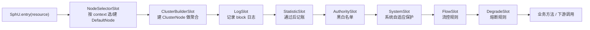
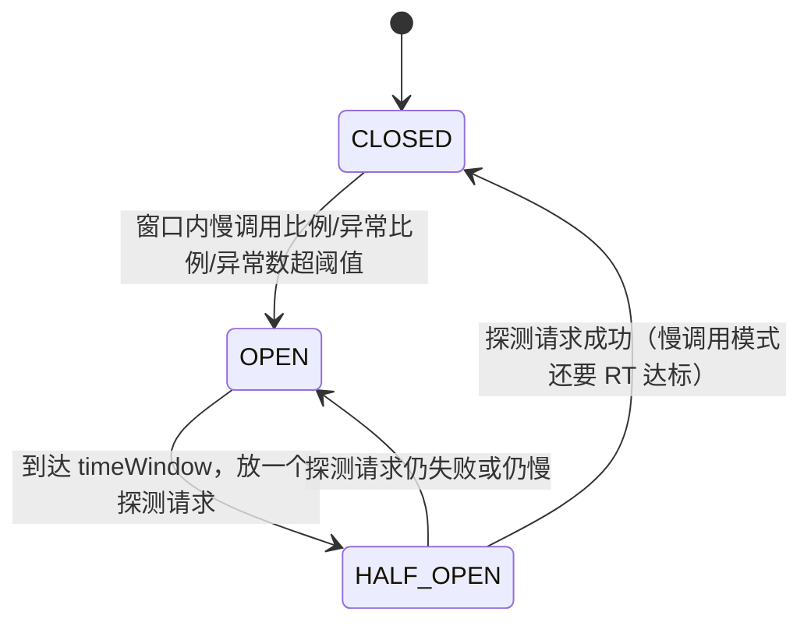

# Sentinel 的流控和熔断在内核里怎么算？和 Hystrix 差在哪？

> Sentinel 的核心不是“限流算法”，而是“以资源为中心的判断链”：一次调用先把资源包成 `Entry`，再让一条槽链按固定顺序过一遍；流控、熔断、系统保护都只是链上的一环。

先看最小的一段埋点：

```java
try (Entry entry = SphU.entry("order:create", EntryType.IN)) {
    createOrder(cmd);
} catch (BlockException e) {
    // FlowException / DegradeException / SystemBlockException / AuthorityException / ParamFlowException
}
```

一次 `SphU.entry()` 干的是：找到资源对应的槽链 → 顺序执行每个槽 → 任何一个槽抛出 `BlockException` 子类，就代表这次请求被拦下、不会走到业务逻辑。

面试里“Sentinel 有控制台、能限流能熔断”是人人都能说的；真正拉开差距的是两个追问：

1. 规则配了为什么不生效？——回去看埋点和资源名。
2. 阈值为什么守不住？——回去看统计粒度和集群放大。

## 定位：一切围绕资源，规则只是外挂

Sentinel 里没有“给方法加个限流器”这种说法，它的第一公民是**资源**（`ResourceWrapper`：名字 + 类型 + 入口/出口方向）。规则不是绑在方法或 URL 上，而是绑在资源名字符串上，并且是**精确匹配**——`FlowRuleManager` 内部就是 `Map<资源名, List<FlowRule>>`，没有通配符。这一条决定了后面所有的工程细节：

- 资源名怎么起，等于你怎么切分治理粒度；
- 资源名不稳定（带自增 ID、带时间戳），规则就永远命中不了；
- 同一个资源可以挂多条规则，按 `limitApp` 优先级依次校验（`{origin}` > `other` > `default`），任意一条不通过就拦。

`EntryType.IN` / `OUT` 也要留意：只有入口流量（`IN`）受系统自适应规则约束，出口流量（`OUT`，比如 Feign 调下游）不受影响。`SphU.entry(name)` 默认是 `OUT`，Web 适配按 `IN` 埋点，而注解默认也是 `OUT`——想让方法受系统规则保护，得显式写 `entryType = EntryType.IN`。

## 资源从哪来：埋点位置决定统计粒度

| 接入方式                           | 资源名长什么样                         | 粒度          | 要注意                                         |
| ---------------------------------- | -------------------------------------- | ------------- | ---------------------------------------------- |
| `@SentinelResource("createOrder")` | 注解 `value`                           | 方法          | 不支持 private；同类自调用走不到代理，规则失效 |
| Web 适配（Filter / MVC 拦截器）    | 默认是请求 URI，如 `/orders/123`       | 一个 URL      | 要按接口治理得挂 `UrlCleaner` 归一到模式       |
| Feign 适配                         | `GET:http://order-service/orders/{id}` | 一个下游方法  | 用的是模板路径，天然稳定                       |
| Dubbo 适配                         | 接口名:方法签名                        | 一个 RPC 方法 | 服务端是 `IN`，客户端是 `OUT`                  |
| 网关适配                           | route id / 自定义 API 分组名           | 一个路由/分组 | 默认不按 URL 粒度                              |
| `SphU.entry(...)` 手动埋点         | 自己传                                 | 任意代码块    | 最灵活，也最容易埋错                           |

**埋点位置就是你“在统计什么”的定义。** 举个真实的错法：想限制“下单接口 500 QPS”，却把埋点埋在 `InventoryMapper.deduct()` 上——一次下单内部预占 + 扣减 + 重试会进 3 次 `Entry`，规则里配的 500 实际只放过了 160 多次真实下单；反过来只埋在最外层 Controller，又看不到链路里对库存服务的调用次数，下游被自己打穿时还没反应过来。

Web 场景还有个高频事故：默认资源名是 URI 而不是 Spring MVC 的映射模式，所以 `/orders/1`、`/orders/2` 会被算成两个不同资源，你在控制台按 `/orders/{id}` 配的规则一条都命中不了。正确做法是注册一个 `UrlCleaner`，把数字段归一成 `{id}`。

## 槽链：一条责任链把规则按顺序过一遍



| 槽                   | 职责                                                  | 笔记                                                   |
| -------------------- | ----------------------------------------------------- | ------------------------------------------------------ |
| `NodeSelectorSlot`   | 按 context 找到或创建 `DefaultNode`，把调用路径拼成树 | 链路限流依赖它建的这棵树，根是 `machine-root`          |
| `ClusterBuilderSlot` | 建资源的 `ClusterNode` 和来源节点                     | 资源级聚合统计（RT/QPS/线程数/异常数）都在这           |
| `LogSlot`            | 被拦时把资源名、规则、来源、数量写进 block 日志       | 排障时“谁被拦了”第一手证据                             |
| `StatisticSlot`      | 记录 pass / block / RT / 异常 / 线程数                | 位置最容易被讲错，下一节单独说                         |
| `AuthoritySlot`      | 黑白名单（需要 `RequestOriginParser` 提供来源）       | 按调用方身份拦，粒度粗                                 |
| `SystemSlot`         | 系统自适应保护：Load、CPU、平均 RT、线程数、入口 QPS  | 只对入口流量（`IN`）生效，是应用整体维度而不是资源维度 |
| `FlowSlot`           | 遍历流控规则，任一不过抛 `FlowException`              | 规则按 `limitApp` 优先级排过序                         |
| `DegradeSlot`        | 按熔断规则判断，打开时抛 `DegradeException`           | 统计在 exit 阶段完成，判断在 entry 阶段                |

槽链本身是可扩展的：`ProcessorSlot` 是 SPI 接口（1.7.2 之前扩的是 `SlotChainBuilder`），每个槽用 `@Spi(order = ...)` 声明顺序，`Constants` 里给它们留好了 -10000、-9000 …… -1000 一档一档的位置。网关的 `GatewayFlowSlot`、热点参数的 `ParamFlowSlot`（挂在 `SystemSlot` 和 `FlowSlot` 之间）就是这么插进来的——这也解释了为什么“加一个能力”在 Sentinel 里等于“加一个槽”。

## StatisticSlot 的位置：先判断，后结算

很多资料写“`StatisticSlot` 先统计后判断”，这句话是反的。看 `entry()` 的真实顺序（简化）：

```java
// StatisticSlot.entry()
fireEntry(context, resourceWrapper, node, count, prioritized, args); // ① 先把判断交给后面的槽
node.increaseThreadNum();                                            // ② 都通过了，才 +1 线程
node.addPassRequest(count);                                          // ③ 才记一次"通过"
// catch (BlockException e) -> node.increaseBlockQps(count)，然后原样抛出
// exit() 阶段                -> addRtAndSuccess(rt)，非 Block 的异常 increaseExceptionQps
```

所以三件事同时成立：

1. **本次请求不参与自己的判定。** `FlowSlot` 读到的“已通过数”不含这一条，`DefaultController` 的判断是 `已通过数 + 本次数量 > 阈值` 才拒绝——阈值语义是“一个统计窗口里最多放过 count 个”，本次请求在通过之后才被计入。
2. **它必须排在 `FlowSlot` 前面**，原因不是“先有数据才能判断”，而是 `fireEntry` 是“调用下一个槽”，前一个槽的代码会在后一个槽返回后继续执行——排在前面的槽天然**包住**后面的槽，才能 `catch` 到后面抛出的 `BlockException` 记成 block QPS，并在 `exit()` 时把 RT 和业务异常记准。把它挪到 `FlowSlot` 后面，`BlockException` 会直接穿过去，被限流的量永远统计不到。
3. **限流在 entry 判断、熔断在 exit 结算**。熔断必须等这次调用有了结果（RT、是否异常）才能统计，所以能算慢调用；限流只关心“已经进来了多少”。

## 统计底座：LeapArray 滑动窗口，默认 1 秒 2 个桶

算法原理站内[限流算法怎么选](/high-availability/high-availability-rate-limiting.html)已经讲透，这里只看 Sentinel 的实现选择：

- 每个节点有两套窗口：秒级 `rollingCounterInSecond`（`SAMPLE_COUNT=2` 个桶 / `INTERVAL=1000ms`，即**两个 500ms 桶**）和分钟级 `rollingCounterInMinute`（60 个 1s 桶，供控制台和 metrics 日志用）。
- 取数时算出当前桶，把“仍在 1 秒内”的桶（当前桶 + 前一个桶）的 pass / block / rt / exception 累加，`QPS = 累加值 / 1s`，再拿它和阈值比。
- 桶数量由 `SampleCountProperty.SAMPLE_COUNT` 控制，调大要重建所有 `ClusterNode`，属于“能调但别乱调”的参数。

由此能推出两个很实用的工程结论。

**① 阈值判断有粒度损失，别把阈值卡在上限。** 桶是按时间边界对齐的，所谓“最近 1 秒”实际是“上一个满桶 + 当前半桶”。桶切换的瞬间，上一秒的计数会被整体换出，于是在“桶边界前后各半秒”这段真实的一秒里，能通过的请求可以接近 2 倍阈值——本质和固定窗口的边界突刺是同一类问题，只是被 500ms 切细了。采样越细误差越小，代价是桶对象更多、遍历更慢。所以阈值要留 buffer（站内那篇给的 70%~80% 安全系数就是这个道理），再用压测校准，别贴着容量上限写。

**② QPS 和并发线程数是两个 grade，别混着配。** `grade=1` 比的是窗口内通过量；`grade=0` 比的是 `curThreadNum`——`LongAdder` 在 entry 时 +1、exit 时 -1，统计的是**当前正在处理该资源的线程数**，既不是线程池大小，也不是排队长度。官方文档说得很直白：Sentinel 的线程数限流不创建也不管理线程池。所以 `grade=0` 的阈值要按“这个资源能占多少线程”配（比如 Tomcat 200 个线程里分 50 给它），配成 500 就永远限不住；反过来说，想靠它实现 Hystrix 那种“独立线程池”，是做不到的。

## 流控规则模型：一张表把字段和玩法对上

| 字段                            | 取值                                              | 含义                   | 典型场景                            |
| ------------------------------- | ------------------------------------------------- | ---------------------- | ----------------------------------- |
| `grade`                         | 0 线程数 / 1 QPS（默认 1）                        | 拿哪个指标比阈值       | 入口用 QPS，慢接口/下游调用用线程数 |
| `count`                         | 阈值                                              | 窗口内允许通过的数量   | 按压测水位 × 0.7~0.8 反推           |
| `strategy`                      | 0 直接 / 1 关联 / 2 链路                          | 统计谁的数据           | 见下方三种模式的例子                |
| `refResource`                   | 关联模式=被关联资源；链路模式=入口资源名          | 引用对象               | 写优先限读；只限某条链路的入口      |
| `controlBehavior`               | 0 快速失败 / 1 Warm Up / 2 匀速排队 / 3 预热+排队 | 超阈值后怎么处理       | 突发拒绝、冷启动、MQ 消费匀速       |
| `limitApp`                      | `default` / `{origin}` / `other`                  | 按调用方拆分统计       | 多租户、多调用方配额                |
| `clusterMode` + `clusterConfig` | 是否走 token server                               | 单机阈值 vs 集群总阈值 | 全局配额必须开                      |

三种 `strategy` 的区别是“看谁的统计”：

- **直接**：看本资源的聚合统计（`ClusterNode` 维度）；`limitApp` 填具体调用方（或 `other`）时才拆到来源节点，默认 `default` 就是全量聚合。
- **关联**：看**被关联资源**的统计。典型场景是读写争抢——给 `read_db` 配一条 `strategy=RELATE, refResource="write_db"`，写多了就把读限住，保写优先。
- **链路**：只统计“从指定入口进来”的流量，`refResource` 必须等于**入口资源名（也就是 context 名）**。这里最容易配错：写了业务资源名，规则在控制台看着生效，实际一点流量都没限住。

几个细节值得单独记：

- **Warm Up**：从 `threshold / coldFactor` 起步（`coldFactor` 默认 3，即 1/3），在 `warmUpPeriodSec`（默认 10 秒）内爬到阈值。适合刚发布、缓存刚冷、连接池还没热的实例。
- **匀速排队**：漏桶语义，按 `count` 算出请求间隔让请求排队通过；排队时间超过 `maxQueueingTimeMs`（默认 500ms）直接拒绝。适合 MQ 消费这种“一波来、后面闲”的流量。
- **集群模式**：单机规则在 N 个实例上各自独立，配 200 QPS 在 8 个实例的集群里实际放过了 1600——这是最常见的配置事故。要真正的全局配额就开 `clusterMode` 由 token server 统一记账；`clusterConfig.thresholdType` 默认“单机均摊”（也可切“全局阈值”），`fallbackToLocalWhenFail` 默认 true，token server 联系不上时退化成单机限流，这时每个实例都会按整条 `count` 各自放行，总阈值又被放大。

## 熔断规则模型：三种 grade，一个状态机

限流在 `entry` 阶段就能判断，熔断必须等这次调用有了结果，所以在 `exit` 阶段才把 RT 和异常喂给 `CircuitBreaker`。1.8 起熔断被重写成 `CircuitBreaker` 抽象，三种 `grade` 对应三种统计口径：

| `grade`      | `count` 含义         | 触发条件                                                               | 适合                               |
| ------------ | -------------------- | ---------------------------------------------------------------------- | ---------------------------------- |
| 0 慢调用比例 | 慢调用 RT 阈值（ms） | 窗口内请求数达到 `minRequestAmount`，慢调用占比 > `slowRatioThreshold` | 下游变慢但还没报错                 |
| 1 异常比例   | 0.0 ~ 1.0            | 请求数达标，异常占比 > `count`                                         | 下游大量报错                       |
| 2 异常数     | 异常次数             | 窗口内异常数 > `count`                                                 | 低频但致命的调用（支付回调、短信） |

默认值（1.8.x 的 `DegradeRule`）：`minRequestAmount=5`、`statIntervalMs=1000`（1 秒统计窗口）、`slowRatioThreshold=1.0`、`grade` 默认慢调用比例；`timeWindow` 没有默认值，必须显式配，单位是秒。`minRequestAmount` 是防误熔断的第一道闸——窗口里只来了 3 个请求、错了 2 个，比例 66% 也不该熔断。



半开只放**一个**探测请求——官方文档的表述是“若接下来的一个请求成功完成则结束熔断”；慢调用模式下，这个探测请求如果还是比 `count` 慢，就直接回到 OPEN。所以熔断恢复不是开关，而是“一个请求换一次机会”，流量大时恢复节奏偏慢；`timeWindow` 一般配 10~30 秒，而不是 1 秒。

**为什么慢调用比例比异常比例更早发现问题？** 下游劣化的前几分钟通常只慢不炸：连接池在排队、GC 在抖、下游自己在限流等待。这时异常率还是 0，“异常比例”规则一点反应都没有，但 RT 已经从 50ms 涨到 800ms，调用方线程开始堆——等真正报错（超时、连接拒绝）时，线程池往往已经满了。所以慢调用比例是**雪崩前兆探测器**，异常比例是**事故确认器**：慢调用的 `count` 取正常 P99 的 2~3 倍，`statIntervalMs` 放到 10 秒让样本更充分，两条规则一起配。

两个容易忽略的边界：异常统计只认业务异常，`BlockException` 不算（自己埋点要 `Tracer.trace(ex)`，注解和适配器会自动统计）；`RuleConstant` 里 `DEGRADE_GRADE_EXCEPTION_COUNT` 的注释还写着“last 60 seconds”，那是 1.7 时代的说法，1.8 起异常数同样按 `statIntervalMs` 统计，别照注释配。

## 和 Hystrix 差在哪：隔离思想 vs 规则中心

| 维度     | Hystrix                                               | Sentinel                                                     |
| -------- | ----------------------------------------------------- | ------------------------------------------------------------ |
| 隔离方式 | 线程池隔离（默认，会切线程）/ 信号量隔离（只限并发）  | 不切线程：并发线程数统计 + 限流；隔离靠你自己配线程池/舱壁   |
| 统计模型 | 10 秒 10 个桶的滚动计数 + 熔断三态                    | `LeapArray` 滑动窗口（默认 1s 2 桶）+ 熔断三态，维度更多     |
| 判断维度 | 熔断为主：失败率 + 最小请求量（超时算失败）           | 流控、熔断、热点参数、系统自适应保护、黑白名单，一条链上分批 |
| 规则来源 | 代码和配置为主，改规则基本要发版                      | 控制台 + Nacos/ZK/Apollo 推模式，热更新                      |
| 兜底写法 | 一个 `fallbackMethod` 兜所有                          | `blockHandler`（规则拦下）与 `fallback`（业务异常）分开      |
| 生态状态 | 已进维护模式，Spring Cloud 官方线用 Resilience4j 替代 | Spring Cloud Alibaba / Dubbo / 网关都有官方适配              |

表格之外还有一条更本质的差别：**Hystrix 的线程池隔离会切线程**，`ThreadLocal`、事务上下文、MDC 日志链路都会丢，得靠 `HystrixConcurrencyStrategy` 包装；Sentinel 选择不切线程，只统计和拒绝，所以没有这类副作用，但代价是**它并不真的隔离**——下游变慢时，调用方线程还是会被占住，必须自己配超时和连接池上限。很多人迁到 Sentinel 后觉得“没 Hystrix 稳”，问题就在这里：把熔断器当成了隔离器。

一句话总结：**Hystrix 的核心贡献是“舱壁隔离 + 快速失败”这个思想，Sentinel 把它扩展成“资源 + 规则中心”**——判断维度变多、规则可热更新、能接配置中心，但隔离要你自己补。

## 接进 Spring Cloud 的三个位置

1. **`@SentinelResource`**：业务方法级埋点，适合“这个方法本身是个稀缺资源”（下单、发券、调风控）。注意它是 AOP 实现，同类自调用不生效，和 `@Transactional` 是同一个坑。
2. **Feign 适配**：把“一次下游调用”变成资源，资源名形如 `GET:http://order-service/orders/{id}`（`SentinelInvocationHandler` 用“方法 + 目标地址 + 模板路径”拼出来，所以天然稳定）。但**规则是精确匹配的字符串**，“按服务名限流”其实做不到一条规则管住一个服务的所有方法——要么逐方法配，要么自己再包一层服务级资源，要么把入口配额交给网关。
3. **网关适配**（`sentinel-spring-cloud-gateway-adapter`）：按 route id 或自定义 API 分组限流，还能带 `paramItem` 按 IP / Header / URL 参数做热点限流；底层会把网关规则转换成热点参数规则，由 `GatewayFlowSlot` 检查。

分工上别重复：网关管“入口总量、route/API 分组配额、调用方限流”，服务内管“业务资源、下游调用、热点参数”。这个落位判断在[网关限流该落在哪一层](/system-design/spring-cloud/spring-cloud-gateway-filter-limit.html)里已经推过一遍，这里只提醒两个配置坑：网关侧默认粒度是 route/API 分组、不认 URL，如果控制台里冒出一堆 URL 资源，说明 `spring.cloud.sentinel.filter.enabled` 没关掉；网关规则的数据源 `rule-type` 必须是 `gw-flow`，写成 `flow` 会静默不生效。

## 规则持久化：不用推模式等于每次发版清零

| 模式     | 规则存哪                    | 变更生效           | 生产可用性           |
| -------- | --------------------------- | ------------------ | -------------------- |
| 原始模式 | 客户端内存（`loadRules()`） | 重启即丢           | 只适合本地实验       |
| 拉模式   | 本地文件、DB、Consul        | 定时轮询，有延迟   | 能用，但变更不够及时 |
| 推模式   | Nacos / ZooKeeper / Apollo  | 配置中心推送，秒级 | 生产标准做法         |

推模式的最小配置骨架（`rule-type` 决定推到哪个 `RuleManager`，常用 `flow` / `degrade` / `param-flow` / `gw-flow` / `authority` / `system`）：

```yaml
spring:
  cloud:
    sentinel:
      transport:
        dashboard: 127.0.0.1:8080
        port: 8719
      datasource:
        flow-rules:
          nacos:
            server-addr: ${NACOS_ADDR}
            data-id: ${spring.application.name}-flow-rules
            group-id: SENTINEL_GROUP
            data-type: json
            rule-type: flow
        degrade-rules:
          nacos:
            server-addr: ${NACOS_ADDR}
            data-id: ${spring.application.name}-degrade-rules
            group-id: SENTINEL_GROUP
            data-type: json
            rule-type: degrade
```

两条运维纪律：一是控制台改的规则默认只写进客户端内存，**控制台不持久化**，所以要么改完让运维把规则落到配置中心，要么直接改配置中心；二是控制台默认账号 `sentinel/sentinel` 只适合本地，暴露公网等于把流量开关送给别人。

## 被判“不许过”之后：兜底策略比阈值更重要

| 触发原因                       | 该进哪个方法   | 备注                                                        |
| ------------------------------ | -------------- | ----------------------------------------------------------- |
| 规则拦截（限流/熔断/系统保护） | `blockHandler` | 参数与原方法一致，最后多一个 `BlockException`，返回类型一致 |
| 业务代码抛异常                 | `fallback`     | 参数一致或多一个 `Throwable`；两者都配时规则异常只走前者    |

兜底不是“随便返回个 null”。工程上要定三件事：

1. **返回什么**：核心写操作返回可识别的错误码，别假装成功；非核心读接口返回兜底缓存/默认值，并标注数据可能滞后。
2. **和前端约定**：限流给 `429`、系统过载给 `503`，带 `Retry-After` 或业务错误码，避免客户端立刻无脑重试把雪崩续上。这块要和[接口契约与错误码](/engineering/engineering-api-contract-testing.html)对齐。
3. **留证据**：日志至少带资源名、命中哪条规则、来源（IP/用户/租户）、当前阈值和实际值。只有“blocked”两个字，线上只能靠猜。

被熔断的资源别忘了观测状态切换：注册 `EventObserverRegistry` 的 state change observer 打一条日志，就能知道“什么时候开的、开之前慢调用比例是多少”。整体策略组合（超时、重试、熔断、降级谁先谁后）见[降级与弹性组合](/high-availability/high-availability-resilience-composition.html)，熔断状态机的通用设计见[熔断器](/high-availability/high-availability-circuit-breaker.html)。

## 容易踩的坑

- **`blockHandler` 签名不对**：必须是 `public`、返回类型与原方法一致、参数一致且最后多一个 `BlockException`；写在别的类里必须 `static`。签名解析不了时 Sentinel 直接抛异常，规则一命中就报错。
- **`fallback` 把业务异常一起吞了**：所有异常都返回兜底值，等于把 bug 藏起来。用 `exceptionsToIgnore` 放掉不该兜的异常（比如参数校验失败）。
- **手写 `SphU` 忘了 `Tracer.trace(ex)`**：异常比例/异常数规则永远不触发。1.4.0 起注解和框架适配器会自动统计，自己埋的代码要手动记。
- **阈值按单机配却当集群用**：8 个实例各配 200 QPS，实际总阈值 1600。要么按实例数除，要么开集群流控。
- **资源名不稳定**：用带 ID 的 URI 或拼了参数的字符串当资源名，规则精确匹配不到。
- **`@SentinelResource` 写在 private 方法或同类自调用**：不生效，且不报错。
- **只配熔断不配超时**：慢调用统计和线程堆积都失真，熔断器打开时你才发现下游早就不可用了。
- **控制台规则不落盘**：发一次版规则全丢，还会被误判成“Sentinel 不生效”。

## 小结

1. Sentinel 是“资源 + 槽链 + 规则”：`SphU.entry` 把资源包成 `Entry`，槽链按 `NodeSelector → ClusterBuilder → Log → Statistic → Authority → System → Flow → Degrade` 依次判断，流控只是其中一环。
2. 资源名精确匹配、埋点位置决定统计粒度：Web 默认资源名是 URI，得用 `UrlCleaner` 归一；Feign 资源名是“方法 + 目标地址 + 模板路径”。
3. `StatisticSlot` 是**先判断后结算**：通过后才记 pass 和线程数，被拦则记 block，RT 和业务异常在 `exit` 阶段记；它排在前面的意义是“包住”后面的判断槽，否则 block/RT 统计不到。
4. 统计用 `LeapArray`，默认 1 秒 2 个桶，判定就是“有效桶求和 + 本次 > 阈值”；由此带来边界上的粒度损失（瞬时可通过量可接近 2 倍阈值），阈值要留 buffer；`grade=0` 统计的是当前占用线程数，不是线程池大小。
5. 和 Hystrix 的核心差别是隔离模型与规则模型：Hystrix 靠线程池隔离换来彻底隔离但丢上下文；Sentinel 不切线程、判断维度更多、规则可推模式热更新，但**必须自己补超时和隔离**。

## 参考

综合自 Sentinel 官方文档（工作主流程、流量控制、熔断降级、系统自适应保护、网关流量控制、动态规则扩展、注解支持），并对照 1.8.x 源码核对了 `ProcessorSlot` 链顺序（`Constants` 中的 `ORDER_*`）、`StatisticSlot` 的 entry/exit 顺序、`FlowRuleChecker` 的节点选择、`DefaultController` 的 `已通过数 + 本次 > count` 判定、`ClusterFlowConfig` 与 `DegradeRule` 的默认值（`statIntervalMs=1000`、`minRequestAmount=5`、`fallbackToLocalWhenFail=true`）、`SampleCountProperty` 的 `SAMPLE_COUNT=2`，以及 Spring Cloud Alibaba 的 `SentinelInvocationHandler` 资源命名。

文中纠正了三处流行说法：`StatisticSlot` 并非“先统计后判断”；Web 适配的资源名默认是 URI 而非 Spring MVC 映射模式；Feign 资源名虽带服务地址，但规则精确匹配，做不到一条规则按服务名整体限流。通用熔断状态机、限流算法与阈值推导不再展开，见站内高可用专题两篇互链。
