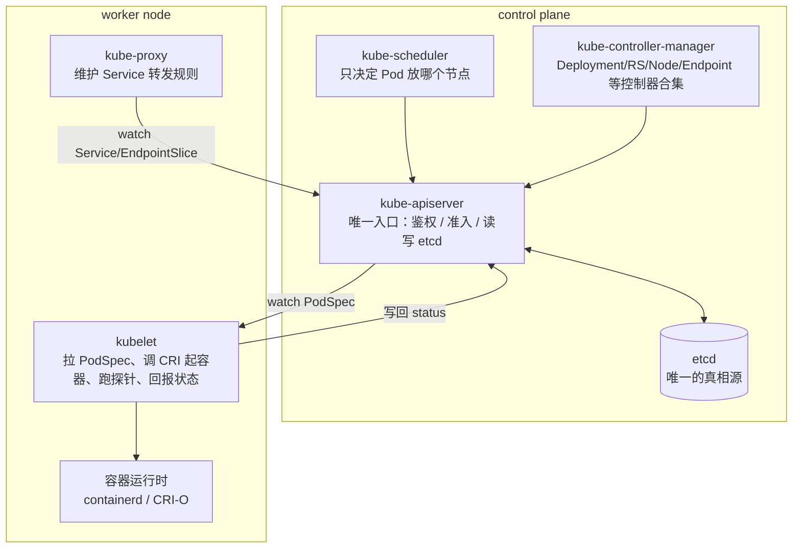

# Pod、Deployment、StatefulSet 到底该用哪个？

> 这三个不是三种「部署方式」，而是同一条调谐循环在不同约束下的产物。先懂循环，再选对象，选型就不靠背。

## 先看世界观：你写期望，控制器负责追

在 Kubernetes 里，几乎所有操作最终都归到一个动作：**把期望状态写进 apiserver**。apiserver 本身不执行任何东西，它只做鉴权、准入校验、落盘 etcd，然后把变更通知出去。真正干活的是底下这批控制器，它们各自盯着自己关心的字段，反复做同一件事：

```text
观察实际状态(status) → 与期望状态(spec) 比较 → 差多少补多少 → 再观察
```

这条循环叫 **reconcile（调谐）**。两个不太直观的性质值得记住：

- **它是水平触发的**：控制器不关心「刚才发生了什么事件」，只关心「现在差多少」。中间漏掉十次通知也无所谓，下一轮看到副本 2、期望 3，照样补一个。所以控制器进程崩了重启，集群状态还能被拉回来。
- **你写的是结果，不是步骤**：你只说「我要 3 个副本」，不说「先起第一个再起第二个」。顺序、重试、退避、失败后重来，全是控制器实现细节。

举个具体链路：`kubectl scale --replicas=5` 只是把 Deployment 的 `spec.replicas` 从 3 改成 5。接着 Deployment 控制器发现当前 ReplicaSet 只有 3 个 Pod，把 RS 的副本改成 5；ReplicaSet 控制器发现差 2 个，创建 2 个 Pod 对象；scheduler 给新 Pod 挑节点并写回 `nodeName`；对应节点的 kubelet 收到后调容器运行时起容器，再把状态写回 `status`。全程没有「部署编排脚本」，只有各自补差。

理解了这条循环，后面那些能力就不用单独记了——**它们不是独立功能，是同一条循环在不同字段上的表现**：

| 你感受到的能力 | 本质是哪个控制器在调谐什么                                |
| -------------- | --------------------------------------------------------- |
| 挂了自动拉起   | kubelet 按重启策略重启容器；RS 发现 Pod 少了补            |
| 滚动更新       | Deployment 新建一个 RS，按 maxSurge/maxUnavailable 挪副本 |
| 弹性扩缩容     | HPA 改 `spec.replicas`，剩下交给 Deployment               |
| 改配置滚一遍   | 你改 Pod 模板，产生新 RS，走一次滚动                      |

## 集群骨架：每个组件只做一件事



三条分工必须钉死，很多误解都来自把它们混在一起：

1. **apiserver 不调度、不起容器**，它只是唯一入口和一致性守门人；改 Pod 模板触发的滚动，是控制器算出来的，不是它干的。
2. **scheduler 只做一件事**：给还没绑定节点的 Pod 选节点，写回 `nodeName` 就退场。它不维护副本数，也不管容器死活。
3. **kubelet 是节点上的唯一执行者**：容器真正跑起来是它调 CRI 的结果；liveness/readiness/startup 三个探针也是它执行的，所以探针失败的重启动作和 apiserver 无关。

## Pod：最小调度单位，和它为什么「不可变」

Pod 不是「一个容器」，而是**一组共享运行环境的容器 + 一次调度决策**。同一 Pod 内容器共享三样东西：

- **网络命名空间**：同一个 IP、同一套端口空间。容器之间走 `localhost` 就能通，代价是**端口不能撞**——两个容器都想监听 8080 时，第二个直接起不来。
- **卷**：同一个 volume 可以挂进多个容器，这是 sidecar 模式的基础（比如日志目录共享给采集容器）。
- **生命周期**：Pod 内的容器一起被调度、一起被删除；某个容器挂了按 `restartPolicy` 处理，但 Pod 本身不被「就地修好」。

那为什么要有**多容器 Pod**？因为有些辅助逻辑必须和主进程共享网络或文件，且必须同生共死：

| 角色           | 干什么                                     | 典型例子                         |
| -------------- | ------------------------------------------ | -------------------------------- |
| sidecar        | 与主容器并行，增强或代理主容器             | 日志采集、mesh 代理、证书轮转    |
| init container | 主容器**之前**按顺序跑完就退出，用于初始化 | 等数据库就绪、拉配置、改目录权限 |
| 普通多容器     | 强耦合、必须同机部署的两个进程             | 老系统拆不动的遗留组合           |

init container 的顺序语义很实用：它们串行执行，全部成功后才开始拉主容器镜像。把「等依赖可用」放进 init container，比在主容器启动脚本里写 `until nc -z db 3306` 更干净。

**Pod 是不可变的**，这点常被误解成「Pod 里的镜像不能改」。准确说法是：PodSpec 的绝大多数字段创建后不可更新，能改的只有镜像、`activeDeadlineSeconds`、追加 `tolerations`、`terminationGracePeriodSeconds` 等少数几个；即便你对裸 Pod 执行 `kubectl set image`，也是 kubelet 把容器重启一遍换上新镜像——**没有滚动、没有旧版本留着回滚、没有健康检查兜底**。

所以结论很直接：**不要直接建裸 Pod 当服务**。裸 Pod 没有副本（节点挂了就没了）、没有自愈（删了没人重建）、没有滚动（改配置只能删了重建，中间必然断流）、没有历史版本（回滚靠记忆）。裸 Pod 只剩两种合理用途：临时调试，以及被控制器创建——你写的所有 Deployment/StatefulSet/DaemonSet，最终产物都是 Pod。

## 控制器选型对照表

把「谁管副本、谁管顺序、谁管身份」拆开看，选型就没那么玄：

| 控制器      | 它替你保证什么                                                      | 什么时候选它                                        | 什么时候别选                                         |
| ----------- | ------------------------------------------------------------------- | --------------------------------------------------- | ---------------------------------------------------- |
| Deployment  | 副本数、滚动更新、回滚（每个 revision 一个 ReplicaSet，旧 RS 留着） | 无状态服务：Web/API、消费端、定时任务之外的长驻进程 | 需要稳定网络标识或独占存储时                         |
| StatefulSet | 稳定序号身份 + 稳定存储 + 有序启停                                  | 数据库、自建 MQ、ZK/etcd 这类要固定成员的集群       | 无状态服务：扩缩慢、滚动受顺序约束，纯属自找麻烦     |
| DaemonSet   | 每个（符合条件的）节点跑一份                                        | 日志采集、监控 agent、CNI、node-proxy               | 业务服务：副本数由节点数决定，HPA 也管不了它         |
| Job         | 跑完就结束，按 `completions`/`parallelism` 控制并发                 | 数据迁移、批处理、一次性初始化                      | 常驻服务：跑完容器就退出了                           |
| CronJob     | 按 cron 表达式周期性造 Job                                          | 定时对账、报表、清理                                | 高频短任务：注意 `concurrencyPolicy` 与历史 Job 堆积 |

几个补充细节，面试和排障都用得上：

- **ReplicaSet 一般不直接建。** 它是 Deployment 的实现细节：一次滚动更新产生一个新 RS，`revisionHistoryLimit`（默认 10）决定留几个旧 RS 给 `rollout undo` 用。
- **StatefulSet 的「稳定」是三件事**：稳定 DNS（`<pod>.<headless-svc>.<ns>.svc.cluster.local`，依赖 headless Service）、稳定存储（`volumeClaimTemplates` 按 `数据卷名-Pod名` 生成 PVC，Pod 重建后仍挂回同一块）、有序启停（默认 `OrderedReady`：0→N-1 顺序创建，逆序删除，前一个 Ready 才起下一个）。
- **StatefulSet 的 PVC 不会随缩容删除。** 这是有意为之（防误删数据），代价是缩容后要人工清理，否则存储费一直烧。
- **CronJob 的时区**：早期只能用 controller-manager 进程时区，1.27 起支持 `spec.timeZone`；另外 `startingDeadlineSeconds` 不配的话，集群长时间不可用后可能补跑一堆过期任务。

## 落到 Java 服务：什么时候真的需要 StatefulSet

绝大多数 Java 业务服务应该用 Deployment，判断标准只有一条：**实例之间是否完全等价**。只要满足下面全部条件，就是无状态，用 Deployment：

1. 会话不落本地内存（放 Redis 或 token 自包含）；
2. 上传文件不写容器本地盘（走对象存储或共享 NAS）；
3. 实例之间不需要互相发现（不是集群成员，只是并列的副本）；
4. 没有「只在某台机器上才存在」的资源。

踩在这几条上的场景，才是 StatefulSet 的地盘：

- **自建 MQ / 中间件集群**：Kafka broker 的 `broker.id`、RabbitMQ 的节点名、ZK 的 `myid` 都要求身份稳定，重启后 IP 变了但身份不能变。StatefulSet 给的稳定 DNS 正好当集群成员地址。
- **需要选主且成员固定**：选主协议里成员列表通常写死在配置里，动态 IP 会让配置永远对不上。
- **独占磁盘 / 本地缓存**：本地 SSD 做缓存、需要把数据目录钉在某块盘上。做法是 local PV（或 hostPath）+ `volumeClaimTemplates` + `nodeAffinity`，把 Pod 按卷的节点约束钉回去——反过来，如果你用了本地卷却让 Pod 能满集群漂，调度到别的节点就等于数据全丢。
- **License 绑机器 / 绑网卡**：这类反而更适合 `nodeSelector` 或节点亲和把 Pod 固定在特定节点，而不是 StatefulSet；StatefulSet 解决的是「身份」，不是「位置」。

至于「有本地缓存」的无状态服务（比如本地 Caffeine 缓存），别急着换 StatefulSet：滚动更新后新实例冷启动、新旧实例缓存不一致，这类问题的解法是缓存加过期、或把共享部分挪到 Redis，而不是给 Deployment 套上序号。

## 调度：scheduler 只看 requests，不看 limits

这是本篇最该记住的一句。scheduler 打分时用的是节点上**已分配 requests 的总和**，与 limits 无关：

| 字段     | 谁在用                                | 配错的后果                                                       |
| -------- | ------------------------------------- | ---------------------------------------------------------------- |
| requests | scheduler 算剩余容量、HPA 算利用率    | 配小 → 节点严重超卖，多个 Pod 挤在一起抢 CPU；配大 → Pod Pending |
| limits   | 节点上 cgroup 限流/限额，仅运行时生效 | CPU 被限流导致 RT 抖动；内存超限直接 OOMKilled（指向配置篇）     |

也就是说，一个节点能塞多少 Pod，取决于大家「声明」要多少，而不是「实际」用多少。于是 `requests` 配小的团队会觉得自己很赚，直到邻居也这么干——节点负载飙高、CPU 被 cgroup 限流、内存压力触发 kubelet 驱逐。

**QoS 也由 requests/limits 决定**：所有容器 CPU 与内存的 requests 都等于 limits 是 `Guaranteed`；完全没配是 `BestEffort`（节点压力时最先被驱逐）；介于两者之间是 `Burstable`。生产上把核心服务配成 Guaranteed 或「内存 requests=limits」，是避免被邻居拖死的最便宜手段。

调度期的四个常用手段：

- **节点亲和 `nodeAffinity`**：按节点标签挑机器（GPU 机型、可用区、专用池）。`required...` 不满足就 Pending，`preferred...` 只是加权。
- **Pod 亲和/反亲和**：按「别的 Pod 在哪」来摆位。同一服务的副本用 `podAntiAffinity` + `topologyKey: kubernetes.io/hostname` 强行打散，避免一台机器挂了整个服务全没。
- **污点与容忍**：节点打 `taint` 表示「别随便来」（`NoSchedule` 不调度、`PreferNoSchedule` 尽量不调度、`NoExecute` 还会驱逐已在跑的）；Pod 写 `toleration` 表示「我能忍」。专用节点池就是靠这对组合隔离的。
- **拓扑分布约束 `topologySpreadConstraints`**：比反亲和更细，能按 `maxSkew` 控制副本在可用区/机架间的均衡程度，节点数不够时可以 `ScheduleAnyway` 降级而不是 Pending。

再补两个容易忘的：**Pod 优先级与抢占**——高 `priorityClassName` 的 Pod 调度不上时，scheduler 会驱逐低优先级 Pod 腾位置，被驱逐者走的是优雅终止（所以 `terminationGracePeriodSeconds` 会直接影响抢占的体验）；**所有 Pod 同优先级时没有抢占对象**，结果就是老老实实 Pending。

```yaml
apiVersion: apps/v1
kind: Deployment
metadata:
  name: order-api
spec:
  replicas: 3
  revisionHistoryLimit: 5
  strategy:
    type: RollingUpdate
    rollingUpdate:
      maxSurge: 1 # 允许多起 1 个
      maxUnavailable: 0 # 先起新的再下旧的，用冗余换不断流
  selector:
    matchLabels: { app: order-api }
  template:
    metadata:
      labels: { app: order-api }
    spec:
      # 必须大于应用优雅停机耗时，否则到点 SIGKILL 硬砍（见下方坑位）
      terminationGracePeriodSeconds: 45
      containers:
        - name: app
          image: registry.example.com/team/order-api:1.4.2 # 钉版本，不用 latest
          ports: [{ name: http, containerPort: 8080 }]
          resources:
            requests: { cpu: 500m, memory: 1Gi } # scheduler 只认这两个数
            limits: { cpu: "2", memory: 1.5Gi } # 只有运行时 cgroup 认
          startupProbe: # 慢启动保护：150s 内起不来才判死
            httpGet: { path: /health/live, port: http }
            periodSeconds: 5
            failureThreshold: 30
          livenessProbe: # 只判断「进程还活着」，不查下游
            httpGet: { path: /health/live, port: http }
            periodSeconds: 10
            failureThreshold: 3
          readinessProbe: # 决定是否接流量
            httpGet: { path: /health/ready, port: http }
            periodSeconds: 5
            failureThreshold: 2
      affinity:
        podAntiAffinity:
          # required 会在节点不足时 Pending；生产常用 preferred 换可用性
          preferredDuringSchedulingIgnoredDuringExecution:
            - weight: 100
              podAffinityTerm:
                labelSelector:
                  matchLabels: { app: order-api }
                topologyKey: kubernetes.io/hostname
```

## 自愈三探针：重启、摘流量、还是给时间

三个探针由 kubelet 执行，语义完全不同，混用就是事故（配歪之后的表现和排查顺序见 [Pod 起不来怎么查](/tools/kubernetes/kubernetes-troubleshooting.html)）：

| 探针           | 失败后发生什么                                       | 该放什么判断                           |
| -------------- | ---------------------------------------------------- | -------------------------------------- |
| livenessProbe  | **重启容器**（按退避重试，表现为 CrashLoopBackOff）  | 进程是否卡死、死锁、无法自恢复         |
| readinessProbe | **从 Service Endpoints 摘除**，容器不重启            | 现在能不能接流量（依赖就绪、预热完成） |
| startupProbe   | 成功前 liveness/readiness 都不生效；失败超阈值则重启 | 慢启动应用的一次性启动窗口             |

**Java 应用启动 60 秒、liveness 却只给 10 秒**，是最典型的自伤配置：kubelet 在第 30 秒（`periodSeconds 10 × failureThreshold 3`）判定失败，杀掉容器；重启后又是 60 秒启动，还没起来又被杀，于是永远卡在 `CrashLoopBackOff`，日志里只有半截启动过程。正确姿势是让 startupProbe 兜住启动期（比如 `periodSeconds: 5 × failureThreshold: 30` = 150 秒窗口），liveness 只负责「跑起来之后有没有僵死」。

关于探针内容，两条经验：

- **liveness 千万别查下游**。数据库抖一下、Redis 抖一下，liveness 全挂，kubelet 把所有实例一起重启，恢复期被你自己拉长——这就是「一次抖动变全量雪崩」。
- **readiness 可以查关键依赖，但要留缓冲**。全部实例 readiness 同时失败会让 Service 没有可用 endpoint，流量直接 503。上下游都抖的时候，宁可让部分实例「假装健康」扛着，也不要集体摘流（这种取舍和 [优雅下线与降级](/high-availability/high-availability-graceful-degradation.html) 里讲的原则一致：保住可用，再谈健康）。

## 滚动更新：四个参数和四条命令

Deployment 滚动更新的实质是「新建一个 RS，两个 RS 之间挪副本」，四个参数决定挪法：

| 参数                      | 默认 | 作用                                                                 |
| ------------------------- | ---- | -------------------------------------------------------------------- |
| `maxSurge`                | 25%  | 最多能超出期望副本多少（可以是百分比或个数），影响资源峰值           |
| `maxUnavailable`          | 25%  | 滚动过程中最多允许多少不可用，设 0 表示全程不降容量（配合 surge 用） |
| `progressDeadlineSeconds` | 600  | 多久没进展就标记 `ProgressDeadlineExceeded`——**只标记，不自动回滚**  |
| `revisionHistoryLimit`    | 10   | 留几个旧 RS 供 `rollout undo`                                        |

`progressDeadlineSeconds` 那个「只标记不回滚」值得强调：很多人以为超时会自动退回上一版，实际上 Deployment 就卡在失败状态，得人来处理。这也是它和很多发布平台「失败自动回滚」的差别所在。

配套命令：

```bash
kubectl rollout status deploy/order-api      # 阻塞观察，发布脚本里用它判断成败
kubectl rollout history deploy/order-api     # 看 revision 列表
kubectl rollout undo deploy/order-api        # 回上一版（--to-revision=N 指到具体版本）
kubectl rollout pause/resume deploy/order-api # 分批发布：先停住，验证完再继续
```

回滚能用的前提是旧 RS 还在——`revisionHistoryLimit: 0` 之类「清理干净」的配置，会把回滚能力一起清掉。

## HPA：利用率的分母是 requests，配歪就乱扩

HPA 算 CPU 利用率的方式是 `实际用量 / requests`，所以 `requests` 既进调度器，又进 HPA 的分母。
同一个实际用 200m 的进程，`requests` 配 100m 算 200%（按 50% 目标就该扩容）；配成 20m 直接算 1000%——HPA 立刻把副本拉满，而且永远觉得不够。

所以 HPA 乱扩，先查 requests 是否名不副实，再看指标是否来自 sidecar（1.23 起可用 `ContainerResource` 类型只算业务容器）。另外，**扩容不等于分流**：如果服务是长连接或 gRPC 流式调用，新副本可能拿不到流量，扩容只是徒增副本数——这部分在 [Service 和 Ingress 怎么把流量送进集群](/tools/kubernetes/kubernetes-service-ingress.html) 里从流量视角展开。

## 容易踩的坑

1. **探针里带下游依赖检查**：一次下游抖动 → 所有实例 readiness 失败 → endpoints 被摘空 → 全站 503；如果查在 liveness 上更糟，直接变成全量重启潮。
2. **镜像用 `latest`**：回滚时说不清「上一版」是哪个 digest，滚动更新也可能因为节点缓存导致不同节点跑不同代码。语义化版本或 `image@sha256:` 才可复现，这点和 [镜像和容器到底有什么区别](/tools/docker/docker-image-container.html) 里的口径一致。
3. **没配 requests**：scheduler 认为节点还很空，拼命往上塞；节点一满，CPU 被限流、内存触发驱逐，最先死的往往就是 `BestEffort` 的 Pod。
4. **`terminationGracePeriodSeconds` 比应用优雅停机时间短**：默认 30 秒，若应用要 40 秒处理完在途请求，第 30 秒就被 SIGKILL，用户看到的是连接重置。而且「摘 Endpoints」和「发 SIGTERM」是**并行**的，所以 preStop 里 sleep 几秒等传播，比单纯调大 grace 更稳（完整时序见 [优雅下线与降级](/high-availability/high-availability-graceful-degradation.html)）。
5. **同一 Pod 内容器端口冲突**：共享网络命名空间，sidecar 和主容器都想监听 8080 时后启动的容器会失败，表现为 Pod 反复重启而主容器日志完全正常。
6. **改了 ConfigMap 却没重启**：env 注入的那份在容器创建时就固定了，永远不会变；volume 挂载的会在 kubelet 同步周期后更新文件，但应用不 reload 照样用旧值——subPath 挂载更是连文件都不更新。注入差异见 [ConfigMap、Secret 和资源限制怎么配](/tools/kubernetes/kubernetes-config-secret-resource.html)。
7. **StatefulSet 用 ClusterIP Service 期待稳定 DNS**：稳定标识依赖 headless Service（`clusterIP: None`），配错了就只能靠 IP，成员重启后配置全对不上。

## 小结

1. Kubernetes 的一切行为都来自「期望状态 + 控制器调谐」这条水平触发循环；自愈、滚动、扩缩不是三个功能，是同一循环的不同字段。
2. 选型看约束：无状态用 Deployment，要稳定身份和存储用 StatefulSet，每节点一份用 DaemonSet，跑完即止或按 cron 用 Job/CronJob；裸 Pod 只用于调试。
3. scheduler 只按 requests 算容量，limits 只在运行时由 cgroup 生效；requests 配小会造成节点超卖，也会让 HPA 按虚高的利用率乱扩。
4. 三探针语义不同：liveness 重启、readiness 摘流量、startup 给慢启动窗口；liveness 里放下游检查等于给自己埋重启风暴。
5. 滚动更新靠 maxSurge/maxUnavailable 控制节奏，`progressDeadlineSeconds` 只标记失败、不自动回滚，回滚能力依赖保留的旧 ReplicaSet。

## 参考

综合 Kubernetes 官方文档中 Pod 生命周期与探针、控制器（Deployment/StatefulSet/DaemonSet/Job）、调度框架与拓扑分布约束、滚动更新策略等章节整理，并结合生产实践核对默认值：`maxSurge`/`maxUnavailable` 各 25%、`progressDeadlineSeconds` 600 秒、`revisionHistoryLimit` 10、`terminationGracePeriodSeconds` 30 秒、StatefulSet 默认 `OrderedReady` 与 PVC 不随缩容删除、CronJob 1.27 起支持 `timeZone`、HPA 1.23 起支持 `ContainerResource` 指标。对「ProgressDeadline 超时会自动回滚」「Pod 完全不可变」两个常见说法做了纠正。
