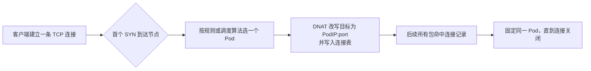
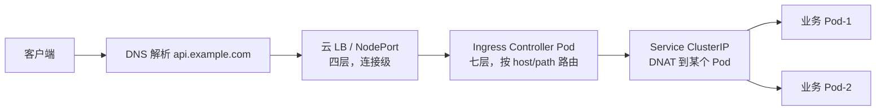

# Service 和 Ingress 怎么把流量送进集群？为什么长连接总钉在一台？

> 集群里的 IP 是消耗品：Service 提供"一个稳定名字 + 一张会变的名单 + 一层转发"，Ingress 再在前面按 host/path 分流。而"扩容没用"的根子在粒度——这两层都是按**连接**分流，不是按**请求**分流。

## 为什么非要加一层 Service

Deployment 起三个副本，每个 Pod 一个 IP：`10.244.1.7`、`10.244.2.9`、`10.244.3.4`。一次滚动发布，三个 IP 全换；节点扩缩容、Pod 被 OOMKilled 重建，IP 也换，而且 IP 还会被回收复用。调用方把这些写进配置，等于把"随时会过期的东西"当常量用——这和 [Docker 网络与数据卷](/tools/docker/docker-network-volume.html) 里"别用容器 IP 写死连接串"是同一个道理，只是 K8s 把问题放大了一号。

Service 补的就是缺的那几块：一个**稳定虚拟地址**（ClusterIP，Pod 换多少轮它都不变）、一个**稳定名字**（`<svc>.<ns>.svc.cluster.local`，由 CoreDNS 解析）、一张**持续维护的后端名单**（靠 label selector 生成 EndpointSlice），以及**一层转发**（节点上的 kube-proxy 规则或 eBPF 程序）。

两个先立住的认知：ClusterIP 是内核规则里的虚拟地址，不在任何网卡上，`ping` 不通很正常；Service 本身不是进程，没有"转发线程"在跑。

## Service 的几种类型：什么时候用，代价是什么

| 类型         | 写法                 | 什么时候用                                   | 代价                                                               |
| ------------ | -------------------- | -------------------------------------------- | ------------------------------------------------------------------ |
| ClusterIP    | 默认                 | 集群内服务互调，绝大多数业务服务             | 只能集群内访问，外部进不来（这正是 Ingress 存在的原因）            |
| NodePort     | `type: NodePort`     | 自建集群暴露端口、临时联调、没有云 LB 时     | 每个节点都开这个端口（默认 30000-32767），端口即入口，没有七层能力 |
| LoadBalancer | `type: LoadBalancer` | 云上要一个公网/内网 IP 做入口                | 一个 Service 一个 LB 实例，通常按量计费；自建集群得装 MetalLB 之类 |
| ExternalName | `type: ExternalName` | 把集群外的域名包成集群内的名字，迁移期最常见 | 只做 DNS CNAME，**没有任何转发**，也不做健康检查                   |
| Headless     | `clusterIP: None`    | StatefulSet 的稳定网络标识、客户端自己分片   | 没有 VIP，DNS 直接返回一组 Pod IP，负载均衡责任推给调用方          |

Headless 是后面长连接话题的伏笔，它长这样：

```yaml
apiVersion: v1
kind: Service
metadata:
  name: kafka
spec:
  clusterIP: None # 关键：不要 VIP
  selector:
    app: kafka
  ports:
    - { name: broker, port: 9092, targetPort: 9092 }
```

配合 StatefulSet，每个 Pod 会拿到 `kafka-0.kafka.<ns>.svc.cluster.local` 这种**跟着 Pod 走**的域名。Kafka、ZooKeeper、Redis Cluster 这类"我必须知道每个实例是谁"的系统要的正是这个，而不是一个每次随机挑后端的 VIP。

## 转发是谁在干：iptables 模式和 IPVS 模式

**iptables 模式**：给每个 Service 建一条自定义链，每个 endpoint 一条 `DNAT` 规则，用随机概率做近似均分。规则是顺序遍历的，数量随"Service 数 × Pod 数"线性增长。**IPVS 模式**：把 Service 做成内核里的虚拟服务，后端是 real server，用哈希表加连接表管理，支持 `rr`、`wrr`、`lc`、`sh` 等多种调度算法。

| 维度     | iptables                                     | IPVS                                        |
| -------- | -------------------------------------------- | ------------------------------------------- |
| 匹配方式 | 规则链顺序遍历，规模大时同步慢、CPU 偏高     | 哈希查找，几千个 Service 也更稳             |
| 调度算法 | 只有随机概率                                 | rr / wrr / lc / wlc / sh / sed 等           |
| 连接状态 | 依赖 conntrack                               | 自带 `ip_vs_conn` 连接表                    |
| 排查手感 | `iptables -t nat -L KUBE-SERVICES -n` 看规则 | `ipvsadm -Ln` / `ipvsadm -Lnc` 看后端与连接 |

> 生态边界：新版本还有 nftables 模式；Cilium 这类 eBPF CNI 可以直接用 eBPF 替掉 kube-proxy，在 socket 层转发，还能顺带做 L7 策略。别把"iptables 还是 IPVS"当成二选一。

**关键结论：这两种都是"连接级"负载均衡。** 做决定的时刻就是一条新连接的第一个包：选一个后端、做 DNAT、把结果写进 conntrack 或 IPVS 连接表；这条 TCP 后续所有包都按已有记录走同一个后端，不会重新选。



所以均衡粒度是**连接**，不是**请求**。对短连接（每请求一条连接）几乎等价于按请求分流；对长连接，一条连接就是一个流量单位——落在哪台，哪台就吃满。

## 为什么长连接总钉在一台

Java 后端常见的几条通道，天生都是长连接：

| 通道                          | 为什么是长连接                            |
| ----------------------------- | ----------------------------------------- |
| gRPC（HTTP/2）                | 一条 TCP 上多路复用所有请求，连上就一直用 |
| WebSocket                     | 协议本身就是一条长期双向连接              |
| HTTP/1.1 + 连接池             | keep-alive 复用，少量连接撑住全部 QPS     |
| 数据库连接池、Kafka/MQ 客户端 | 建连昂贵，建好缓存着反复用，还带心跳      |

（HTTP/2 不用 `Connection: Keep-Alive`，但那一条 TCP 更"值钱"；连接复用与分段的细节见 [HTTP 长连接怎么保活](/cs-basics/network/network-http-keepalive-tcp-keepalive.html)。）

于是就有了这类现场：扩容前 2 个 Pod 各 500 QPS，扩到 4 个之后，老的两个还是各 500，新的两个各 5——只有探针在连。已经建立的连接不会因为后端多了两台就搬过去，要它搬只能断掉重建。表现很有辨识度：

1. **扩容无效**：副本数上去了，压测 QPS 不变，新 Pod 的 CPU 趴在地上；
2. **单点被打爆**：某个 Pod 的 CPU / 连接数远高于同伴，其余几乎空闲；
3. **重启即雪崩**：钉住流量的 Pod 一重启，全部连接重连后瞬间涌向剩下的 Pod；
4. **分布随机不均**：每次发布后"哪个 Pod 最忙"都不一样，看监控像玄学。

解法只有一个方向——**把分流粒度变细**：

| 解法                  | 粒度        | 怎么做                                                                                       | 代价 / 边界                                                                 |
| --------------------- | ----------- | -------------------------------------------------------------------------------------------- | --------------------------------------------------------------------------- |
| 客户端负载均衡        | 请求/子通道 | gRPC 用 `round_robin` 解析出多个地址、建多条子通道；Spring Cloud LoadBalancer 每次调用挑实例 | 客户端要能拿到实例列表（Headless DNS 或注册中心）；非 Java 客户端要各自实现 |
| 服务网格 Sidecar      | 请求        | Envoy 按请求分流，连接被切成"客户端→sidecar"和"sidecar→Pod"两段                              | 多一跳、多一层运维；mTLS 与配置复杂度上升                                   |
| 连接数上限 / 缩短寿命 | 连接        | 限制一条连接最多服务多少请求，或定期重建连接池                                               | 有握手成本；WebSocket / SSE 这类根本不能这么干                              |
| 连接池按实例分片      | 连接        | Redis Cluster / Kafka 客户端本就按 slot、partition 建连到不同实例                            | 要客户端支持分片；对无状态 HTTP 服务没意义                                  |

一个必须点明的细节：**Ingress Controller 并不是白送的请求级均衡**。nginx 到 upstream 的连接是"每个 worker、每个 upstream"各自复用的长连接池，默认连接数很少（ingress-nginx 的 `upstream-keepalive-connections` 默认 32），worker 一多，每个池里就几条连接，后端自然倾斜。要的是 `max-requests-per-connection` 这类上限，ingress-nginx 里对应的 ConfigMap 键是 `upstream-keepalive-requests`（默认 10000）。把连接数配足、这两个数调小，才能把粒度压到"每 N 个请求换一次后端"。HTTP/1.1 keep-alive 的问题从来不是"是否连接级"，而是"一条连接能不能切成几段"。

## Endpoints / EndpointSlice：Service 到底把流量发给谁

Service 并不"知道 Pod 在哪"。它靠 `selector` 匹配 Pod 的 label，由 EndpointSlice 控制器把匹配到**且通过 readiness 检查**的 Pod IP 写进名单，kube-proxy 只认这份名单。早期是 `Endpoints` 一个大对象，现在默认 `EndpointSlice`：按每片 100 个地址切开，名字形如 `order-service-abc12`。

```bash
kubectl get endpointslice -l kubernetes.io/service-name=order-service -o wide
kubectl get endpoints order-service -o wide   # 老对象通常还在，做兼容
```

### "没有 endpoint"的四个原因

`kubectl describe svc` 里 `Endpoints: <none>`，或者 slice 查出来是空，基本就这四种：

| 原因               | 怎么确认                                                                    | 典型现象                            |
| ------------------ | --------------------------------------------------------------------------- | ----------------------------------- |
| selector 不匹配    | `kubectl get svc xx -o yaml` 看 selector，和 `get pod --show-labels` 逐个对 | 一直是 `<none>`，从未有过地址       |
| readiness 没过     | 看 `kubectl get pod` 的 READY 列，`describe pod` 看探针失败事件             | 曾经有过地址，Pod 重启后变空        |
| 端口名不一致       | Service 写 `targetPort: http`，Pod 里却叫 `web`，或根本没命名               | 地址有，连上去是 connection refused |
| Pod 在别的命名空间 | `kubectl get pod -A -l app=xx`                                              | Pod 明明 Running，Service 就是空    |

这四种就是 `502 / 503` 的第一现场，而且能把三类错误分开：**名单为空**是没有后端——iptables 模式下无 endpoint 的 Service 会被 REJECT，从节点直连 VIP 得到 connection refused，经 Ingress 则表现为 nginx 找不到后端、返回 503；**名单有但端口错**是转发到错误端口，连接被拒，Ingress 侧就是 502；**有 endpoint 但并不健康**（readiness 配得太松）则是请求真打进去了，属于应用层的 500。所以排查顺序是：先看有没有地址，再看端口，最后才看应用日志，别一上来就怀疑 CNI。另外 `publishNotReadyAddresses: true` 会让未就绪的 Pod 也进名单，它只适合"必须先互相发现才能就绪"的场景，普通业务打开等于放大 502。

## Ingress：七层路由，但规范本身只定义了很少一部分

Ingress 是"集群入口的七层路由规则表"：按 host、path 把请求分给不同 Service。它只是**声明**，必须由 Ingress Controller 实现——没有 Controller，Ingress 对象就是一段没人读的 YAML（`kubectl get ingress` 里有 ADDRESS 才说明真被接管了）。

```yaml
apiVersion: networking.k8s.io/v1
kind: Ingress
metadata:
  name: order
  annotations:
    nginx.ingress.kubernetes.io/proxy-read-timeout: "3600"
spec:
  ingressClassName: nginx
  rules:
    - host: api.example.com
      http:
        paths:
          - path: /order
            pathType: Prefix
            backend: { service: { name: order-service, port: { number: 8080 } } }
```

常见 Controller：ingress-nginx（最普遍）、Traefik、APISIX、以及各云厂商 LB 的 Ingress 实现。它们的差异**不在 spec 里，而在注解里**：

| 想做的事      | ingress-nginx 的注解（示意）                | 备注                                    |
| ------------- | ------------------------------------------- | --------------------------------------- |
| 去/改路径前缀 | `rewrite-target` 配正则捕获组               | 与后端 `context-path` 叠加是 404 高发区 |
| 调后端超时    | `proxy-read-timeout`、`proxy-send-timeout`  | SSE / 长轮询必看                        |
| 放大请求体    | `proxy-body-size`（默认 1m）                | 上传接口必踩                            |
| 限流 / 灰度   | `limit-rps`、`limit-burst`；`canary-weight` | 与网关层限流是两道闸，别互相顶          |
| 会话保持      | `affinity: cookie`                          | 比 Service 的 ClientIP 更可控           |

注解是**实现绑定**的：同一份 Ingress 挪到 Traefik 上，`nginx.ingress.kubernetes.io/*` 全部静默失效——不报错，行为只是回到默认。跨 Controller 迁移时这一层要逐个对照重写。

> 规范现状：Ingress 的 API 已经冻结（只修问题、不加新特性），后续方向是 **Gateway API**：把"谁能监听、谁终止 TLS"和"路由规则"拆成 GatewayClass、Gateway、HTTPRoute 等角色，支持 header 匹配、流量拆分、跨命名空间引用。长期规划可以按它设计，存量项目不必为了迁而迁。

## 一条流量的完整路径



"能通"和"稳定"是两件事。这条链上**每一跳都有自己的超时、缓冲和空闲回收**，任何一跳比内层更早放弃，用户看到的就是 502/504：

| 跳                   | 典型可调项                                         | 长连接 / SSE 要注意什么                         |
| -------------------- | -------------------------------------------------- | ----------------------------------------------- |
| 云 LB / SLB          | 空闲超时（常见 60s 量级）、后端健康检查间隔        | 谁的空闲超时最短，连接就只能活那么久            |
| Ingress Controller   | `proxy-read-timeout`、`proxy-buffering`、body 大小 | SSE 要关 buffering、放大读超时；上传要放开 body |
| Service / kube-proxy | 没有超时概念                                       | 只在建连时选后端，不改写应用层语义              |
| 业务应用             | 连接池 idle timeout、读写超时、堆与 limit 的配比   | 池的空闲回收必须小于上游的空闲超时              |

两条结论：**超时从内到外递增**（应用 5s < Ingress 10s < 云 LB 30s），反了就变成"内层还在干活，外层已经给用户报错"——这和 [Spring Cloud Gateway 的路由和过滤器](/system-design/spring-cloud/spring-cloud-gateway-filter-limit.html) 里"网关必须比后端超时大一点"是同一条原则，只是这条链更长；**长连接是分段建立的**，客户端到 Ingress 是一条 TCP、Ingress 到 Pod 是另一条，keep-alive、超时甚至 HTTP 版本都可以两段不同，别拿一段的表现推另一段。SSE、流式输出这类"挂很久还要边算边推"的场景，逐跳怎么配见 [大模型流式输出怎么落到后端](/ai/ai-streaming-sse-backend.html)。

## DNS 与服务发现：Java 服务在这里有个专属坑

CoreDNS 给每个 Service 注册 `<service>.<namespace>.svc.cluster.local`。同命名空间可以直接用短名，跨命名空间至少写到 `order-service.prod`，写全 FQDN 最保险，也最省查询次数。Pod 的 `/etc/resolv.conf` 大概是这样：

```text
search prod.svc.cluster.local svc.cluster.local cluster.local
options ndots:5
```

`ndots:5` 的含义是：**域名里点数少于 5 个时，先按 search 列表逐个拼接试一遍，全失败才当成绝对域名去查**。于是 `order-service.prod`（1 个点）会先被拼成若干无效名字，吃几次 NXDOMAIN 才轮到真正的查询。高 QPS 下这就是 CoreDNS 的额外压力和肉眼可见的解析延迟。取舍很简单：集群内互调尽量写 FQDN 或至少 `svc.ns`，外部域名末尾加点写成绝对域名，或上 NodeLocal DNSCache。

### JVM 的 DNS 缓存不遵守 TTL

准确的说法不是"JVM 永久缓存"，而是：**JVM 不读 DNS 记录里的 TTL 字段，它按自己的缓存时长决定何时重查**。所以你在 CoreDNS 侧把 TTL 调到 5 秒，对 JVM 一点用都没有。

| 配置                                | 含义                                    | 默认值                                       |
| ----------------------------------- | --------------------------------------- | -------------------------------------------- |
| `networkaddress.cache.ttl`          | 解析成功的结果缓存多久（秒），-1 为永久 | JDK 8 及更早是 -1；JDK 9 起改为 30 秒        |
| `networkaddress.cache.negative.ttl` | 解析失败（NXDOMAIN）缓存多久            | 10 秒                                        |
| `-Dsun.net.inetaddr.ttl`            | 私有系统属性，安全属性未设置时会被采纳  | 不建议依赖，优先级与安全管理器行为随版本变化 |

后果很具体：Service 删了重建、StatefulSet 换了一批 Pod，IP 池会被复用，而 JVM 手里那份老地址还在缓存里 → 连到已经属于别的 Pod 的 IP，或者干脆连不上。表现是"重启应用就好了"，于是没人去查根因。工程解法按推荐度：业务配置里不写 Pod IP 也不写解析后的地址，统一写 Service 名；显式设置 `-Dnetworkaddress.cache.ttl=30`（变动频繁可压到 5~10 秒）；给连接池设 `maxLifetime`（小于后端连接的空闲超时），让连接周期性重建、顺带刷新 DNS。

## 几个语义细节，记错就会白查半天

**targetPort 用名字还是数字**。名字更好，但必须和 Pod 里 `containerPort` 的 `name` 对上（Pod 写 `name: http`、Service 写 `targetPort: http`）。用数字则耦合：端口 8080 改成 8081 而 Service 没同步就是 connection refused。名字是一份契约，代价是写错不报错（照样表现为"有 endpoint 但连不上"），所以命名建议全站统一（`http`、`grpc`、`metrics`）。

**sessionAffinity 很少是解药**。`sessionAffinity: ClientIP` 把同一客户端 IP 的请求钉到同一个 Pod，解决的是"会话状态没外置"这个设计问题，代价却不少：客户端在 NAT/代理后面时，一大群人共享出口 IP，会被钉到同一台——把"负载不均"做成了"必然不均"；Pod 挂了要等超时才切换；对 gRPC/长连接**毫无作用**，连接本来就钉住了。正解是把会话状态外置到 Redis 之类，确实要粘性就用 Ingress 的 cookie affinity。

**NodePort 的端口范围**默认 `30000-32767`（可配），每个节点都监听。它常被当临时方案，但端口就是暴露面：能被扫到就能被打，别忘了配 NetworkPolicy 或安全组。

**NetworkPolicy 的默认语义是"全通"，不是"全拒"**。这点最容易搞反：没有 Policy 选中某个 Pod 时，它的进出流量完全不受限；一旦有 Policy 选中它且 `policyTypes` 含 `Ingress`，它的入向才变成"只允许列表里列出的"。所以"加了 NetworkPolicy 之后 5xx 反而变多"是真事——一个只写了 `from: namespaceSelector` 的 Policy 会把监控、探针、Ingress 的流量一起挡掉，然后被误判成"集群网络不通"。不同 CNI 对策略的支持程度也不同，排查前先确认它是真在强制执行。

## 容易踩的坑

- **Service selector 和 Pod label 对不上**：`app: order-svc` 与 `app: order-service`，一个字母之差，`Endpoints` 永远 `<none>`，而 `kubectl get pod` 一切正常。第一步永远是 `kubectl get endpoints <svc>`。
- **Ingress path 和应用 context-path 叠加成 404**：Ingress 把 `/api/order/1` 原样转给后端，后端 `server.servlet.context-path=/order`，实际匹配 `/order/api/order/1` → 404。要么用 `rewrite-target` 去前缀，要么让两边路径对齐；写清"客户端路径 → Ingress 处理后 → 后端收到"，比在日志里猜快得多。
- **Ingress Controller 和业务不在同一命名空间，却写短名**：Ingress 的 `service.name` 只能引用**同命名空间**的 Service（跨命名空间要用 ExternalName，或 Gateway API 的跨 namespace 引用机制）。写短名得到的是"Service 找不到"，报错往往看不出因果。
- **把 Kafka / Redis 这类有状态服务放在 ClusterIP 后面**：客户端通常一条连接搞定所有请求，整个集群的读写全压在一个节点上；slot 迁移、partition leader 变更时客户端还感知不到该换连接。正确做法是 Headless + 客户端按 partition/slot 分片，Service 只负责提供名单。
- **readiness 和 liveness 配成一样**：readiness 决定"要不要接流量"，liveness 决定"要不要重启"。都写同一个 `/health`，依赖一抖动就全员被摘流量又被重启，故障从"部分慢"扩大到"全挂"。探针细节见 [Pod 起不来、上不了线怎么查](/tools/kubernetes/kubernetes-troubleshooting.html)。

## 小结

1. Pod IP 会随重建和扩缩容变化，Service 用稳定的 ClusterIP、集群 DNS 名字和一份 EndpointSlice 名单把它换掉；Service 不是进程，转发靠节点上的 kube-proxy 规则或内核模块。
2. 五种类型按暴露范围选：ClusterIP 内部、NodePort 节点端口、LoadBalancer 云 LB、ExternalName 只是 DNS 别名、Headless 是把名单直接交给客户端，不是"轻量版 ClusterIP"。
3. iptables 与 IPVS（含 eBPF 替代方案）都是**连接级**均衡：首个包选后端、写连接表、后续包固定。长连接倾斜不是 bug，是粒度决定的。
4. 治理长连接只能把粒度变细：客户端 LB、sidecar 按请求分流、限制每条连接的请求数、连接池按实例分片；加副本和 sessionAffinity 都治不了，ClientIP 保持还可能放大倾斜。
5. `502/503` 先查 EndpointSlice：selector 不匹配、readiness 没过、端口名不一致、Pod 在别的命名空间，四种覆盖绝大多数；Ingress 是声明、能力在注解、规范已冻结方向是 Gateway API；JVM 的 DNS 缓存不看记录 TTL，是 Java 服务专属的坑。

## 参考

综合自 Kubernetes 官方文档的 Service、EndpointSlice、Ingress、NetworkPolicy 与 DNS for Services and Pods 章节，ingress-nginx 的 ConfigMap 键位与注解说明（`upstream-keepalive-connections`、`upstream-keepalive-requests`、`proxy-read-timeout` 等），以及 JDK 网络安全属性文档；同时对齐了站内 [Docker 网络与数据卷](/tools/docker/docker-network-volume.html)、[HTTP 长连接怎么保活](/cs-basics/network/network-http-keepalive-tcp-keepalive.html)、[Spring Cloud Gateway 的路由和过滤器](/system-design/spring-cloud/spring-cloud-gateway-filter-limit.html) 三篇的既有口径。

撰写时纠正或收紧的几处说法：

1. **"JVM 会永久缓存 DNS"不准确**：真正的机制是不读记录里的 TTL、用自己的缓存时长；`networkaddress.cache.ttl` 在 JDK 8 及更早默认 -1，JDK 9 起默认 30 秒。
2. **"Service 是四层负载均衡，所以扩容会自动分流"混淆了粒度**：连接级均衡只在建连时生效，长连接不会因为副本变多而重新分配。
3. **"NetworkPolicy 默认拒绝"是错的**：默认全通，只有在有策略选中 Pod 且包含相应 `policyTypes` 后才对它生效。
4. **"sessionAffinity 能解决负载不均"方向反了**：ClientIP 粘性在 NAT 场景下会把一批客户端钉到同一 Pod。
5. **Ingress 的"请求级均衡"不是免费的**：nginx 到 upstream 的 keep-alive 池是 per-worker、per-upstream 的，连接数偏少就会倾斜。
