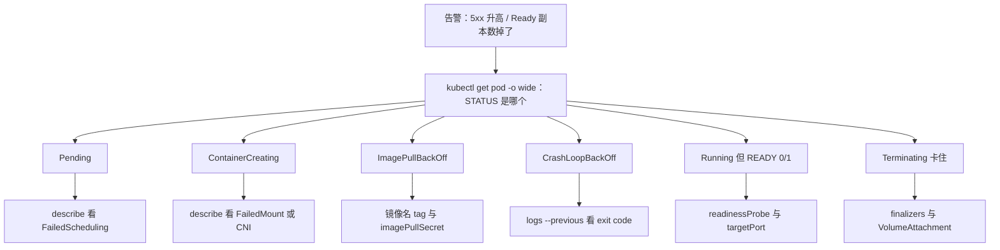

# Pod 起不来、被杀、上不了线，按什么顺序查？

> Pod 出问题时，最贵的不是命令不熟，而是顺序错了——先看日志再看事件，等于先听被告陈述再找现场。

## 先把主干钉死：状态 → 事件 → 日志 → 资源 → 网络

一个 Pod 的生命是一条流水线：**调度 → 创建 → 启动 → 就绪 → 运行 → 终止**。每一步失败，留下的证据形态完全不同：

- 调度失败：容器根本没创建，**没有日志**，只有 Events 里一行 `FailedScheduling`；
- 启动即退：Events 里只有 `Back-off restarting failed container`，真正原因在**上一个容器**的日志里；
- 就绪失败：进程活得好好的，日志干干净净，唯一线索是 `Readiness probe failed`；
- 运行中被杀：状态可能还显示 `Running`，但 `RESTARTS` 已经两位数了。

所以顺序不能乱：先确定"卡在哪一步"，再决定打开哪一种证据。

```text
STATUS / READY / RESTARTS    → 卡在哪一步
kubectl describe 的 Events   → 为什么卡（调度器与 kubelet 的说法）
kubectl logs --previous      → 应用自己怎么说
top / limits / QoS           → 是不是被资源掐住
endpoints / netpol / ingress → 流量到底有没有进来
```

反过来，一上来就 `kubectl logs`：遇到调度失败、镜像拉不下来，输出要么是空的，要么只有一句提示，然后你开始怀疑代码——这是最典型的浪费时间。



这几类证据的保鲜期差别很大，值得单独记一笔：Events 默认只保留约 1 小时，而且会被同 key 聚合；容器一重建，旧日志就没了（除非已经接了日志采集）；指标能回溯几十天，但粒度是分钟级，抓不到 30 秒内的抖动。所以到现场第一件事是**把 `describe`、`logs --previous`、`-o yaml` 导出存档**，而不是边推理边等它们过期。

## 状态矩阵：看到这个状态，第一反应是什么

`kubectl get pod` 的 `STATUS` 只回答"卡在哪一步"，不回答"为什么"。下表把两件事对上：

| 状态                     | 实际含义                                          | 最可能原因                                                                                       | 第一条命令                                             |
| ------------------------ | ------------------------------------------------- | ------------------------------------------------------------------------------------------------ | ------------------------------------------------------ |
| `Pending`                | 已进队列，调度器还没找到节点                      | request 超过节点可分配量、nodeSelector 或亲和反亲和冲突、污点不容忍、PVC 未绑定、节点 Pod 数到顶 | `kubectl describe pod POD` 找 `FailedScheduling`       |
| `ContainerCreating`      | 已调度到节点，容器还没起来                        | 挂卷失败 `FailedMount`、Secret 或 ConfigMap 缺 key、CNI 分配 IP 失败、镜像还在拉                 | `kubectl describe pod POD` 看 Events 尾部              |
| `ImagePullBackOff`       | 镜像拉不下来，指数退避重试                        | 镜像名或 tag 拼错、私有仓库凭据缺失或过期、节点到仓库的证书或网络、跨架构镜像                    | `kubectl describe pod POD` 找 `Failed to pull image`   |
| `CrashLoopBackOff`       | 起来了又退出，kubelet 退避重启（间隔最长 5 分钟） | 配置错、依赖不可达、启动太慢被 liveness 杀掉、command 或 entrypoint 写错                         | `kubectl logs POD --previous`                          |
| `Running` 但 `READY 0/1` | 进程活着，readiness 没过                          | 探针路径或端口不对、依赖未就绪、`initialDelaySeconds` 短于实际启动耗时                           | `kubectl describe pod POD` 找 `Readiness probe failed` |
| `OOMKilled`              | 被内核 cgroup 杀掉，`exitCode 137`                | 容器内存超 limit、堆外内存没算、内存泄漏                                                         | `kubectl describe pod POD` 看 `Last State`             |
| `Error`                  | 容器已退出，失败被判定为不可恢复                  | `1` 应用异常、`137` SIGKILL、`143` SIGTERM、`127` 命令不存在、`139` 段错误                       | `kubectl logs POD --previous --tail=200`               |
| `Terminating` 卡住       | 删除流程走不完                                    | finalizer 未清、卷卸载失败、节点 NotReady 联系不上 kubelet、优雅停机超时                         | `kubectl get pod POD -o yaml` 看 `finalizers`          |

两个容易看错的状态：`Completed` 是 Job 正常跑完，不是故障；`Evicted` 是节点压力驱逐，落在 `Failed` 阶段，`describe` 里会写明 `The node was low on resource`。

还要提醒一句：`STATUS` 列显示的是"容器状态里最显眼的那个理由"，不是分类。同一个故障，可能这一分钟显示 `OOMKilled`，过两分钟变成 `CrashLoopBackOff`——把它当线索，别当结论。

## 七条命令，每条在找什么

```bash
NS=prod; POD=order-api-7d9c8f6b5-x2k4m; SVC=order-api

kubectl get pod -n $NS -o wide
kubectl describe pod -n $NS $POD
kubectl logs -n $NS $POD --previous --tail=200
kubectl exec -it -n $NS $POD -- sh
kubectl top pod -n $NS $POD && kubectl top node
kubectl get endpoints -n $NS $SVC
kubectl get events -n $NS --sort-by=.lastTimestamp
```

- **`get pod -o wide`**：`NODE` 列为空说明从未被调度（往 `Pending` 方向查），有值说明问题在节点侧；`RESTARTS` 涨得快说明正在退避循环；`AGE` 只有几十秒说明刚被重建，可能正卡在滚动更新里。
- **`describe pod`**：Events 是金矿，调度失败、拉镜像失败、挂卷失败、探针失败全在这里。注意 Events 只保留最近一段时间（默认约 1 小时），而且相同事件会被聚合成 `x N`。
- **`logs --previous`**：看的是**上一个容器实例**的日志。容器重启后当前日志从零开始，你看到的可能是"启动到一半就被杀"的半截现场，和崩溃前的真实报错完全是两回事。容器只启动过一次时该参数会报 `previous terminated container not found`，那是正常的。
- **`exec` 进去看**：进程在不在（`ps -ef`）、端口在不在听（`ss -lntp`）、能不能连下游（`curl`、`getent hosts`）。这一步只验证现象，不改文件；整机 load、内存、IO 怎么读见 [Linux 进程怎么排查](/tools/linux/linux-process-diagnosis.html)。
- **`top pod/node`**：对照 `resources.limits` 看是贴着 limit 还是远低于 limit。贴 limit 加节流，才是"资源不够"；远低于 limit 还慢，方向在依赖或代码。
- **`get endpoints`**：Service 有没有后端。为空只有三种可能：selector 不匹配 Pod 标签、Pod 没 Ready、Service 和 Pod 不在同一 namespace。
- **`get events --sort-by=.lastTimestamp`**：把镜头从单个 Pod 拉到集群，看节点压力、驱逐、PDB、镜像拉取这类集群级信号。

## 状态字段地图：yaml 里到底看哪几行

`describe` 是给人看的摘要，细粒度信息在 `kubectl get pod -o yaml` 里。三条 jsonpath 基本够用：

```bash
kubectl get pod $POD -n $NS -o jsonpath='{range .status.conditions[*]}{.type}={.status} {.reason}{"\n"}{end}'
kubectl get pod $POD -n $NS -o jsonpath='{range .status.containerStatuses[*]}{.name} ready={.ready} restarts={.restartCount}{"\n"}{end}'
kubectl get pod $POD -n $NS -o jsonpath='{.status.qosClass} {.spec.nodeName}{"\n"}'
```

- `status.conditions`：`PodScheduled`、`Initialized`、`ContainersReady`、`Ready` 四条。`PodScheduled=False` 说明压根没调度上，后面的检查可以整段跳过。
- `status.containerStatuses[].state.waiting.reason`：正在等什么，`ContainerCreating`、`CrashLoopBackOff`、`ImagePullBackOff` 都在这。
- `status.containerStatuses[].lastState.terminated`：上一次怎么死的，`reason`、`exitCode`、`startedAt`、`finishedAt` 都在，"活了 40 秒才死"这种关键结论就是从时间差算出来的。
- `status.qosClass`：`Guaranteed`、`Burstable`、`BestEffort`，直接决定节点压力时谁先被驱逐。

## Events 里出现这些词，基本就定性了

Events 的文案是调度器和 kubelet 写的，措辞比状态更接近根因：

| 事件文案（节选）                                                 | 含义                         | 下一步                                               |
| ---------------------------------------------------------------- | ---------------------------- | ---------------------------------------------------- |
| `FailedScheduling: 0/12 nodes are available: 3 Insufficient cpu` | request 超过剩余可分配量     | 降 request、拆小规格或加节点                         |
| `FailedMount: timeout waiting for volumes to attach or mount`    | 卷挂不上，云盘跨可用区最常见 | 比对 PV 所在 zone 与 Pod 所在节点                    |
| `Failed to pull image ... unauthorized`                          | 仓库认证失败                 | 查 `imagePullSecrets` 与 Secret 是否在同一 namespace |
| `Back-off restarting failed container`                           | 容器反反复复退出             | `logs --previous` 找第一条异常                       |
| `Liveness probe failed ... timeout`                              | 探针超时被判死               | 调 `timeoutSeconds` 与失败阈值，或换 startupProbe    |
| `Readiness probe failed ... statuscode 503`                      | 应用自己说没准备好           | 查依赖状态与探针路径                                 |
| `Killing container ... reason: OOMKilled`                        | 内核 OOM                     | 查 limit 与堆外内存                                  |
| `The node was low on resource: memory ... evict`                 | 节点压力驱逐                 | 查节点余量与 QoS 等级                                |
| `FailedCreatePodSandBox` 或 `networkPlugin` 报错                 | CNI 分配 IP 失败             | 查 CNI 组件与节点 IP 池                              |

同一句话反复出现不是刷屏：Events 会把相同事件聚合成 `x 17`，这个数字本身就是"失败了多少回"的计量。

## 现场一：新版本发布后起不来

这是运维通知"发版失败"最常见的形态，五个子情况长得像但根因完全不同：

| 症状                                                                       | 判定                                               | 处理                                                                                                                                  |
| -------------------------------------------------------------------------- | -------------------------------------------------- | ------------------------------------------------------------------------------------------------------------------------------------- |
| 新 Pod 全是 `ImagePullBackOff`                                             | tag 写错，或新 namespace 里没带 `imagePullSecrets` | 核对 tag 与 `kubectl get secret`；急的话 `kubectl rollout undo` 回旧 tag                                                              |
| `RESTARTS` 一直涨，`logs --previous` 反复出现同一段启动日志                | 启动没完成就被 liveness 杀了                       | 加 `startupProbe`，或把 `initialDelaySeconds` 拉到最慢启动时间以上                                                                    |
| Pod `READY 0/1`，`get endpoints` 为空                                      | readiness 一直没过，Service 没有后端               | 看探针路径是否被 context-path 前缀吃掉，见 [Service 和 Ingress 怎么把流量送进集群](/tools/kubernetes/kubernetes-service-ingress.html) |
| 新 Pod `Pending`，旧 Pod 还在跑                                            | 滚动更新时 `maxSurge` 让资源需求短暂翻倍           | `describe node` 看 Allocated resources，降 request 或先缩容                                                                           |
| `rollout status` 一直卡住，`kubectl get pdb` 显示 ALLOWED DISRUPTIONS 为 0 | PDB 拦住驱逐，老 Pod 下不去                        | 临时放宽 PDB，或改 `maxUnavailable` 小步走                                                                                            |

判断"是不是被探针杀的"有个很硬的证据：**日志在同一个位置重复出现，且没有异常堆栈**。应用还没来得及报错就被 SIGTERM 了，日志里只会看到启动流程走到一半。此时 `describe` 的 `Last State` 常常是 `Reason: Error, Exit Code: 143`——143 是 128+15，SIGTERM 的语义，不是崩溃。

## 现场二：跑着跑着被杀

运行期被杀只有三种来源，先分清再动手：

```bash
# 1. 是不是被内核 OOM 杀的
kubectl get pod $POD -n $NS -o jsonpath='{.status.containerStatuses[*].lastState.terminated.reason}{"\n"}'
kubectl get pod $POD -n $NS -o jsonpath='{.status.containerStatuses[*].lastState.terminated.exitCode}{"\n"}'

# 2. 是不是节点压力驱逐
kubectl get pod -n $NS --field-selector=status.phase=Failed | grep Evicted
kubectl describe node $NODE | sed -n '/Conditions:/,/Addresses:/p'

# 3. 是不是探针误判
kubectl describe pod $POD -n $NS | grep -iE "Liveness|Readiness|Startup|Killing"
```

- **OOMKilled**：`lastState.terminated.reason` 直接写 `OOMKilled`，`exitCode` 是 137。注意 137 本身只是 SIGKILL 的编号，`kill -9` 也是 137，所以**必须看 reason 字段**，不能看到 137 就认定内存超限。
- **Evicted**：节点 `MemoryPressure`、`DiskPressure`、`PIDPressure` 为 True 时，kubelet 按 QoS 顺序驱逐，`BestEffort` 最先死，`Guaranteed` 最后。设了 request 和 limit 相等才进 Guaranteed。
- **liveness 误判**：`timeoutSeconds` 默认只有 1 秒，`failureThreshold` 默认 3 次、`periodSeconds` 默认 10 秒——意味着一次 GC 长停顿加上下游抖动，30 秒内就可能被判死。liveness 只该回答"进程是否已经卡死"，"能不能接流量"交给 readiness，慢启动交给 startupProbe。
- **优雅停机没走完**：`Terminating` 卡住除了 finalizer 和卷，还要看 `terminationGracePeriodSeconds`（默认 30 秒）和 `preStop`。超时后 kubelet 直接 SIGKILL，应用如果还在刷盘或提交事务，数据就可能丢一半。另一个隐形坑是容器里的 `PID 1` 不是应用本身（中间隔了一层 shell 脚本），SIGTERM 根本递不到 JVM，只能等 30 秒后被强杀。

## 现场三：通了，但慢或者根本不通

流量链路是 `Ingress → Service → Endpoints → Pod`，从里往外查比从外往里查快，因为每一层都有自己的"空"信号：

1. **Endpoints 为空**：selector 与 Pod 标签不一致（改标签没改 selector 是高频事故），或者 Pod 一个都没 Ready。
2. **Endpoints 有 IP 但连不上**：`targetPort` 与容器实际监听端口不一致。`kubectl get svc -o yaml` 看端口，`exec` 进去用 `ss -lntp` 看真实端口，两边对不上就是它。
3. **只有部分客户端不通**：先怀疑 NetworkPolicy。默认 deny 之后忘了放行 ingress-controller 或某个 namespace，表现是超时而不是拒绝。
4. **Ingress 返回 404 而不是 502**：说明流量进来了但路径没匹配。典型是 Ingress `path: /api` 没做 rewrite，而 Spring 又配了 `server.servlet.context-path: /api`，后端实际收到 `/api/api/order`。
5. **偶发连到已删除的 Pod**：客户端用 Pod IP 而不是 Service 名，或者 DNS 缓存把旧 IP 抱住了。
6. **通但慢**：Pod 侧能定性的是 CFS 节流和 GC；再往下就是应用内部与下游，按 [慢请求证据链怎么查](/high-availability/high-availability-slow-request-tracing.html) 分层拆延迟，别在 kubelet 的日志里找答案。

第 5 点需要纠正一个流传很广的说法。JVM **不是**"完全无视 TTL"，而是自带一层固定缓存：正向解析默认缓存 30 秒（`networkaddress.cache.ttl`），负向 10 秒，这个值和 DNS 记录里的 TTL 字段无关——"不遵守 TTL"指的是这件事。把它设成 `-1` 才是永久缓存，那才是真正的事故配置。排障时先用临时 Pod 验证解析：

```bash
kubectl run tmp-$RANDOM --rm -it --image=nicolaka/netshoot -n $NS -- \
  sh -c 'nslookup order-api; curl -sv http://order-api:8080/actuator/health'
```

## Java 服务最容易踩的四条

1. **启动慢就必须配 `startupProbe`**。Spring 应用冷启动 60 到 120 秒很正常，而 liveness 默认 30 秒就判死。`startupProbe` 成功之前 liveness 和 readiness 都不生效，用 `failureThreshold × periodSeconds` 覆盖最慢启动时间，才谈得上"探针保护"。
2. **OOMKilled 时拿不到堆 dump**。要分清两种死法：JVM 堆内 OOM 抛 `OutOfMemoryError`，`-XX:+HeapDumpOnOutOfMemoryError` 能抓；容器内存超 cgroup limit 是**内核直接 SIGKILL**，JVM 没有任何机会写 dump。所以 dump 路径必须落在持久卷（`-XX:HeapDumpPath=/dump`，`/dump` 挂 PVC），否则容器一重建，`/tmp` 里的 dump 跟着没了。另外 `-XX:MaxRAMPercentage=75` 让堆跟着 limit 走，`-XX:+ExitOnOutOfMemoryError` 让 JVM 干脆退出交给 kubelet 重启，别留半死状态。容器内存 = 堆 + Metaspace + 线程栈 + DirectBuffer，只按堆设 limit 必炸。参数怎么和 limit 对齐见 [ConfigMap、Secret 和资源限制怎么配](/tools/kubernetes/kubernetes-config-secret-resource.html)。
3. **CPU limit 太低会把 GC 线程节流**。CFS 按 100ms 周期配额，用完就睡到下一周期，表现是"RT 毛刺 + CPU 使用率贴着 limit 但没打满"。看 `rate(container_cpu_cfs_throttled_periods_total[5m]) / rate(container_cpu_cfs_periods_total[5m])`，超过 20% 基本可以定性。JVM 的 GC 线程数默认按 `availableProcessors()` 算，limit 给 0.5 核就是单线程 GC，停顿自然变长；对 GC 敏感的服务，CPU limit 要么不设，要么给到 2 核以上。
4. **时区和字符集**。`alpine`、`distroless` 这类基础镜像没有 tzdata，容器里 `date` 是 UTC，日志时间与本地差 8 小时，和网关日志对时间线时能把人带偏；补 `tzdata` 并设 `TZ=Asia/Shanghai`。字符集方面，JDK 18 起 `file.encoding` 默认 UTF-8，之前版本跟随 locale，`LANG` 没设会退到 `ANSI_X3.4-1968`，中文直接乱码，稳妥做法是显式加 `-Dfile.encoding=UTF-8`。进入 JVM 之后要看线程栈、方法耗时，接 [Arthas 怎么在线诊断](/high-availability/high-availability-arthas-diagnostics.html)。

## 从告警到定位的十步 checklist

1. 定影响面：哪些接口、哪些实例、错误率和 P99 各是多少，先确认是"全挂"还是"部分劣化"。
2. 对齐时间线：最近 1 小时有没有发布、配置变更、扩缩容、证书轮换、依赖升级。
3. `kubectl get pod -o wide`：扫一遍 STATUS、RESTARTS、NODE，异常集中在同一个节点还是同一个 Deployment。
4. `kubectl describe pod`：抄下 Events 最后 10 行和 `Last State`。
5. `kubectl logs --previous --tail=200`：找崩溃前的最后一条业务日志或异常栈。
6. `kubectl top pod` 与 limit 对比，同时 `kubectl top node` 看节点是否整体吃紧。
7. `kubectl get endpoints`：先判断"请求根本进不来"还是"进来了处理不了"。
8. `kubectl exec` 验证：进程在、端口在听、下游能连通、DNS 解析正确。
9. `kubectl get events --sort-by=.lastTimestamp`：补集群级信号，尤其是驱逐、探针、PDB。
10. 决定动作：回滚、前滚修复、还是扩容；无论选哪个，先把证据（describe、logs、yaml）存到 `./incident-<时间>/`。

### 什么时候该直接回滚

三条同时成立就别在线上做实验：**影响还在持续**（用户侧错误率或 P99 没回落）、**最近一次变更与故障起点吻合**、**根因还没定位到具体一行代码或一个配置**。这时候回滚是止血，不是认输。

反过来，两种情况不要回滚：故障与变更无关（节点故障、下游崩了、流量突增），或者回滚代价大于修复代价（DB schema 已迁移、消息格式已变、下游已按新协议调用）——这类只能前滚。回滚本身也有坑，`kubectl rollout undo` 之后要确认新版本 Pod 已 Terminating 干净、Endpoints 已全部指向旧版本，流程见 [容器发布与回滚怎么做](/engineering/engineering-container-release.html)。

## 容易踩的坑

- **只看 `kubectl logs`，不看 `--previous`**。重启后当前日志从零开始，你看到的是"新的启动过程"，得出来的结论往往和崩溃原因正好相反。
- **只看 Pod，不看 Events**。状态是结论，Events 才是证词；`describe` 只显示最近的聚合事件，跨节点、跨 Deployment 的问题要 `get events -A --sort-by=.lastTimestamp`。
- **把"重启次数多"当成应用 bug**，却不去看探针配置和 `lastState.exitCode`。143 是 SIGTERM（探针杀或正常停机），137 才需要往内存方向查，1 才是应用自己抛异常退出。
- **在容器里改文件**。`kubectl cp` 改完确实"好了"，但 Pod 一重建全部丢失，而且下一个人看镜像完全复现不了。正确做法是改 ConfigMap、Secret 后 `rollout restart`，或者直接重打镜像。
- **把 NetworkPolicy 当代码问题查两天**。先用同 namespace 的临时 Pod `curl` 一次，再 `kubectl get networkpolicy -n $NS` 扫一眼，多数"玄学超时"当场结案。
- **忘了慢请求还有一整条证据链**。Pod 侧一切正常但接口就是慢，说明瓶颈可能在应用内部或下游，接 [慢请求证据链怎么查](/high-availability/high-availability-slow-request-tracing.html)。

## 小结

1. 顺序固定：状态（卡在哪一步）→ Events（为什么）→ 日志含 `--previous`（应用怎么说）→ 资源（够不够）→ 网络（通不通）。乱序查是最耗时间的错法。
2. `STATUS` 只定位阶段，`describe` 的 Events 才给原因；`Pending` 看 `FailedScheduling`，`ContainerCreating` 看 `FailedMount`，`ImagePullBackOff` 看拉取凭据。
3. 退出码要读语义：`1` 应用异常、`137` SIGKILL（是不是 `OOMKilled` 要看 `reason`）、`143` SIGTERM（探针杀或正常停机），别一律当崩溃。
4. Java 服务三件套：慢启动配 `startupProbe`；容器 OOMKilled 是内核杀的，dump 必须落持久卷；CPU limit 太低会节流 GC 线程，表现为 RT 毛刺。
5. 有变更、影响持续、根因未明，三条同时成立就先回滚止血，把证据存档再复盘，别在故障现场做实验。

## 参考

综合 Kubernetes 官方文档中 Pod 生命周期与容器状态、liveness/readiness/startup 探针、容器资源管理与 QoS、Service 与 EndpointSlice、NetworkPolicy 各章节，以及 `kubectl` 命令参考；退出码语义按 128+signal 约定与容器运行时的实际观测口径对齐，JVM 的 DNS 缓存默认值按 JDK 官方 `InetAddress` 缓存说明核对（正向 30 秒、负向 10 秒，`-1` 才是永久）。

站内口径做了去重：整机与进程侧读数见 [Linux 进程怎么排查](/tools/linux/linux-process-diagnosis.html)，进 JVM 之后的方法级观测见 [Arthas 怎么在线诊断](/high-availability/high-availability-arthas-diagnostics.html)，端到端耗时归因见 [慢请求证据链怎么查](/high-availability/high-availability-slow-request-tracing.html)。
