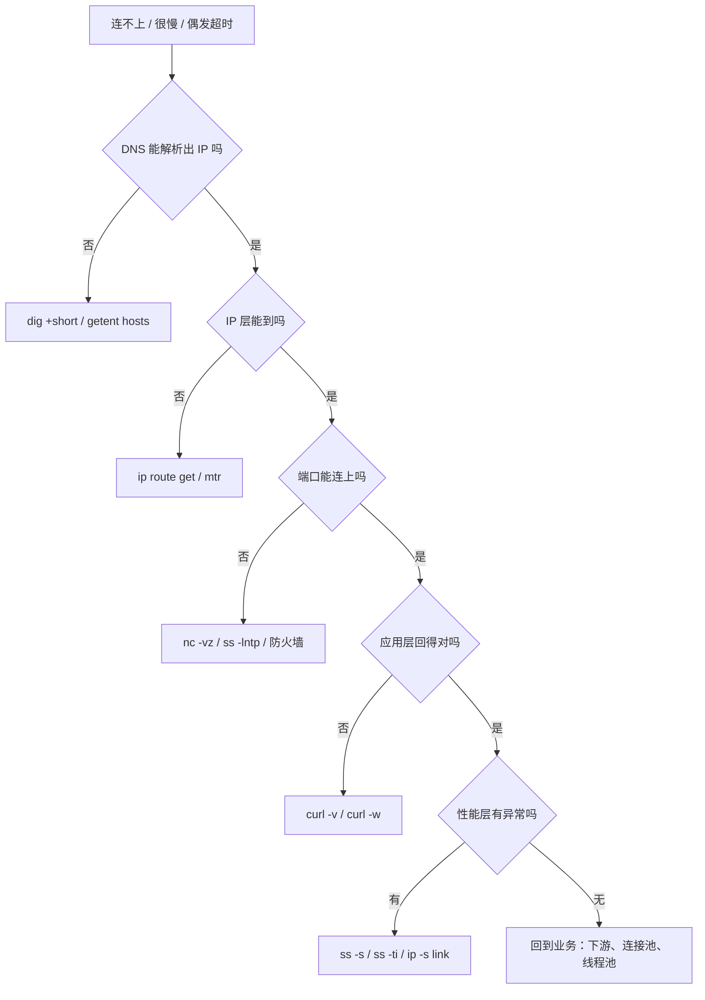

# 端口不通、连接堆积怎么定位？

> 排障不是「先抓个包看看」，而是把「连不上、很慢、偶发超时」切成一层层可证伪的小问题：每层用一条命令确认或排除，再决定要不要往下走。

## 排障为什么要先分层，而不是一上来就抓包？

同一个「连不上」可能卡在五个完全不同的地方，分层的作用是让每层只回答一个是非题。



| 层       | 要回答什么           | 证伪命令                     | 命中就停在这一层             |
| -------- | -------------------- | ---------------------------- | ---------------------------- |
| DNS      | 名字能变成 IP 吗     | `dig +short`、`getent hosts` | `NXDOMAIN`、解析耗时几百毫秒 |
| IP 可达  | 包能出本机、能到对端 | `ip route get`、`mtr -rw`    | 路由选错网卡、中间跳持续丢包 |
| 端口可达 | 有人接、中间没拦     | `nc -vz`、`ss -lntp`         | `refused`、`timed out`       |
| 应用层   | 协议层对不对         | `curl -v`、`curl -w`         | 502/504、TLS 失败、首字节慢  |
| 性能层   | 连接与队列堆没堆     | `ss -s`、`nstat -az`         | 状态异常、重传高、队列溢出   |

跳层的代价很具体：DNS 没解析出来，网卡上一个包都不会有；监听绑成 `127.0.0.1` 时包到了本机也没 socket 接；安全组静默丢 SYN 时，服务端抓包一片空白，很容易被误读成「客户端根本没发」。抓包是取证，不是第一步。

## 一个端口连不上，先怀疑谁？

先划一条分界线：**对端回 `RST` 和什么都不回，是两类问题**。前者是包到了没人接，后者是包在半路消失。

| 原因       | 典型表现                                     | 先跑什么                                       |
| ---------- | -------------------------------------------- | ---------------------------------------------- |
| 进程没监听 | `Connection refused`（有 RST）               | `ss -lntp \| grep ':8080'`                     |
| 绑错地址   | 本机 `curl 127.0.0.1` 通、外部不通           | 看 Local Address 是 `0.0.0.0` 还是 `127.0.0.1` |
| 防火墙拦截 | `timed out`（静默丢）或 `REJECT` 回 RST      | `iptables -L -n -v`、`nft list ruleset`        |
| 网络不可达 | `No route to host`、`Network is unreachable` | `ip route get`、VPN 状态、`mtr -rw`            |

```bash
sudo ss -lntp | grep ':8080'
# LISTEN 0 511 0.0.0.0:8080 0.0.0.0:* users:(("java",pid=2317,fd=87))
# LISTEN 0 511 127.0.0.1:8081 0.0.0.0:* users:(("java",pid=2317,fd=92))
nc -vz -w 2 10.0.0.12 8080   # succeeded!
nc -vz -w 2 10.0.0.12 8081   # Connection refused  ← 有 RST，端口没开
nc -vz -w 2 10.0.0.12 8082   # Connection timed out ← 无回应，继续查防火墙
```

地址列是 `127.0.0.1:8081` 就注定外部连不上，改 `bind`/`server.address` 比查防火墙有效；第二列是 `tcp6` + `[::]:8080` 时默认也能接 IPv4，仍不通就确认 `bindv6only`。`refused` 其实是好消息——三层都通，问题在本机监听或被 `REJECT` 拦；`timed out` 才要往下查。`curl -v --connect-timeout 3` 同理：卡在 `Trying ...` 是没拿到 SYN+ACK，立刻 `refused` 是吃到 RST，`Connected` 后长期没有响应行则已经不属于端口问题。

### 防火墙有四道闸，你确认到第几道？

| 闸             | 位置                              | 查看办法                                | 拦了会怎样                     |
| -------------- | --------------------------------- | --------------------------------------- | ------------------------------ |
| 云安全组/NACL  | 云平台虚拟网络层                  | 控制台/云 API，NACL 分入站出站          | 通常静默丢，`timed out`        |
| 主机 netfilter | `iptables`/`nftables`/`firewalld` | `iptables -L -n -v`、`nft list ruleset` | `DROP` 静默丢、`REJECT` 回 RST |
| 应用/中间件    | Nginx `allow/deny`、`hosts.allow` | 配置文件与访问日志                      | 403 或直接 RST                 |
| 容器网络       | docker 的 DNAT 链                 | `iptables -t nat -L DOCKER -n -v`       | 映射没生效、连不上             |

看 iptables 一定要带 `-v` 读计数器，规则文本本身判断不了命中：`pkts` 在涨的那条才是实际命中的规则，想验证一次连接有没有走到某条规则，就 `iptables -L INPUT -n -v --line-numbers` 看清序号、`iptables -Z INPUT` 清零后再重试一次。最常见的事故是顺序——`-A INPUT -j DROP` 排在放行规则前面，放行永远不生效。另外 `firewalld` 与手写 `iptables` 会互相覆盖，nftables 后端下 `iptables` 只是兼容壳，`nft list ruleset` 更接近真相。

## TCP 状态这一堆，哪些是真问题？

```bash
ss -s
# TCP: 1823 (estab 412, closed 1201, orphaned 3, timewait 1180)
ss -ant | awk 'NR>1 {print $1}' | sort | uniq -c | sort -rn
# 1180 TIME-WAIT / 412 ESTAB / 96 CLOSE-WAIT / 14 LISTEN / 3 SYN-SENT
```

| 状态          | 说明什么                             | 下一步                                |
| ------------- | ------------------------------------ | ------------------------------------- |
| `TIME-WAIT`   | 本机是主动关闭方，在等 2MSL 收尾     | 看是否短连接高频，能复用就复用        |
| `CLOSE-WAIT`  | 对端已发 FIN，**本机应用没调 close** | 代码/连接池问题，去 `jstack` 找持有者 |
| `ESTAB` 堆积  | 连接建上了但处理不完                 | 看下游 RT、线程池、`Recv-Q/Send-Q`    |
| `SYN-SENT` 多 | 发出 SYN 收不到回应                  | 对端不回或被拦，看 `tcp_syn_retries`  |
| `SYN-RECV` 多 | 服务端半连接堆积                     | 查 SYN 队列、丢包、SYN Flood          |

### TIME_WAIT 多到底要不要处理？

它是**主动关闭方**的正常状态（被动关闭方走的是 `CLOSE-WAIT`/`LAST-ACK`，不会停在 `TIME-WAIT`），持续 2MSL（Linux 固定 60 秒），用来兜住丢失的最后一个 ACK、让旧连接的迟到报文消亡，不是故障。判断顺序：先认清谁是主动关闭方——`ss -tan state time-wait '( dport = :8080 )'` 里本地是临时端口、目标是 8080，说明**我们是客户端**；再用 `ss -s` 的 `timewait` 除以 60 算每秒主动关闭数，几十 QPS 的短连接对应几千个 `TIME-WAIT` 完全正常。处置优先改架构：HTTP 开 keep-alive、RPC 走长连接、连接池限制 `maxIdle` 并做空闲回收。`net.ipv4.tcp_tw_reuse=1` 的边界很窄——只对出向连接有效、要求时间戳、不适用于监听 socket；而 `tcp_tw_recycle` 在 4.12 内核已被移除，还在推荐它的资料可以判定过时。

### CLOSE_WAIT 堆积为什么调内核参数没用？

含义非常确定：对端发了 FIN、内核回了 ACK，但**应用始终没 `close()`**。它没有超时机制，`tcp_fin_timeout` 管的是 `FIN-WAIT-2`，跟它无关，任何 `sysctl` 都不解决问题。

```bash
sudo ss -tanp state close-wait '( sport = :8080 )' | head -2
# CLOSE-WAIT 1 0 10.0.0.12:8080 10.0.0.31:51422 users:(("java",pid=2317,fd=1204))
```

拿 pid 去线程栈找持有者：常见是响应流没关、`finally` 之前抛异常、连接池 `maxIdle` 大于对端 idle timeout。正解是 try-with-resources 加连接池 `evict` 与探活。

### ESTABLISHED 堆积和 SYN-SENT 多，分别往哪查？

```bash
ss -tin state established '( sport = :8080 )' | head -3
# ESTAB 0 213504 10.0.0.12:8080 10.0.0.31:51422  rtt:0.31/0.1 retrans:0/12
ss -tan state syn-sent
# SYN-SENT 0 1 10.0.0.12:38442 10.0.0.99:6379
```

`Send-Q` 挂着几十上百 KB 说明对端不收，`Recv-Q` 涨说明应用不读，再配合线程栈看是线程池满还是下游慢。`SYN-SENT` 是另一回事——连接压根没建起来，客户端抓包能看到同一 SYN 按 `tcp_syn_retries` 重发，服务端什么都抓不到。

## 连接数上不去，是不是句柄到顶了？

别拿 shell 的 `ulimit` 当进程的限额：

```bash
cat /proc/2317/limits | grep -i 'open files'
# Max open files  1024  1048576  files    ← soft 才是生效值
systemctl show app -p LimitNOFILE
# LimitNOFILE=1024
```

进程启动后无法自抬 soft limit；systemd 托管看 `LimitNOFILE`，没写就继承 `DefaultLimitNOFILE`（部分发行版仍是 1024）。打满时报错很好认：`java.net.SocketException: Too many open files`。排查顺序：

1. 数：`ls /proc/2317/fd | wc -l`，跟 soft limit 比。
2. 分类：`ls -l /proc/2317/fd | awk '{print $NF}' | sort | uniq -c | sort -rn | head`，看 socket 还是文件/管道。
3. 定性：fd 数单调上升不回落才是泄漏，锯齿状属正常波动。
4. 泄漏查池不归还、流不关闭、`Selector` 不注销；确属配置小就把 `LimitNOFILE` 抬到 65535 以上并重启。
5. 算预算：fd ≈ 各连接池 `max` 之和 + 监听 socket + 日志 + 管道 + JAR，两三个池叠起来很容易顶穿默认值。

## 抓包怎么抓才有用？

```bash
sudo tcpdump -i eth0 -nn -s0 -c 20000 -w /tmp/cap.pcap 'tcp port 8080'
sudo timeout 300 tcpdump -i eth0 -nn -s0 -C 100 -W 5 -w /data/cap.pcap 'tcp port 8080'
```

| 目的       | 过滤表达式                                        |
| ---------- | ------------------------------------------------- |
| 对端加端口 | `'host 10.0.0.31 and tcp port 8080'`              |
| 只看 SYN   | `'tcp[tcpflags] & (tcp-syn\|tcp-ack) == tcp-syn'` |
| 只看 RST   | `'tcp[tcpflags] & tcp-rst != 0'`                  |

看三次握手卡在哪一步，只需要认四种形态：

| 抓到的序列                     | 卡点               | 结论                                          |
| ------------------------------ | ------------------ | --------------------------------------------- |
| 只有 SYN，反复重发             | 去程丢失或被静默丢 | 安全组/ACL/未监听；服务端抓不到包             |
| SYN → 立刻 RST                 | 对端回了 RST       | 看 RST 源 IP：端口没开、`REJECT` 或 LB 无后端 |
| SYN → SYN+ACK → 无第三次 ACK   | 回程丢             | 服务端停在 `SYN-RECV` 并重发 SYN+ACK          |
| SYN → SYN+ACK → ACK → 首包 RST | 应用或队列出问题   | 查 accept 队列、`tcp_abort_on_overflow`       |

重传、dup ack、零窗口的读法在[抓包怎么看三次握手和重传](/cs-basics/network/network-tcpdump-handshake-retransmission.html)里拆过了，这里只用来定位，统计用 `tshark -r cap.pcap -Y 'tcp.analysis.retransmission or tcp.flags.reset == 1'`。生产抓包有三个真实风险：写盘（`-s0` 全包在千兆流量下几分钟就是几个 G）、丢包（高 PPS 下 `tcpdump` 自己就是瓶颈，退出时打印 `packets dropped by kernel` 说明手上的 pcap 不是全量）、敏感数据（明文里的 Token、Cookie、SQL 都会落盘）。所以要限条数、限大小、轮转，并且写数据盘。

## accept 队列溢出怎么证实？

客户端超时、服务端**访问日志里查不到这次请求**，是队列溢出的典型特征：连接没进到应用。

```bash
netstat -s | grep -iE 'overflow|SYNs to LISTEN'
#     51234 times the listen queue of a socket overflowed
#     51234 SYNs to LISTEN sockets dropped
ss -lnt sport = :8080
# State  Recv-Q Send-Q Local Address:Port
# LISTEN 511    511    0.0.0.0:8080
sysctl net.core.somaxconn net.ipv4.tcp_max_syn_backlog net.ipv4.tcp_abort_on_overflow
# net.core.somaxconn = 4096
```

`netstat -s` 是累计值，隔 10 秒再取一次看增量，涨了才说明现在仍在溢出。`LISTEN` 行的 `Recv-Q` 是等待 `accept()` 的连接数、`Send-Q` 是上限，`Recv-Q` 贴着 `Send-Q` 不放就是 accept 不过来；上限近似 `min(backlog, somaxconn)`。队列为什么满、`tcp_abort_on_overflow` 取 0/1 分别让客户端看到什么，见[半连接队列和全连接队列](/cs-basics/network/network-tcp-queue-overflow.html)。另外，加大 `somaxconn` 治不了所有连接超时——客户端端口耗尽、SYN 队列溢出、LB 空闲超时都会伪装成同一个现象。

## 长连接为什么会被「静默掐断」？

TCP keepalive 默认 `net.ipv4.tcp_keepalive_time=7200`、`intvl=75`、`probes=9`：空闲 **2 小时**才开始探测，再探 9 次才判死。而 NAT/LB 的空闲超时常见 60 秒、350 秒，连接在链路上早被清掉了，两端 socket 却都以为还活着。

| 机制          | 谁在发   | 能发现什么          | 局限               |
| ------------- | -------- | ------------------- | ------------------ |
| TCP keepalive | 内核     | 对端主机/端口是否活 | 默认 7200 秒太晚   |
| 应用层心跳    | 应用     | 端到端链路是否可用  | 要协议和代码支持   |
| 连接池探活    | 客户端池 | 复用前连接是否可用  | 每次复用多一个往返 |

典型的「偶发 3 秒超时」：客户端从池里取出一条**已被 LB 静默回收**的连接，把请求写进去，包在 LB 处被丢，重传两次（约 1 秒、2 秒），第三次才拿到 RST，正好 3 秒左右。特征是偶发、集中在空闲后的第一个请求、重试就好。处置是把 `tcp_keepalive_time` 压到 30 秒让心跳早于中间设备的 idle timeout，同时加应用层 30 秒空闲心跳、让连接池 `maxIdleTime` 小于 LB idle timeout、把 HTTP keepalive 与网关超时对齐。

## DNS 解析慢怎么定位？

`dig` 直接问 DNS 服务器，**不读** `nsswitch.conf`、不走 search 域；`getent hosts` 走 NSS，更接近应用真实行为。两者不一致，基本就是 search/ndots 在作怪——容器里这套放大尤其明显。

```bash
dig +short api.internal.example.com      # 10.0.3.21
getent hosts api.internal.example.com    # 10.0.3.21  api.internal.example.com
cat /etc/resolv.conf
# nameserver 10.0.0.2
# options timeout:1 attempts:2
# search default.svc.cluster.local svc.cluster.local cluster.local
# options ndots:5
```

`ndots:5` 意味着名字里点数少于 5 时**先拿 search 域拼一遍**：查 `api` 会依次尝试 `api.default.svc.cluster.local.`、`api.svc.cluster.local.`、`api.cluster.local.`、`api.` 四次；首个 nameserver 不通时 `timeout:1 attempts:2` 再走一遍，单次解析就能吃掉两秒以上，接口 RT 莫名多出几百毫秒到几秒。处置：调用方写 FQDN（尾点可避免 search 展开）、把 `ndots` 调到 2 左右、本机加 DNS 缓存（nscd / NodeLocal DNS）、确认 `nsswitch.conf` 的 `hosts: files dns` 顺序。

## 带宽、丢包和 MTU 怎么查？

先看网卡自己的账本，错误计数比带宽更有信息量；实时速率用 `iftop -n -P -i eth0` 或 `nload eth0` 看，逐跳丢包用 `mtr -rw`。

```bash
ip -s link show eth0
# RX: bytes 9821345521 packets 7412033 errors 0 dropped 1182 overrun 0
iftop -n -P -i eth0          # 按连接看实时速率
mtr -rw -c 100 10.0.0.12     # 逐跳丢包
```

RX 的 `dropped` 持续增长说明包到了网卡但没进协议栈（多半是 ring buffer 满）——这时抓包也看不到，`tcpdump` 只能证明「协议栈没收到」，证明不了「链路上没丢」，别以为抓包一定看得到丢包。`mtr` 的结论要这么读：中间某跳丢包而末跳 0%，多半是该路由器对 ICMP 限速；从某一跳开始持续上升到最后一跳，才是这段链路真丢；首跳就丢则是本机网卡、网关或本地策略。MTU 问题最容易被误判成应用 bug，因为表现是**小包通、大包卡死**：能登录、能调小接口，一传文件或返回大 JSON 就挂。

```bash
ping -M do -s 1472 -c 2 10.0.0.12   # 2 received, 0% packet loss
ping -M do -s 1473 -c 2 10.0.0.12   # ping: local error: message too long, mtu=1500
```

1472 + 8（ICMP 头）+ 20（IP 头）= 1500；走隧道/VPN 时外层封装吃掉 40~60 字节，路径 MTU 掉到 1400 附近，临界点变成 `-s 1372`。PMTUD 依赖 ICMP `fragmentation needed`，中途防火墙拦掉就成黑洞，临时处置是 `ip link set eth0 mtu 1400` 或对 SYN 做 MSS clamp（`TCPMSS --clamp-mss-to-pmtu`）。

## 一次完整排查怎么走一遍？

现象：调用方报「偶发超时、约 3 秒」，服务端访问日志里没有对应记录。第一步，客户端把时间拆开，同时看服务端连接状态：

```bash
curl -o /dev/null -s -w 'dns=%{time_namelookup} conn=%{time_connect} first=%{time_starttransfer} total=%{time_total}\n' \
  http://api.internal:8080/health
# dns=0.001 conn=0.002 first=3.004 total=3.004
ss -s
# TCP: 1844 (estab 391, closed 1301, timewait 1210)
ss -ti state established '( sport = :8080 )' | grep -o 'retrans:[0-9]*/[0-9]*' | sort | uniq -c | sort -rn | head -2
# 61 retrans:0/1
#  7 retrans:0/12
```

DNS 和建连都是毫秒级、卡在首字节，说明不是解析也不是握手——包发出去了但没人回；`estab` 不高、没有堆积，说明服务端没被压垮，更像「请求没进来」。

第二步，两端同时抓包定位：

```bash
sudo tcpdump -i any -nn -s0 -c 5000 -w /tmp/c.pcap 'tcp port 8080 and host 10.0.0.12'
tshark -r /tmp/c.pcap -Y 'tcp.analysis.retransmission or tcp.flags.reset == 1' | head
```

结果是客户端侧同一 `seq` 重传两次后收到 LB VIP 的 `RST`，服务端侧完全没有这个五元组的入包。第三步下结论：连接池复用的是一条已被 LB 静默回收的空闲连接，请求写进黑洞，重传到第三次才被 RST，约 3 秒，所以服务端当然没有日志。随即处置并验证：`tcp_keepalive_time` 压到 30 秒、应用层加 30 秒心跳、连接池 `maxIdleTime` 小于 LB idle timeout（此处 60 秒）、LB idle 提到 300 秒并配后端健康检查、幂等请求加一次带退避的重试；监控补上「复用连接首包失败率」、`SYN-SENT` 数和 `retrans` 比例。

## 容器里的网络为什么和宿主机看到的不一样？

容器有自己的 network namespace，容器内 `ss` 看到的是容器视角，宿主机常看不到那条监听：

```bash
docker port web                  # 8080/tcp -> 0.0.0.0:18080
sudo iptables -t nat -L DOCKER -n -v
# DNAT tcp -- !docker0 172.17.0.0/16 0.0.0.0/0 tcp dpt:18080 to:172.17.0.2:8080
sudo nsenter -t "$(docker inspect -f '{{.State.Pid}}' web)" -n ss -lntp
```

`--network host` 则相反：共享 netns，两边 `ss` 一致，端口冲突是真实冲突，`18080:8080` 的映射也不存在。还有一个坑：`net.core.somaxconn` **不按 netns 隔离**，容器里改它改的是宿主机；`net.ipv4.*` 多数才按 netns 隔离。所以「容器里调了 `somaxconn` 仍溢出」往往是生效位置查错了。

## 容易踩的坑

1. **`ping` 通就认为端口通**：ICMP 与 TCP 策略完全不同，安全组放 ICMP 只开个别端口很常见，`ping` 只能说明 IP 层大致可达。
2. **把 `CLOSE_WAIT` 当 `TIME_WAIT` 治**：它是应用没 `close()`，没有内核超时能救，`tcp_fin_timeout` 管的是 `FIN-WAIT-2`。
3. **只查服务端不看客户端**：服务端日志干净不代表没问题，连接可能死在客户端到 LB 之间。
4. **抓包没加 `-s0`**：默认 snaplen 只留头部，事后想看 payload、TLS 记录、HTTP 头全是截断的。
5. **抓包忘了限流**：`-s0` 全量写盘很快吃满分区，务必配 `-c`、`-C/-W` 轮转并写数据盘。
6. **`ss` 看不到进程就以为服务没起来**：普通用户看不到别人的 socket 进程，加 `sudo` 再来一次。
7. **改内核参数不评估副作用**：`somaxconn`、`tcp_abort_on_overflow` 会改变失败形态，可能把「慢失败」换成「快失败」。
8. **容器里改 `somaxconn` 以为改的是容器**：`net.core.*` 是宿主机全局的。
9. **防火墙规则顺序不对**：前面一条 `DROP` 吃掉后面所有 `ACCEPT`，用 `iptables -L -n -v` 看计数器命中才靠谱。

## 小结

1. 排障顺序是 DNS → IP 可达 → 端口可达 → 应用层 → 性能层，每层只回答一个是非题；抓包是取证手段，不是第一步。
2. `refused`（有 RST）和 `timed out`（无回应）是两类问题：前者查监听与 `REJECT`，后者查安全组、ACL、路由与中间设备。
3. `TIME_WAIT` 看主动关闭方和速率，靠连接复用解决；`CLOSE_WAIT` 一定是应用没 `close()`；`ESTAB` 堆积看 `Recv-Q/Send-Q` 与线程栈；`SYN-SENT` 多查对端回不回包。
4. 连接数上不去先看 `/proc/<pid>/limits` 和 fd 增长曲线；`LISTEN` 行的 `Recv-Q/Send-Q` 才能证明 accept 队列在溢出，溢出计数要看增量。
5. 长连接被静默掐断的根因是 keepalive 周期长于中间设备 idle timeout，处置要同时改内核心跳、应用心跳、连接池回收与 LB 超时。

## 参考

综合自 iproute2（`ss`、`ip`）与 `tcpdump`/`libpcap` 手册页、Linux 内核 `Documentation/networking/ip-sysctl` 与 `nstat` 相关文档、`systemd.exec` 中 `LimitNOFILE` 语义、`resolv.conf(5)` 的 `ndots/timeout/attempts` 说明，以及 RFC 9293（TCP）、RFC 1122（主机要求）、RFC 1191（路径 MTU 发现）等公开资料整理。文中 `sysctl` 默认值取自当前主流 LTS 内核的实际输出，`ss` 与 `netstat -s` 的字段顺序在不同发行版可能略有差异，以本机 `man` 为准；命令与输出片段均在本地核对形态后改写。
