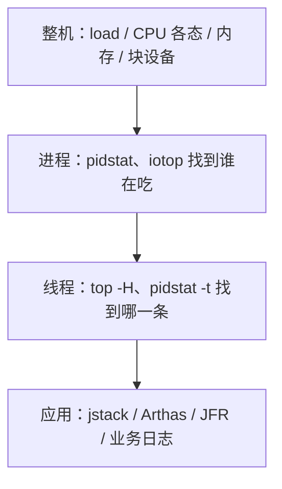
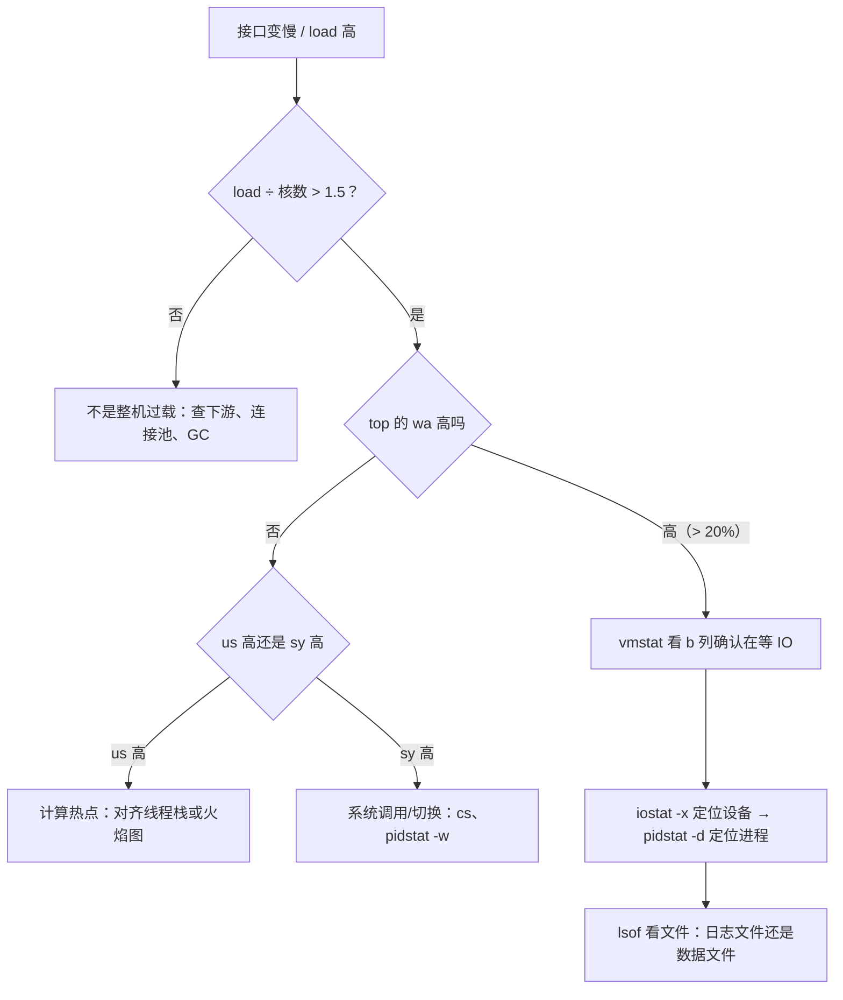

# CPU 高、内存涨、进程卡怎么在 Linux 上定位？

> 整机"变慢"只有三种原料：CPU 不够算、内存不够放、IO 不够快。先把三样量出来，再下钻到进程，最后才轮到 JVM。

## 为什么不能一上来就 jstack？

`jstack`、Arthas、JFR 回答"哪条线程、哪段代码"，前提是机器本身健康。整机在等 IO 或被 OOM 盯上时，线程栈里看到的全是"在等"，顺着栈走只会走进死胡同。所以顺序是四层：



上层没定性就进下层，证据链是断的。本篇只讲前两层加第三层的系统侧：Java 堆、GC、线程栈看[线程飙高、CPU 打满、死锁怎么标准排查？](/high-availability/high-availability-thread-cpu-troubleshooting.html)，分页与缺页的"为什么"看[虚拟内存解决了什么问题？](/cs-basics/operating-system/os-virtual-memory.html)。

## load average 三个数该怎么读？

```bash
$ uptime
 14:22:31 up 41 days,  2 users,  load average: 20.12, 18.90, 15.33
$ nproc
8
```

三个数是 1、5、15 分钟的**指数衰减**平均，不是简单滑动窗口。判断标准只有一个：**除以核数**。20 / 8 ≈ 2.5，等于每个核平均还排着 2.5 个任务；`< 0.7` 有余量，`≈ 1` 饱和，`1~2` 明显排队，`> 3` 先止血。

必须记住：**Linux 的 load 不只数 CPU**，它数 R（可运行）+ D（不可中断睡眠）两类任务。所以 load 高而 CPU 很闲完全正常，常见三种原因：

1. **IO 等待**：进程在等块设备或网络文件系统，D 状态，进 load 不吃 CPU。这就是"load 20、CPU 30%"最常见的形态。
2. **D 状态卡死**：NFS 失联、磁盘掉线、驱动 bug，进程挂在不可中断睡眠里，`kill -9` 都杀不掉，`vmstat` 的 `b` 列一直挂着数。
3. **大量短进程**：每秒 fork 几百个一次性任务，队列里总有人排着，但每个只活几十毫秒，CPU 时间加起来不多 —— 特征是 `vmstat` 的 `in`、`cs` 高而 `pidstat` 抓不到大户。

反过来：容器里 `load` 读的是**宿主机**的 `/proc/loadavg`，跟你的 quota 无关。被限流时 load 可能很低，进程却已经在排队等配额。

## top 里那些 CPU 列分别代表什么？

```bash
$ top
%Cpu(s): 12.3 us,  8.1 sy,  0.0 ni, 41.2 id, 38.4 wa,  0.0 hi,  0.0 si,  0.0 st
MiB Mem :  15884.0 total,   1024.5 free,   6312.2 used,   8547.3 buff/cache
```

| 列  | 含义                | 高了往哪查                     |
| --- | ------------------- | ------------------------------ |
| us  | 用户态（不含 nice） | 业务计算、循环、序列化         |
| sy  | 内核态              | 系统调用密集、上下文切换、缺页 |
| ni  | nice 过的用户态     | 低优先级任务（CI、批处理）     |
| id  | 空闲                | —                              |
| wa  | 空闲但仍有未完成 IO | 块设备慢                       |
| hi  | 硬中断              | 网卡/磁盘中断打满某个核        |
| si  | 软中断              | 网络包处理，`ksoftirqd` 吃满   |
| st  | 被 hypervisor 拿走  | 云主机超卖，邻居抢 CPU         |

三个口径必须分开：

- 首部 `%Cpu(s)` 是**整机归一化**，8 核全满才 100%；真正的使用率是 `100 - id`（`wa` 从 idle 里单列，算"没干活"）。
- 进程列表的 `%CPU` 以**单核 100%** 为基准。看到 `%CPU 350` 不是异常，是 3.5 个核。想切成除以核数的口径，`top` 里按 `I`。
- 整机 40% 可能是"一个核 100%、其余闲着"的假象（单线程绑核、中断全落 CPU0）。`mpstat -P ALL 1` 会把它摊开：`all` 行 38% iowait，展开后 CPU 0 是 96% us、CPU 1 是 88% iowait，两种病完全不同。

进程级用 `pidstat -u 1 5`，它把 `%usr` 与 `%system` 分列：**us 高 sy 低**是纯计算（算法、正则、序列化），**sy 高 us 低**是大量小 `read`/`write`、锁 syscall、`fork`、缺页抖动。注意 `pidstat` 的 `%CPU` 也以单核为基准，且按 utime/stime 差分计算，1 秒间隔抓不准短命进程。

## 上下文切换多少才算多？

`vmstat` 信息密度最高，但要看清哪列是什么：

```bash
$ vmstat 1 3
 r  b   swpd   free   buff  cache   si   so    bi    bo   in    cs us sy id wa st
 3 14      0 131072   4096 872448    0    0  4120  8812 1120  4210 12  8 42 38  0
 2 16      0 130880   4096 872448    0    0  4300  9020 1180  4380 11  8 43 38  0
```

`r` 持续大于核数 = CPU 排队；`b` 约等于 D 状态进程数，持续 > 0 就是 IO 卡；`si`/`so` 持续非零是 swap 抖动；`bi`/`bo` 是块设备 block/s（按 1024 字节换算），看趋势不看绝对值；`in` 含时钟中断，几百到几千都正常。**第一行是开机以来的平均值**，盯第一行判断现状是经典误读。

`cs` 高本身不是结论，先看谁贡献的。`pidstat -w 1 3` 给两列：`java` 是 `cswch/s 820.4` 对 `nvcswch/s 42.1`，`app-worker` 反过来是 `3.2` 对 `2140.6`，两种病的分界一眼就清楚。

- `cswch/s`（自愿切换）高 → 主动让出 CPU：等锁、等 IO、等条件变量。是代码或依赖的问题，加 CPU 没用。
- `nvcswch/s`（非自愿切换）高 → 时间片没跑完被抢：可运行进程比核多，真在抢。几百个线程在 8 核上互抢，吞吐反而降。
- 两者都不高但 `in` 很高 → 方向是中断不是调度：网卡多队列没开、定时器精度太高。

## 内存到底够不够，看哪一列？

```bash
$ free -h
               total        used        free      shared  buff/cache   available
Mem:            15Gi       6.2Gi       1.0Gi       132Mi       8.3Gi       8.9Gi
```

**判断依据是 `available`，不是 `free`。** `free` 只剩 1Gi 完全正常：那 8.3Gi 是 page cache，随时可回收；`available` 是内核估算的"不触发 swap 还能给新应用多少"，已扣除不可回收部分。低于总内存 10% 才该紧张。`used` 的口径还有版本差异：procps-ng 3.3.10 之后是 `total - free - buff/cache`，更早版本是 `total - free`，所以"内存用了 90%"在不同机器上可能指两回事。要拆细节翻 `/proc/meminfo`：

| 字段                  | 含义                   | 关注点                             |
| --------------------- | ---------------------- | ---------------------------------- |
| `AnonPages`           | 匿名页（堆、栈）       | 真正不可回收的大头，涨得快就是泄漏 |
| `Mapped`              | mmap 的文件页          | 含可执行文件、jar、`/dev/shm`      |
| `Slab` / `SUnreclaim` | 内核对象缓存           | `SUnreclaim` 持续涨是内核态泄漏    |
| `Dirty` / `Writeback` | 已改待回写/正在回写    | `Dirty` 堆积 + 慢盘 = 写被卡住     |
| `MemAvailable`        | 同 `free` 的 available | 脚本读这个，别去解析 `free` 输出   |

两类"假缓存"要认出来：**tmpfs 不是缓存**（`/dev/shm`、`/run` 的 shmem 占物理内存且不能丢弃，Docker 默认 `/dev/shm` 仅 64MB，共享内存用得多的应用会在这里炸）；**脏页堆积**（写入快过回写，`Dirty` 顶到 `dirty_ratio` 后所有写被迫同步，表现是突然全线变慢，同时 `w_await` 跳起来）。

## 内存不够时，是 swap 还是 OOM？

swap 用了一点不绝对有问题。几十 MB 静态占用说明有冷页被换出去过，不影响性能。要看 `si`/`so` 是否**持续非零**：一直为 0 就忽略；持续非零且 `wa` 抬高就是**swap 抖动** —— 换出、访问、再换入的死循环，每步都是 4KB 随机 IO。对 Java 更致命：堆页被换出后，GC 扫描触发大规模缺页，STW 从几十毫秒变几秒。所以数据库和 JVM 主机通常把 `vm.swappiness` 调到 1~10，让 OOM 早点暴露而不是慢慢假死。找谁被换出去：`grep VmSwap /proc/*/status | awk '$2>0{print $2,$1}' | sort -rn | head`（PID 藏在路径里，要连路径一起读）。

OOM 的证据只有两处：`journalctl -k --since '-2h' | grep -iE 'oom|out of memory'` 与 `dmesg -T`。

```text
kern: Out of memory: Killed process 21311 (java) total-vm:8388608kB,
      anon-rss:3840120kB, file-rss:1024kB, shmem-rss:0kB, UID:1000
kern: oom-kill:constraint=CONSTRAINT_MEMCG,...,task=java,pid=21311
```

`constraint=CONSTRAINT_MEMCG` 说明是 **cgroup 限额**触发，不是宿主机没内存 —— 容器里绝大多数 OOM 是这个；`anon-rss` 和被杀的 `-Xmx` 一比就知道超了多少；`oom_score_adj`（`-1000 ~ 1000`，越大越容易被杀）决定谁先死，给 `sshd`、监控 agent 设 `-1000` 是常规操作：`echo -1000 > /proc/$(pidof sshd)/oom_score_adj`（`oom_score` 本身只读）。`dmesg -T` 的时间戳依赖开机 wall clock，长期运行或休眠后会偏，能用 `journalctl -k` 就用它。

Java 容器被杀，最常见的不是堆泄漏，而是**堆 + 堆外 + Metaspace + 线程栈 + page cache 一起顶到 limit**（cgroup 里 page cache 也算用量）：limit 4G 配 `-Xmx3g`，剩 1G 装不下那些，基本必死。

## 磁盘 IO 慢，%util 100% 就是瓶颈吗？

```bash
$ iostat -x 1 2
Device   r/s     w/s   rkB/s   wkB/s  r_await  w_await  aqu-sz  %util
sda     12.0   180.0   480.0  14400.0    0.42     1.85    0.12    3.20
sdb   2100.0  2100.0 16800.0  16800.0   86.30    92.10   12.40   98.70
```

`r/s`、`w/s` 是 IOPS，和设备的 IOPS 上限比；`rkB/s`、`wkB/s` 是吞吐，顺序大 IO 看它；`r_await`、`w_await` 是单次 IO 平均耗时（含排队），机械盘 > 20ms、SSD > 2ms 就该怀疑；`aqu-sz` 是平均队列深度。**`%util` 只在单队列设备上有意义**：SATA/SAS 单盘 100% 约等于饱和，但 NVMe、RAID、云盘是多队列并行，100% 时仍可能有富余带宽；反过来 30% 也可能因队列塞满而慢。真假饱和要看 `await` 与 `aqu-sz` 是否同向上升。顺带一个版本坑：sysstat 12.0 之后 `avgqu-sz` 改名 `aqu-sz`，`awk '{print $9}'` 的老脚本会取错列。

定位进程用 `iotop -oPa`（只看有 IO 的、按进程、累计值）与 `pidstat -d 1 5`。`iotop` 读 `/proc/<pid>/io`，注意 `rchar`/`wchar` 是**经过系统调用的字节数**（含缓存命中、管道、socket），`read_bytes`/`write_bytes` 才是**真正落盘**的字节 —— 读了 10GB 但全命中 page cache 的进程，`read_bytes` 接近 0。

顺序写和随机写不是一回事：大文件顺序写表现为 `wkB/s` 高、`w/s` 低、`await` 低（日志归档、备份、消息队列 segment）；小随机写带 fsync 表现为 `w/s` 高、`wkB/s` 低、`w_await` 高（redo/binlog、WAL、元数据）；随机读则是 `r/s` 高而 `rkB/s` 低（缺索引的查询、海量小文件）。同一块盘上这三种负载混在一起，`await` 只能给你一个平均数，拆不开。

磁盘"满了"还有两个盲区。`df -h` 与 `df -i` 是两个独立配额：inode 用光时照报 `No space left on device`，但 `df -h` 显示还有空间（元凶是邮件队列、session 文件、按请求切片的日志）。`du` 和 `df` 打架则是"幽灵占用"——文件被 `rm` 但进程还开着 fd，查 `lsof +L1`，处理是让进程重新打开文件或重启，日志场景配 `copytruncate` 或 `USR1`。找大目录用 `du -x -h --max-depth=1 /data | sort -rh | head`，`-x` 不跨文件系统，否则挂载点上的 NFS 会被一起统计甚至卡住。

## 进程卡住了，怎么知道它在等什么？

看进程状态第一手命令是 `ps -eo pid,ppid,stat,etime,pcpu,pmem,rss,comm --sort=-pcpu`，`STAT` 列的含义：

| 状态      | 含义         | 备注                             |
| --------- | ------------ | -------------------------------- |
| `R`       | 运行/可运行  | 在 runqueue 里排着               |
| `S`       | 可中断睡眠   | 等事件、锁、socket，最常见，正常 |
| `D`       | 不可中断睡眠 | **在等 IO 或内核锁，杀不掉**     |
| `T` / `t` | 停止/被跟踪  | `SIGSTOP`、调试器 ptrace         |
| `Z`       | 僵尸         | 已退出，等父进程收尸             |
| `I`       | 空闲内核线程 | 不占 CPU                         |

后缀：`<` 高优先级、`N` 低优先级、`L` 有页锁定内存（`mlock`，无法换出）、`s` 会话首进程、`l` 多线程、`+` 前台进程组。

**D 状态是重点**：信号只在进程被调度回用户态时才处理，D 状态根本没机会处理，`kill -9` 也不生效。它要么等 IO 超时（几十秒到永久），要么等设备恢复。所以对着它反复 `kill -9` 没用，只会误判成权限问题；该看 `cat /proc/<pid>/wchan`（卡在哪个内核函数，如 `nfs_wait_bit_killable`、`io_schedule`）和 `/proc/<pid>/stack`，处理方向是修 IO 路径而不是杀进程。

**僵尸进程**是子进程退出但父进程没 `wait()`，内核留着 PID 和退出码。它几乎不占内存（只剩一个 `task_struct`），但占 PID，堆积会耗尽 `pid_max`。杀僵尸没意义（已经死了），要么让父进程正确回收，要么杀父进程让 init 接管；持续产生说明父进程信号处理有 bug。

看进程握着什么：`lsof -p 21311 | wc -l` 给 fd 数（和 `ulimit -n` 比），`grep -E 'VmRSS|VmSwap|Threads' /proc/21311/status` 给常驻内存、换出量与线程数，`ls /proc/21311/task | wc -l` 比 `status` 更实时。

## Java 进程的 RSS 为什么远大于 -Xmx？

```bash
$ ps -o pid,rss,vsz,comm -p 21311
    PID     RSS    VSZ COMMAND
  21311 3840120 8388608 java        # RSS ≈ 3.7G，VSZ ≈ 8G
$ java -XX:+PrintFlagsFinal -version | grep -i maxheapsize
   size_t MaxHeapSize = 2147483648  # -Xmx2g
```

RSS 比堆大了近一倍，钱花在这些地方：Java 堆（常驻的是已提交部分）、Metaspace（100~400MB，`MaxMetaspaceSize` 默认无上限）、Code Cache（JIT 机器码，`ReservedCodeCacheSize` 默认 240M）、直接内存（`MaxDirectMemorySize` 默认等于最大堆，Netty 池化后常驻不小）、GC 辅助结构（G1 的 card table、remembered set，约堆的 5%~10%）、glibc arena（多线程 malloc 开出多个 arena，碎片化后 RSS 只涨不落）、JNI 库（snappy、zstd、tcmalloc 各自有池）。

三条容易错的认识：

1. **线程栈不是大头**。1000 线程按 `-Xss1m` 算，虚拟地址要 1GB，但 RSS 一般只有几十 MB —— 栈按需提交。把 RSS 大归因到线程数通常找错方向。
2. **RSS 含共享页**。多个进程 mmap 同一个 jar 或 so，RSS 各算一遍，加起来超物理内存是正常的。要真实占用看 PSS：`grep -E 'Rss|Pss' /proc/21311/smaps_rollup`（4.14+ 才有此文件，比逐行解析 `smaps` 快得多）。
3. **页缓存不算 RSS**。`read()` 读文件只进 page cache，进程 RSS 不变；`mmap()` 后访问才映射进地址空间（`RssFile`），而这部分可回收。所以 RSS 里有一部分"看着占住了，其实能还回去"——按映射拆开就用 `awk` 汇总 `smaps` 里的 `Rss:` 块，能看出是堆、jar 映射还是某个 `.so`、`/dev/shm` 段在涨。

## 一次「接口变慢、load 20」的现场

场景：8 核 16G 应用机，接口 P99 从 80ms 涨到 2.1s，load 20，CPU 看着"没满"。

**① 确认负载性质**：`uptime` 给出 `20.12, 18.90, 15.33` —— 15 分钟值也在涨，不是瞬时尖峰。**② 看 CPU 各态找方向**：`top -b -n1` 首部 `12.3 us, 8.1 sy, 41.2 id, 38.4 wa`，`wa 38.4` 直接排除算力不够，机器在等 IO。

**③ 确认队列里等的是什么**：`vmstat 1 3` 给了 `b = 14~16`，十几个进程挂在 D 状态；`si/so = 0` 排除 swap 抖动；`cs` 才 4000 出头，不是调度压力 —— 方向锁定块设备。**④ 定位哪块盘**：`iostat -x 1 2` 显示 `sdb` 的 `w_await 92.10`、`aqu-sz 12.40`、`%util 98.70`，三个指标同向恶化，是真饱和不是 `%util` 假象；`r/s`、`w/s` 都是 2100，读写在同时压。

**⑤ 对上挂载点和进程**：

```bash
$ df -h | grep sdb
/dev/sdb1       200G  188G   12G  95% /data
$ pidstat -d 1 3
UID   PID   kB_rd/s   kB_wr/s iodelay  Command
1000  21311     0.00  16200.00    2140  java
1000   8421   180.00      0.00      12  mysqld
```

`java` 狂写 16MB/s，`mysqld` 只有零头读 —— 排除"数据库刷盘"。

**⑥ 看它写什么文件**：

```bash
$ lsof -p 21311 2>/dev/null | grep /data | head -3
java 21311 app 47w REG 8,17 12884901888 4194 /data/logs/app.log
java 21311 app 48w REG 8,17  2147483648 4195 /data/logs/app-2025-11-16.log
```

单个日志已 12GB 还没滚动。判定：**不是数据库刷盘，是同步日志写爆了盘** —— fsync 频繁、文件巨大、同目录小文件多，顺序写退化成随机写。

**⑦ 处理与固化**：日志级别降 WARN、手动 rotate 并用 `copytruncate` 释放巨文件；logback 换 `AsyncAppender`（有界队列 + 丢弃策略）、访问日志采样；根因追某接口循环打全量报文或异常重复打堆栈；最后把 `wa`、`b`、`w_await` 三项进告警，别只盯 CPU。反过来，如果第 ⑥ 步是 `mysqld` 持有 `ib_logfile0`、且 `w/s` 高而 `wkB/s` 低，那就是刷盘策略、大事务、checkpoint 抖动的另一条路。



## 几条能直接复制的组合命令

```bash
# CPU 前 5（带线程数）；内存前 5（按 RSS）
ps -eo pid,stat,pcpu,pmem,rss,nlwp,comm --sort=-pcpu | head -6
ps -eo pid,pcpu,pmem,rss,vsz,comm --sort=-rss | head -6

# 按写盘量排序
pidstat -d 1 3 | grep -v '^Linux' | sort -k5 -rn | head
# 端口被谁占用
ss -lntp | grep ':8080'
lsof -i :8080 -sTCP:LISTEN

# 实时看线程数；查出卡在 D 状态的线程及其内核函数
watch -n 1 'grep Threads /proc/21311/status'
ps -eLo pid,tid,stat,wchan:28,comm | awk '$3 ~ /D/'
# OOM 证据
journalctl -k --since '-2h' | grep -iE 'oom|out of memory'
```

`ps -eLo` 的 `wchan` 很划算：直接告诉你线程卡在哪个内核函数上，比猜快得多。端口和连接那一层（`ss -s` 的 TIME_WAIT、`Recv-Q` 不为 0、conntrack 打满）留给[端口不通、连接堆积怎么定位？](/tools/linux/linux-network-troubleshooting.html)。

## 容器里的数字为什么和宿主机对不上？

| 现象                       | 原因                                    | 正确姿势                                                       |
| -------------------------- | --------------------------------------- | -------------------------------------------------------------- |
| `free` 显示宿主机内存      | `/proc/meminfo` 没做 namespace 隔离     | 读 `/sys/fs/cgroup/memory.max`（v2）或 `memory.limit_in_bytes` |
| `nproc` 显示宿主机核数     | 尊重 CPU affinity，但不认 cgroup quota  | 读 `cpu.max`，或按 limit 显式配置线程池                        |
| `top` 里 load 很高         | 同样是宿主机的 `/proc/loadavg`          | 看 `cpu.stat` 的 `nr_throttled`、`throttled_usec`              |
| `docker stats` 比 `top` 小 | MEM USAGE 扣掉了可回收的 inactive cache | 口径不同，别互相当校验                                         |
| CPU 没满却变慢             | quota 用完在等下一个周期（throttling）  | `cat /sys/fs/cgroup/cpu.stat`                                  |

`nr_throttled / nr_periods` 超过 10%，说明配额在持续卡你的进程 —— 而宿主机 `top` 里这个容器可能只占 20%，看着很闲。这就是"CPU 没满却变慢"最典型的来源（cgroup v1 对应 `cpu.cfs_quota_us` 与 `cpu.stat` 的 `throttled_time`，单位纳秒）。JVM 这边还要再对一次：JDK 10+ 默认 `UseContainerSupport`，读 cgroup limit，默认 `MaxRAMPercentage=25`，所以 limit 4G 时堆只有 1G —— 这就是"内存给了 4G、堆却很小"的来源；JDK 8u191 之前完全不认 cgroup，按宿主机内存和核数算，老镜像跑新宿主机是经典事故。内存预算留 25%~40% 给 Metaspace、直接内存、线程栈、Code Cache 和页缓存，`-Xmx` 与 `MaxRAMPercentage` 只设一个。

## 容易踩的坑

1. **只看 `free` 列判断内存不足**。要看 `available`；`buff/cache` 大是健康的。
2. **load 高就加机器**。load 里混着 D 状态，IO 卡住时加 CPU 只是多花钱。
3. **`%util` 100% 就断定磁盘瓶颈**。多队列设备上会骗人，要连 `await`、`aqu-sz` 一起看。
4. **对 D 状态进程 `kill -9`**。杀不掉不是权限问题，是它压根不处理信号，去看 `wchan`。
5. **在容器里用 `top`/`free` 判断资源**。那是宿主机视角，cgroup limit 才是边界。
6. **`df -h` 正常就认为磁盘没毛病**。`df -i` 用尽一样报 `No space left on device`。
7. **`du` 和 `df` 对不上就怀疑文件系统坏了**。先查 `lsof +L1` 有没有已删除但被持有的文件。
8. **拿采样值当全貌**。`vmstat` 第一行是开机平均值，1 秒平均又会把 100ms 抖动摊平，要连续跑几分钟的 `pidstat` 或上 profiler。
9. **把 RSS 当进程真实内存**。它含共享页和可回收映射，相加会超物理内存，准确值看 PSS。

## 小结

1. 四层下钻：整机（load、CPU 各态、内存、IO）→ 进程（`pidstat`、`iotop`）→ 线程（`top -H`）→ 应用（`jstack`、Arthas）。上层没定性就别进下层。
2. load 统计 R 加 D 两类任务，高 load 不等于 CPU 忙：IO 等待、D 状态卡死、大量短进程都能顶上去，判断永远用 load ÷ 核数。
3. 内存看 `available` 不看 `free`；swap 看 `si`/`so` 是否持续非零；OOM 证据在 `journalctl -k`，先看 `constraint` 是宿主机还是 memcg。
4. IO 是否真瓶颈看 `await` 与 `aqu-sz` 同向上升，`%util` 只对单队列设备有意义；`du -x` 别跨挂载点，`df` 与 `du` 打架先查 `lsof +L1`。
5. Java 的 RSS 远大于 `-Xmx` 是常态：堆、Metaspace、直接内存、Code Cache、GC 结构、glibc arena 都要算；容器里真实边界是 cgroup limit 和 `cpu.stat` 的 throttling。

## 参考

综合自 procps-ng（`top`、`free`、`vmstat`、`pidstat`）、sysstat（`iostat`、`mpstat`）、util-linux（`dmesg`）官方手册，以及 Linux 内核文档中 `/proc/meminfo`、`/proc/<pid>/status`、`/proc/<pid>/io`、cgroup v1/v2 的字段说明整理。核对过这几处：`free` 的 `used` 口径按 procps-ng 3.3.10 前后分开表述，没有沿用"used 含缓存"的旧说法；`aqu-sz` 与 `avgqu-sz` 的改名、`%util` 在多队列设备上失效的边界按 sysstat 手册核对；`vmstat` 首行为开机以来平均值、`bi`/`bo` 的 block 按 1024 字节换算，只给读法不给万能阈值；`smaps_rollup`（4.14+）的版本前提已在文中标注；JVM 容器感知（JDK 10 默认开启、8u191 backport、`MaxRAMPercentage` 默认 25）按 OpenJDK 容器支持说明核对。文中输出片段按真实字段构造，列名与单位与工具一致，数值用于演示判读方法。
