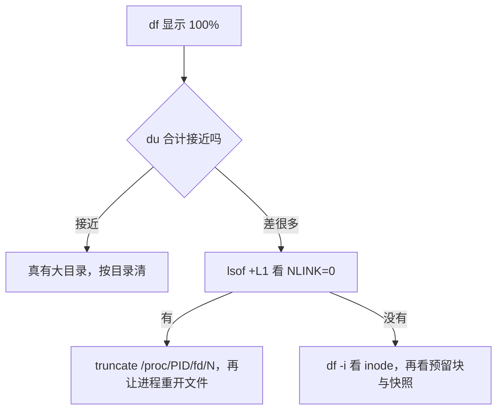

# 磁盘满、日志滚爆、定时任务不跑怎么处理？

> 这三件事重启都只能止血，根因分别藏在文件句柄、日志策略和 cron 的运行环境里；方向判断错，删半天文件 `df` 还是 100%。

systemd 托管、进程资源、网络排查各自成篇，这篇收口剩下的：磁盘与 inode、日志切割与句柄、定时任务、权限与环境。

## df 说满了，du 加起来却只有一半，空间去哪了？

```bash
$ df -h /data
Filesystem      Size  Used Avail Use% Mounted on
/dev/vdb1       200G  199G  1.0G  99% /data
$ du -x -sh /data/* 2>/dev/null | sort -rh | head -3
 96G  /data/logs
 41G  /data/data
# 合计 137G，比 199G 少了 60G+
```

差出来的块没消失，只是**没有目录项指向它**。`rm` 只减少 link count，数据块要等**最后一个 fd 关闭**才归还；Java 一直攥着 `app.log` 的 fd，文件就成了「已删除但仍被打开」的幽灵，`du` 走目录树自然看不见。查的时候加分区范围别全盘扫，`lsof | grep deleted` 也能用，但输出更慢更杂：

```bash
$ sudo lsof +L1 /data 2>/dev/null
COMMAND  PID USER FD  TYPE DEVICE   SIZE/OFF NLINK     NODE NAME
java    4127 app   7w  REG  253,17 64424509440     0 1835021 /data/logs/app.log (deleted)
```



`NLINK=0` 就是判据，处置三条路，代价递增：`sudo truncate -s 0 /proc/4127/fd/7` 秒级回收、进程无感；`kill -USR1` 让进程重开文件（要框架支持，Java 多数不响应）；重启有损，放最后。注意 fd 若不是以 `O_APPEND` 打开，截断后进程仍停在旧 offset，继续写会造出**稀疏文件**（`ls -l` 几十 G、`du` 很小），下次 `df` 又往上爬——所以截断只是止血，根治是让日志自己滚动，别靠人工 `mv`、`rm` 腾地方。

## 明明还有空间，为什么写文件还是 No space left？

```bash
$ df -i /data
Filesystem      Inodes  IUsed   IFree IUse% Mounted on
/dev/vdb1      6553600 6553600      0  100% /data
```

`df -h` 还有 40%、`touch` 却报 `No space left on device`，因为拿不到 inode。ext4 的 inode 数建文件系统时定死（`mkfs.ext4 -N`），xfs 动态分配、吃的是块——xfs 上更常见的是直接块满，这点别混着说。定位用 `sudo du -x --inodes --max-depth=1 /data | sort -rn | head -5`（coreutils ≥ 8.22），元凶通常是按请求切片的日志、上传临时分片、session 文件、邮件队列（`/var/spool/postfix/{maildrop,deferred}`）。先治源头——session 挪 Redis、日志换带保留策略的滚动、临时文件加 TTL；`rm` 只撑几天，被进程打开的那批同样要等 fd 关闭。

## 找大目录和大文件，怎么又快又不误删？

```bash
du -x -h --max-depth=1 / 2>/dev/null | sort -rh | head -6
find / -xdev -type f -size +500M -printf '%s\t%p\n' 2>/dev/null | sort -rn | head
```

`-x`（不跨挂载点）、`--max-depth=1`、`find -xdev`（别爬进 `/proc`、`/sys` 和别的盘）三个参数决定结果对不对；挂到 `/data/backup` 的 NFS 被一起统计，`du` 可能跑几分钟甚至卡在网络上。`ncdu` 适合人肉翻目录、能按 inode 排序，但扫描慢、不能脚本化——巡检用 `du -x`，排查开 `ncdu -x /data`。清理顺序比命令重要：先出清单再动手；先归档再删（`tar -czf /backup/x.tgz --remove-files` 或传对象存储）；正在写的日志用 `truncate -s 0` 而不是 `rm`；确认不是挂载点、不是软链（`rm -rf link/` 会跟进去）；一次删一个目录，删完 `df -h` 验证。

## 日志怎么就把 200G 的盘写满了？

| 原因                 | 特征                                     | 处置                                    |
| -------------------- | ---------------------------------------- | --------------------------------------- |
| 级别误配，DEBUG 上线 | `grep -c ' DEBUG '` 占比高，单请求几十行 | 按包降级，配置中心动态调                |
| 异常循环打日志       | 同一段堆栈每秒刷几万行                   | 采样限流，别在 catch 里无脑打全栈       |
| 没有切割策略         | `ls -lh` 只有一个巨大 `app.log`          | 按天 + 按大小滚动                       |
| 切了但不删旧文件     | `app.2026-10-*` 几十份占满分区           | `maxHistory`/`totalSizeCap`、`rotate N` |
| 单文件被写爆         | 一行几十 MB，把报文、大对象打进日志      | 打印前截断，只留 id 与长度              |

分清方向：**问「谁在写」看 `iotop -oPa` / `pidstat -d 1`，问「删了为什么不释放」看 `lsof +L1`**，两者混用结论必偏。

## logrotate 配了就不用管了吗？

```conf
# /etc/logrotate.d/app
/data/logs/app/*.log {
    daily
    rotate 14
    maxsize 512M
    compress
    missingok
    notifempty
    dateext
    su app app
    create 0640 app app
    postrotate
        /bin/systemctl reload app.service > /dev/null 2>&1 || true
    endscript
}
```

`su app app` 别省：日志文件所在目录对非 root 用户可写时，logrotate 会报 `insecure permissions` 并跳过该文件；`su` 让这个检查通过、后续动作也以该身份执行，新文件的属主则交给 `create 0640 app app`，这一行漏了就会造出 root 拥有的日志、应用下次写直接 `Permission denied`。真正容易踩的是两种切割模式的差别：`create` 把旧文件改名、新建同名空文件，进程**不重开文件就一直在写改名后的旧 inode**，空间不释放；`copytruncate` 先复制再 `truncate` 原文件，复制与截断之间有窗口，**这段写入的日志直接丢**，量大时丢得更多。所以「配了 logrotate 就万事大吉」是错的：`create` 要求应用收到信号后重新打开文件，而 logback/log4j2 默认不监听 `SIGUSR1`，`postrotate` 里 `kill -USR1` 对 Java 常常是空动作——文件看着滚了，`df` 不降。让应用自己管更稳：

```xml
<appender name="FILE" class="ch.qos.logback.core.rolling.RollingFileAppender">
  <rollingPolicy class="ch.qos.logback.core.rolling.SizeAndTimeBasedRollingPolicy">
    <fileNamePattern>/data/logs/app.%d{yyyy-MM-dd}.%i.log.gz</fileNamePattern>
    <maxFileSize>256MB</maxFileSize>
    <maxHistory>14</maxHistory>
    <totalSizeCap>20GB</totalSizeCap>
  </rollingPolicy>
</appender>
```

`maxHistory` 按天算、`totalSizeCap` 才是硬上限，两个都配才不会被「一天写 30G」打穿；log4j2 对应 `DefaultRolloverStrategy` 挂 `Delete` 子元素。代价是滚动压缩吃点 CPU，换来句柄始终指向当前文件。

## journald 会不会把磁盘悄悄吃光？

`journalctl --disk-usage` 报「take up 1.9G」时，先改 `/etc/systemd/journald.conf`：`SystemMaxUse=1G` 卡总量、`MaxRetentionSec=14day` 按时间淘汰，改完 `systemctl restart systemd-journald`；已涨起来的用 `journalctl --vacuum-size=500M` 或 `--vacuum-time=7d` 立刻回收。默认 `Storage=auto`，只有 `/var/log/journal` 存在时才落盘，否则 journal 只在内存、重启即丢——想让它一定留，显式写 `Storage=persistent`（会主动建这个目录）。

另有一种「日志莫名断档」：`journalctl -u app` 出现 `Suppressed N messages from ...`，是 journald 限流（默认每服务 30 秒 10000 条）被循环日志触发，`RateLimitIntervalSec=0` 能关，但更该修刷屏那行。unit 里 `StandardOutput`、`LimitNOFILE` 的配法见 [Java 服务怎么用 systemd 托管？](./linux-systemd-deploy.html)。

## crontab 里手敲能跑，定时就是不跑，从哪查起？

先确认「有没有执行」再问「执行了为什么失败」，顺序反了就会在脚本里瞎改：

```bash
systemctl status cron     # Debian/Ubuntu；RHEL 系是 crond
sudo grep -i cron /var/log/syslog | tail -20   # RHEL: /var/log/cron
crontab -l                # 确认装在哪个用户下
```

| 症状                 | 常见原因                                                      | 确认方式                                        |
| -------------------- | ------------------------------------------------------------- | ----------------------------------------------- |
| 日志里连记录都没有   | crond 没起、装错用户、`/etc/cron.d` 文件名带 `.` 或权限非 644 | `systemctl status cron`                         |
| 有记录但什么都没干   | 时间字段理解错、`%` 没转义                                    | 五列是分/时/日/月/周；`@daily` = `0 0 * * *`    |
| command not found    | PATH 只有 `/usr/bin:/bin`，没有 alias 和 `JAVA_HOME`          | 写绝对路径 `/usr/local/jdk/bin/java`            |
| No such file         | 相对路径                                                      | 脚本开头 `cd /data/app` 或全绝对路径            |
| Permission denied    | 缺 `+x`、缺 shebang、CRLF 换行                                | `chmod +x`，首行 `#!/bin/bash`                  |
| 中文乱码 / 差 8 小时 | `LANG`、`TZ` 没设                                             | 顶部写 `LANG=zh_CN.UTF-8`、`TZ=Asia/Shanghai`   |
| 跑了但没留痕         | 输出没人收，默认发本地邮件                                    | 加 `>> /data/logs/cron.log 2>&1`，或配 `MAILTO` |

- cron 用 `/bin/sh` 执行，Debian 上是 dash，`[[ ]]`、`source`、`let` 直接报错；复杂逻辑写脚本，crontab 只留一行调用。
- `%` 在 crontab 里是特殊字符，第一个未转义的会被当成换行，`date +\%F` 才是对的。
- 日（第 3 列）和周（第 5 列）同时指定是 **OR**：`0 3 1 * 1` 是「每月 1 号**或**每周一」，不是「1 号且周一」。
- `/etc/cron.d/xxx` 比用户 crontab 多一列用户（`分 时 日 月 周 用户 命令`）；少写这列会把用户名当命令跑，报错很像权限问题。
- `CRON_TZ` 只在较新 cronie 上可用，时区敏感的任务在脚本里再 `export TZ` 更稳。

最省事的定位手段是让 cron 自己吐环境：

```bash
* * * * * ( date -Is; id; pwd; echo "PATH=$PATH"; env ) >> /data/logs/cron-env.txt 2>&1
```

一分钟后 `diff <(env | sort) <(sort /data/logs/cron-env.txt)`，少哪个变量一目了然。用 `>>` 别用 `>`（会覆盖上次证据），也别写 `/tmp`（可能被 `systemd-tmpfiles` 清掉）。

## 上一轮还没跑完，下一轮又开始了怎么办？

对账、同步、报表的单次耗时一旦超过调度间隔就会叠加：`ps` 里挂着 5 个同名脚本，内存和连接数一起涨。三层护栏：

```bash
#!/bin/bash
set -euo pipefail
exec 9>/var/lock/report.lock
flock -n 9 || { echo "$(date -Is) skip: previous run alive"; exit 0; }
timeout -k 30s 1800s /usr/bin/java -jar /data/app/report.jar
echo "$(date -Is) done rc=$?"
```

`flock -n` 拿不到锁立即退出并留一行日志（去掉 `-n` 会排队等待，进程照样堆积）；`timeout -k 30s 1800s` 先 `TERM` 再等 30 秒 `KILL`，兜住死锁与阻塞 IO；退出码一定落日志，否则「跑了但失败」和「没跑」在监控上长得一样。再把耗时与成败写成指标，接近间隔时提前告警。

## cron 和 systemd timer 怎么选？

| 维度         | cron            | systemd timer                             |
| ------------ | --------------- | ----------------------------------------- |
| 精度         | 分钟级          | 秒级，可 `OnCalendar=*:0/30`              |
| 错过是否补跑 | 不补            | `Persistent=true` 下次启动补一次          |
| 运行环境     | 极简，`/bin/sh` | unit 里 `Environment=`/`EnvironmentFile=` |
| 依赖关系     | 无              | `After=`/`Requires=` 能等网络、等挂载     |
| 并发控制     | 自己 `flock`    | 同名 service 天然不重复启动               |
| 日志         | 自己重定向      | `journalctl -u report.service`            |

```ini
# /etc/systemd/system/report.timer
[Timer]
OnCalendar=*-*-* 03:30:00
Persistent=true
[Install]
WantedBy=timers.target
```

```bash
systemd-analyze calendar "*-*-* 03:30:00"   # 校验表达式并打印下次触发
systemctl enable --now report.timer && systemctl list-timers --all
```

`OnCalendar` 比五列好读（`Mon..Fri 09:00`、`daily`、`hourly`），但**必须用 `systemd-analyze calendar` 验证**：写错不报错，只是永远不触发。`Persistent=true` 只补一次、不会补跑 N 次。机器上有 systemd 且任务要环境、依赖、日志统一就用 timer；只是「每天跑个脚本」，cron 更轻。

## 权限看着是对的，为什么还是打不开？

```bash
$ ls -l /data/app/config.yml
-rw-r--r-- 1 app app 1024 Nov 17 10:00 config.yml
$ sudo -u app cat /data/app/config.yml
cat: /data/app/config.yml: Permission denied
```

文件 644、属主也对，还是 denied，说明问题不在这层。按四层查（`namei -l` 最容易被跳过：文件 644，但 `/data` 是 700 且属主 root，进程一样进不去）：

| 层           | 查什么                     | 命令                                 |
| ------------ | -------------------------- | ------------------------------------ |
| 目录穿越     | 每级父目录都要有 `x`       | `namei -l /data/app/config.yml`      |
| 文件权限     | rwx 位、属主属组           | `ls -l`                              |
| ACL          | 有没有额外条目改了最终结果 | `getfacl`、`setfacl -m u:monitor:rx` |
| 强制访问控制 | SELinux / AppArmor 标签    | `getenforce`、`ls -Z`、`aa-status`   |

`chmod`/`chown` 本身没有玄机：文件 644、目录 755、属主是运行用户，剩下的都是例外。`chmod 777` 才是坏习惯：它扩大了「谁能访问」，却没回答「为什么原本不给访问」。根因通常是 SELinux 标签错、父目录少 `x`、进程以错误用户跑（systemd 漏了 `User=`），777 只把问题挪到下一台机器重演；SELinux 开着时 777 也照样 denied。

```bash
$ getenforce
Enforcing
$ sudo ausearch -m avc -ts recent | tail -2
type=AVC msg=audit(1763350000.123:8871): avc:  denied  { read } for  pid=2311 comm="java"
  name="config.yml" dev="vdb1" scontext=system_u:system_r:unconfined_service_t
  tcontext=unconfined_u:object_r:user_home_t tclass=file
```

`tcontext` 是 `user_home_t`——文件还带着家目录标签，说明拷贝时属性没重置；给合适的 fcontext 再 `restorecon`（`chcon` 是临时的，`restorecon` 会覆盖）。AppArmor 侧看 `dmesg | grep -i 'apparmor="DENIED"'`。`setenforce 0` 只用来验证假设，别当修复。

两个易忽略点：`umask` 决定新文件默认权限（022 → 644/755，027 → 640/750），日志文件 640 往往是进程 `UMask=` 的产物；`sudo` 免密条目同理——`NOPASSWD: /usr/local/bin/restart.sh` 看着只放行一个脚本，但脚本可被应用用户改写就等于给了 root，必须 `chown root` 且 755。

## 环境变量和 locale 会怎么坑你？

| 变量                             | 症状                                                       | 处置                                                          |
| -------------------------------- | ---------------------------------------------------------- | ------------------------------------------------------------- |
| `LANG` / `LC_ALL` / `LC_COLLATE` | 中文乱码、文件名变 `???`，`sort` 与 MySQL、Java 顺序不一致 | 服务里固定 `LANG=zh_CN.UTF-8`（或 `C.UTF-8`），排序交给数据库 |
| `TZ`                             | 日志差 8 小时、任务在错误时段跑                            | `TZ=Asia/Shanghai` + `-Duser.timezone=Asia/Shanghai`          |
| `ulimit -n`                      | 手动起没事，托管后 `Too many open files`                   | systemd `LimitNOFILE=`，cron 在脚本里 `ulimit -n 65535`       |

`ulimit` 那条要单独说：它是**进程级**、只能从父进程继承。SSH 里 `ulimit -n 65535` 只影响这个 shell 及其子进程；cron 由 `crond` fork、systemd 服务由 PID 1 fork，跟那次 SSH 毫无关系。`/etc/security/limits.conf` 也只对走 PAM 的登录会话生效，systemd 服务默认不过 PAM——「我明明改过 limits 还是报错」多半出在这。

## 一次「磁盘 100% 把服务全挂」是怎么处理完的？

现象：接口大面积 500，日志里 `No space left on device`，监控报响应时间飙升。第一步 `df -h` 确认写满，第二步 `du` 对账、发现对不上：

```bash
$ df -h /data
/dev/vdb1  200G  199G  1.0G  100% /data
$ du -x -sh /data/* 2>/dev/null | sort -rh | head -3
 96G  /data/logs
 41G  /data/data
# 只有这两项，合计 137G，与 199G 差 60G+
```

第三步找幽灵文件，第四步止血并验证：

```bash
$ sudo lsof +L1 /data 2>/dev/null | head
java  4127  app   7w  REG  253,17  64424509440  0  1835021  /data/logs/app.log (deleted)
$ sudo truncate -s 0 /proc/4127/fd/7
$ df -h /data
/dev/vdb1  200G  136G   64G  68% /data
```

第五步，把根因说清：上周有人为腾空间 `mv app.log app.log.bak && rm app.log.bak`，而 logback 的 `<file>` 是固定名字、没配滚动，进程 fd 一直指着那个已删除的 inode，写进去的每一行都在吃块——删除动作看着「成功」，`df` 却一点也不降。

第六步，堵住复发：应用打开 `SizeAndTimeBasedRollingPolicy`（`maxHistory=14`、`totalSizeCap=20GB`）；`/data/logs` 单独挂盘并加配额；清理任务带 `flock`、只删 `-mtime +14` 的归档；加水位告警（`df -h --output=pcent /data` 取数，80% warning、90% critical），并把 `lsof +L1` 的 `NLINK=0` 文件数与总大小做成指标，每分钟只扫数据盘。复盘一句话：`df` 与 `du` 的差值是判断幽灵文件的第一手证据，`truncate` 止血、重启清创、滚动策略才是根治。

## 哪些坑是排障时最容易踩的？

1. **`rm` 删了日志就当空间回来了**：目录项没了、fd 还在，块要等进程关闭才释放；正在写的日志用 `truncate -s 0`。
2. **`copytruncate` 当万能钥匙**：复制与截断之间写入的日志会丢，高并发下更明显，也不能让应用改回正确的文件。
3. **给 Java 发 `SIGUSR1` 就算重开日志**：logback/log4j2 默认不处理，`create` 模式下文件一直写旧 inode，`df` 不降还去别处找原因。
4. **cron 里不做 `cd`**：相对路径按 `$HOME` 解析，手测时你在应用目录，跑起来却在别处找 `./config/x.yml`。
5. **`> /dev/null 2>&1` 一刀切**：失败原因全丢，等于亲手关掉唯一的证据；至少留 `>> 日志 2>&1` 或接告警。
6. **`find / -name '*.log' -delete`**：不加 `-xdev` 会爬进 `/proc`、NFS 和其他盘，不加 `-mtime` 会删掉今天正在写的；先 `-print` 看清单再动手。
7. **清理脚本自己把盘写满**：`tar` 归档写在同一分区、`| xargs` 生成巨型临时文件、忘了重定向 stdout。
8. **把 `/tmp` 当永久存储**：`systemd-tmpfiles` 会清长期未访问的文件，重启也可能清空，锁文件和会话放 `/var/lib/<app>`。
9. **`chmod 777` 收尾**：掩盖 SELinux 标签错、父目录缺 `x`、进程跑错用户，换台机器原样复现。
10. **`kill -9` 收尾**：`SIGKILL` 不给刷缓冲、提交事务、释放锁的机会，日志最后一段直接丢；先 `SIGTERM` 配 `timeout`。

## 小结

1. `df` 满而 `du` 不够，多半是「已删除但仍被打开」：`lsof +L1` 看 `NLINK=0`，`truncate -s 0 /proc/PID/fd/N` 止血，根治靠日志滚动而不是人工删。
2. 块与 inode 是两套配额：`df -h` 有空间却写不进去先 `df -i`，session、临时分片、邮件队列是典型元凶。
3. 日志滚爆先分类：级别误配、异常循环、无切割、切了不删、单文件写爆；Java 侧 `maxHistory` + `totalSizeCap` 比依赖外部 logrotate 稳。
4. cron 不跑按「有没有执行 → 报错是什么」查：`/bin/sh` 而非 bash、PATH 只有 `/usr/bin:/bin`、无 `cd`、`%` 要转义、`/etc/cron.d` 多一列用户、日与周是 OR；单实例 `flock`、兜底 `timeout`。
5. 权限 denied 先 `namei -l`、再 ACL、最后 SELinux/AppArmor，`chmod 777` 不是答案；`ulimit` 是进程级、不跨 fork 链继承，托管服务的限制要写进 unit 或脚本。

## 参考

综合自 `df(1)`、`du(1)`、`find(1)`、`lsof(8)`、`crontab(5)`、`logrotate(8)`、`journald.conf(5)`、`systemd.timer(5)`、`systemd.time(7)`、`acl(5)`、`namei(1)` 等 man 手册，以及发行版文档中关于 cron 目录格式、SELinux 标签的说明与 ext4/XFS inode 分配差异。命令输出按主流 LTS 发行版（coreutils 8.32、systemd 249、cronie 1.5）的实际形态改写，字段顺序随版本可能不同，以本机 `man` 为准；`truncate` 对非 `O_APPEND` 句柄会产生稀疏文件、`copytruncate` 存在丢日志窗口这两点按手册与实测行为核对后写入。
