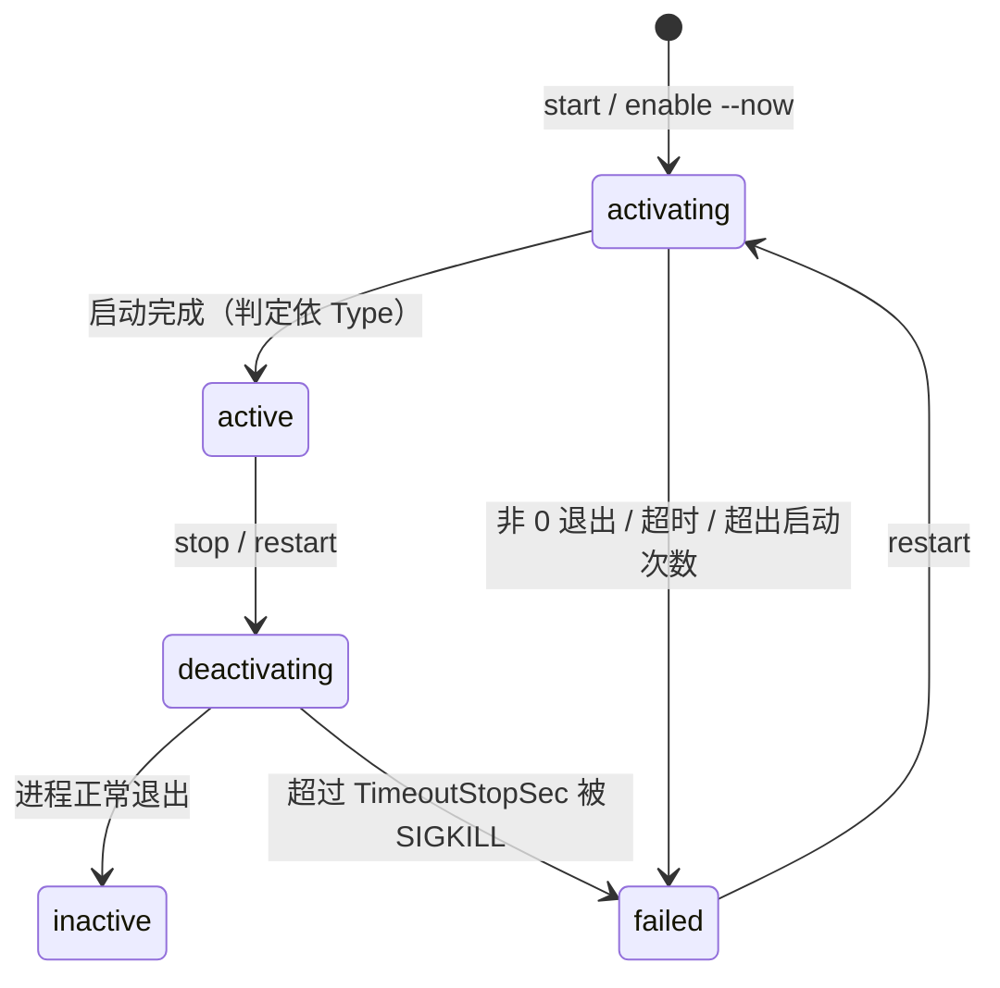

# Java 服务怎么用 systemd 托管？

> `nohup java -jar app.jar &` 只挡住了 SIGHUP；开机自启、崩溃重启、日志收集、资源限制没人负责。systemd 把这些收进一份 unit 描述，用一条命令管完整生命周期。

## nohup 起的服务，问题会从哪冒出来？

`nohup java -jar app.jar > nohup.out 2>&1 &` 只解决一件事：SSH 断开时 SIGHUP 带不走进程。可进程被 init 收养后不在任何服务单元里——**"SSH 断了还在跑"和"部署好了"是两件事**，剩下的坑早晚会撞上：

| 现象                                               | systemd 的对应能力                            |
| -------------------------------------------------- | --------------------------------------------- |
| 重启后服务不见了 / 半夜挂了没人知道                | `enable`；`Restart=on-failure` + `RestartSec` |
| `nohup.out` 涨到几十 G，写满磁盘                   | journal 统一收集，或应用落文件 + 轮转         |
| 不知道主进程是谁、多实例抢端口、改配置要 `kill -9` | `MainPID`、cgroup 边界；`restart` 一个入口    |
| 句柄数上不去、内存不设限                           | `LimitNOFILE`、`MemoryMax`、`CPUQuota`        |
| 停机时请求被砍断                                   | `KillSignal` + `TimeoutStopSec`               |

## 一份能用的 unit 文件长什么样？

自己写的服务放 `/etc/systemd/system/myapp.service`，别改发行版 `/usr/lib/systemd/system/` 下的文件：

```ini
[Unit]
Description=myapp order service
After=network-online.target
Wants=network-online.target
[Service]
Type=exec
User=myapp
Group=myapp
WorkingDirectory=/opt/myapp/current
EnvironmentFile=/etc/myapp/myapp.env
ExecStart=/usr/lib/jvm/java-17-openjdk/bin/java -Xms2g -Xmx2g \
  -XX:+HeapDumpOnOutOfMemoryError -XX:HeapDumpPath=/opt/myapp/shared/dump \
  -XX:+ExitOnOutOfMemoryError -Duser.timezone=Asia/Shanghai -Dspring.config.additional-location=file:/etc/myapp/ \
  -jar /opt/myapp/current/app.jar
SuccessExitStatus=143
Restart=on-failure
RestartSec=5
TimeoutStopSec=60
KillSignal=SIGTERM
LimitNOFILE=65535
StandardOutput=journal
StandardError=journal
SyslogIdentifier=myapp
[Install]
WantedBy=multi-user.target
```

`[Unit]` 管"它是什么、和别人什么次序"，`[Install]` 管 `enable` 时挂到哪个 target，决定行为的是 `[Service]`：

| 字段                       | 作用                    | 写错的后果                           |
| -------------------------- | ----------------------- | ------------------------------------ |
| `After=` / `Wants=`        | 只表达顺序与弱依赖      | 误当成"依赖已就绪"，库没起来照样失败 |
| `ExecStart=`               | 绝对路径、前台运行      | 相对路径或带 `&`，启动判定立刻错乱   |
| `Restart=` / `RestartSec=` | 重启策略与间隔          | 启动即崩时无限重启，日志被刷爆       |
| `TimeoutStopSec=`          | 发 SIGKILL 前的等待上限 | 小于应用关闭时间，请求被硬切         |
| `KillSignal=`              | 停机先发什么信号        | 默认 SIGTERM，shutdown hook 靠它     |
| `LimitNOFILE=`             | 文件描述符上限          | 高并发下 `Too many open files`       |

`SuccessExitStatus=143` 被抄得很广，但 143 就是 `128+15`，即被 SIGTERM 杀掉——systemd 本来就把 `SIGHUP`/`SIGINT`/`SIGTERM`/`SIGPIPE` 视为正常退出（`oneshot` 除外）。留着无害，其实不必要；真正需要它的是应用自定义的非 0 退出码。

## Type= 怎么选？选错会怎样？

`Type=` 定义的是**systemd 何时认为服务启动完成**。这句判断错了，重启策略、`start` 的返回码、健康检查全跟着错。

| Type             | 何时算启动完成           | 适用场景                                      |
| ---------------- | ------------------------ | --------------------------------------------- |
| `simple`（默认） | fork 后立即算成功        | 简单脚本；不校验 exec 是否真成功              |
| `exec`           | `execve()` 成功后才算    | 前台跑 `java -jar` 的常驻服务，**推荐**       |
| `forking`        | 父进程退出、子进程在后台 | 自己 daemonize 的老程序，通常还要 `PIDFile`   |
| `notify`         | 进程主动发 `READY=1`     | 实现了 sd_notify 的服务；Spring Boot 默认不发 |
| `oneshot`        | 进程退出即完成           | 初始化脚本、刷配置、一次性任务                |

- **该用 `exec`/`simple` 却用 `forking`**：`java -jar` 不会 fork，systemd 等不到"父进程退出"，一路挂到 `TimeoutStartSec` 判失败。
- **`ExecStart` 是包装脚本、脚本里又 `java ... &`**：脚本自己退出，systemd 认为服务已结束，`Restart=always` 开始疯狂拉起——**你以为在重启崩溃的 JVM，其实在重启一个立刻退出的脚本**。
- **用 `notify` 但应用不发 `READY=1`**：一直等到启动超时；Spring Boot 默认没有 sd_notify 实现，单纯 `java -jar` 别选它。

`exec` 只保证进程起来了，**不保证能接请求**；要"起来即可用"，得在 `ExecStartPost=` 里补健康检查，或让上游探针决定何时挂流。

## JVM 参数为什么不能塞进 JAVA_OPTS？

`JAVA_OPTS` 不是 JDK 的约定，是各家启动脚本自己 `eval` 的变量：`java` 进程根本不读它，写进 `EnvironmentFile` 等于没写。

JDK 真正认的是 `JAVA_TOOL_OPTIONS`（各厂商 VM 都读，stderr 打印 `Picked up`）、`_JAVA_OPTIONS`（HotSpot 读、优先级更高）、`JDK_JAVA_OPTIONS`（Java 9+ 的 `java` 启动器读）。运维上更推荐**直接写进 `ExecStart`**：`systemctl cat myapp` 就是唯一真相。代价是参数会出现在 `ps` 里，**密码、token 不能写命令行**——放 `EnvironmentFile`，它是 PID1 以 root 读入再降权启动进程的，文件 `chown root:myapp && chmod 640` 就够，进程用户不必自己读得到。

`EnvironmentFile` 也不是 shell 脚本：每行 `KEY=VALUE`，空行与 `#`、`;` 开头的忽略，变量名只能是字母数字下划线。写成 `export KEY=VALUE` 会被当非法赋值整行丢掉，服务起来后变量是空的——**比直接报错难查得多**；值里含空格、`#`、引号时别赌它的引号语义，换个配置文件或命令行参数更稳。

堆大小与机器内存：

- 不写 `-Xmx` 时 HotSpot 默认最大堆约物理内存的 1/4（Java 10+ 有 cgroup 限额时按限额算）；生产显式写，`-Xms` 与 `-Xmx` 设成一样省掉堆伸缩。
- 堆之外还有 Metaspace、直接内存、线程栈、JIT code cache、GC 结构，**堆别超过总内存的 70%**，剩下留给堆外和页缓存。
- `-XX:+ExitOnOutOfMemoryError` 让 JVM 在 OOM 时以非 0 退出码结束，交给 `Restart=on-failure` 拉起。OOM 之后堆状态不可信，快速重启比"半死不活继续接请求"好；但重启会抖流量，所以必须配 `-XX:+HeapDumpOnOutOfMemoryError` 留现场。
- `-XX:HeapDumpPath` 的相对路径基于 `WorkingDirectory`，dump 大小约等于堆大小，**要放有空间的独立分区**且 `User=` 可写；若另用 `MemoryMax=` 限了 cgroup，内核 OOM killer 直接 SIGKILL，JVM 来不及 dump。

## 停服务时，请求是怎么被截断的？

`systemctl stop` 的动作固定：向 cgroup 内所有进程发 `KillSignal`（默认 SIGTERM）→ 等 `TimeoutStopSec` → 不退就 SIGKILL（不可捕获）。

Spring 容器关闭顺序大致是：发布 `ContextClosedEvent` → 生命周期 Bean 的 `stop()`（内嵌 Web 服务器先停）→ 单例 Bean 的 `@PreDestroy` / `DisposableBean.destroy()` → JVM 退出。默认 `server.shutdown=immediate` 是**直接掐断连接**，在途请求拿不到响应、消息消费到一半没 ack。Spring Boot 2.3 起可改成：

```properties
server.shutdown=graceful
spring.lifecycle.timeout-per-shutdown-phase=30s
```

1. **它只管 HTTP 在途请求**：消息监听容器、`@Async` 线程池、定时任务不会因此排空，要各自配关闭超时，或在 shutdown hook 里显式 `awaitTermination`。
2. **`TimeoutStopSec` 必须大于应用的关闭预算**：应用说最多等 30 秒、unit 写 `TimeoutStopSec=10`，第 10 秒 SIGKILL 就到了，优雅停机等于没配；也别设 600，依赖卡住时 `restart` 陪着卡。
3. 外层顺序更重要：**先摘流再停进程，先起进程再挂流**——网关摘掉这台 → 等 20~30 秒让长连接与重试窗口过去 → `systemctl stop` → 换版本 → `start` → 健康检查 → 挂回流量。反着做，摘流还没生效进程就停了，用户看到 502。

## 日志该落在哪，journal 还是文件？

```bash
journalctl -u myapp -f                     # 实时跟
journalctl -u myapp --since "10 min ago"   # 最近十分钟
journalctl -u myapp -b -n 200              # 本次开机倒数 200 行
journalctl -xe                             # 最近错误 + 解释，查启动失败好用
```

`StandardOutput=journal` 是 systemd 服务的默认行为；`SyslogIdentifier=myapp` 让条目带固定标识，否则默认用可执行文件名，同机几个 `java` 立刻分不清。也能直接落文件：`StandardOutput=append:/var/log/myapp/stdout.log`（systemd 240+）。但**只靠 journal 有几个硬边界**：容量有上限（`SystemMaxUse=`）到顶就删最旧的；可能只存 `/run/log/journal`，重启机器日志全丢；单元级速率限制（默认 30 秒 1000 条）会把突发报错丢掉，只留一行 `Suppressed N messages`；外送与审计也不方便。所以**两条腿走路**：journal 保启动期与 stderr 的粗粒度信息，应用日志按级别落文件再交给 logrotate 或采集端。

```text
/var/log/myapp/app.log {
    daily
    rotate 14
    compress
    copytruncate
    create 0640 myapp myapp
}
```

`copytruncate` 是"应用不会重开文件"时的妥协：复制一份再把原文件截断为 0，应用继续往同一个 inode 写。坑在**复制与截断之间写入的日志会丢**，大文件截断还会抖一下 IO；更稳的是让日志框架自己滚动（logback 的 `SizeAndTimeBasedRollingPolicy` 配 `maxHistory`/`totalSizeCap`），logrotate 只清超期文件。磁盘写满导致服务莫名挂掉，就用 `df -h` 看分区、`journalctl --disk-usage` 看 journal 占比、`du -xhd1 /var` 找大目录，并且**把日志与 dump 放独立分区**——别写满根分区还把同机的库带走。

## 用什么身份跑，权限收到多紧？

```bash
sudo useradd -r -s /sbin/nologin -d /opt/myapp myapp     # 系统用户，不能登录
sudo chown -R myapp:myapp /opt/myapp/current /var/log/myapp /opt/myapp/shared
```

`User=` 不写就是 root：跑在 root 的 Java 服务，任何反序列化、模板注入、文件上传漏洞的收益都直接变成"整台机器"，它写出的日志、dump、临时文件属主也都是 root。

`[Service]` 里几行低成本加固：`NoNewPrivileges=yes` 禁 exec 提权（基本无副作用，建议默认开）；`PrivateTmp=yes` 给服务独立 `/tmp`（跨服务借 `/tmp` 传文件会失效）；`ProtectSystem=strict` 让文件系统只读，但**必须配 `ReadWritePaths=/opt/myapp/shared /var/log/myapp`**，否则应用写不了日志和 dump；`ProtectHome=yes` 屏蔽 `/home`、`/root`，配置别放家目录。

想直接监听 80/443 别用 `User=root`：前面挂 Nginx/SLB 反代到 8080（最常见），或 `iptables`/`nft` 把 80 转 8080，或只授绑端口这一项能力——`AmbientCapabilities=CAP_NET_BIND_SERVICE` 配 `CapabilityBoundingSet=CAP_NET_BIND_SERVICE`。

配置文件含密码时 `chown root:myapp /etc/myapp/myapp.env && chmod 640`，配置文件本身 `chmod 600`。别用 `chmod -R 777` 图省事——那等于把密码公开给机器上所有用户。

## 日常启停和排障的标准动作有哪些？

```bash
sudo systemctl daemon-reload        # 改过 unit 之后必须
sudo systemctl enable --now myapp   # 开机自启 + 立刻启动
systemctl status myapp              # 状态、MainPID、cgroup、最近日志
systemctl is-enabled myapp          # enabled / disabled / static
systemctl is-active myapp           # active / inactive，脚本里用这个
sudo systemctl restart myapp        # stop + start，换 PID
sudo systemctl reload myapp         # 发 ExecReload/ReloadSignal，进程不变
```



`restart` 与 `reload` 的区别：`restart` 换进程，有停机窗口、JVM 得重新预热；`reload` 向运行中的进程发信号重读配置，无窗口，但 unit 里没写 `ExecReload=`/`ReloadSignal=` 会直接报 `Job type reload is not applicable`。改了 unit **必须** `daemon-reload`，否则 PID1 内存里还是旧配置；要看生效值用 `systemctl show myapp -p ExecStart`，改配置优先 `systemctl edit myapp` 生成 drop-in。服务起不来时，按这个顺序查基本不走回头路：

1. **语法与字段**：`systemd-analyze verify`，再看 `journalctl -u myapp -b` 里的 `Failed to parse`、`Unknown key`。
2. **路径与权限**：`ExecStart` 是否绝对路径、文件在不在；`sudo -u myapp test -r /opt/myapp/current/app.jar`。
3. **环境变量**：`sudo systemctl show myapp -p Environment`，或用同样环境手动跑一次 java。
4. **端口占用**：`ss -lntp | grep :8080`，看是不是上一个实例没退干净。
5. **依赖未就绪**：`After=` 只保证顺序，不保证 MySQL 能连上；这类失败靠应用重试或 `ExecStartPost=` 探活。

## 多实例怎么跑在同一台机器上？

把 `myapp.service` 改成模板 `/etc/systemd/system/myapp@.service`，`@` 后面是实例名（也是端口来源，`/etc/myapp/8081.env` 里写 `SERVER_PORT=8081`），unit 里用 `%i` 引用。和上面那份相比只改这几处：

```ini
EnvironmentFile=/etc/myapp/%i.env
ExecStart=/usr/lib/jvm/java-17-openjdk/bin/java -Xms1g -Xmx1g \
  -jar /opt/myapp/current/app.jar --server.port=%i
SyslogIdentifier=myapp-%i
```

```bash
sudo systemctl enable --now myapp@8081 myapp@8082
systemctl status 'myapp@*'          # 加引号，别让 shell 展开
```

两条纪律：**实例名、端口、env 文件三者对齐**——`myapp@8081` 的 env 里 `SERVER_PORT` 也得是 8081，否则两个实例抢同一端口，第二个起来就 `failed`，报错藏在 journal 的 `Address already in use` 里，只看 `status` 容易误判成"偶发启动失败"；**`%i` 是实例名原文**，`%I` 是反转义后的，日志标识记得带 `%i`，否则多实例日志在 journal 里彻底糊掉。

前面挂 Nginx 时实例和 upstream 要一起改，滚动发布才有意义——一台一台"摘流 → 换软链 → `restart` → 健康检查 → 挂回 upstream"，另一台继续扛流量：

```nginx
upstream myapp {
    server 127.0.0.1:8081 max_fails=3 fail_timeout=10s;
    server 127.0.0.1:8082 max_fails=3 fail_timeout=10s;
}
```

## 上线和回滚怎么做才敢点？

版本目录 + `current` 软链，是单机发布最省事又最好回滚的结构；`WorkingDirectory` 和 `ExecStart` 都指向 `/opt/myapp/current`。注意**换软链不等于换版本**——在跑的进程 exec 的是旧 inode，软链只影响下一次 `start`，`restart` 不能省。

```text
/opt/myapp/releases/{20261116-101500,20261117-183000}/app.jar
/opt/myapp/current -> releases/20261117-183000
/opt/myapp/shared/{dump,logs}
```

```bash
#!/usr/bin/env bash
set -euo pipefail
APP=myapp; JAR_SRC=$1
REL=/opt/myapp/releases/$(date +%Y%m%d-%H%M%S)
PREV=$(readlink -f /opt/myapp/current)     # 备份：记住旧版本
install -d -o myapp -g myapp "$REL" && cp "$JAR_SRC" "$REL/app.jar" && chown myapp:myapp "$REL/app.jar"
ln -sfn "$REL" /opt/myapp/current          # 替换：切 current
systemctl restart "$APP"                   # 让新版本真正生效
for i in $(seq 1 30); do                   # 健康检查：最多 30 秒
  curl -fsS -m 2 http://127.0.0.1:8080/actuator/health | grep -q '"status":"UP"' && exit 0
  sleep 1
done
echo "health check failed, rollback to $PREV" >&2
ln -sfn "$PREV" /opt/myapp/current         # 失败：回滚 + 重起
systemctl restart "$APP"; exit 1
```

几条纪律：健康检查要看返回体里的 `status`，不能只看 HTTP 200（健康端点在 DOWN 时也可能回 200，也可能回 503 带一段 HTML）；回滚序列就是"软链回旧版本 → `restart` → 再健康检查"；单实例一定有停机窗口，零停机得靠上一节的多实例 + 摘流滚动。而**回滚不了的东西要提前想清楚**：库表结构、消息格式、缓存旧对象都是硬约束，纪律是"先上兼容代码，再改读写，最后删旧字段"分三次发。

## 容易踩的坑

1. **改 unit 忘 `daemon-reload`**：`systemctl cat` 看到的是磁盘新内容，`restart` 用的却是内存旧配置；用 `systemctl show -p ExecStart` 核对生效值。
2. **`ExecStart` 写相对路径或裸 `java`**：systemd 的 `PATH` 是编进 PID1 的固定值，JDK 装在 `/usr/lib/jvm/...` 时找不到；路径全写绝对。
3. **没设 `User=`**：跑在 root，漏洞收益直接放大，日志和 dump 也是 root 属主。
4. **`EnvironmentFile` 带 `export`、shell 引号、`$()`**：整行被忽略、变量静默为空；`journalctl -u` 里通常有提示。
5. **`Restart=always` + 启动即崩**：`RestartSec=5` 比 `StartLimitIntervalSec=10` 还长，启动限流永远触发不了，变成"每 5 秒崩一次"的僵尸循环；把 `RestartSec` 压进限流窗口，或配 `StartLimitBurst` 直接判失败。
6. **journald 速率限制丢日志**：只留一行 `Suppressed N messages`，偏偏丢掉错误最密的那几秒；调 `RateLimitBurst=` 或让应用落文件。
7. **`LimitNOFILE` 太小**：`Too many open files` 常在压测才暴露；另外 `/etc/security/limits.conf` 对 systemd 服务**不生效**（不经 PAM 登录），要改 unit 的 `LimitNOFILE=` 或 systemd 的 `DefaultLimitNOFILE=`。
8. **时区差 8 小时**：`timedatectl` 确认系统时区，JVM 再加 `-Duser.timezone=Asia/Shanghai`，否则日志、`created_at`、定时任务全对不上。
9. **`systemctl start` 成功就认为健康**：`Type=exec` 只保证进程起来了，要"起来即可用"得自己加健康检查。
10. **硬化指令的副作用**：`ProtectSystem=strict` 少配 `ReadWritePaths=` 会写不了日志和 dump；`PrivateTmp=yes` 之后跨进程借 `/tmp` 传文件会凭空消失。

## 小结

1. `nohup &` 只挡住 SIGHUP；开机自启、崩溃重启、日志收集、资源限制、依赖顺序都得由 systemd 补上。
2. `Type=` 定义"什么叫启动完成"：前台 `java -jar` 选 `exec`；选 `forking` 或用包装脚本会等错时机，让重启策略在错误时刻触发。
3. JVM 参数写 `ExecStart`（`JAVA_OPTS` 没人读），环境变量走 `EnvironmentFile`（不是 shell 脚本）；堆不超总内存 70%，OOM 靠 `ExitOnOutOfMemoryError` + dump + `Restart=on-failure`。
4. 停机是 SIGTERM → shutdown hook 的协作：`TimeoutStopSec` 要大于应用关闭预算，`server.shutdown=graceful` 只管 HTTP 在途请求，外层还要"先摘流后停机、先起后挂"。
5. 日常闭环：`daemon-reload` → `restart` → 健康检查 → 失败回滚；日志两条腿（journal + 文件轮转），权限用专用用户 + 640 配置文件。

## 参考

综合自 systemd 官方手册（`systemd.unit(5)`、`systemd.service(5)`、`systemd.exec(5)`、`systemd.kill(5)`、`journald.conf(5)`）、`logrotate(8)` 手册、主流发行版（RHEL/CentOS、Debian/Ubuntu）服务管理文档，以及 OpenJDK 启动参数说明；并逐条核对了这些行为：SIGTERM 默认即被视为正常退出（`SuccessExitStatus=143` 并非必需）、`EnvironmentFile` 不是 shell 脚本、`/etc/security/limits.conf` 不作用于 systemd 启动的服务、`RestartSec` 与 `StartLimitIntervalSec`/`StartLimitBurst` 的相互作用、`ProtectSystem=strict` 必须配 `ReadWritePaths=` 放行。Spring 侧按 Spring Boot 2.3+ 的 graceful shutdown 行为核对。
