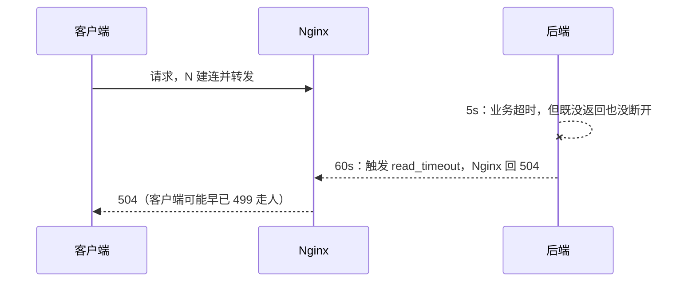

# Nginx 反向代理和 upstream 怎么配？为什么后端说超时了它还在等？

> Nginx 对"超时"和"失败"有自己的一套理解：`proxy_read_timeout` 量的是**两次读之间的间隔**，不是整个请求的时长；`proxy_next_upstream` 又会在你没发话时决定"换一台再试"。这两件事都跟业务语义无关，所以"后端已经报超时了，Nginx 还在等"和"一个订单下了两次，却查不出谁重试的"都能从这里找到答案。

## Nginx 在这条链路里站哪一格

Java 系统里 Nginx 反复出现，动机各不相同：静态入口（静态资源、TLS 终止、gzip）靠事件驱动省线程；反向代理（按 host/path 分发、灰度分流、限流）让应用不必知道部署拓扑；内部跳板（统一出口、注入鉴权头）把外部依赖收敛到一处。这三层东西经常被一起叫"网关"，一句话分清各自负责什么：

- **Nginx**：通用七层反向代理加静态服务器，用配置文件描述"流量怎么走"。本篇只讲它。
- **K8s Ingress**：集群里"按 host/path 把外部流量路由到 Service"的**声明式规则**，落地还得有 Controller，最常见的 ingress-nginx 本身就是一份 Nginx 配置，见 [Service 和 Ingress 怎么把流量送进集群](/tools/kubernetes/kubernetes-service-ingress.html)。
- **Spring Cloud Gateway**：跑在 JVM 里的应用侧网关，强项是贴着业务做鉴权、聚合、灰度，见 [Spring Cloud Gateway 的路由和过滤器](/system-design/spring-cloud/spring-cloud-gateway-filter-limit.html)。

## location 的匹配顺序：为什么"明明配了"却不生效

配置是三层嵌套：`http` 放全局（日志、MIME、`upstream`），`server` 按 `listen` + `server_name` 收流量，`location` 才决定这条请求交给谁。匹配规则只有四条，但执行顺序是**固定**的：

| 顺序 | 写法             | 语义                             | 备注                                  |
| ---- | ---------------- | -------------------------------- | ------------------------------------- |
| 1    | `location = /x`  | 精确匹配，命中即结束             | 完全相等才算                          |
| 2    | `location ^~ /x` | 最长前缀命中后**不再看正则**     | 想锁死一段前缀就用它                  |
| 3    | `location ~ /x`  | 正则，按**配置文件里的书写顺序** | `~*` 忽略大小写；先命中的赢，不看长短 |
| 4    | `location /x`    | 普通前缀，取最长的那条           | 最长前缀带 `^~` 时跳过正则            |

两个反直觉的点：正则之间不是"谁更精确谁优先"，而是**书写顺序优先**；普通前缀命中后**还会再跑一遍正则**，正则赢了就覆盖前缀。于是"我在 `location /api` 里把超时调到 300s，线上还是 60s 就 504"是真实事故——另一条 `location ~ ^/api/v[0-9]+/` 先匹配上了，前缀里的指令一起作废。查这类问题别猜，用 `nginx -T` 打出**合并后**的完整配置，确认这条 URI 实际落在哪个块。

斜杠也是高频坑，只差一个字符：`proxy_pass http://order_svc;` 原样转发（后端收到 `/api/order/1`），写成 `proxy_pass http://order_svc/;` 就砍掉 location 前缀（后端收到 `/order/1`）。边界：**正则 location 和命名 location 里 `proxy_pass` 不允许带 URI**，写了直接启动失败。

## upstream 块：一份带状态的名单

```nginx
upstream order_svc {
    server 10.0.1.11:8080 weight=3 max_fails=2 fail_timeout=10s;
    server 10.0.1.12:8080 weight=1;
    server 10.0.1.13:8080 backup;   # 主节点全挂才启用
    server 10.0.1.14:8080 down;     # 人为摘除：维护、灰度、止损
    keepalive 32;                   # 每个 worker 复用到上游的空闲连接上限
}
```

`max_fails` / `fail_timeout` 是一对，语义常被说反：

- `fail_timeout`（默认 10s）**既是统计窗口也是摘除时长**：窗口内失败达 `max_fails`（默认 1）次，这台就被摘掉 `fail_timeout` 这么久；
- 到期不会恢复满权重，而是**放一个请求去试探**，成功才重新计入，失败再摘一轮；
- `max_fails=0` 是"永不摘除"，不是"只摘一次"。

"失败"的口径来自 `proxy_next_upstream`：默认只算**连不上**和**超时**，后端返回 500 并不摘节点——"机器明明在报错，Nginx 还一直往上打"通常不是 `max_fails` 失灵。反过来把 5xx 加进判据要克制：一个必现的 500 bug 会让整组节点在 10 秒内被清空，然后所有请求变成"没有可用节点"。`backup` 只在主节点全被摘除后启用，`ip_hash` 不支持 `backup`。

## 到后端的连接复用：三件套缺一不可

**默认是短连接**：`proxy_http_version` 默认 1.0，默认头里还带着 `Connection: close`，于是每个请求都要跟上游重新握手、重新慢启动。要复用，三行必须**同时**出现：

```nginx
upstream order_svc {
    server 10.0.1.11:8080;
    keepalive 32;                     # ① 每个 worker 缓存多少条空闲连接
}
location /api/ {
    proxy_pass http://order_svc;
    proxy_http_version 1.1;           # ② 版本不对，1.1 的复用语义根本不存在
    proxy_set_header Connection "";   # ③ 把默认的 Connection: close 清掉
}
```

少一条都白配，原因各不相同：没有 `keepalive` 就没有池子，1.1 只是"允许复用但没地方存"；没有 `proxy_http_version 1.1`，Nginx 仍按 1.0 发请求，上游认为这是一次性的；没有 `Connection ""`，默认的 `close` 会把刚建好的连接标记成用完即弃。收益是定性的，现象却很好认：压测时 QPS 上不去，`ss -s` 里 `TIME_WAIT` 暴涨，极端时 error log 出现 `connect() failed (99: Cannot assign requested address)`——本地临时端口被短连接耗光了；开了复用后，同样 QPS 下 Nginx 到上游的 established 连接数应该稳定在个小数字上，不随并发线性涨。

两个配套细节。`keepalive 32` 是**每个 worker 进程**的上限而不是全局（16 个 worker 就是最多 512 条空闲连接），ingress-nginx 把这套参数包成了 `upstream-keepalive-connections`（默认 32）；上游自己的空闲超时必须**大于** Nginx 复用连接的间隔，否则会从池里取出一条对面已关闭的连接，日志是 `upstream prematurely closed connection while reading response header`，客户端看到 502——这就是 [HTTP 长连接怎么保活](/cs-basics/network/network-http-keepalive-tcp-keepalive.html) 里"两段连接各自计时"的具体版本，上游侧口径见 [Tomcat 的连接器和线程模型](/tools/tomcat/tomcat-connector-thread-model.html)。

顺带记一个命名陷阱：`keepalive_timeout`（http/server 层）管的是**客户端**连 Nginx 这条连接的闲置时间，和 upstream 块里的 `keepalive N`（池子大小）完全是两回事。

## 代理头与真实 IP：XFF 是追加，不是覆盖

```nginx
proxy_set_header Host              $host;
proxy_set_header X-Real-IP         $remote_addr;
proxy_set_header X-Forwarded-For   $proxy_add_x_forwarded_for;
proxy_set_header X-Forwarded-Proto $scheme;
```

| 头                  | 谁在用                                    | 常见错法                                    |
| ------------------- | ----------------------------------------- | ------------------------------------------- |
| `Host`              | 后端按域名路由、生成绝对链接、CSRF 校验   | 不设时默认 `$proxy_host`，后端只看到内网 IP |
| `X-Real-IP`         | 应用直接取"客户端 IP"                     | 以为它天然可信，其实也是前面那跳写进来的    |
| `X-Forwarded-For`   | 通用标准，多级代理**追加**在末尾          | 用 `$remote_addr` 覆盖，把链路信息抹掉      |
| `X-Forwarded-Proto` | 生成 `https://` 链接、判断是否安全 Cookie | 少了它，HTTPS 站点被重定向回 http           |

`$proxy_add_x_forwarded_for` 就是"原来的 XFF + 逗号 + `$remote_addr`"，所以三级代理会累加成 `client, proxy1, proxy2`。**取哪一段才是关键**：从右往左数，跳过你自己信任的那几跳，第一个不可信的地址才是真实客户端。直接取最左段等于信任客户端——随手写一个 `X-Forwarded-For: 1.2.3.4`，限流、风控、审计日志就全是假的。正确做法是在可信边界上让 Nginx 自己算：

```nginx
set_real_ip_from 10.0.0.0/8;      # 只信这些来源发来的 XFF
real_ip_header    X-Forwarded-For;
real_ip_recursive on;             # 从右往左剥掉可信地址
```

配好之后 `$remote_addr` 就是真实客户端，`$proxy_add_x_forwarded_for` 往下传也干净。边界之外那台（公网直连的入口）**不要**开 `real_ip`，等于把 XFF 的解释权交给任何人；后端也要配合，Spring Boot 得设 `server.forward-headers-strategy=framework`（或 Tomcat 的 `RemoteIpValve`）才认这些头，否则 `getRemoteAddr()` 永远返回 Nginx 的 IP。

## 超时三兄弟：量的都不是"整个请求"

| 指令                    | 默认 | 计的是什么                       | 什么时候触发                        |
| ----------------------- | ---- | -------------------------------- | ----------------------------------- |
| `proxy_connect_timeout` | 60s  | 与上游**建立 TCP 连接**的时长    | 上游进程卡死、网络不通、SYN 被丢    |
| `proxy_send_timeout`    | 60s  | 发请求时**两次写操作之间**的间隔 | 上游不收数据、接收窗口打满、body 大 |
| `proxy_read_timeout`    | 60s  | 收响应时**两次读操作之间**的间隔 | 上游迟迟不给响应头或下一段 body     |

三个都不是"这个请求总共允许多久"。最反直觉的是 `proxy_read_timeout`：它计的是"从上次收到字节到现在过了多久"，只要对方每隔 59 秒吐一个字节，这条请求可以挂一整天。SSE、大模型流式输出正是靠它活着——心跳间隔小于读超时就不会断，而不是把超时调成一小时。（`proxy_connect_timeout` 是唯一一次性动作的时长，实际还受 TCP SYN 重试影响，通常不超过 75 秒。）



### 那"后端已经超时了，它还在等"到底在等什么

两边计的不是同一件事。后端（Tomcat + Spring）自己的处理超时是 5 秒，到点返回一个 504 的业务响应；Nginx 的 `proxy_read_timeout` 默认 60 秒，它只知道"这个 socket 上还没新字节"：

- 后端 5 秒就**真的返回了**，Nginx 立刻拿到响应，不会等——所以"还在等"通常不是这条路径；
- 真正的现场是后端**没能按时返回**：线程卡在数据库、Full GC 停顿、下游连接池耗尽。后端日志早打了一堆"调用超时"，Nginx 这边计时才走 5 秒，没有任何理由放弃，只能等满 60 秒才记一条 `upstream timed out (110: Connection timed out) while reading response header`。中间那 55 秒里连接、worker、后端线程全被占着，客户端很可能早就自己超时走了（记成 499）；
- 还有一种"等"在 TCP 层：进程被 `kill -9`、机器断电、容器网络黑洞，对端不发 FIN，Nginx 只能等读到超时或 keepalive 探活失败。

所以要盯的不是某个数字，而是一条**单调递增**的链：后端处理超时（5s）< Nginx 的 `proxy_read_timeout`（10~30s）< 客户端/外层 LB 的忍耐（≥30s）。反过来配（Nginx 10s、后端 30s）更难收拾：Nginx 10 秒断开、给客户端 504，后端还在老实跑完 30 秒并把事务提交了——用户看到失败，数据却变了。这也是重试会变成重复写入的物理基础，时序与预算见 [重试风暴怎么避免](/high-availability/high-availability-retry-storm.html)。

排障先看三个变量：`$request_time`（Nginx 视角总耗时）、`$upstream_response_time`（上游耗时）、`$upstream_header_time`（拿到头用了多久）。差值突然拉大说明时间花在排队或缓冲上，而不是后端计算；缓冲与 gzip 的坑单独见 [Nginx 缓冲、gzip 和限流怎么配](/tools/nginx/nginx-buffer-timeout-limit.html)。

## `proxy_next_upstream`：重复下单可能是 Nginx 帮你按的

默认值 `proxy_next_upstream error timeout;`——这两类失败时"换下一台上游再试一次"。它不看 HTTP 方法、不看业务语义，判据只有失败类型。但"非幂等请求也会重试"这句流行说法要收紧，真正的分界是**请求有没有真的发到上游**：

| 失败发生的阶段                   | 请求是否可能已被执行 | GET（幂等）默认 | POST（非幂等）默认                      |
| -------------------------------- | -------------------- | --------------- | --------------------------------------- |
| 建连失败 / connect timeout       | 否                   | 换台重试        | 换台重试                                |
| 已发出，读响应头 error / timeout | **可能**             | 换台重试        | **不重试**，除非显式开 `non_idempotent` |
| 响应已开始回给客户端             | 是                   | 不重试          | 不重试                                  |

也就是说 Nginx 对 POST 有一层保护，前提是请求已经发出去了。重复下单的真实来源通常是这几条：①有人为了"提高成功率"加了 `non_idempotent`，把最后一层保护拆掉；②建连阶段重试本身安全，但上游已经收下再崩，那台机器上可能执行了一半；③Nginx 先超时断开、504 已回给客户端，后端仍在跑并提交事务，客户端或网关再重试一次就是两次写入；④上一层（网关、SDK、前端）自己在重试，Nginx 只是背锅的，日志里最显眼的却是它返回的 502/504。

收敛要三层一起收：

```nginx
proxy_next_upstream error timeout;
proxy_next_upstream_tries 2;        # 最多尝试 2 台（含首次），0 表示不限
proxy_next_upstream_timeout 5s;     # 换台的总时间预算，0 表示不限
location /api/order/ {
    proxy_next_upstream off;        # 下单接口：一次就是一次
}
```

第三层永远在业务侧：**幂等键**。Nginx 会重试、客户端会重试、用户会手抖点两下，能兜住的只有"同一个幂等键只生效一次"，做法见 [接口幂等怎么设计](/high-availability/high-availability-idempotency-design.html)。原则一句话：Nginx 是整条链路上**最不懂失败语义**的一层，重试该收敛在最懂语义的那一层。

## 负载均衡策略：没有最好，只有代价

| 策略                     | 写法                            | 什么时候选                   | 代价                                                  |
| ------------------------ | ------------------------------- | ---------------------------- | ----------------------------------------------------- |
| 轮询（带权重）           | 默认，或 `weight=3`             | 绝大多数无状态服务           | 不感知节点忙闲，慢节点照样被平均分到                  |
| `least_conn`             | `least_conn;`                   | 请求耗时差异大、长短请求混跑 | 只看连接数，不看每连接的成本                          |
| `ip_hash`                | `ip_hash;`                      | 会话没外置、必须粘住的老系统 | 只取 IPv4 前三段做 key，同网段全压一台；不支持 backup |
| `hash $key [consistent]` | `hash $request_uri consistent;` | 缓存友好，同一 URL 固定一台  | key 设计错了就是把热点放大；只有一致性哈希才少迁移    |

`ip_hash` 最能说明问题：它按 IPv4 地址的**前三段**做哈希（`1.2.3.x` 全是同一个 key），办公网、机房 NAT、运营商大出口后面的几百个客户端会被钉到同一台后端——本来想解决会话问题，先把负载做歪了。这就是那句话：**客户端 IP 一致性和负载均衡天生矛盾**，要 IP 粘性就得接受分布由 IP 决定，而不是由后端容量决定。会话的正解是外置到 Redis，确实要粘性就用 cookie 亲和。

另外澄清一个易混点：Nginx 是**按请求**选后端的，比 Service 那种连接级均衡更细，所以加机器真的有效；会把粒度重新变粗的是 `ip_hash` 这类粘性策略和偏小的连接池，机制见 [Service 和 Ingress 怎么把流量送进集群](/tools/kubernetes/kubernetes-service-ingress.html)。

## 上游地址会变：`upstream` 里的域名只在加载配置时解析

`server order-svc.internal:8080;` 是在**加载配置时**解析成 IP 并缓存的，之后 DNS 变了它不会动——容器重建、云上实例换地址、蓝绿切换全踩这条，表现是"DNS 已经改了，Nginx 还往老 IP 打"，只能 `nginx -s reload`。

| 做法                                         | 是否跟随 DNS | 代价                                        |
| -------------------------------------------- | ------------ | ------------------------------------------- |
| `upstream` 里写域名                          | 否           | 最省事，变更时靠 reload                     |
| `upstream` 里写 `resolve`（1.27.3 起开源版） | 是           | 需要配 `resolver`，版本要够新               |
| 变量式 `proxy_pass` + `resolver`             | 是           | 丢掉 upstream 的权重、`max_fails`、`backup` |

```nginx
resolver 127.0.0.53 valid=10s ipv6=off;
location /api/ {
    set $backend "order-svc.internal:8080";
    proxy_pass http://$backend;
    proxy_set_header Host $host;   # 变量式下 Host 默认不再是客户端原始 Host
}
```

`proxy_pass` 里一出现变量，Nginx 就在**每个请求**上走一遍 resolver、按 `valid` 缓存：好处是跟得上服务发现，代价是失去 upstream 的摘除与权重能力，而且每个 worker 各缓存各的。静态环境别用变量；K8s 里让 Ingress Controller 自己维护 upstream 更省心。

## 状态码定位表：先分清是谁返回的

| 码      | 谁返回的                    | 典型原因                                                 | 先查什么                                      |
| ------- | --------------------------- | -------------------------------------------------------- | --------------------------------------------- |
| **502** | Nginx                       | 上游拒绝连接：进程挂了、端口写错、容器没起               | `curl` 直连上游端口；看 error log 的 upstream |
| **503** | 多半是后端，或 Nginx 的限流 | Tomcat 线程/连接打满、应用降级；`limit_req` 按默认码拒绝 | 后端日志与线程池指标；确认没配 `limit_req`    |
| **504** | Nginx                       | `proxy_read_timeout` 到了，上游还没给响应                | `$upstream_response_time`；后端是否卡在 DB    |
| **499** | Nginx 自己记的              | 客户端先断开：用户取消、前端超时更短、外层 LB 更短       | 对比前端超时与 Nginx 超时，不是上游的问题     |
| **413** | Nginx                       | 请求体超过 `client_max_body_size`（默认 1m）             | 上传接口必看，调大或改成分片上传              |

一处必须纠正的常见说法：**"upstream 全被摘除时返回 503"是错的**。所有节点都不可用时 Nginx 返回的是 **502**，error log 里是 `no live upstreams while connecting to upstream`；看到 503 更可能是后端自己吐的，或者 `limit_req` / `limit_conn` 在按默认码拒绝。分不清就查两处：access log 的 `$upstream_status`（有值说明是上游给的，`-` 说明是 Nginx 自己造的）和 error log 的关键字。

502 还有一类隐蔽来源就是前面的 keepalive 错配：连接从池里取出来时对面已经关了，Nginx 写出去才收到 RST。这类 502 只在低 QPS 时偶发，最容易被当成"网络抖动"糊过去。

## 面试怎么答

按"位置 → 三个硬点 → 一个收尾"讲，比背参数表有用：

1. **位置**：Nginx 在 Java 架构里通常是入口反向代理加静态资源服务器，七层、事件驱动；K8s 里同角色的声明式版本是 Ingress，JVM 里贴着业务做鉴权限流的是 Spring Cloud Gateway。
2. **连接复用三件套**：`keepalive 32` + `proxy_http_version 1.1` + `proxy_set_header Connection ""`，少一个就退回短连接，压测时表现为 TIME_WAIT 暴涨甚至临时端口耗尽。
3. **超时三兄弟**：connect 管建连，send 管两次写之间，read 管**两次读之间**——都不是总时长；所以"后端已超时返回、Nginx 还在等"并不矛盾，对齐原则是后端处理超时 < Nginx 读超时 < 客户端忍耐。
4. **重试陷阱**：`proxy_next_upstream` 默认 `error timeout`，建连阶段连 POST 都会换台；用 `_tries` 限次、写接口 `off`，最后靠业务幂等键兜底。
5. **收尾**：502 是"连不上或对面把连接掐了"，504 是"连上了但等太久没数据"；再补一句 499 是客户端先跑、413 是 body 超限，这条链就讲圆了。

## 容易踩的坑

- **正则 location 覆盖了前缀 location**：以为调了参数，请求其实走了另一个块。用 `nginx -T` 看合并后的配置，别只看自己写的那段。
- **`proxy_pass` 结尾多写少写斜杠**：`/api/order/1` 到后端变成 `/order/1` 或原样带前缀，直接 404；正则 location 里带 URI 还会启动失败。
- **`Connection ""` 漏了**：`keepalive` 和 `proxy_http_version 1.1` 都写了，连接还是不复用——默认的 `Connection: close` 一直生效。
- **`keepalive_timeout` 和 upstream 里的 `keepalive` 混为一谈**：一个管客户端连接的闲置回收，一个管上游连接池大小。
- **把 5xx 加进 `proxy_next_upstream` 又不限次**：一台后端偶发 500，请求一路换台把整组打一遍；配合 `max_fails` 还可能在 10 秒内清空整个 upstream。
- **上游域名换了地址却没 reload**：`upstream` 里的域名只在加载配置时解析一次，容器化环境尤其容易踩。

## 小结

1. Nginx 负责七层反向代理和静态资源，K8s 里由 Ingress（常见实现就是 nginx）承担同一角色，JVM 侧另有 Spring Cloud Gateway；三者是分工，不是替代。
2. `location` 的优先级是 `=` > `^~` > 正则（按书写顺序）> 最长前缀，普通前缀命中后仍会被正则覆盖；"配了不生效"先看 `nginx -T`。
3. 到上游的连接复用必须三件套同时到位：`keepalive N`、`proxy_http_version 1.1`、`proxy_set_header Connection ""`；池子是 per-worker 的，且必须小于上游的空闲超时。
4. 三个超时量的都是"两段操作之间的间隔"，`proxy_read_timeout` 尤其不是总时长；对齐原则是后端处理超时 < Nginx 读超时 < 客户端忍耐。
5. `proxy_next_upstream` 默认 `error timeout` 就会换台，建连阶段连 POST 都重试；限次、写接口关掉、业务幂等键兜底，重试才谈得上"提高可用性"。

## 参考

综合自 Nginx 官方文档的 `ngx_http_proxy_module`、`ngx_http_upstream_module`、`ngx_http_core_module`（location 匹配、`keepalive_timeout`）与 `ngx_http_realip_module` 章节，以及 Spring Boot 的 `server.forward-headers-strategy` 说明；并与站内 [Service 和 Ingress 怎么把流量送进集群](/tools/kubernetes/kubernetes-service-ingress.html)、[HTTP 长连接怎么保活](/cs-basics/network/network-http-keepalive-tcp-keepalive.html)、[重试风暴怎么避免](/high-availability/high-availability-retry-storm.html) 对齐了三处口径：超时从内到外递增、keepalive 分段生效、重试归口在最懂失败语义的一层。

撰写时收紧或纠正的几处说法：

1. **"非幂等请求默认也会被重试"需要限定**：Nginx 在请求**已发送**给上游后默认不再对 POST/PATCH 换台，只有建连阶段失败才重试；打开 `non_idempotent` 才是"非幂等也重试"。重复下单更多来自上层重试和"超时之后才提交"的后端。
2. **"upstream 全挂返回 503"是错的**：Nginx 返回 502，error log 为 `no live upstreams`；503 通常来自后端自身或 `limit_req` / `limit_conn`。
3. **`proxy_read_timeout` 常被当成"请求总超时"**：它是两次读之间的间隔，`proxy_send_timeout` 同理，只有 `proxy_connect_timeout` 是一次性动作的时长。
4. **`ip_hash` 不是按完整客户端 IP 取模**：它取 IPv4 前三段做 key，同网段共享后端，且不支持 `backup`。
