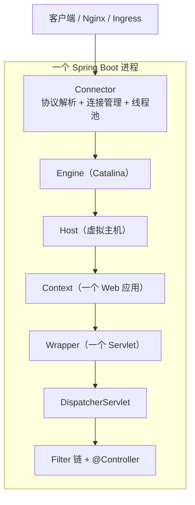
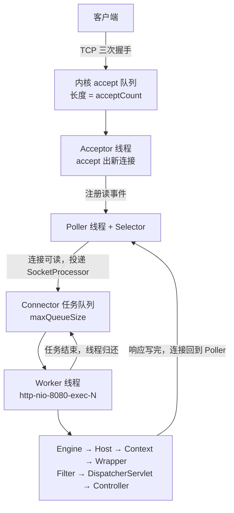

# Tomcat 的连接器和线程模型是怎么跑的？线程数该调多少？

> Connector 把字节变成请求，Container 把请求跑成响应；而业务代码跑在 Connector 的工作线程上，所以「线程数」不是在调一个数字，而是在决定「同一时刻愿意为多少份阻塞付账」。

## 先把两个词分清楚：Connector 和 Container

打开 `conf/server.xml`，骨架是固定的：`Server → Service →（Connector + Engine）`，Engine 下面才是 `Host → Context → Wrapper` 四层容器。这两半的职责完全不同：

- **Connector**：监听端口、TLS 握手、解析 HTTP 报文、管理连接、决定「哪个线程来处理这个请求」。Tomcat 的线程池就挂在这一层。
- **Container（Engine/Host/Context/Wrapper）**：做虚拟主机与路径路由，管 Servlet 的加载、初始化、`service()` 调用与销毁。Wrapper 里就是那一个 Servlet 实例——用 Spring MVC 时，它是 `DispatcherServlet`。

Spring Boot 内嵌 Tomcat 时，这两半**在同一个 JVM 进程里**：`TomcatServletWebServerFactory` 直接 new 出 Tomcat，把 `DispatcherServlet` 注册进 Context，然后 start。所以你在 `jstack` 里看到的 `http-nio-8080-exec-*`、连接上限、停机行为，都是这个进程自己的事，不存在「外面还套了一个 Tomcat」。



三个直接推论：Connector 的线程池和业务自己的线程池**互不相干**；容器层本身不新开线程（异步 Servlet 除外）；Tomcat 只管请求进来之后的并行度，上游 Nginx 到它的连接池是另一套账。

## 一个请求到底经过哪几组线程

NIO 连接器内部就三组线程，线程名里写得清清楚楚：

| 线程组   | 线程名例子                        | 默认数量      | 干什么                             | 被卡住会怎样          |
| -------- | --------------------------------- | ------------- | ---------------------------------- | --------------------- |
| Acceptor | `http-nio-8080-Acceptor-0`        | 1             | `accept()` 新连接，交给 Poller     | 新连接建不上来        |
| Poller   | `http-nio-8080-Poller-0`          | 个位数（1~2） | Selector 等就绪事件，就绪后投任务  | 所有连接都收不到数据  |
| Worker   | `http-nio-8080-exec-1 … exec-200` | `maxThreads`  | 执行 Filter、Servlet、业务、写响应 | 请求排队，RT 直线上升 |



**最关键的一句：业务代码跑在 Worker 线程上。** Filter、拦截器、`@Controller`、事务、Hikari 取连接、Feign/HTTP 调用、JSON 序列化，全在这同一条线程里排队执行。任何形式的阻塞——等 DB、等 RPC、读写文件、抢锁、同步日志落盘——都在占 Tomcat 的线程。所以「接口慢」和「Tomcat 线程打满」经常是同一件事的两面。

线程名是排查的抓手：`jstack` 里 `http-nio-8080-exec-*` 全停在 `WAITING` 的 socket read，是下游慢；大面积 `BLOCKED`，是锁；`RUNNABLE` 且 CPU 高，是计算或序列化。取证顺序见 [线程飙高、CPU 打满怎么排查](/high-availability/high-availability-thread-cpu-troubleshooting.html)。

还有一个容易被忽略的实现细节：Tomcat 用的不是裸的 `ThreadPoolExecutor`，而是 `org.apache.tomcat.util.threads.ThreadPoolExecutor` + 自己的 `TaskQueue`，**有空闲线程就直接入队，没有空闲线程且还没到 `maxThreads` 就先扩线程，到了上限才真正排队**，和 [线程池 7 个参数怎么理解](/java/concurrent/java-concurrency-thread-pool.html) 里「先入队、队列满了才扩容」的策略正好相反。这条差异决定了：并发爬升时你先看到线程数涨；看到队列在涨，基本就等于线程已经到顶。

## 为什么 NIO 能用很少的线程撑住很多连接

| 维度     | 一连接一线程（BIO，Tomcat 8.5 之前可选） | 就绪通知（NIO，现在的默认）           |
| -------- | ---------------------------------------- | ------------------------------------- |
| 连接占用 | 一个线程从读到写，整段占着               | 一条连接 = 一个 Channel + 少量状态    |
| 线程数   | 约等于并发连接数                         | 约等于「正在处理中」的请求数          |
| 空闲连接 | 白占一个线程                             | 几乎不占线程，只在 Selector 上登记    |
| 编程模型 | 阻塞读写，代码简单                       | Poller 通知就绪，工作线程只处理就绪的 |

NIO 的核心是「**只处理已经就绪的连接**」：Poller 用一次 `select()` 问内核「这几千条连接里哪些有数据了」，把就绪的挑出来交给工作线程，剩下的继续躺着。所以 `maxConnections=8192` 和 `maxThreads=200` 并不矛盾——8000 条空闲的 keep-alive 连接只是 socket 加若干状态对象，真正并行执行的永远是那 200 条线程。

连接器实现的选择：

- `Http11NioProtocol`：默认，基于 Java NIO 的 Selector，绝大多数场景就用它。
- `Http11Nio2Protocol`：走 JDK 的 AIO（`AsynchronousSocketChannel`），Linux 上底层仍是 epoll，没有实测收益时不必换，出问题时反而少了社区经验。
- APR：老版本里靠 native 库 + OpenSSL 抢 TLS 和静态文件的性能；Tomcat 9 那一代还能选独立的 APR 连接器，**10.1 的连接器文档里只剩 NIO / NIO2**，APR/native 退化成给它们提供 OpenSSL 的 TLS 实现。Spring Boot 的 `server.tomcat.use-apr` 默认就是 `never`。

## 四个关键数字，和它们各自「满」了的样子

| 参数                | 默认值   | 含义                                                     | 调大的代价                           |
| ------------------- | -------- | -------------------------------------------------------- | ------------------------------------ |
| `maxThreads`        | 200      | 工作线程上限，也就是「同时能跑多少个请求」               | 栈内存、上下文切换，以及成倍压向下游 |
| `acceptCount`       | 100      | 内核 accept 队列长度（`maxConnections` 满之后的缓冲）    | 只是把排队挪到内核，不增加处理能力   |
| `maxConnections`    | 8192     | 同一时刻的连接总数上限（**含空闲的 keep-alive 连接**）   | 每条连接都要占内存与文件句柄         |
| `connectionTimeout` | 60000 ms | 连上后等请求行（默认还覆盖读请求体）的时间，不是业务超时 | 慢速连接挂更久，Slowloris 更好使     |

另外两个常被忘掉的：`minSpareThreads` 默认 10（常驻线程，避免反复创建）；`maxQueueSize` 是 Connector 任务队列的长度，**默认 `Integer.MAX_VALUE`**，也就是「线程不够时请求无限排队」，较新的 Boot 把它暴露成 `server.tomcat.threads.max-queue-capacity`。

三层「满」的表现差别很大，别混着看：

| 哪一层满了       | Tomcat 的行为                      | 客户端看到                 | 最容易误判成     |
| ---------------- | ---------------------------------- | -------------------------- | ---------------- |
| `maxThreads`     | 任务进 Connector 队列，等空闲线程  | 变慢，状态码正常，偶发超时 | 「数据库变慢了」 |
| `acceptCount`    | 内核队列溢出，新连接被拒           | connect timeout 或 RST     | 「网络抖动」     |
| `maxConnections` | Acceptor 停止 accept，不再收新连接 | 建连卡住、长时间排队       | 「服务挂了」     |

两个容易踩的认知差：其一，**`maxThreads` 满不等于拒绝**，请求只是排队，排队时间会计进你的 RT，所以监控上先看到 RT 抬升而不是 5xx；其二，`maxConnections` 数的是连接不是请求，前面挂了 Nginx/Ingress 的连接池时，几千条空闲连接就能把额度吃光，此时线程很闲却建连失败——这正是 [Service 和 Ingress 怎么把流量送进集群](/tools/kubernetes/kubernetes-service-ingress.html) 里那条「连接级均衡」的另一面。

## 吞吐的算术：200 线程 ÷ 3 秒 ≈ 66 QPS

用 Little's law 一行就够：**并发 = 吞吐 × 平均耗时**，反过来 **吞吐 = 线程数 ÷ 平均耗时**。200 个线程、单请求平均 3 秒，理论上限就是 200 ÷ 3 ≈ 66 QPS——不管机器多空、CPU 几个核。

要做到 300 QPS，只有三条路：

| 路径     | 需要什么                | 边界                                 |
| -------- | ----------------------- | ------------------------------------ |
| 加线程   | 900 个线程（300 × 3s）  | 栈内存、调度开销，以及下游能不能接住 |
| 缩短耗时 | 3s → 0.67s（200 ÷ 300） | 得先定位慢在 DB、RPC 还是序列化      |
| 异步化   | 少量容器线程 + 独立等待 | 复杂度上升，线程池要隔离、要能观测   |

900 个平台线程本身就要付账：默认 1MB 栈（`-Xss`）大约 900MB 地址空间预留，加上调度与 GC 扫描。

但真正致命的是第三条边界——**把 `maxThreads` 从 200 调到 1000，等于允许 1000 个请求同时涌向 DB 连接池和下游**。池子只有 20 个连接，多出来的 980 个线程全卡在 `getConnection()` 上等；HikariCP 的 `connectionTimeout` 默认 30 秒，于是 30 秒后一批请求集中抛异常，而这 30 秒里 Tomcat 线程一直被占着——健康检查也开始排队，K8s 探针超时把 Pod 摘掉，流量压向剩下的实例。这就是「调大线程数把服务调死」的完整链条。

结论：`maxThreads` 的上限不是 JVM 给的，是下游给的。合适的值在「让下游刚好跑满、又基本不排队」那个点上，靠压测找，不靠拍脑袋。

## 和连接池匹配：把这个不等式写下来

```text
maxThreads × 每请求平均占用的连接数 ≤ 连接池大小 + 你能接受的排队预算
```

代入一组真实感的数字：`maxThreads=200`，每个请求平均占 1 条 DB 连接，而连接池只有 20 条（HikariCP 自己的默认 `maximumPoolSize` 只有 10）。左边 200 远大于 20，意味着常态下就有 180 个线程在等连接。这不一定是错配置——少量排队能吸收抖动——但你要能回答：**排队时间会不会超过下游超时？**

- 排到接近 Hikari 的 30 秒上限 → 用户等 30 秒拿到一个异常，Tomcat 线程被占满 → 雪崩。
- 一个请求里既查库又调下游，各自占一个并发名额 → 「每请求占用」是 2，有效并发直接减半。
- 只是想「兜住一点突发」→ 降 `maxThreads` 到接近池子、让多余请求快速失败，比硬扛更健康。

线上按这个顺序查「哪里先满」：

1. **Tomcat 层**：`tomcat.threads.busy` / `tomcat.threads.current`，或 `jstack` 里 exec 线程的状态分布；
2. **连接池**：`hikaricp.connections.active` 与 `hikaricp.connections.pending`，pending 持续涨说明池子不够或有泄漏；
3. **下游**：socket timeout、504/502 的比例，以及是不是「内层超时比外层还大」。

顺序反了就会永远在调 Tomcat 参数，而问题在第三层。

## 异步 Servlet 和虚拟线程：把容器线程还回去

同步模型里，等待时间是**全额**占用线程的。Servlet 3.0 的异步（`Callable`、`DeferredResult`、`WebAsyncTask`）做的事很简单：把「等」搬出容器线程，Worker 立刻归还，结果由另一条线程写回响应。

- `spring.mvc.async.request-timeout` 控制异步超时，不设就用容器默认（Tomcat 的 `asyncTimeout` 默认 30 秒）。超时后容器会把连接丢掉，而你的业务线程可能还在跑——所以异步接口要考虑取消与幂等。
- 异步不是免单：等待仍然需要线程，只是不占 Tomcat 那 200 个。容器线程池和业务线程池要分开配、分开看指标。
- 异步化对 SSE、大模型流式输出这类「挂很久还要边算边推」的场景是刚需，逐跳的超时与缓冲问题见 [接入 AI 的流式输出会占多少线程](/ai/ai-streaming-sse-backend.html)。

JDK 21 的虚拟线程是另一条路：`spring.threads.virtual.enabled=true`（Boot 3.2+，需 Tomcat 10.1.x）。收益和边界都很清楚：

| 场景                  | 虚拟线程的收益                                           |
| --------------------- | -------------------------------------------------------- |
| 阻塞 IO（DB/RPC）     | 大，阻塞时载体线程被卸载去跑别的虚拟线程                 |
| CPU 密集计算          | 没有，核数还是那几个核                                   |
| `synchronized` 里阻塞 | JDK 21 会钉住载体线程（pin），JDK 24 的 JEP 491 起才解决 |

开启后 `server.tomcat.threads.max` 与 `min-spare` 不再起作用（官方属性说明的原话），容器并发不再由线程数封顶——但**下游连接池依然是硬上限**，前面那个不等式照样成立。另外 ThreadLocal 用量会随并发放大，池化对象也得重新审视。

## 常用配置：Spring Boot 属性对照表

| 属性                                            | 默认值                  | 说明                                      |
| ----------------------------------------------- | ----------------------- | ----------------------------------------- |
| `server.tomcat.threads.max`                     | 200                     | 工作线程上限；开虚拟线程后失效            |
| `server.tomcat.threads.min-spare`               | 10                      | 常驻线程数                                |
| `server.tomcat.max-connections`                 | 8192                    | 连接数上限，含空闲 keep-alive             |
| `server.tomcat.accept-count`                    | 100                     | 内核 accept 队列长度                      |
| `server.tomcat.connection-timeout`              | 60s（Tomcat）           | 等请求行的时间，不是请求处理超时          |
| `server.tomcat.keep-alive-timeout`              | 取上面的值              | 空闲多久关连接，`-1` 为不超时             |
| `server.tomcat.max-keep-alive-requests`         | 100                     | 一条连接跑够多少请求就关（0/1 关闭复用）  |
| `server.tomcat.accesslog.enabled`               | false                   | 打开后默认写到 `logs/`，pattern 为 common |
| `server.tomcat.accesslog.buffered` / `max-days` | true / -1               | 缓冲写、保留天数                          |
| `server.shutdown`                               | `graceful`（Boot 3.4+） | 优雅停机；更早版本默认 `immediate`        |
| `spring.lifecycle.timeout-per-shutdown-phase`   | 30s                     | 优雅停机的等待上限                        |

```yaml
server:
  tomcat:
    threads:
      max: 200
      min-spare: 20
    max-connections: 8192
    accept-count: 200
    connection-timeout: 5s
    keep-alive-timeout: 30s
    max-keep-alive-requests: 100
  shutdown: graceful
spring:
  lifecycle:
    timeout-per-shutdown-phase: 45s
```

## 长连接：keep-alive 会把流量钉在一台

`maxKeepAliveRequests` 默认 100 的含义是：一条连接跑够 100 个请求，服务端主动关掉，客户端重连时会重新做一次后端选择。**这就是把「连接级均衡」变细的手段**，思路和 Ingress 的 `upstream-keepalive-requests` 完全一样，只是旋钮在不同层。

`keepAliveTimeout` 默认等于 `connectionTimeout`，也就是空闲连接最多挂 60 秒，这段时间它一直占着 `maxConnections` 的额度。

和上游读超时的关系要单独理一遍：Tomcat 的 keep-alive 超时到了会主动关连接。如果 Nginx 侧 `keepalive_timeout` **大于** Tomcat 的 `keepAliveTimeout`，Nginx 可能从池子里捞出一条刚被对端关闭的连接去发请求——表现为零星的 502/连接重置，且极难复现。稳妥做法是让 Nginx 先关（`keepalive_timeout` 小于 Tomcat 的 `keepAliveTimeout`），并确认 `proxy_read_timeout` 大于业务最慢请求。整条链路的分段超时口径见 [Nginx 反向代理和 upstream 怎么配](/tools/nginx/nginx-reverse-proxy-upstream.html)。

## 优雅停机：发布时的 502 从哪来

从容器线程的视角看，优雅停机就是两件事：**停止接受新连接**（Acceptor 停下，网络层就不再收）、**让手上的 Worker 把活跑完**。

- Boot 3.4 起 `server.shutdown` 默认就是 `graceful`；3.3 及更早默认 `immediate`，必须显式打开。网上大量文章还停在旧版本，抄配置前先看自己的版本。
- 等待上限是 `spring.lifecycle.timeout-per-shutdown-phase`（默认 30 秒），超时就强关连接 → 客户端 502。所以它必须**大于**你最慢的正常请求耗时。
- 它还必须**小于** K8s 的 `terminationGracePeriodSeconds`（默认也是 30 秒）。两者相等时，进程经常在最后几秒被 SIGKILL，表现就是「优雅停机配了却没用」。
- 别忘了 preStop 睡几秒让 Endpoint 摘除生效；探针本身也走同一个 Connector，线程打满时 readiness 会先生效，把 Pod 从流量里摘掉——对象与探针的细节见 [Pod、Deployment、StatefulSet 该用哪个](/tools/kubernetes/kubernetes-core-objects.html)。

## 容易踩的坑

1. **只调 `maxThreads`，不调连接池。** 线程是「允许同时进来多少人」，池子是「真正能同时干活多少人」，两者差一个数量级时，多出来的线程只是在排队等池子。
2. **大文件上传占满线程。** 上传期间 Worker 线程被整段占用，几十个并发上传就能打满 200。正确做法是让客户端直传对象存储（预签名 URL），服务端只处理元数据。
3. **把 `connectionTimeout` 当「请求处理超时」。** 它管的是「连上之后多久内得把请求行发过来」，默认还覆盖读请求体；慢 SQL、慢下游它一概不管，要治得靠下游超时和 `spring.mvc.async.request-timeout`。
4. **优雅停机时间短于请求处理时间。** 30 秒上限撞上 40 秒的导出任务，就是每次发布固定出现几个 502。
5. **access log 把磁盘写满或拖慢 RT。** 默认 `buffered=true` 已经是缓冲写，但 QPS 上千时同步追加仍是热点：控制 `pattern` 字段、开 `rotate`、把日志目录放到独立盘或交给 sidecar。
6. **只看 CPU 不看线程状态。** CPU 不高、RT 很高、线程数顶在 `maxThreads`，八成是线程都在等 IO 或等锁，此时加线程只会加剧排队。

## 面试被问到，按什么顺序讲

1. **分层**：Connector 管协议与线程，Container 管 Servlet 生命周期，内嵌 Tomcat 时两者在同一个进程。
2. **线程三层**：Acceptor 收连接 → Poller 等就绪 → Worker 执行业务；业务代码在工作线程上，所以任何阻塞都在占容器线程。
3. **算术**：`QPS ≈ maxThreads ÷ 平均耗时`，200 ÷ 3s ≈ 66；要 300 QPS 就得加线程、缩耗时或异步化。
4. **三层上限的区别**：`maxConnections` 满停止 accept、`acceptCount` 满连接被拒、`maxThreads` 满请求排队——现象完全不同。
5. **匹配**：`maxThreads` 要和连接池、下游容量对齐，异步 Servlet 与虚拟线程是「释放容器线程」的两条正规路。

## 小结

- Connector 负责网络与线程、Container 负责 Servlet 生命周期；Spring Boot 内嵌 Tomcat 时两者在一个 JVM 里，不存在额外的「Tomcat 进程」。
- 一个请求走 Acceptor → Poller → Worker 三组线程，业务代码跑在 Worker 上，任何阻塞都在消耗 `maxThreads`。
- 吞吐 = 线程数 ÷ 平均耗时；200 线程配 3 秒平均耗时约 66 QPS，加线程受栈内存与下游容量双重限制。
- 三层上限要分清：`maxConnections`（含空闲长连接）、`acceptCount`（内核 backlog）、`maxThreads`（排队等线程，队列默认无界）。
- `maxThreads` 必须和连接池匹配；异步 Servlet 与虚拟线程释放容器线程，但下游连接池仍是硬上限。

## 参考

- [Apache Tomcat 10.1 — The HTTP Connector](https://tomcat.apache.org/tomcat-10.1-doc/config/http.html)：`acceptCount`（100）、`connectionTimeout`（60000，且默认覆盖读请求体）、`keepAliveTimeout`（默认取 `connectionTimeout`）、`maxKeepAliveRequests`（100）、`maxQueueSize`（`Integer.MAX_VALUE`）、`maxConnections` 满后的排队语义，以及「非异步请求在处理期间独占一条线程」的原文。
- [Apache Tomcat 10.1 — APR/Native](https://tomcat.apache.org/tomcat-10.1-doc/apr.html)：确认 APR 已只作为 OpenSSL 的 TLS 实现存在，连接器只剩 NIO / NIO2。
- [Spring Boot 3.5 — Common Application Properties](https://docs.spring.io/spring-boot/3.5/appendix/application-properties/index.html)：逐项核对 `server.tomcat.threads.max`（200）、`min-spare`（10）、`max-connections`（8192）、`accept-count`（100）、`max-keep-alive-requests`（100）、`accesslog.*`（false / `logs` / common / buffered true / max-days -1）、`spring.lifecycle.timeout-per-shutdown-phase`（30s）、`spring.threads.virtual.enabled`（false）、`server.tomcat.use-apr`（never）；虚拟线程开启后线程数属性失效的原话也出自这里。
- [Spring Boot — Graceful Shutdown](https://docs.spring.io/spring-boot/reference/web/graceful-shutdown.html)：对比 3.3 与 3.4+ 文档措辞，确认「默认开启优雅停机」是 3.4 起的变化，更早版本需显式 `server.shutdown=graceful`。
- [JEP 491: Synchronize Virtual Threads without Pinning](https://openjdk.org/jeps/491)：`synchronized` 内阻塞钉住载体线程的限制及其在 JDK 24 的解除。
- 站内口径对齐：[线程池 7 个参数怎么理解](/java/concurrent/java-concurrency-thread-pool.html)（线程池执行流程、隔离与监控）、[线程飙高、CPU 打满怎么排查](/high-availability/high-availability-thread-cpu-troubleshooting.html)（线程取证）、[Service 和 Ingress 怎么把流量送进集群](/tools/kubernetes/kubernetes-service-ingress.html)（连接级均衡与长连接倾斜）、[Pod、Deployment、StatefulSet 该用哪个](/tools/kubernetes/kubernetes-core-objects.html)（探针与停机）、[Nginx 反向代理和 upstream 怎么配](/tools/nginx/nginx-reverse-proxy-upstream.html)（upstream keep-alive 与读超时）、[接入 AI 的流式输出会占多少线程](/ai/ai-streaming-sse-backend.html)（SSE 与异步）。吞吐算式按 Little's law 手算复核（200 ÷ 3 ≈ 66.7，300 × 3 = 900）。
